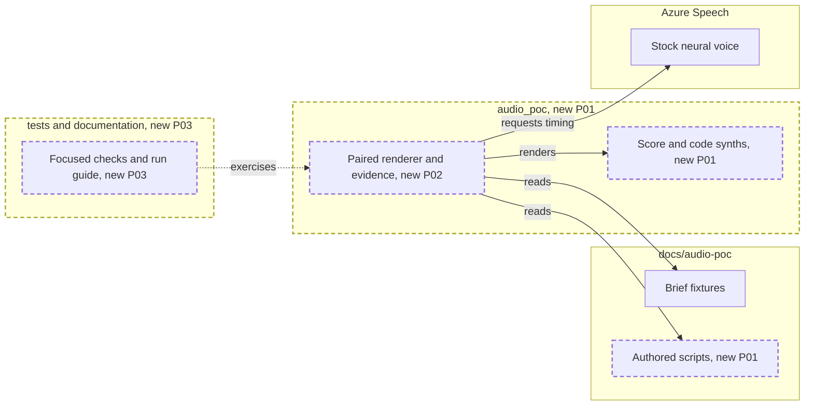

<!-- markdownlint-disable-file -->
# RPI Plan: Local retro-synth audio proof

## Task Metadata

* Task ID and slug: `issue-2-local-audio-proof`
* Plan date: 2026-11-12

## Executive Summary

Build a local Python command that composes inspectable MIDI, synthesizes the
bed and vocoder carrier, obtains Azure stock-voice audio and timing, and exports
paired 30-second vocoded and spoken comparisons for the three synthetic briefs.
Persist provenance, alignment, usage attempts, calculated costs and evaluation
blanks. Local tests establish mechanics, not musical or commercial suitability.
Planning is complete and ready for local implementation. The standard critique
completed with Pass and no findings.

### What You May Not Know

No Speech configuration is present in the environment. Build and verify the
offline path first, but never label it a substitute for Azure vocal outputs.
Live execution requires a paid resource, explicit rate evidence and spend
authorization. Human listening and rights review remain Pending.

## Phase Checklist

### After

Arrows point from the actor to its dependency. Dashed borders identify additions.
No existing connection is replaced. Diagram preview is not independently rendered.

<!-- rpi:phase id=P01 -->
### [x] P01: Establish repeatable local musical material

Goals:
* Create an inspectable score and audible original bed for every brief.

Dependencies:
* None.

Changes in the map: Authored scripts, score and code synths.

<!-- rpi:task id=P01-T01 -->
#### [x] P01-T01: Add local package, scripts, MIDI and synthesis

Goals:
* A no-cloud command produces a 30-second instrumental and MIDI per brief.

Requirements:
* `FR-001`, `FR-002`, `NFR-001`, `NFR-002`.

Details:
* Use Python 3.11+, NumPy and SciPy; small deterministic fixed-score composition.
* No music samples, SoundFonts, cloning, prompts or external music loading.
* Keep generation independent of evaluator answers. Author CTA text from brief
  facts in a separate generation script fixture.
* No BRD, PRD or ADR exists; the issue and committed protocol are the sources.

References:
* [docs/audio-poc/advertiser-briefs.json](../../../docs/audio-poc/advertiser-briefs.json)
* [docs/audio-poc/protocol.md](../../../docs/audio-poc/protocol.md)
* [.copilot-tracking/research/2026-11-12/issue-2-local-audio-proof-research.md](../../research/2026-11-12/issue-2-local-audio-proof-research.md), F1-F2.

Dependencies:
* None.

<!-- rpi:phase id=P02 -->
### [x] P02: Produce paired vocal outputs with evidence

Goals:
* Make the experiment repeatable and its limits visible.

Dependencies:
* `P01`.

Changes in the map: Paired renderer and evidence.

<!-- rpi:task id=P02-T01 -->
#### [x] P02-T01: Add explicit Azure rendering and evidence manifests

Goals:
* A live command yields paired mixes, source speech, alignment, attempt ledger
  and per-output metrics without implicit requests or silent retries.

Requirements:
* `FR-003`, `FR-004`, `FR-005`, `NFR-001`, `NFR-002`, `NFR-003`.

Details:
* Use one allowlisted stock neural voice and word events; capture exact source
  timing and destination note slots. Use a multiband envelope vocoder and retain
  natural speech for comparison. Reject incomplete timing rather than dropping words.
* Share each request across the pair; account once with visible allocation.
* Persist attempts before calling Azure; failed request charges remain unknown.
* Use unique output directories, refuse overwrites, bound request wait and validate
  configuration before any cloud spend. Never inspect or persist secrets.
* Include every audible component's origin and evidence references. Do not equate
  a URL with commercial clearance; rights remain Pending without a recorded basis.
* Live configuration and exact spend authorization are external prerequisites.

References:
* [docs/audio-poc/protocol.md](../../../docs/audio-poc/protocol.md), component and metered evidence.
* [.copilot-tracking/research/2026-11-12/issue-2-local-audio-proof-research.md](../../research/2026-11-12/issue-2-local-audio-proof-research.md), F2-F3 and W1-W4.

Dependencies:
* `P01-T01`.

<!-- rpi:phase id=P03 -->
### [ ] P03: Verify repeatability and explain remaining proof gates

Goals:
* Demonstrate measurable mechanics and make real listening possible.

Dependencies:
* `P02`.

Changes in the map: Focused checks and run guide.

<!-- rpi:task id=P03-T01 -->
#### [ ] P03-T01: Test boundary behavior and document the proof command

Goals:
* Verify all three offline renders, paired rendering with a synthetic test
  provider, timing rejection, no-clipping duration, cost attribution and errors.

Requirements:
* All `FR` and `NFR` requirements.

Details:
* Test ownership: `tests/test_audio_poc.py`; maximum 12 focused test functions.
  Removals: none. Canonical code: `audio_poc/`; generated targets: ignored
  `renders/`. No existing tests or behavior to remove.
* Regression scope: existing briefs and evaluator contract must remain unchanged.
  Semantic tests must check observable PCM/MIDI and evidence, not constant values.
* Run `uv run pytest`, `uv run ruff check`, `uv run ruff format --check`, and the
  offline command across all briefs. Do not install unrelated tooling.
* Document live setup without keys; explain rights, rate and listening evidence.
  Live validation remains blocked unless user configures prerequisites.

References:
* [docs/audio-poc/protocol.md](../../../docs/audio-poc/protocol.md).

Dependencies:
* `P02-T01`.

## User Decisions and Requirements

### Confirmed User Direction

* Work on #2 end to end; local proof only.
* Three briefs, both vocal treatments, original code-generated music and complete
  per-output evidence; no third-party musical assets or artist imitation.

### Planning Decisions and Feedback

Agent-owned decisions from the end-to-end choice:

| Group | Decision | Status | Evidence | Impact |
|-------|----------|--------|----------|--------|
| D1 | Python CPU DSP with NumPy/SciPy | confirmed | Research F2; no existing runtime | P01 |
| D2 | Explicit instrumental-only mode | confirmed | Research F3; no credentials | Enables honest offline verification |
| D3 | Live use gated by evidence and spend consent | confirmed | Research F3 | P02 live gate |

## Planning Readiness and Next Step

Planning execution: Complete. Readiness: Ready.
Continuation owner: automatic RPI Agent. Critique: standard, Complete, Pass.
Changes record: `.copilot-tracking/changes/2026-11-12/issue-2-local-audio-proof-changes.md`.
No routine approval is required; external paid usage requires explicit consent.

## Goals

* Make the audio comparison reproducible and auditable without building a platform.

## Scope and Non-Goals

Include local CLI, DSP, MIDI, fixtures, evidence and focused tests.
Exclude web UI, deployment, Foundry, STT scoring, broadcast mastering and tracker
mutations. Do not claim independent-listener evaluation.

## Functional Requirements

* `FR-001`: Load only normalized brief facts and separate authored generation scripts.
* `FR-002`: Export composed MIDI melody/chords and a code-synthesized bed for each brief.
* `FR-003`: Live command uses Azure word timing to align speech to notes and vocode
  it; exports vocoded and spoken-tagline alternatives.
* `FR-004`: Record component origins, commercial-rights evidence and unresolved
  clearance; identify synthetic audio. No unsupported Pass.
* `FR-005`: Record per-output duration, render time, request quantities, Azure
  usage and calculated cost with source/date, attempts and pair allocation.

## Non-Functional Requirements

* `NFR-001`: Exactly 30 seconds, finite non-silent PCM, peak at most -1 dBFS.
  Review demos, not broadcast masters.
* `NFR-002`: Repeatable seeded score; no sampled musical assets, cloning or imitation.
  Existing fixtures and evaluator separation preserved.
* `NFR-003`: Strict `<300 s` render and `<USD 0.50` metered cost checks; unknown
  evidence is Pending, never zero or Pass. No automatic retries or overwrites.

## Risks and Open Questions

| Priority | Risk | Work | Evidence needed | Owner |
|----------|------|------|-----------------|-------|
| High | No Speech environment configuration | P02-T01 live | Configured paid S0 resource and spend consent | user |
| High | Commercial rights not cleared by code | P02-T01 | Account-specific terms and recorded use basis | user |
| High | Vocoder may obscure CTA | P03-T01 live | Actual listening/transcription, not expected-answer copying | user |
| Medium | Rate is not verified | P02-T01 | USD rate, dated source and region | user |

## Dependencies

* Issue #1 is closed and its committed protocol exists.
* Python/uv installed; dependency manifest will be introduced before installation.
* Azure Speech SDK native runtime may require OS libraries; surface any failure.

## Sources

* [docs/audio-poc/protocol.md](../../../docs/audio-poc/protocol.md).
* [docs/design-proposal.md](../../../docs/design-proposal.md), sections 4-6 and 9.
* [.copilot-tracking/research/2026-11-12/issue-2-local-audio-proof-research.md](../../research/2026-11-12/issue-2-local-audio-proof-research.md).
* Issue #2 supplied by user and verified with `gh issue view`.

## Critique Disposition

Standard (first-task default); Complete, Pass, no findings. Direct assessment;
no independent-review claim. Native runtime and vocal quality risks accepted
only as execution risks, not as evidence of proof success.

## Artifact Self-Check

Scope, source, requirements, dependencies, tests and external gates defined.
All task requirements trace to the issue and supplied evidence. Readiness and
summary synchronized after critique. No human approval is claimed.

## Follow-Up Items

* None.

## Handoff

Local implementation is eligible after critique; actual live proof requires the
specific external gates above. Do not mark the issue complete without outputs.
