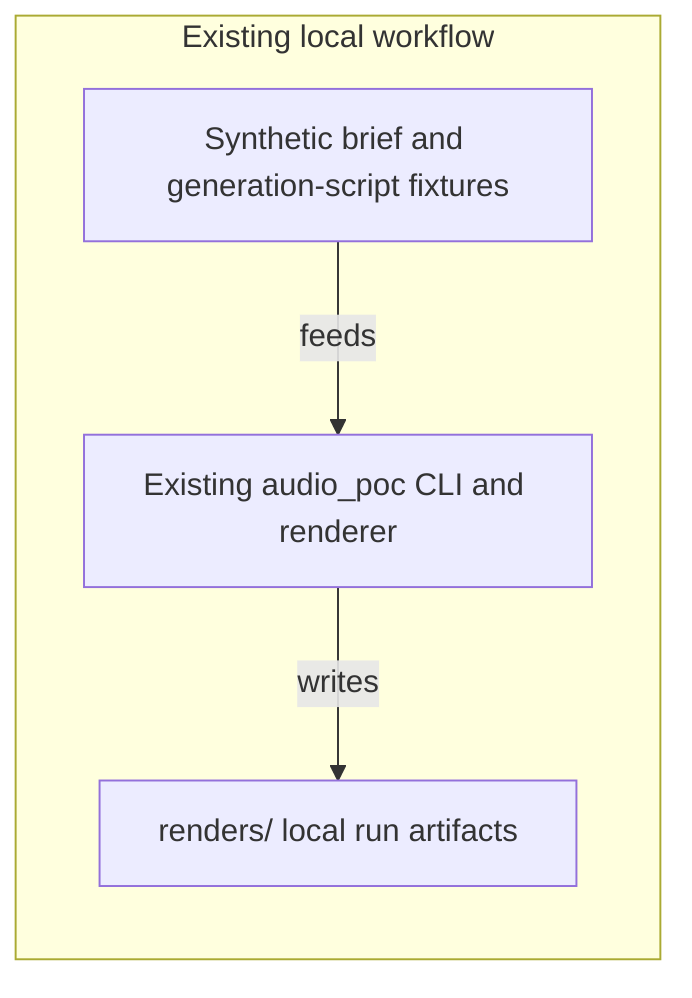
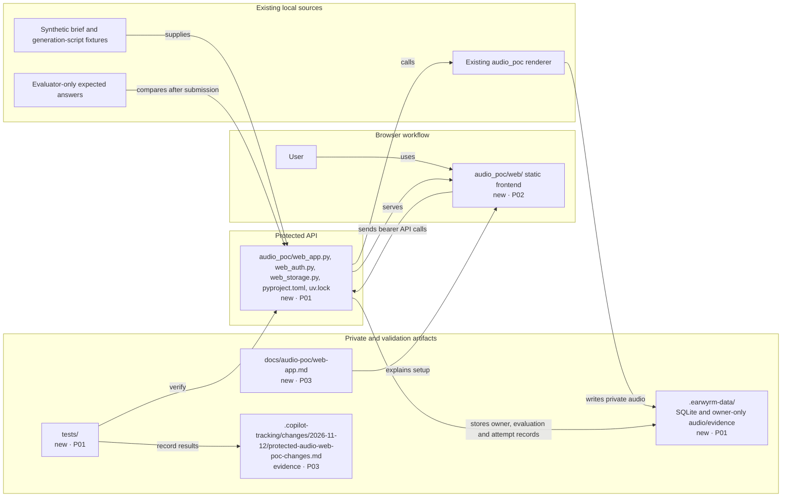

<!-- markdownlint-disable-file -->
# RPI Plan: Protected audio web POC

## Task Metadata

* Task ID: `protected-audio-web-poc`
* Task slug: `protected-audio-web-poc`
* Plan date: 2026-11-12

## Executive Summary

* Bottom line: Build a local, configurable web POC that reuses the existing audio renderer, signs users in through the existing Entra External ID tenant, protects API actions with access-token scopes, and keeps audio and evaluation evidence outside the public web root.
* Why this matters: Users can select synthetic briefs, render and compare audio variants, evaluate them, and download protected outputs without exposing Speech credentials or the evaluator answer fixture to the browser.
* Planning result: The standard critique is complete and its findings have been incorporated into the API/storage, browser, and verification tasks. The plan is implementation-ready; its single critique is not being rerun.
* Confidence and uncertainty: High confidence in the existing renderer and the documented MSAL/API flow; actual tenant sign-in remains unvalidated. The tenant's domain, application IDs, audience, scopes, Speech secret and spend cap are unavailable and remain configuration prerequisites.

### What You May Not Know

* The expected brand and CTA answers are evaluator-only. The API must reveal only comparison results after the user submits an immutable transcription. Local private storage is not Azure Blob Storage or production retention.
* Paid Speech rendering stays disabled unless a user later makes the separate spending decision and supplies the required server-side enablement, identity allowlist, per-run cap, and cumulative budget. Implementation and tests will not make paid calls.

## Phase Checklist

### Before

### After

New parts sit inside outlined destination boxes and carry phase tags; each arrow names an action from the part that acts to the part it uses.

<!-- rpi:phase id=P01 -->
### [x] P01: Protect the API and local render evidence

Goals: Establish a fail-closed API and private local evidence boundary so every user action is authenticated, permission-checked, and isolated from other users.

Dependencies: Existing synthetic fixtures, evaluation protocol, and `render_brief` implementation.

Changes in the map: `audio_poc/web_app.py`, `audio_poc/web_auth.py`, `audio_poc/web_storage.py`, `pyproject.toml`, `uv.lock`, `.gitignore`, `.earwyrm-data/`, and API tests.

<!-- rpi:task id=P01-T01 -->
#### [x] P01-T01: Adding External ID token validation and API permissions

Goals: A configured External ID user can access only API operations authorized by a valid, correctly scoped access token.

Requirements:

* `FR-001`, `FR-002`, `NFR-001`, `NFR-002`

Details:

* Add `fastapi`, `uvicorn`, and `PyJWT[crypto]` as runtime dependencies and `httpx` as a test dependency using `uv`; update `uv.lock`. Use the standard-library `sqlite3` module for local records.
* Add a same-origin FastAPI host for the frontend and API, bound by default to `127.0.0.1:8000`. Keep `/healthz` non-sensitive; `/api/config` returns only non-secret client ID, authority, scope prefix, and setup status. With incomplete identity settings, protected routes return 503 rather than accepting a fallback token.
* Provide authenticated `GET /api/briefs` with the proposed `briefs.read` scope so the valid-token contract is exercised by a product route. Return only normalized brief fields; do not return generation scripts or expected-answer data.
* Configure `ENTRA_CLIENT_ID`, `ENTRA_AUTHORITY`, `ENTRA_METADATA_URL`, `ENTRA_EXPECTED_ISSUER`, `ENTRA_AUDIENCE`, and `ENTRA_API_SCOPE_PREFIX`. Fetch only HTTPS OpenID metadata; compare its exact issuer with `ENTRA_EXPECTED_ISSUER`, use its `jwks_uri`, and reject inconsistent or unsupported signing algorithms. Validate access-token signature, expiration, exact issuer, API audience, nonempty subject, and route-specific delegated `scp` permissions.
* Treat `briefs.read`, `renders.read`, `renders.write`, `evaluations.write`, and `outputs.read` as the proposed POC scope contract, not facts about the existing registration. The user must later configure the existing tenant's API registration to expose matching delegated scopes; the SPA and API use the same exact scope URI prefix.
* Return 401 for invalid identity and 403 for missing permission. Do not infer workforce Entra values, change the tenant, enable permissive CORS, or add token/cookie shortcuts.
* Add focused tests for valid and invalid signatures, issuer/audience/expiry, algorithm and metadata mismatch, missing scope, missing configuration, and the public configuration response. Inject test metadata/JWKS so tests make no network calls.
* Accept only the implementation's explicit `RS256` allowlist; never choose an algorithm from the token header. Require tenant metadata to advertise `RS256` in `id_token_signing_alg_values_supported` and the selected HTTPS `jwks_uri` to provide a matching RSA signing key. Require the exact metadata issuer to match `ENTRA_EXPECTED_ISSUER`; reject issuer, JWKS, key-type, or algorithm mismatch and keep setup blocked rather than weakening validation.

References:

* [.copilot-tracking/research/2026-11-12/protected-audio-web-poc-research.md](../../research/2026-11-12/protected-audio-web-poc-research.md)
* [docs/audio-poc/protocol.md](../../../docs/audio-poc/protocol.md)
* [audio_poc/__main__.py](../../../audio_poc/__main__.py)
* [pyproject.toml](../../../pyproject.toml)
* [uv.lock](../../../uv.lock)

Dependencies: None.

<!-- rpi:task id=P01-T02 -->
#### [x] P01-T02: Storing and serving protected renders and evaluation evidence

Goals: An authorized user can render selected synthetic briefs, compare and evaluate outputs, and download only outputs and evidence owned by that user.

Requirements:

* `FR-002`, `FR-003`, `FR-004`, `FR-005`, `FR-006`, `FR-007`, `FR-008`, `NFR-002`, `NFR-003`, `NFR-004`, `NFR-005`, `NFR-007`, `NFR-008`

Details:

* Reuse the existing `load_inputs`, `load_evidence`, `cost_for`, and `render_brief` behavior in [audio_poc/__main__.py](../../../audio_poc/__main__.py) rather than duplicate audio-generation logic or change the CLI contract.
* Preserve each brief's original index from `load_inputs()` when rendering a selected subset; the canonical index controls score, seed, and root note. Use a unique run ID and generated output IDs without changing CLI scoring behavior.
* Provide authenticated brief listing; instrumental-only rendering with zero provider/network calls; gated Azure vocal rendering; per-user output listing and comparison metadata; transcript/rating submission; per-output component-rights and metered-usage evidence; a three-brief POC status rollup; and protected audio/evidence downloads.
* Read expected brand and CTA answers only inside evaluation handling after the participant submits transcriptions. Return match results and status, never expected strings or accepted variants. Persist transcript/rating submission once per output; reject a resubmission rather than overwriting evidence after feedback. Record each evaluation with the output and authenticated owner.
* Retain the protocol's per-output duration, rights references, metered-cost evidence, component-rights evidence, and usage-attempt attribution. Derive each output's `Fail`, `Pending`, or `Pass` from the protocol; derive the overall POC result across all three canonical brief IDs even when only a subset is selected. Any failed output makes the overall result Fail; otherwise absent outputs or required evidence keep it Pending; Pass requires all three briefs and all required evidence to pass.
* Store audio, manifests, evaluation records, and a paid-attempt ledger in the standard-library SQLite database `.earwyrm-data/earwyrm.sqlite3`, with media under `.earwyrm-data/audio/`; make the root configurable through `EARWYRM_DATA_DIR` and default it to the repository-root `.earwyrm-data/`, outside the static mount. Resolve the default independently of the current working directory, set directories to owner-only `0700` and files to owner-only `0600`, and use generated IDs plus database ownership lookups keyed by token subject; never accept filesystem paths from requests. Add the root to `.gitignore`, verify it is ignored, and document manual deletion as the retention boundary.
* Keep paid Speech rendering disabled by default with `SPEECH_ENABLED=false`. A later user/operator enablement must configure `SPEECH_ALLOWED_SUBJECT`, a finite positive `SPEECH_PER_RUN_CAP_USD`, and a finite positive `SPEECH_TOTAL_BUDGET_USD`, in addition to the existing credentials and evidence. Only that allowlisted token subject may submit a paid render.
* Bind each paid request's explicit confirmation to the selected brief IDs and a server-recomputed estimate; reject missing or mismatched confirmation before provider invocation. In a transaction, reserve each estimate against the cumulative budget before dispatch. Serialize paid renders to one active attempt, persist each attempt across runs, make no automatic retries, and account for failed attempts. Block new paid requests after every attempt until the operator reconciles actual metered usage with evidence; timeout, cancellation, process interruption, or other unknown usage leaves the attempt reserved and blocked. Do not silently release a reservation.
* Require the existing S0/rate/region checks and reject the placeholder resource reference in the current local sample. A null commercial-use basis is permitted for local experimentation but keeps rights/evaluation status Pending and prohibits distribution; it is not, by itself, the spend authorization gate. Do not make a paid request during implementation or tests.
* Keep synchronous Speech requests bounded by the existing 60-second per-brief timeout; show a busy state for a multi-brief render and do not cancel, retry, or submit another paid request while one is active.
* Add focused tests for user isolation, canonical subset index, path-safe lookup, immutable evaluation, three-brief rollup, status semantics, sentinel expected-answer/credential exclusion from success/error responses and logs, local-only permissions and ignore behavior, zero-call offline mode, disabled/default paid mode, placeholder/rate/identity/cap/confirmation gates, cumulative and concurrent reservations, unknown-attempt blocking, no retries, and fake-provider injection. The test fixture must prevent live provider construction even if developer credentials are present; tests make no Speech or tenant calls.

References:

* [audio_poc/__main__.py](../../../audio_poc/__main__.py)
* [audio_poc/speech.py](../../../audio_poc/speech.py)
* [docs/audio-poc/protocol.md](../../../docs/audio-poc/protocol.md)
* [docs/audio-poc/rendering.md](../../../docs/audio-poc/rendering.md)
* [renders/speech-evidence.json](../../../renders/speech-evidence.json)

Dependencies: `P01-T01`.

<!-- rpi:phase id=P02 -->
### [x] P02: Deliver the signed-in browser workflow

Goals: Let a user sign in and complete the brief-to-evaluation workflow in an accessible same-origin browser interface, while keeping credentials and evaluator answers out of the client.

Dependencies: P01 API configuration and endpoint contracts.

Changes in the map: `audio_poc/web/`.

<!-- rpi:task id=P02-T01 -->
#### [x] P02-T01: Building the MSAL brief, render, compare, and evaluate interface

Goals: A signed-in user can choose briefs, start an allowed render, listen to and compare outputs, record the unblinded evaluation, and download authorized results.

Requirements:

* `FR-001`, `FR-002`, `FR-003`, `FR-004`, `FR-006`, `FR-007`, `FR-008`, `NFR-002`, `NFR-005`, `NFR-006`, `NFR-007`, `NFR-008`

Details:

* Add a small static frontend under `audio_poc/web/` using the pinned `@azure/msal-browser` 5.29.0 npm distribution: vendor `lib/msal-browser.min.js` and its `LICENSE` under `audio_poc/web/vendor/`, and record a SHA-384 checksum for the exact vendored bundle. Do not load the rejected 404 CDN URL or any remote script. Keep access tokens in MSAL's session cache and acquire tokens for the exact full route-specific API scope URIs returned by configuration.
* Show a setup-needed state when tenant configuration is absent; do not use a mock sign-in or silently downgrade protected API calls.
* Configure MSAL with the non-secret tenant client ID and authority, authorization-code/PKCE browser flow, same-origin redirect URI, session storage, and the shared scope prefix. A configured test client must request the same full scope URI the API maps to the route's `scp` suffix.
* Let the user select one or more synthetic briefs and choose an offline instrumental preview or enabled Azure voice treatment. Label instrumental-only output as not vocal proof. For paid rendering, display the server-computed estimate and require a confirmation bound to the exact brief IDs and estimate; keep the option unavailable while server-side spending prerequisites are missing or an attempt is active/unreconciled. Do not retry or offer cancellation; if the browser disconnects, retrieve attempt status and wait for reconciliation before another request.
* Show audio variants with accessible play controls, comparison facts, immutable evaluation fields, output and overall status, component/usage evidence references, and protected download actions. Fetch media with an `Authorization` header and use short-lived object URLs for playback/download; never place bearer tokens in URLs. Do not display expected answers before submission.
* Use semantic labels, keyboard-accessible controls, visible focus, and announced loading/error/status changes. Keep app scripts/styles separate and apply a restrictive policy: scripts/styles and default resources from `'self'`; no remote script sources; connect/frame authorization requests only to HTTPS origins from the configured authority and validated discovery metadata; `object-src 'none'`, `base-uri 'self'`, and `frame-ancestors 'none'`.
* Validate the browser workflow locally against fake MSAL/API responses without a real tenant: setup-needed state, configured scope request and access-token call, brief selection, offline render, compare/play, transcript/rating and status, protected fetch playback/download, no token in URLs, no answer leakage, and keyboard/focus/status announcements. Verify the pinned asset loads under the CSP.

References:

* [.copilot-tracking/research/2026-11-12/protected-audio-web-poc-research.md](../../research/2026-11-12/protected-audio-web-poc-research.md)
* [docs/audio-poc/protocol.md](../../../docs/audio-poc/protocol.md)

Dependencies: `P01-T01`, `P01-T02`.

<!-- rpi:phase id=P03 -->
### [x] P03: Document setup and verify the local POC

Goals: Make the POC reproducible without tenant mutation, deployment, or paid calls, and verify that the existing CLI and new protected workflow work together.

Dependencies: P01 and P02 implementation.

Changes in the map: `docs/audio-poc/web-app.md` and end-to-end validation evidence.

<!-- rpi:task id=P03-T01 -->
#### [x] P03-T01: Documenting setup boundaries and running focused validation

Goals: A maintainer can configure the existing External ID tenant and optional Speech credentials locally, run the web POC, and distinguish a local demo from a production deployment.

Requirements:

* `FR-001`, `FR-005`, `FR-008`, `NFR-001`, `NFR-002`, `NFR-003`, `NFR-004`, `NFR-005`, `NFR-006`, `NFR-007`, `NFR-008`

Details:

* Add `docs/audio-poc/web-app.md` with `uv sync --locked` and `uv run uvicorn audio_poc.web_app:app --host 127.0.0.1 --port 8000`; required non-secret External ID values and where to copy them from tenant metadata; proposed API scope names; the exact MSAL package version, npm source, license, checksum and CSP boundary; local secret handling; SQLite/storage location and permissions; ignored-data verification; and the local-only/manual-deletion retention boundary.
* Explain that app-registration changes, deployment, Azure resource creation, and spending are separate user decisions. Do not make those changes or include usable credentials.
* Document offline rendering separately from Speech rendering, default-off enablement, the allowlisted subject, per-run and cumulative caps, evidence prerequisites, confirmation binding, serialized attempts, no automatic retries, and reconciliation of metered usage after every attempt.
* Run existing tests and focused new tests, Ruff lint/format checks, `uv lock --check`, and `uv sync --locked`. Verify `/healthz` returns 200, `/api/config` reports setup-required, and protected routes return 503 when auth is not configured. Run all browser acceptance checks with a local fake identity/API; test that no offline request reaches a provider/network and no test can construct the live Azure provider.
* In the browser, complete the offline brief-to-evaluation-and-download path using a test identity: verify setup state, scope/token contract, brief selection, instrumental-only label, comparison/playback, immutable transcript/rating, output and three-brief statuses, protected download, and zero token/expected-answer leakage in URLs, responses, or logs. Use a fake long-running attempt to verify a visible busy state, disabled duplicate submission, and status recovery without retry or cancellation. Keyboard-only operation must reach each action with visible focus and receive loading, error, and result announcements.

References:

* [docs/audio-poc/rendering.md](../../../docs/audio-poc/rendering.md)
* [docs/audio-poc/protocol.md](../../../docs/audio-poc/protocol.md)
* [docs/project-plan.md](../../../docs/project-plan.md)

Dependencies: `P01-T01`, `P01-T02`, `P02-T01`.

## User Decisions and Requirements

### Confirmed User Direction

* Build a web frontend with Entra External ID sign-in using the existing external tenant.
* Users select synthetic briefs, render, compare, evaluate, and download.
* Protect the API with OAuth access-token and permission validation.
* Keep Speech credentials server-side and retain audio and evaluation evidence in private storage.
* Deployment and spending are separate decisions; do not deploy, provision resources, change tenant configuration, or submit paid Speech requests during this task.
* Progress automatically through Research, Plan, Implement, Review, and required follow-ups.

### Planning Decisions and Feedback

| Group | Decision or feedback item                      | Status                                      | Owner         | Rationale                                                                                 | Evidence                 | Planning impact |
|-------|--------------------------------------------------|---------------------------------------------|---------------|-------------------------------------------------------------------------------------------|--------------------------|-----------------|
| D1    | Use a same-origin Python API and static SPA     | decided                                     | Agent         | Chosen local POC design based on the Python renderer and research recommendation; not a Microsoft hosting requirement | C1, C5, W3 | Serve UI and protected API from one local process |
| D2    | Use private local POC storage                   | decided                                     | Agent         | Deployment is deferred; standard-library SQLite and owner-only local files support this repository-only build | User scope, C4 | Keep data outside the static root and make the local-only retention boundary explicit |
| D3    | Use exact External ID metadata and scopes       | decided                                     | Agent         | Tenant issuer, audience, JWKS and scope values are unknown and must not be guessed | W1-W4 | Read configured metadata; fail closed on issuer, key, audience or scope mismatch |
| D4    | Enable paid Speech rendering and authorize spend | deferred-user-decision; disabled by default | User/operator | The user explicitly kept spending separate; no paid requests are authorized in this task | User scope, rendering guide | Keep the feature off unless a later user decision supplies explicit enablement, identity allowlist, per-run cap and cumulative budget |
| D5    | Persist paid attempts and reserve the cumulative budget | decided                              | Agent         | Actual metered use must be reconciled after every attempt; unknown usage must not allow a new request | Rendering guide, PC-012 | Permit at most one active paid attempt and block new requests while usage is unreconciled |

## Planning Readiness and Next Step

| Field                            | Record |
|----------------------------------|--------|
| Planning execution and readiness | Complete; implementation-ready after the standard critique and direct correction of all 22 findings |
| Decision participation           | agent-owned; user selected end-to-end RPI |
| Blockers                         | No plan blockers. Live sign-in requires local tenant configuration; paid rendering remains disabled pending a separate user decision |
| Latest critique                  | [.copilot-tracking/reviews/plans/2026-11-12/protected-audio-web-poc-plan-critique.md](../../reviews/plans/2026-11-12/protected-audio-web-poc-plan-critique.md); standard first-task default, execution Complete, verdict Revise; all findings directly resolved in this revision |
| Relevant research                | [.copilot-tracking/research/2026-11-12/protected-audio-web-poc-research.md](../../research/2026-11-12/protected-audio-web-poc-research.md) |
| Plan                             | [.copilot-tracking/plans/2026-11-12/protected-audio-web-poc-plan.md](./protected-audio-web-poc-plan.md) |
| Changes-record role              | `.copilot-tracking/changes/2026-11-12/protected-audio-web-poc-changes.md` will record implementation evidence |
| Continuation owner               | Confirmed automatic RPI Agent |
| Required gates or confirmations  | No tenant changes, deployment, or paid requests; all are outside this task's approved boundary |
| Next action                      | Run the post-implementation Review; keep tenant changes, deployment, and paid requests outside this task |

## Goals

* Deliver a configurable, authenticated web POC over the existing local audio proof.
* Keep API access, output files, evaluator answers, and evaluation evidence protected.
* Preserve the rule that missing rights or billing evidence leaves results Pending.

## Scope and Non-Goals

### In Scope

* Same-origin Python API and web frontend using MSAL Browser for External ID sign-in.
* Protected brief, render, evaluation, comparison, and download workflows, including a three-brief status rollup.
* Local private SQLite storage for generated audio, evaluation evidence, and paid-attempt reservations.
* Test doubles, local setup guidance, and focused security/functional validation.

### Non-Goals

* Cloud deployment, Azure resource provisioning, infrastructure generation, or tenant mutation.
* Enabling or submitting paid Speech requests during implementation or validation.
* Real advertiser data, external sharing, approval workflows, CRM access, or Blob Storage.
* Claims that local storage, audio rights, billing reconciliation, or output quality are production-approved.

## Functional Requirements

* FR-001: A user can sign in to the POC through the existing Entra External ID tenant using browser-based MSAL.
* FR-002: A user can view the three synthetic briefs, select one or more, and request either an offline instrumental render or an explicitly configured Azure vocal render.
* FR-003: A signed-in user can compare and play variants, submit one immutable brand/CTA transcription and usability rating per output, and see evaluation results only after submission.
* FR-004: A signed-in user can download authorized audio and evaluation evidence through protected API endpoints.
* FR-005: The POC stores renders and evaluation evidence in a local private storage root that is not served as static content.
* FR-006: The API enforces the route-specific delegated permission and output ownership for listing, evaluation, and downloads.
* FR-007: Azure voice rendering requires valid rate/resource evidence, server-side cost limits, an allowlisted user, and request-specific confirmation; offline instrumental rendering makes no provider or network request.
* FR-008: The POC retains per-output duration, rights, and metered-usage evidence and derives the overall status across all three canonical brief IDs; unselected outputs or missing evidence remain Pending.

## Non-Functional Requirements

* NFR-001: Every protected API route validates an access token's signature, expiration, exact External ID issuer, API audience, subject, and required delegated scope; missing or invalid configuration fails closed.
* NFR-002: Speech credentials and evaluator expected answers remain server-side and are never returned to the frontend or written to logs.
* NFR-003: A Speech request cannot run unless valid rate/resource evidence, explicit enablement, an allowlisted subject, and finite positive per-run and cumulative server-side limits are configured and the request fits both limits; each paid run requires a server-validated confirmation bound to its selected briefs and estimate.
* NFR-004: Automated tests use fake Speech output and local test signing keys, cannot construct the live provider even when credentials exist, and make no tenant or paid cloud calls.
* NFR-005: Audio and evaluation access is authorized and scoped to the requesting user; client-supplied paths are never used to open files; local storage is owner-only and Git-ignored.
* NFR-006: The web workflow supports keyboard use, visible focus, semantic labels, and accessible status/error announcements.
* NFR-007: The first transcript and rating submission for an output is immutable; subsequent submissions cannot replace evidence shown with expected-answer feedback.
* NFR-008: Paid attempts are durably reserved and serialized; failed or unknown attempts are not silently retried or released, and new paid requests remain blocked until actual metered usage for the preceding attempt is reconciled.

## Risks and Open Questions

| Priority | Type          | Risk, question, or planning item | Affected work | Impact | Smallest action or evidence needed | Owner |
|----------|---------------|----------------------------------|---------------|--------|-----------------------------------|-------|
| High     | open question | Tenant domain, app IDs, API audience and delegated scopes are unknown | P01-T01, P02-T01, P03-T01 | Live sign-in cannot run until local setup is completed | Document required metadata and exact config fields; fail closed until configured | User/setup |
| High     | risk          | Speech calls can incur variable charges and unknown attempts may remain billable | P01-T02, P02-T01 | Repeated or concurrent paid runs could exceed the user's later spending decision | Default off; use allowlisted subject, per-run and cumulative caps, durable reservation, one active attempt, and reconcile actual usage after every attempt | Implementer |
| Medium   | risk          | Local filesystem protection is not equivalent to private cloud storage | P01-T02 | Local OS users may access data; no cloud retention controls | Keep SQLite/audio outside static root, set owner-only modes, ignore the directory, and document manual deletion | Implementer |
| Medium   | risk          | Human rights and billing evidence remain pending in current manifests | P01-T02, P02-T01 | Evaluation must not claim Pass based only on listening form | Preserve per-output evidence and Pending semantics; do not treat null rights basis as spend authorization | Implementer |
| Medium   | open question | Real sign-in and paid Speech remain unverified until separately configured/authorized | P02-T01, P03-T01 | Local fake-identity/browser tests do not establish tenant readiness or authorize spending | Document setup prerequisites; keep paid rendering disabled by default | User/setup |

## Sources

* [.copilot-tracking/research/2026-11-12/protected-audio-web-poc-research.md](../../research/2026-11-12/protected-audio-web-poc-research.md): findings C1-C5 and W1-W4 establish renderer reuse, evaluator isolation, and External ID token guidance.
* [docs/audio-poc/protocol.md](../../../docs/audio-poc/protocol.md): evaluation fields, status semantics, and evaluator-answer boundary.
* [docs/audio-poc/rendering.md](../../../docs/audio-poc/rendering.md): explicit Azure mode, credentials, spend cap, and render evidence.
* [renders/speech-evidence.json](../../../renders/speech-evidence.json): current local, Git-untracked sample has a non-secret placeholder resource reference and must not authorize Azure rendering.
* [@azure/msal-browser 5.29.0](https://www.npmjs.com/package/@azure/msal-browser): published npm tarball metadata and package contents provide the pinned browser bundle and `LICENSE`; compute the checksum from the exact vendored file rather than the failed CDN response.
* [docs/project-plan.md](../../../docs/project-plan.md) and [docs/design-proposal.md](../../../docs/design-proposal.md): existing POC direction; no relevant BRD, PRD, or ADR business source found after searching `docs/planning/`, PRD/BRD/ADR filename patterns, and the task terms “External ID”, “web app”, “protected API”, and “render”.
* [External ID vanilla JavaScript API sample](https://learn.microsoft.com/en-us/samples/azure-samples/ms-identity-ciam-javascript-tutorial/ms-identity-ciam-javascript-tutorial-0-call-api-vanillajs/): official sample direction for MSAL Browser plus a protected API.

## Critique Disposition

* Critique setting and provenance: `standard`; first-task default.
* Critique status: execution Complete; verdict Revise; all 22 findings are closed by direct plan corrections.
* Latest critique and verdict: [.copilot-tracking/reviews/plans/2026-11-12/protected-audio-web-poc-plan-critique.md](../../reviews/plans/2026-11-12/protected-audio-web-poc-plan-critique.md); initial standard assessment.
* Earlier critiques: none.
* Limitations: The critique's findings are resolved at the planning level. Their implementation tests and browser evidence will be recorded in the changes record; no follow-up critique is authorized or required.

| Critique run and finding | Disposition | Action owner | Exact resolving evidence | Decision route | Plan response or residual risk |
|--------------------------|-------------|--------------|--------------------------|---------------|-------------------------------|
| Initial `PC-001` | resolved | Planning parent | P03-T01 and Test Ownership define the offline browser sequence, keyboard/focus/status checks, and changes-record evidence | Direct correction | Complete browser validation before implementation handoff |
| Initial `PC-002` | resolved | Planning parent | P01-T02 requires sentinel expected-answer and credential assertions over success/error responses and captured logs | Direct correction | Preserve answer/secret non-disclosure in implementation tests |
| Initial `PC-003` | resolved | Planning parent | P01-T01's protected `GET /api/briefs` and P02-T01/P03-T01 fake MSAL scope/token checks verify the configured path; real tenant verification remains a documented local setup step | Direct correction | No tenant values or live sign-in are assumed |
| Initial `PC-004` | resolved | Planning parent | FR-008 and P01-T02 require retained component-rights/metered-usage evidence and the all-three-brief Pending/Fail/Pass rollup | Direct correction | Missing outputs or evidence cannot produce Pass |
| Initial `PC-005` | resolved | Planning parent | P01-T02 and Test Ownership name placeholder, enablement, confirmation, failed-attempt, no-retry, and live-provider-isolation tests | Direct correction | Tests inject only a fake provider |
| Initial `PC-006` | resolved | Planning parent | P01-T01 and P03-T01 name runtime/test dependencies, `uv.lock`, `uv lock --check`, and `uv sync --locked` | Direct correction | Lock file is included in the change map |
| Initial `PC-007` | resolved | Planning parent | P01-T02 requires a zero-provider/network offline path and P02-T01 requires an instrumental-only, not-vocal-proof label | Direct correction | Offline output is not presented as vocal evidence |
| Initial `PC-008` | resolved | Planning parent | P01-T02/P02-T01 bind required confirmation to the selected brief IDs and server-recomputed estimate before provider invocation | Direct correction | Client-supplied estimates are not trusted |
| Initial `PC-009` | resolved | Planning parent | P01-T01 requires exact metadata issuer, HTTPS JWKS, signing-key/algorithm consistency, and mismatch tests | Direct correction | Unsupported tenant metadata remains fail-closed |
| Initial `PC-010` | resolved | Planning parent | P01-T01/P02-T01/P03-T01 label the five scope suffixes as proposed and require the exact configured full URI to match in MSAL and API authorization | Direct correction | Existing tenant registration remains unchanged |
| Initial `PC-011` | resolved | Planning parent | P01-T02 distinguishes the invalid placeholder resource from a null commercial-use basis; null rights keep results Pending and prohibit distribution | Direct correction | A null rights field is not treated as spend authorization |
| Initial `PC-012` | resolved | Planning parent | D4, D5, NFR-003/NFR-008 and P01-T02 define default-off paid mode, identity allowlist, per-run/cumulative caps, durable reservations, serialization, and reconciliation after every attempt | Direct correction | Spending remains a separate user decision; no paid calls are authorized here |
| Initial `PC-013` | resolved | Planning parent | P02-T01 pins npm `@azure/msal-browser` 5.29.0, its vendored bundle/license, file checksum, and same-origin CSP; P03-T01 documents loading it under that policy | Direct correction | Do not use the failed CDN URL or its invalid hash |
| Initial `PC-014` | resolved | Planning parent | P01-T02 preserves the canonical `load_inputs()` index for selected renders and adds regression coverage | Direct correction | Existing deterministic scoring remains unchanged |
| Initial `PC-015` | resolved | Planning parent | P01-T02/P03-T01 and Test Ownership name repository-root `.earwyrm-data/`, SQLite, owner-only modes, Git ignore verification, and manual deletion | Direct correction | Local data is not described as cloud-private storage |
| Initial `PC-016` | resolved | Planning parent | P01-T02 and Sources describe `renders/speech-evidence.json` as the current local sample, not tracked evidence | Direct correction | The sample's placeholder cannot authorize rendering |
| Initial `PC-017` | resolved | Planning parent | D1 labels same-origin Python/FastAPI as a chosen local POC design and cites renderer/research evidence, not a Microsoft hosting requirement | Direct correction | Architecture rationale is accurately bounded |
| Initial `PC-018` | resolved | Planning parent | P01-T01/P03-T01 give the loopback Uvicorn command and exact health, configuration, and protected-route behavior | Direct correction | Local checks use test tokens and no tenant calls |
| Initial `PC-019` | resolved | Planning parent | D4 and P01-T02 set paid rendering disabled by default and require later explicit user/operator configuration before any request | Direct correction | No spending consent is inferred |
| Initial `PC-020` | resolved | Planning parent | P02-T01 uses Authorization-header fetches and short-lived object URLs, forbids tokens in URLs, and adds URL assertions | Direct correction | Protected media remains within the bearer-token boundary |
| Initial `PC-021` | resolved | Planning parent | P01-T02/P02-T01 make the first evaluation immutable and add overwrite-prevention coverage | Direct correction | Feedback cannot be used to replace the first submission |
| Initial `PC-022` | resolved | Planning parent | P01-T01/P01-T02/P02-T01/P03-T01 specify loopback binding, serialized paid work, 60-second per-brief bounds, visible busy state, no retry/cancel behavior, and post-disconnect status recovery | Direct correction | Unknown usage remains reserved pending reconciliation |

## Implementation-Time Plan Updates

### Moving the MSAL contract test to the browser task

* Affected plan area or markers: `P01-T01`, `P02-T01`, and `PC-003`
* What changed: Kept API token and scope validation in `P01-T01`; assigned the fake MSAL scope/token contract to the browser workflow validation in `P02-T01` and `P03-T01`.
* Why: The API task has no SPA to exercise, while `P02-T01` already owns the configured MSAL client and fake-browser contract.
* Triggering evidence: `P02-T01` specifies the exact configured full scope request and authenticated API call; P01-T01's protected `GET /api/briefs` independently verifies API authorization.
* User answer or decision: None
* Reconciliation performed: Updated the PC-003 disposition to point to the browser task; the test remains required before full-plan completion.
* Planning and critique state: The initial critique remains complete; no follow-up critique was requested or run.

## Test Ownership and Validation

* Test ownership: Add focused API, authentication, and storage coverage in `tests/`; preserve all existing renderer tests and CLI behavior.
* Exact removals: None.
* Maximum additions: 24 focused test functions, with parameterized identity, status, and spend-ledger cases allowed.
* Canonical targets: Existing `tests/` suite; new tests cover signature/issuer/audience/expiry/algorithm/JWKS/scope validation, fake MSAL scope/token behavior, unconfigured auth, ownership/path safety, evaluation immutability and three-brief rollup, response/log sentinels, local permissions/ignore behavior, zero-call offline rendering, and spend enablement/allowlist/limit/confirmation/reservation/reconciliation.
* Generated targets: Use `tmp_path` or equivalent isolated roots only. Never write test output to `renders/` or the default private-data root.
* Semantic coverage: Include a fake-identity browser path for setup and configured scope/API access; verify the offline brief-to-download flow, keyboard traversal, visible focus, announced loading/error/result states, no token in URLs, and no answer/credential in responses or logs. Test all paid gates with the fake provider, including default-off, placeholder rejection, no retry, concurrent attempts, reconciliation after success/failure, unknown-attempt blocking, and disabled live-provider construction.
* Regression coverage: Run existing renderer tests to ensure `audio_poc` CLI outputs and scoring semantics remain unchanged.
* Validation evidence: `uv run pytest -q`, `uv run ruff check audio_poc tests`, `uv run ruff format --check audio_poc tests`, `uv lock --check`, `uv sync --locked`, `git check-ignore` for private storage, and the P03-T01 browser checks. No external tenant, network token, or Speech requests.

## Artifact Self-Check

* [x] Executive summary, phase checklist, requirements, scope, risks, and next action are synchronized.
* [x] Every phase has Goals, Dependencies, and a matching Changes in the map line; every task has the required five blocks.
* [x] Each task cites its functional and non-functional requirements and relevant research.
* [x] The single standard critique completed and each finding has an explicit disposition with resolving evidence.
* [x] Readiness, executive summary, deferred spending decision, security gates, and implementation handoff are synchronized.
* Checked sections: User direction, change map, goals, scope, requirements, dependency sequence, risks, sources, critique disposition, and test ownership.
* Missing or limited sections: Runtime tenant sign-in and paid Speech remain outside this task's authorized validation boundary.

## Follow-Up Items

* None

## Handoff

* Authoritative implementation handoff: Planning Readiness and Next Step
