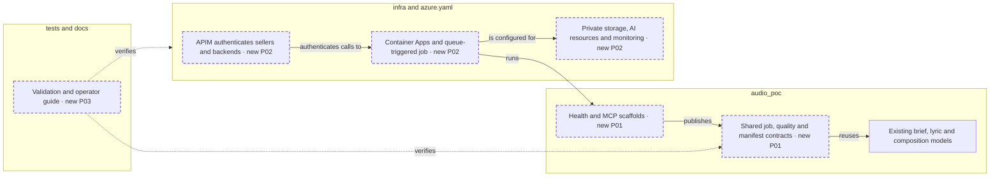

<!-- markdownlint-disable-file -->
# RPI Plan: Azure foundation

## Task Metadata

* Task ID: issue-4-azure-foundation
* Task slug: issue-4-azure-foundation
* Plan date: 2026-11-13

## Executive Summary

Establish reusable service contracts and a credential-free, reproducible Azure foundation. Keep existing local rendering and MCP services unchanged. Deploy explicit non-generating scaffolds rather than presenting a local SQLite queue as production infrastructure. Planning is implementation-ready pending standard critique; cloud deployment remains a separate consent and prerequisite gate.

### What You May Not Know

* APIM's native MCP resource needs the documented preview management API; use Developer rather than Consumption.
* Current azd discovers Container App Jobs with `host: containerapp`.
* The user confirmed the audio proof passed; this plan does not fabricate individual listening, cost or rights measurements.

## Phase Checklist

### After

<!-- rpi:phase id=P01 -->
### [ ] P01: Adopt contracts and build explicit service scaffolds

Goals:
* Consumers have reusable schemas and containers that identify their capabilities honestly.

Dependencies:
* User audio-proof pass attestation.

Changes in the map: Shared contracts and runtime.

<!-- rpi:task id=P01-T01 -->
#### [ ] P01-T01: Define contracts and scaffold entrypoints

Goals:
* Publish schemas for all issue-4 entities with bounded, validated identity and audit fields.

Requirements:
* FR-001, FR-002, NFR-001, NFR-002.
* Reuse existing brief, lyric, composition and syllable models without breaking their callers.
* MCP negotiates 2025-06-18 or newer over Streamable HTTP; unavailable workflow/worker actions fail explicitly and never acknowledge queue work.

Details:
* Add `audio_poc/contracts.py`, `audio_poc/platform_service.py`, one Dockerfile and a strict build-context exclusion file.
* Do not implement workflow, Azure queue consumption, lyric-to-composition conversion, quality measurement or approvals storage in this issue.
* Schemas are generated from Pydantic at runtime, not maintained as duplicated JSON.
* Avoid paid startup calls; health means process health, not a fully functioning generator.

References:
* [audio_poc/melody.py](../../../audio_poc/melody.py): composition and timing contracts.
* [audio_poc/lyrics.py](../../../audio_poc/lyrics.py): brief and lyric contracts.
* [.copilot-tracking/research/2026-11-13/issue-4-azure-foundation-research.md](../../research/2026-11-13/issue-4-azure-foundation-research.md): F4-F5.

Dependencies:
* None.

<!-- rpi:phase id=P02 -->
### [ ] P02: Define reproducible Azure infrastructure

Goals:
* A configured environment can provision and deploy the foundation without committed credentials.

Dependencies:
* P01.

Changes in the map: APIM, Container Apps/job and supporting Azure resources.

<!-- rpi:task id=P02-T01 -->
#### [ ] P02-T01: Add azd and Bicep resources

Goals:
* Provision all required resource types with endpoint outputs and role-scoped identities.

Requirements:
* FR-003, FR-004, NFR-002, NFR-003.
* Include ACA environment, three services, event-driven render job, queue/private Blob containers, ACR, APIM, Azure OpenAI model, Speech S0, Content Safety, Key Vault and Application Insights.
* APIM validates tenant, audience, delegated scope and seller identity; MCP backends permit only APIM's managed identity.
* No account keys, client secrets or anonymous blob access.

Details:
* Use subscription entrypoint and resource-group module plus focused reusable service and gateway modules where needed.
* Use pre-created seller/backend Entra registrations as documented prerequisites, not hidden Graph side effects.
* Use current documented native MCP management schema and disable response buffering.
* Job image deployment uses azd service tags, not hooks.
* Scope RBAC by service role; Key Vault remains empty until a remaining secret is actually required.
* Use placeholder bootstrap image only during infrastructure creation; azd deploy replaces every app/job image.

References:
* [docs/design-proposal.md](../../../docs/design-proposal.md): sections 5, 6, 8.
* [.copilot-tracking/research/2026-11-13/issue-4-azure-foundation-research.md](../../research/2026-11-13/issue-4-azure-foundation-research.md): W3-W7.

Dependencies:
* P01-T01.

<!-- rpi:phase id=P03 -->
### [ ] P03: Verify contracts, protocol and deployment readiness

Goals:
* Operators can set up, smoke-check and remove the foundation with known limits.

Dependencies:
* P01 and P02.

Changes in the map: Validation and operator guide.

<!-- rpi:task id=P03-T01 -->
#### [ ] P03-T01: Add focused tests and deployment documentation

Goals:
* Verify invalid contract states are rejected, scaffolds do not claim generation, and Bicep and image builds succeed.

Requirements:
* FR-005, NFR-001 through NFR-004.
* Document runtime, region/model checks, costs, permissions, Entra setup, local setup, authenticated smoke checks and teardown.
* Record live deployment as unverified until a real authorized `azd up` succeeds.

Details:
* Test ownership: new `tests/test_contracts.py` and `tests/test_platform_service.py`; no existing tests removed; maximum 12 new test functions, parametrization allowed.
* Cover semantic invariants, not constant/accessor checks. Exercise MCP initialization using the real SDK.
* Canonical targets: Pydantic models, Bicep, runtime, azd configuration. Generated targets: runtime JSON schemas and build ARM JSON; no committed duplicates.
* Run targeted pytest and Ruff, Bicep build/lint, Docker build plus health and protocol smoke, then existing tests for regression because shared models and packaging are involved.
* Do not run deployment, tear down existing resources, or mutate shared cloud configuration without explicit approval.

References:
* [pyproject.toml](../../../pyproject.toml): existing validation commands and dependencies.
* [docs/project-plan.md](../../../docs/project-plan.md): deployment definition of done.

Dependencies:
* P01-T01 and P02-T01.

## User Decisions and Requirements

### Confirmed User Direction

* Work on #4 end to end.
* User confirmation: "audio proof passed".
* Preserve unrelated uncommitted lyric work.
* No cloud provisioning, commits, pushes or tracker writes authorized.

### Planning Decisions and Feedback

| Group | Decision or feedback item | Status | Owner | Rationale | Evidence | Planning impact |
|---|---|---|---|---|---|---|
| D1 | Python 3.12 Linux container runtime | confirmed | agent | Reuse current Python/MCP stack and locked dependencies | C1, C6 | P01 |
| D2 | Explicit service scaffolds, not production queue integration | confirmed | agent | Issue 4 is foundation only; local SQLite is not cloud-ready | F4 | P01-P03 |
| D3 | Live clean deployment needs operator consent and prerequisites | deferred | user | Creates billable shared resources | Issue 4, W5 | P03 |

## Planning Readiness and Next Step

* Execution: draft complete.
* Readiness: awaiting standard critique.
* Participation: agent-owned, automatic mode.
* Next action: critique, then automatic implementation if ready.
* Plan: `.copilot-tracking/plans/2026-11-13/issue-4-azure-foundation-plan.md`.
* Changes record: `.copilot-tracking/changes/2026-11-13/issue-4-azure-foundation-changes.md`.

## Goals

* Make the platform foundation reproducible without claiming later integration is complete.

## Scope and Non-Goals

In scope: issue-4 contracts, resource scaffolding, validation and operator documentation.
Non-goals: deploying local POC as a production app, implementing the workflow/renderer, modifying lyric work, choosing unprovided quality thresholds, or treating user attestation as legal clearance.

## Functional Requirements

* FR-001: Contracts cover briefs, lyrics, compositions, jobs/versions, status/errors, syllable timing, quality, provenance and approval records.
* FR-002: Local/container service entrypoints expose health and schema discovery and supported MCP negotiation, with explicit unimplemented operations.
* FR-003: `azd up` can create the specified Azure resource foundation after documented prerequisites.
* FR-004: Endpoint outputs identify each service and Azure dependency; managed identities replace keys.
* FR-005: Operator guide covers prerequisites, local setup, authenticated smoke checks and teardown.

## Non-Functional Requirements

* NFR-001: Preserve current local service behavior; existing tests continue to pass.
* NFR-002: No credentials committed or logged; local default binds loopback and cloud backend identity prevents direct caller bypass.
* NFR-003: Bicep compiles without unresolved schema/type diagnostics; container builds from the lock file and excludes local/private artifacts.
* NFR-004: Actual cloud acceptance remains pending until authorized clean deployment and authenticated smoke checks provide evidence.

## Risks and Open Questions

| Priority | Risk | Affected work | Evidence needed | Owner |
|---|---|---|---|---|
| High | Subscription-specific quotas, model lifecycle and regional availability | P02/P03 | Operator preflight and clean authorized azd up | operator |
| Medium | Native MCP management API is preview | P02 | Pin documented version and compile schema | implementer |
| Medium | Foundation is not yet a working generator | P01/P03 | Explicit status and deployment limitations | implementer |

## Dependencies

* User-attested audio decision; existing Python and MCP contracts.
* Two tenant Entra application registrations, Azure subscription permissions and model quota before deployment.
* No committed BRD, PRD or ADR exists; issue 4 and the design proposal are the business sources.

## Sources

* [docs/design-proposal.md](../../../docs/design-proposal.md): sections 5, 6, 8.
* [docs/project-plan.md](../../../docs/project-plan.md): work sequence.
* [.copilot-tracking/research/2026-11-13/issue-4-azure-foundation-research.md](../../research/2026-11-13/issue-4-azure-foundation-research.md): C1-C6, W1-W7.
* https://github.com/dkirby-ms/earwyrm/issues/4

## Critique Disposition

* Setting: standard, first-task default.
* Status: started.
* Output: `.copilot-tracking/reviews/plans/2026-11-13/issue-4-azure-foundation-plan-critique.md`.
* Findings: pending.

## Artifact Self-Check

Requirements map to tasks. Existing tests remain owned and untouched. No source changes have been made during planning. No human review is fabricated.

## Follow-Up Items

* None outside the issue's existing workflow/render integration boundaries.

## Handoff

Automatic RPI Agent continues after critique; live provisioning remains gated.
