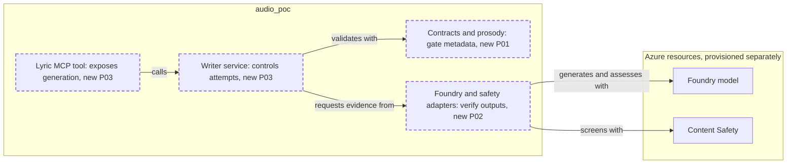

<!-- markdownlint-disable-file -->
# RPI Plan: Lyric and Hook Writer

## Task Metadata

* Task ID: issue-5
* Task slug: issue-5-lyric-hook-writer
* Plan date: 2026-11-13

## Executive Summary

Add a standalone lyric MCP tool using Foundry, deterministic prosody checks,
independent factual/style review and Azure Content Safety. Invalid, unsafe
or ungrounded output never returns as accepted; risky claims are held.
Planning complete and ready after one standard critique correction.

### What You May Not Know

The shared platform contract in #4 is not implemented. This work defines a
provisional v1 without deployment or UI integration. Live cloud calls require
separate configuration and consent; local validation will use HTTP fakes.

## Phase Checklist

### After

New independent service only; existing composition connections remain unchanged.

<!-- rpi:phase id=P01 -->
### [x] P01: Establish strict contracts and reproducible lyric rules

Goals:
* Machine-checkable English lyric output with no guessed counts or rhymes.

Dependencies:
* None.

Changes in the map: Contracts and prosody.

<!-- rpi:task id=P01-T01 -->
#### [x] P01-T01: Define contracts and dictionary-backed checks

Goals:
* Strict briefs, requests and six-field drafts; deterministic per-path validation.

Requirements:
* FR-001, FR-002, NFR-001, NFR-003.

Details:
* Add `audio_poc/lyrics.py`; reuse `Contract` and `ProductPath`.
* Spoken: two lines, 8-20 syllables each, no rhyme (`--`).
* Vocoded: four lines, 8-12 syllables each, AABB with distinct rhyming words.
* Both: exact full brand twice, supplied CTA exactly the final line, hook is a non-CTA line.
* Recompute counts and dictionary rhyme tails; unknown words fail with explicit code.
* RV-001: Reject unsupported pronounceable symbols, numeric/symbolic brand names and CTA notation rather than silently dropping characters; normal sentence punctuation remains supported.
* CMU ARPABET overrides support brand pronunciations; validate keys and phonemes.

References:
* [audio_poc/melody.py](../../../audio_poc/melody.py), shared strict-extra contract.
* [docs/audio-poc/protocol.md](../../../docs/audio-poc/protocol.md), seven-field brief.

Dependencies:
* None.

<!-- rpi:phase id=P02 -->
### [x] P02: Require independent cloud evidence

Goals:
* Structured generation, factual checks and mandatory safety results.

Dependencies:
* P01.

Changes in the map: Foundry and safety adapters.

<!-- rpi:task id=P02-T01 -->
#### [x] P02-T01: Implement Foundry and Content Safety adapters

Goals:
* Refusals, truncation, incomplete safety responses and unavailable resources cannot pass.

Requirements:
* FR-003, FR-004, FR-005, NFR-001, NFR-002.

Details:
* Add `audio_poc/lyric_cloud.py` with HTTPX REST and DefaultAzureCredential.
* Separate structured preflight (English, imitation, input risk), generation and independent grounding/output-English/risk assessments. Hook and CTA are included.
* Generation sees structured brief plus rules, not transcripts, website text or expected-answer fixtures.
* Strict all-required JSON schema; reject refusal/non-stop finish and wrong types.
* POST both text moderation and protected-material APIs, version `2024-09-01`.
* Require exactly all four categories and severity zero; protected `detected=false`.
* HTTP timeout, no hidden retries; distinguish transient HTTP status/transport errors, permanent failures and model refusals. Do not retry failed safety evidence.
* Entra ID default; resource HTTPS endpoints only, explicit model deployment.
* Add `azure-identity`, `cmudict`, `httpx` runtime dependencies with `uv`; update lock.
* Emit OTel server/client spans, no content attributes; generic warning/error logs only.

References:
* [.copilot-tracking/research/2026-11-13/issue-5-lyric-hook-writer-research.md](../../research/2026-11-13/issue-5-lyric-hook-writer-research.md), W1-W3.
* [pyproject.toml](../../../pyproject.toml), existing environment.

Dependencies:
* P01-T01.

<!-- rpi:phase id=P03 -->
### [x] P03: Expose bounded generation and verify acceptance gates

Goals:
* An independent MCP tool returns usable lyrics or an explicit non-success outcome.

Dependencies:
* P01, P02.

Changes in the map: Writer service and Lyric MCP tool.

<!-- rpi:task id=P03-T01 -->
#### [x] P03-T01: Implement bounded service, MCP transport and focused tests

Goals:
* Verify each acceptance criterion locally without requiring paid cloud requests.

Requirements:
* FR-001 through FR-006; NFR-001 through NFR-003.

Details:
* Add `audio_poc/lyric_service.py`, `audio_poc/lyric_mcp.py`.
* Preflight before generation; no freeform artist-style prompt.
* Retry only candidate schema/rule/grounding failures and transient generation errors, maximum four generation calls.
* Safety blocks and model refusals reject immediately; unavailable/malformed assessment or safety yields unavailable without output.
* Hold regulated categories, prices, superlatives and evaluator-flagged risk, never accepted.
* Only accepted or held output can carry a draft. No unsafe output in errors.
* Add `docs/lyric-mcp.md`: schema, example, setup/RBAC, English scope, policies, human review and provisional status.
* Test ownership: `tests/test_lyrics.py`, `tests/test_lyric_cloud.py`, `tests/test_lyric_service.py`, `tests/test_lyric_mcp.py`. Maximum 35 new test functions, parametrization allowed; no removals.
* Semantic safety cases use controlled verdicts; HTTP tests verify provider payloads, strict parsing and required response completeness. MCP test uses actual in-memory protocol client.
* Run focused pytest and Ruff over new modules/tests. Then existing melody/adapter tests if integrations change; no unrelated fixes.
* Canonical targets: Python source and docs. Generated target: `uv.lock`.

References:
* [audio_poc/melody_mcp.py](../../../audio_poc/melody_mcp.py), independent transport pattern.
* [tests/test_melody_mcp.py](../../../tests/test_melody_mcp.py), actual protocol tests.

Dependencies:
* P01-T01, P02-T01.

## User Decisions and Requirements

### Confirmed User Direction

* Build issue #5 end to end using the existing application.
* Preserve all supplied acceptance criteria.
* Automatic progression and agent-owned ordinary decisions.

### Planning Decisions and Feedback

Provisional strict v1, Python/FastMCP and separate semantic assessments selected
from research C1-C4/W1-W3. No unresolved material decision.

## Planning Readiness and Next Step

Implementation complete, including accepted RV-001 remediation. Automatic parent
proceeds to Follow-up acceptance without another Review.
Critique completed with PC-001 resolved directly; no unresolved decisions.

## Goals

Grounded, rule-checked English lyrics with explicit outcomes.

## Scope and Non-Goals

Service, adapters, tests, documentation and dependency lock only.
No new app, deployment, paid test calls, tracker writes, commits or pushes.

## Functional Requirements

* FR-001: Return hook, lyrics, syllables per line, rhyme scheme, brand count and CTA in strict versioned JSON.
* FR-002: Recompute metadata; enforce per-path line/meter/rhyme, exact brand count and final-line CTA.
* FR-003: Reject artist-imitation requests and unsupported claims using independent assessments over structured facts only.
* FR-004: Run moderation and English protected-material screening before acceptance; hold risky/regulated claims for human review.
* FR-005: Bound lyric regeneration to one initial attempt and three retries, with explicit exhausted and unavailable outcomes.
* FR-006: Provide independent stdio and loopback Streamable HTTP MCP transports.

## Non-Functional Requirements

* NFR-001: Tests verify gates, actual MCP output schema, malformed cloud responses and exact four-attempt ceiling without cloud calls.
* NFR-002: No credentials, brief text or raw model output in telemetry; bounded timeouts and explicit cloud errors.
* NFR-003: Existing melody/web behavior is unchanged.

## Risks and Open Questions

Semantic assessments are probabilistic; all output still requires producer
approval. Unknown pronunciations fail unless explicitly supplied by caller.

## Dependencies

Existing FastMCP/Pydantic/OTel; add CMUdict, Azure Identity and runtime HTTPX.

## Sources

* [.copilot-tracking/research/2026-11-13/issue-5-lyric-hook-writer-research.md](../../research/2026-11-13/issue-5-lyric-hook-writer-research.md)
* [docs/design-proposal.md](../../../docs/design-proposal.md), sections 5-6
* [audio_poc/melody.py](../../../audio_poc/melody.py), strict contracts
* Supplied issue #5; #4 is an open integration dependency, not claimed complete.
* No separate applicable BRD, PRD or adopted ADR supplied.

## Critique Disposition

Standard, first-task default. Execution Complete; verdict Revise.
PC-001 opened then resolved: independent assessment now checks candidate English
including hook/CTA. No further critique needed. Planner accepts residual semantic
false-negative risk with mandatory producer review documented.

## Artifact Self-Check

Requirements covered, dependencies ordered, test ownership and maximum additions
locked, summary synchronized and critique findings disposed.

## Follow-Up Items

* None.

## Handoff

All plan tasks completed and validated. Automatic parent reconciles the existing
Review finding with its regression evidence and assesses session acceptance.
