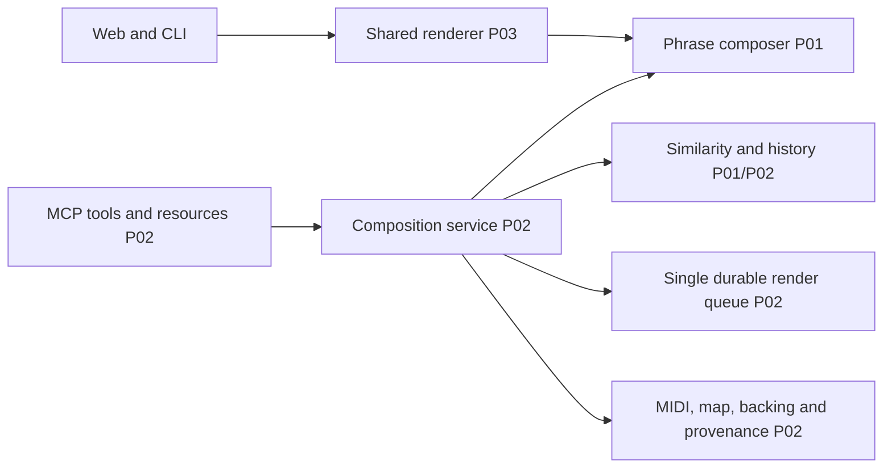

<!-- markdownlint-disable-file -->
# RPI Plan: Melody and Arrangement MCP

Task ID: issue-6-melody-arrangement

## Executive Summary

Replace both fixed melodies with reproducible phrase-level composition and fresh
per-render seeds. Expose a standalone typed MCP service that validates syllable
windows, writes MIDI/backing/timing/provenance, screens similarity and atomically
records one durable local render job. Preserve the existing web and Speech gates.

## What You May Not Know

Dependency #4 remains open: no shared platform schema or Azure queue exists.
The new versioned contract and queue are explicitly provisional/local, ready
for platform adaptation, not a claim that deployment is complete.

## Phase Checklist

### Before

### After

<!-- rpi:phase id=P01 -->
### [x] P01: Establish musical composition and screening

Goals: Different versions change actual intervals, rhythms, harmony and form;
transposition cannot bypass screening.
Dependencies: completed Research.
Changes in the map: composer, similarity.

<!-- rpi:task id=P01-T01 -->
#### [x] P01-T01: Composing and validating musical phrases

Goals: Seeded 30-second retro-synth arrangements with coherent repeating hooks,
contrasting sections and inspectable chords.
Requirements: FR-001, FR-002, NFR-001.
Details: Reuse `Note`, synthesis and MIDI writers in
[audio_poc/dsp.py](../../../audio_poc/dsp.py). Use seeded musical choices, not
independent white-noise pitches. Explicitly reject invalid/unfit lyric windows.
References: Research C1/C2/C5; design proposal sections 4-6.
Dependencies: none.

<!-- rpi:task id=P01-T02 -->
#### [x] P01-T02: Blocking similar melodies

Goals: Known references and prior output block delivery, regardless of key.
Requirements: FR-003, NFR-002.
Details: Document public-domain tune origins, legacy fixed motifs, method,
minimum comparisons and threshold. Check both backing hook and vocal melody.
Use interval edit/window comparison; persist prior service output.
References: Research C1/C2; issue #6 similarity criteria.
Dependencies: P01-T01.

<!-- rpi:phase id=P02 -->
### [x] P02: Deliver the independent MCP service

Goals: Typed tool, artifact resources and one durable logical render submission.
Dependencies: P01.
Changes in the map: MCP, service, history, queue, artifacts.

<!-- rpi:task id=P02-T01 -->
#### [x] P02-T01: Persisting screened jobs and exposing MCP

Goals: Invalid requests fail explicitly; duplicate submissions across concurrent
instances/restarts return the same job, with conflicting payloads rejected.
Requirements: FR-002, FR-003, FR-004, FR-005, NFR-003.
Details: Local SQLite transaction owns job creation and similarity history.
Use opaque server-generated artifact directories and allowlisted binary
resources, not arbitrary client paths. A job is queued only after successful
screening and artifact writes. Workflow must not enqueue another copy.
Only committed jobs expose resources; handled failures remove their own partial
artifacts, and crash orphans remain private. Retain the composition seed.
Supported MCP SDK handles stdio and Streamable HTTP; local default binds loopback.
No Speech request in this service. Return structured chords/map/references and
component ledger with unresolved human-rights status.
References: Research C3-C5/W1-W2; issue #6 acceptance criteria.
Dependencies: P01-T01, P01-T02.

<!-- rpi:phase id=P03 -->
### [x] P03: Integrate, document and verify

Goals: Existing app produces new music, not only the standalone service.
Dependencies: P02.
Changes in the map: shared renderer, existing callers.

<!-- rpi:task id=P03-T01 -->
#### [x] P03-T01: Integrating actual variation and proving contracts

Goals: Existing offline and vocal paths use shared musical decisions while
accounting/auth behavior remains unchanged.
Requirements: FR-001 through FR-005, NFR-001 through NFR-003.
Details: Fresh seed per new render; voice derives notes from the same score.
Keep existing word-timing API compatibility and label word versus syllable
granularity honestly. Document setup, example v1 request, outputs, screening
limitations and local queue consumption contract.
Existing synchronous POC outputs also enter the shared melody history, without
creating queue rows; CLI and web explicitly supply persistent history roots.
Generated candidates get at most eight local screening attempts; explicit seeds
never change silently. POC preflight reads history before any paid synthesis,
and publication rechecks history transactionally.
Test ownership: extend existing audio tests for renderer regression; add at most
three focused test modules for composition, service and MCP. No removals.
Canonical targets: Python source and docs; generated target: `uv.lock`.
Semantic tests: distinct normalized intervals/rhythm, timing boundaries,
screening outcomes, concurrent/restart idempotency, conflict, failed delivery,
actual MCP initialize/list/call/resource and errors. Regression: existing audio
and web tests, then full pytest when integration warrants it. Run Ruff on touched
source, format check, locked dependency check and real local protocol smoke.
Inject an artifact-write failure and verify no job/history/resource is delivered.
References: Research C4/C5/W2; attached #6.
Dependencies: P02-T01.

## User Decisions and Requirements

End-to-end authorized. Automatic through Review, agent-owned decisions.
No deployment, cloud calls, tracker mutations or commits requested.

## Planning Decisions and Feedback

* D1 confirmed: provisional contract v1 because #4 provides no implemented schema.
* D2 confirmed: local SQLite is queue owner; no external broker or second workflow enqueue.
* D3 confirmed: seeded structure and oscillator synthesis preserve provenance.
* D4 confirmed: screening failures raise errors and deliver/queue nothing.

## Goals, Scope and Requirements

* FR-001: actual variation beyond key/rotation; coherent 30-second retro-synth.
* FR-002: validated versioned lyric windows, syllables and selected product path;
  MIDI/chords/map/backing references returned.
* FR-003: documented known/legacy/prior-output screening blocks failures.
* FR-004: code-only instruments and component origins, no legal-clearance claim.
* FR-005: one durable logical job per idempotency identity; conflict explicit.
* NFR-001: deterministic seed, finite non-silent 30-second PCM and valid MIDI.
* NFR-002: key-independent screening; no commercial-catalog/rights guarantees.
* NFR-003: explicit errors, private artifacts, concurrency/restart correctness.

## Risks and Dependencies

No BRD/PRD/ADR found in tracked inventory. Business authority: attached #6 and
[docs/design-proposal.md](../../../docs/design-proposal.md), sections 4-6.
Required producer/listening/rights approval is for distribution, not local build.
Screening coverage is necessarily bounded; history only covers this private store.

## Follow-Up Items

Optional/out-of-scope: #4 deployment/shared-contract adoption; #7 queue worker and
Azure adapter. Neither is represented as completed by this local implementation.

## Sources

Research: `.copilot-tracking/research/2026-11-13/issue-6-melody-arrangement-research.md`.
SDK: <https://github.com/modelcontextprotocol/python-sdk/tree/v1.x>.

## Critique Disposition

Setting: standard, first-task default. Execution: Complete; verdict Revise.
PC-001 Medium: resolved by committed-only resources, handled failure cleanup
and explicit failure-injection coverage in P02-T01/P03-T01.
Planning Readiness: Ready. Parent continues automatically to Implement.
