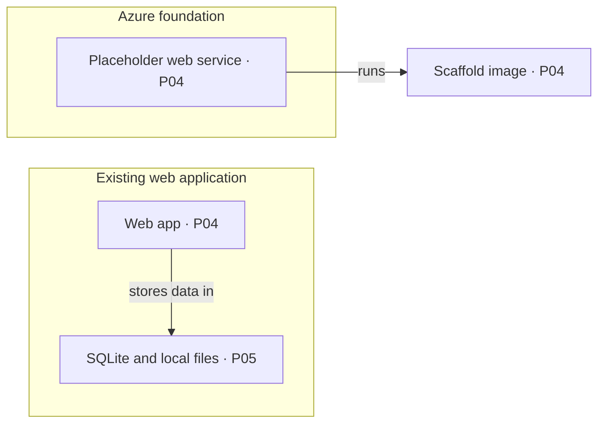
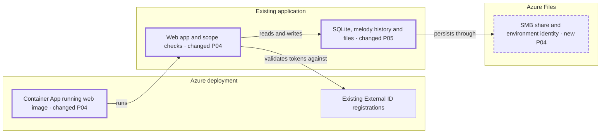

<!-- markdownlint-disable-file -->
# RPI Plan: Existing web app with Azure Files

## Task Metadata

* Task ID: azure-files-working-app.
* Task slug: azure-files-working-app.
* Plan date: 2026-11-14.

## Executive Summary

The existing External ID web app is configured for deployment with its SQLite databases and private audio on an Azure Files SMB mount authenticated by the Container Apps environment's managed identity. Accepted review findings `RV-001` through `RV-003` are implemented and locally validated: stopped-writer deployment gates, runtime database-loss protection, and GitHub OIDC-only deployment. This is a limited POC, not a production persistence guarantee. No Azure resources have been provisioned; live acceptance remains unverified.

### What You May Not Know

SQLite on a network filesystem has a residual corruption risk even with one replica; this is a POC trade-off, not production-grade durability. Managed-identity SMB mounting is a preview feature.

## Phase Checklist

### Before

### After

The web app remains responsible for External ID token and scope validation. Its SQLite, melody history and audio reside on the mounted share; the identity used to mount belongs to the Container Apps environment, not the web app.

<!-- rpi:phase id=P04 -->
### [x] P04: Deploy the working app and managed-identity file share

Goals:
* Run the existing web UI and API with the existing External ID configuration and a writable managed-identity SMB mount.

Dependencies:
* Existing web app and confirmed POC risk acceptance.

Changes in the map: Container App and web image, web app authentication configuration, Azure Files share and environment identity.

<!-- rpi:task id=P04-T01 -->
#### [x] P04-T01: Configure image, identity and mount

Goals:
* An operator can deploy the actual web app with its existing CIAM registrations and a persistent mount.

Requirements:
* FR-006, FR-007, FR-008, NFR-005, NFR-006, NFR-007.
* Deploy the real web entrypoint, browser assets and all required JSON fixtures; never claim `/healthz` proves identity or persistence readiness.
* Pass all six existing non-secret `ENTRA_*` values verbatim. Keep application-level token validation and the five existing delegated scope suffixes. Do not put an EasyAuth 401 barrier in front of the browser UI or API's own CIAM validation.
* Use classic SMB Azure Files, `SMBOAuth`, a Container Apps environment managed identity, the documented account-scoped `Storage File Data SMB MI Admin` assignment, and an `AzureFile` environment storage definition. Require Kerberos-compatible SMB settings; never fall back to account keys.
* Configure one Uvicorn worker, maximum one app replica and single active-revision mode, but do not claim these settings alone prevent overlapping revisions. Mount the share at an absolute private application data directory and surface mount/write failures instead of falling back to `/tmp`.

Details:
* Reconcile [Dockerfile.web](../../../Dockerfile.web), [.dockerignore](../../../.dockerignore), [azure.yaml](../../../azure.yaml), [infra/](../../../infra/) and current scaffold-only documentation with the selected path. Scope active deployable services to the working web app; do not silently deploy an unused placeholder as if it were functional.
* Establish a deployment or startup exclusion mechanism for old and new revisions that can be demonstrated in a live update; if exclusivity cannot be established, document and enforce a stop-old-before-start-new maintenance procedure. `maxReplicas: 1` is per revision and is not sufficient.
* Configure the image and mount for non-root UID `10001`; live verification of `uid`, `gid`, file operations and SMB locking belongs to `P05-T01` and requires separate cloud authorization.
* Keep existing uncommitted dependency changes and empty persistence files intact unless their owner explicitly authorizes cleanup. No PostgreSQL or Blob integration is assumed.
* Before any authorized cloud update, inventory the selected subscription and environment and preview proposed resource changes. Prefer a new isolated environment; preserve existing resources and data. Stop and seek separate approval for destructive migration, replacement, deletion or changes to unrelated services. Do not assume deleting an azd service declaration deletes its Azure resources.
* Paid Speech remains disabled by default; do not substitute storage or speech keys, alter seller registrations, or imply live voice generation is configured.
* Address accepted `RV-001` with fail-closed `azd` provision/deploy hooks that verify all app revisions have zero replicas. Supply an explicitly authorized GitHub maintenance path to stop writers; verification failures must prevent updates.
* Address accepted `RV-003` with a manually dispatched, serialized GitHub OIDC-only deployment workflow and guidance. Verify the deployment account is the configured service principal; do not support interactive user deployment or change the existing External ID registrations.
* Validate deployment gates locally with mocked Azure CLI responses, including running replicas, CLI failures, unrelated apps and wrong identity. Check workflow/hook configuration and warning-free Bicep compilation. No live hook execution is authorized.

References:
* [audio_poc/web_auth.py](../../../audio_poc/web_auth.py): External ID configuration and scope checks.
* [docs/audio-poc/web-app.md](../../../docs/audio-poc/web-app.md): registration, issuer and callback contract.
* [Dockerfile.web](../../../Dockerfile.web): existing image candidate.
* https://learn.microsoft.com/azure/container-apps/storage-mounts: identity ownership, SMB prerequisites and mount model.

Guidance:
* [audio_poc/cloud_web.py](../../../audio_poc/cloud_web.py) requires a mounted data root and holds an exclusive advisory writer lock through the single Uvicorn process. Real SMB lock semantics remain unverified; stop existing writers before updates.

Dependencies:
* None.

<!-- rpi:phase id=P05 -->
### [x] P05: Preserve SQLite behavior and verify operating limits

Goals:
* Existing POC data survives normal restarts while the risks, backup and recovery boundaries are explicit and tested.

Dependencies:
* P04.

Changes in the map: SQLite, melody history and private files.

<!-- rpi:task id=P05-T01 -->
#### [x] P05-T01: Validate storage behavior and operational handoff

Goals:
* The mounted app preserves existing functional and access-control behavior without pretending that SMB makes SQLite corruption-proof.

Requirements:
* FR-008, FR-009, FR-010, NFR-005 through NFR-008.
* Preserve owner isolation, paid-render reservation/reconciliation and melody-history screening. Preserve both SQLite databases, associated rollback journals, audio and evaluation data; do not put durable state in ephemeral storage.
* Use or verify rollback-journal mode for both SQLite databases; do not use WAL on the network mount. Fail explicitly on unavailable storage, incompatible mount permissions or SQLite errors; never silently recreate data or bypass access checks.
* Document backups and a restore procedure that captures a consistent set of databases and audio while writers are stopped; verify restored `PRAGMA integrity_check` for each database and the presence and accessibility of referenced audio. Snapshots alone are not assumed application-consistent.
* Record local and static checks independently from an authorized real Azure test. A clean deployment, two authenticated users, restart persistence, exclusive update behavior, denied access, backup/restore and mount failure tests are required before claiming cloud acceptance.
* For live cloud acceptance, use the actual deployed image to sign in, select a brief, generate an offline instrumental, compare/evaluate it, download protected audio and evidence, restart, and retrieve the same records and audio. Confirm another user cannot read them; do not make a paid Speech call. Exercise an instrumental render through the locally built image as well.

Details:
* Use existing [audio_poc/web_storage.py](../../../audio_poc/web_storage.py), [audio_poc/melody_service.py](../../../audio_poc/melody_service.py), [audio_poc/web_app.py](../../../audio_poc/web_app.py) and their tests. Confirm UID `10001` can create, read, chmod, write, rename and delete files on the actual SMB mount, and verify `uid`, `gid`, mode, SQLite locking, advisory writer exclusion and `BEGIN IMMEDIATE`.
* Document a maintenance procedure to stop all writers before deployment, backup and restore, and how to confirm revisions are stopped. Store consistent backups outside the protected share. Backup and restore must not require deleting the source share. Explicitly warn that `azd down` can delete the resource group, share and its data; destructive teardown requires separate approval.
* Replace obsolete scaffold and workforce-tenant deployment instructions in [docs/azure-deployment.md](../../../docs/azure-deployment.md). Document exact `azd` inputs and explain `ENTRA_CLIENT_ID`, `ENTRA_AUTHORITY`, `ENTRA_METADATA_URL`, `ENTRA_EXPECTED_ISSUER`, `ENTRA_AUDIENCE`, and `ENTRA_API_SCOPE_PREFIX`; use the existing SPA/API registrations and the deployed origin's `/auth-callback.html`. Obtain separate approval for registration changes.
* Test ownership: extend existing `tests/test_web_app.py`, `tests/test_web_auth.py`, `tests/test_melody_service.py` where relevant; use a new dedicated test file only when necessary. Exact removals: none. Maximum new test functions: 12, parametrization allowed. Canonical targets are source, Bicep, image and operator documentation; generated ARM templates and schemas are validation outputs only.
* Run scoped tests, Ruff, full regression suite, warning-free Bicep build, image build and actual HTTP health/UI/config smoke. Local tests cannot prove Azure SMB semantics or real CIAM behavior.
* Live `azd up`, tenant registration changes, failure injection, revision changes and teardown require separately granted operator approval; record unavailable checks rather than inventing success.
* Address accepted `RV-002`: initialized-store constructors and runtime connections must not create a missing database. Cover deletion after startup for both databases, including cached connections' next open and a new melody service during render; preserve fresh-store initialization.

References:
* [audio_poc/web_storage.py](../../../audio_poc/web_storage.py): data layout, SQLite transactions and file permissions.
* [audio_poc/melody_service.py](../../../audio_poc/melody_service.py): separate SQLite melody history.
* [docs/audio-poc/web-app.md](../../../docs/audio-poc/web-app.md): local behavior and scope checks.
* https://sqlite.org/useovernet.html and https://sqlite.org/wal.html: residual risk and journal-mode constraints.

Dependencies:
* P04-T01.

## User Decisions and Requirements

### Confirmed User Direction

* Deploy the existing working web app with the existing External ID SPA and API registrations, not non-generating scaffolds.
* Plan the Azure Files and managed-identity approach after the network filesystem risk and preview status were explained.
* Preserve in-progress files and uncommitted changes. Do not provision billable resources or mutate app registrations without separate approval.
* Review decisions `RD-004`, `RD-006` and `RD-009` accept `RV-001` and `RV-002` for implementation and require GitHub OIDC-only deployment for `RV-003`. These decisions authorize local corrections, not cloud operations.

### Planning Decisions and Feedback

| Group | Decision | Status | Owner | Rationale and evidence | Impact |
|---|---|---|---|---|---|
| D4 | Azure Files SMB with environment managed identity for POC | confirmed | user | User chose the approach after the SQLite risk discussion | Hosting and persistence |

## Planning Readiness and Next Step

* Execution: local implementation and accepted review corrections complete; cloud acceptance remains unverified and separately gated.
* Decision participation: user-owned, standalone planning request.
* Next action: optional local review with `/rpi-review`. Cloud operations and registration changes still require separate approval.
* Plan: `.copilot-tracking/plans/2026-11-14/azure-files-working-app-plan.md`.
* Changes record, created during implementation: `.copilot-tracking/changes/2026-11-14/azure-files-working-app-changes.md`.

## Goals

* Run the existing authenticated web POC on Azure with persistent files without inventing a new backend.

## Scope and Non-Goals

* In scope: existing web image, CIAM settings, Azure Files/managed identity, operational limitations, verification and instructions.
* Non-goals: production durability guarantees, PostgreSQL/Blob migration, autonomous cloud provisioning or tenant mutations.

## Functional Requirements

* FR-006: Run the existing same-origin web UI and API in Container Apps with the six existing External ID configuration values and existing authorization behavior.
* FR-007: Mount a classic Azure Files SMB share with Container Apps environment managed identity, without account keys.
* FR-008: Persist existing SQLite records, melody history and private audio/evaluations across restart without a silent ephemeral fallback.
* FR-009: Document the identity setup, operational limits, costs, safe update, backup/restore and teardown.
* FR-010: Demonstrate local behavior and, with separate approval, real cloud mount, authentication, persistence and recovery.

## Non-Functional Requirements

* NFR-005: One worker and no concurrent writers across revisions; single-replica settings alone do not prove exclusivity.
* NFR-006: Use no committed credentials or Azure Files storage keys; preserve existing delegated-scope authorization.
* NFR-007: Use least privilege consistent with the currently documented environment-identity SMB mount requirements; no silent key fallback.
* NFR-008: State that SQLite on SMB remains a POC corruption and network-availability risk, even after tests pass.

## Risks and Open Questions

| Priority | Risk | Affected work | Evidence or action | Owner |
|---|---|---|---|---|
| High | SQLite SMB locking/fsync failure may corrupt data, even when tests pass | P05-T01 | Restrict use to disposable POC data, verify recovery and preserve risk disclosure | operator |
| High | Revision overlap, replica restart or uncontrolled access can produce concurrent writers | P04-T01, P05-T01 | Demonstrate a reliable exclusion mechanism or enforce documented stop-before-start | implementer/operator |
| High | SMB identity is preview and Linux permissions, `chmod`, locking and journal semantics may fail | P04-T01, P05-T01 | Check applicable API and subscription availability; run approved actual-mount validation | implementer/operator |
| Medium | Existing uncommitted PostgreSQL/Blob dependency changes and empty persistence files | P04-T01 | Preserve; ask before cleanup or reuse | operator |
| Medium | Exact External ID issuer, redirect URI and scope consent are tenant-specific | P04-T01 | Operator provides existing non-secret configuration; explicitly approve registration changes | operator |
| Medium | Snapshot or shutdown failure may leave inconsistent DB/audio backups | P05-T01 | Quiesce writers and verify restore plus both integrity checks | operator |
| High | Existing environments or data might be disrupted by migration or teardown | P04-T01, P05-T01 | Inventory and preview, preserve existing resources, require separate approval for destructive changes | operator |

## Dependencies

* Azure role-assignment write permission, supported region and preview features, SMB network connectivity and adequate quota.
* Existing SPA registration, API audience, discovery URL, issuer and consent. The deployed HTTPS origin needs a matching SPA redirect URI, changed only with separate authorization.
* User consent and appropriate non-secret configuration before any billable live deployment.

## Sources

* [audio_poc/web_app.py](../../../audio_poc/web_app.py).
* [audio_poc/web_storage.py](../../../audio_poc/web_storage.py).
* [docs/audio-poc/web-app.md](../../../docs/audio-poc/web-app.md).
* [audio_poc/melody_service.py](../../../audio_poc/melody_service.py).
* https://learn.microsoft.com/azure/container-apps/storage-mounts.
* https://sqlite.org/useovernet.html.
* https://sqlite.org/wal.html.

## Critique Disposition

* Setting: standard, default. Execution: complete; verdict: Revise. Critique: [azure-files-working-app-plan-critique.md](../../reviews/plans/2026-11-14/azure-files-working-app-plan-critique.md).
* PC-001 (High): resolved by explicitly updating the existing deployment guide with exact CIAM inputs and callback.
* PC-002 (High): resolved by requiring an end-to-end instrumental render, evaluation, downloads and post-restart retrieval locally and in the approved cloud test.
* PC-003 (High): resolved by requiring inventory, preview, preservation, off-share backups and separate approval for destructive migration or teardown.

## Artifact Self-Check

* Includes confirmed user direction, supported managed-identity prerequisites, CIAM boundaries, preservation of existing work, local and live validation, and explicit POC risks.

## Follow-Up Items

* None.

## Handoff

The local changes and validation are recorded in [.copilot-tracking/changes/2026-11-14/azure-files-working-app-changes.md](../../changes/2026-11-14/azure-files-working-app-changes.md). Both tasks and phases are locally complete, including accepted review corrections. No active-plan markers remain. Optional review covers local implementation only; cloud provisioning, acceptance and tenant changes require separate authorization.
