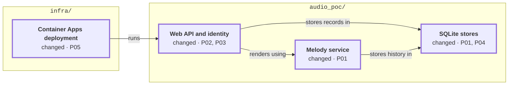
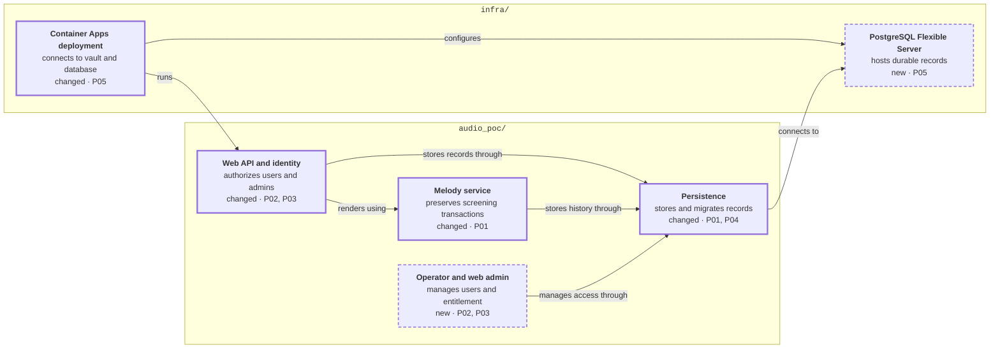

<!-- markdownlint-disable-file -->
# RPI Plan: PostgreSQL migration

## Task Metadata

* Task ID: `postgresql-migration`
* Task slug: `postgresql-migration`
* Plan date: 2026-11-15

## Executive Summary

Move both hosted stores to PostgreSQL, keep External ID sign-in, and add web and operator access administration. Implementation and its standard critique are complete; live provisioning and data cutover remain separately approval-gated.

### What You May Not Know

The identity provider already validates External ID access tokens. The owner subject, Key Vault, outbound IPs, deployment region and live data are not identified in the repository. The network plan uses explicit public-IP allowlisting, not private networking.

## Phase Checklist

### Before

### After

Key: arrows point from a part to what it uses; dashed border, new; thick border, changed; each tag names the phases that make the change.

The web API and melody service use the revised persistence layer in P01-P03. P04 moves existing records without discarding files, and P05 configures the hosted PostgreSQL and vault connection.

<!-- rpi:phase id=P01 -->
### [x] P01: Preserve application persistence

Goals:
* Both hosted stores run on PostgreSQL without weakening spend or melody serialization.

Dependencies:
* None.

Changes in the map: Persistence and Melody service.

<!-- rpi:task id=P01-T01 -->
#### [x] P01-T01: Implement PostgreSQL storage

Goals:
* Web records, paid ledger, melody jobs and history persist in PostgreSQL.

Requirements:
* `FR-001`, `FR-002`, `NFR-001`, `NFR-002`; research C1, C5, C6.
* Preserve atomic paid reservation and cumulative budget checks, idempotent jobs, melody history serialization, ownership and failure behavior under concurrency.

Details:
* Reuse the installed `psycopg` dependency. Preserve local CLI functionality and private file storage; no silent fresh-database fallback for existing production data.
* Exercise real isolated PostgreSQL connections and concurrent writers, plus existing storage and melody regression tests.

References:
* [audio_poc/web_storage.py](../../../audio_poc/web_storage.py): web schema and transactions.
* [audio_poc/melody_service.py](../../../audio_poc/melody_service.py): melody history and jobs.
* [tests/test_web_app.py](../../../tests/test_web_app.py): paid concurrency coverage.
* [tests/test_melody_service.py](../../../tests/test_melody_service.py): history and idempotence.

Dependencies:
* None.

<!-- rpi:phase id=P02 -->
### [x] P02: Establish user authorization

Goals:
* Authenticated users have explicit manageable application access, with one verified owner initially entitled to paid Speech.

Dependencies:
* P01.

Changes in the map: Web API and identity; Operator and web admin.

<!-- rpi:task id=P02-T01 -->
#### [x] P02-T01: Implement controlled bootstrap and operator management

Goals:
* An operator can bootstrap exactly one owner and manage application access without storing passwords for users.

Requirements:
* `FR-003`, `FR-004`, `FR-005`, `NFR-002`, `NFR-003`; research C2, C7, W4.
* Use the validated API subject with issuer context, protect against duplicate or unintended bootstrap, fail closed for absent or disabled users, and ensure owner-only administrative operations. Do not silently restore revoked privileges on restart.
* Bootstrap is an explicit operator action against an empty authorization table, using the exact issuer and subject from a validated API token; it creates one enabled administrator with paid Speech entitlement and no other user. Repeating bootstrap must not modify existing users or privileges.

Details:
* External ID remains the authentication authority. Establish role and entitlement behavior with transactional database updates and safe operator commands; preserve paid budget, estimation, explicit consent and reconciliation gates.
* A scoped authenticated identity-discovery endpoint may return only the caller's validated issuer and subject, even before enrollment. An operator verifies this binding out of band and uses those values for bootstrap or administrator-led enrollment; no token, password or guessed email is used as the key. Unknown and disabled identities receive no application or admin access.
* Test unknown and disabled identities, discovery of the caller only, non-admin denial, authorization changes, owner bootstrap replay and separation of paid privileges.

Guidance:
* [audio_poc/persistence.py](../../../audio_poc/persistence.py) supplies `PostgresConnection` and the initialized-store check; the web and melody stores accept `database_url`.

References:
* [audio_poc/web_auth.py](../../../audio_poc/web_auth.py): validated access-token claims and scopes.
* [audio_poc/web_app.py](../../../audio_poc/web_app.py): paid Speech controls.
* [audio_poc/bootstrap_database.py](../../../audio_poc/bootstrap_database.py): existing empty bootstrap module.

Dependencies:
* P01-T01.

<!-- rpi:phase id=P03 -->
### [x] P03: Add web administration

Goals:
* An authorized admin can view and manage application access and paid Speech entitlement through the web app.

Dependencies:
* P02.

Changes in the map: Web API and identity; Operator and web admin.

<!-- rpi:task id=P03-T01 -->
#### [x] P03-T01: Deliver protected management endpoints and page

Goals:
* Admin users can manage users in the browser without exposing admin operations to other users.

Requirements:
* `FR-004`, `FR-005`, `NFR-002`, `NFR-003`, `NFR-004`.
* Every management read and write verifies administrator privileges server-side, irrespective of UI visibility; newly signed-in users remain unprivileged until an admin explicitly enrolls their verified issuer and subject.

Details:
* Follow existing same-origin frontend patterns. Do not create or change External ID users or tenant registrations implicitly.
* Test allowed and forbidden API operations, UI navigation, actionable errors, keyboard interaction and account privilege updates.

Guidance:
* [audio_poc/web_storage.py](../../../audio_poc/web_storage.py) supplies issuer-bound `get_user`, `list_users`, and `set_user`; the web application's `authorized_scope` checks enabled access. Admin mutations must verify the caller's admin privilege server-side.

References:
* [audio_poc/web/index.html](../../../audio_poc/web/index.html): current interface.
* [audio_poc/web/app.js](../../../audio_poc/web/app.js): browser API interactions.
* [tests/test_web_navigation.cjs](../../../tests/test_web_navigation.cjs): navigation tests.

Dependencies:
* P02-T01.

<!-- rpi:phase id=P04 -->
### [x] P04: Protect migration and recovery

Goals:
* Existing SQLite records can be imported without losing ownership, spend history, melody screening, or media references.

Dependencies:
* P01, P02.

Changes in the map: Persistence.

<!-- rpi:task id=P04-T01 -->
#### [x] P04-T01: Provide controlled migration and verification

Goals:
* Operators can migrate both old databases into a verified empty PostgreSQL target and retain source files for rollback.

Requirements:
* `FR-006`, `NFR-001`, `NFR-002`; research C1, C4-C6.
* No automatic destructive cutover; import fails atomically on inconsistent, partial or nonempty targets and validates all records and relationships.
* Startup requires an explicit initialized-store marker, written only by a successful fresh initialization explicitly selected for an empty source or by a verified import. It must not infer a fresh deployment from missing PostgreSQL data or bypass a pre-existing SQLite marker.

Details:
* Preserve IDs, timestamps, owners, ledger status, melody histories and artifact references. Explain backup, quiescence, migration, verification, rollback and separately approved cutover.
* Document source and target inventories, write quiescence, and verification before enabling the new app. Rollback to SQLite is safe only before PostgreSQL accepts new writes; afterward require a separately approved reverse migration and reconciliation rather than silently reverting to stale data.
* Test realistic source records, partial failures, repeat imports, missing databases, absent initialization marker, mismatched media and fresh-versus-import startup.

Guidance:
* `validate_postgres_store` in [audio_poc/persistence.py](../../../audio_poc/persistence.py) requires `earwyrm_store_metadata` with schema version `1`, both store schemas, and the authorization tables. P04 owns writing the marker only after an explicit verified initialization or import.

References:
* [audio_poc/cloud_web.py](../../../audio_poc/cloud_web.py): existing store validation.
* [docs/azure-deployment.md](../../../docs/azure-deployment.md): maintenance gates.

Dependencies:
* P01-T01, P02-T01.

<!-- rpi:phase id=P05 -->
### [x] P05: Configure low-cost hosted deployment

Goals:
* The Azure deployment can use a dedicated low-cost PostgreSQL server and an existing Key Vault secret with restricted connectivity.

Dependencies:
* P01-P04.

Changes in the map: Container Apps deployment; PostgreSQL Flexible Server.

<!-- rpi:task id=P05-T01 -->
#### [x] P05-T01: Update infrastructure and operating guide

Goals:
* A separately approved deployment can provision and connect the database using the smallest available supported configuration and an existing vault secret.

Requirements:
* `FR-007`, `NFR-002`, `NFR-003`, `NFR-005`; research C3, W1-W3, W5.
* No secret in source, azd environment files, output, or command logs; restrict network reachability, require verified TLS and preserve deployment gates. Do not infer the existing vault, subject, region, or approval.
* Use PostgreSQL public access with an explicit, nonempty allowlist of verified Container Apps outbound IPv4 addresses supplied by the deployment owner; never create the all-Azure `0.0.0.0` exception or an all-internet rule. Verify that every active outbound address is covered before rollout; stop when stable/reliable egress cannot be established. This retains the existing environment but is not private networking.
* Provision PostgreSQL with an existing Key Vault secret through a secure deployment-time reference, and configure the app's managed-identity Key Vault reference to that same secret version. Grant only the required secret-read permissions after approval; fail if vault permissions, template deployment access or the secret are unavailable.

Details:
* Start with B1ms and 32 GiB subject to regional SKU and total-price verification. Document burstable limits, backups, networking cost, managed-identity Key Vault access, required secret lifecycle and release gates. Document how to revalidate and update the allowlist when egress changes.
* Document coordinated password rotation: prepare the approved secret version, update the server credential and runtime reference within maintenance, verify a fresh database connection, and retain a tested rollback; rotating the secret alone must not be presented as rotating the PostgreSQL password.
* Validate Bicep, configuration and rejection of missing, broad or invalid allowlists without provisioning a shared Azure environment. Live connectivity and outbound inventory are deployment approval gates.

References:
* [infra/platform.bicep](../../../infra/platform.bicep): hosting resources.
* [infra/service.bicep](../../../infra/service.bicep): application identity and runtime.
* [docs/azure-deployment.md](../../../docs/azure-deployment.md): deployment and maintenance instructions.

Dependencies:
* P01-T01, P02-T01, P04-T01.

## User Decisions and Requirements

### Confirmed User Direction

* Replace SQLite with a dedicated low-cost Azure PostgreSQL Flexible Server.
* Use a database password stored in the existing Key Vault.
* Provide user authentication management and bootstrap the requester as the only user with paid Speech access.
* Proceed end to end with agent-owned ordinary decisions.
* Provide both a web admin page and operator commands for user access management.

### Planning Decisions and Feedback

| Group | Decision or feedback item | Status | Owner | Rationale or input needed | Evidence | Planning impact |
|-------|---------------------------|--------|-------|----------------------------|----------|-----------------|
| D1 | User management interface and responsibilities | Confirmed | User | Provide both admin page and operator commands while External ID handles sign-in | User response 2026-11-15; research C2, C7 | Admin authorization, commands and UI in scope |
| D2 | Use existing External ID with explicit verified-subject bootstrap | Selected | Agent | Preserves current identity validation and ownership; never infer identity from GitHub | Research C2, W4 | P02, P03 |
| D3 | Azure network and cost | Deployment gate | Deployment owner | Region, vault and current environment are unknown; broad all-Azure rule is not private | Research C3, W1-W3, W5 | Must be reviewed before deployment |

## Planning Readiness and Next Step

| Field | Record |
|-------|--------|
| Planning execution and readiness | Complete; Ready after the critique's required corrections |
| Decision participation | Agent-owned; automatic end-to-end user selection |
| Blockers | None currently |
| Latest critique | Standard; Complete, Revise; four High findings resolved in this plan |
| Relevant research | [.copilot-tracking/research/2026-11-15/postgresql-migration-research.md](../../research/2026-11-15/postgresql-migration-research.md) |
| Plan | `.copilot-tracking/plans/2026-11-15/postgresql-migration-plan.md` |
| Changes-record role | `.copilot-tracking/changes/2026-11-15/postgresql-migration-changes.md` is implementation evidence |
| Continuation owner | Confirmed automatic RPI session |
| Required gates or confirmations | Separate approval for live infrastructure, downtime, data migration and billing |
| Next action | Continue automatically to post-implementation Review after reconciliation |

## Goals

* Preserve application data, user isolation, paid spend constraints and melody history while migrating hosted storage.
* Support secure initial ownership and user access management.

## Scope and Non-Goals

### In Scope

* Application persistence, migration, bootstrap, authentication management, deployment and validation.

### Non-Goals

* Live deployment, external identity changes or destructive data operations without separate approval.

## Functional Requirements

* `FR-001`: Store hosted web and melody records in PostgreSQL while preserving local workflows.
* `FR-002`: Preserve owner isolation, paid ledger, melody screening and idempotent jobs.
* `FR-003`: Bootstrap the verified requester as the initial administrative user and sole paid Speech user.
* `FR-004`: Manage user access and paid Speech entitlement through both operator commands and a protected web admin interface.
* `FR-005`: Retain External ID sign-in, delegated scopes and paid Speech safeguards.
* `FR-006`: Safely migrate both SQLite stores and retain media and rollback evidence.
* `FR-007`: Configure a dedicated low-cost PostgreSQL Flexible Server using a password in the existing Key Vault.

## Non-Functional Requirements

* `NFR-001`: Concurrent reservations, history writes and retries retain existing invariants; verify with competing database clients and regression tests.
* `NFR-002`: Deny access on invalid identity, authorization, configuration or database failure; validate negative cases and no data loss on migration failure.
* `NFR-003`: Do not expose credentials or allow an unprivileged user to administer users; validate secret references and authorization tests.
* `NFR-004`: The management interface supports keyboard use, accessible labels and visible errors; validate navigation and accessibility behavior.
* `NFR-005`: Cost and region availability must be verified before live provisioning; no unreviewed deployment or wide Azure firewall default.

## Risks and Open Questions

| Priority | Type | Risk | Affected work | Impact | Smallest action or evidence needed | Owner |
|----------|------|------|---------------|--------|------------------------------------|-------|
| High | Risk | Live data and owner subject are not established | Deployment | Potential data loss or wrong entitlement | Verify sources and owner out of band before migration | Deployment owner |
| High | Risk | Network and vault inputs and effective cost are unknown | P05-T01 | Deployment may be unsafe or unavailable | Check actual topology, vault access, regional SKU and total price before provisioning | Deployment owner |
| Medium | Risk | PostgreSQL integration tests require isolated database | P01-T01, P04-T01 | Unit-only validation misses transactional defects | Run temporary isolated local PostgreSQL | Implementer |

## Dependencies

* `psycopg` is already declared; a disposable PostgreSQL instance is required for integration tests.
* Actual vault, verified owner identity, region and data inventory are deployment inputs, not repository defaults.

## Sources

* [.copilot-tracking/research/2026-11-15/postgresql-migration-research.md](../../research/2026-11-15/postgresql-migration-research.md): repository and Azure evidence
* [docs/project-plan.md](../../../docs/project-plan.md): proposed MVP, not an approved BRD, PRD or ADR
* Relevant BRD, PRD and ADR filename search under `docs/` found none. The project proposal is not an approved business requirements artifact.

## Validation and Test Ownership

* Extend existing web, authentication and melody tests for changed behavior; add at most three focused test files for PostgreSQL integration, bootstrap/migration and admin UI where existing files are unsuitable. No existing tests are removed.
* Semantic tests target concurrent transactions, migration failure and preservation, bootstrap and privilege boundaries; existing suites own regression coverage. Production source and Bicep files are canonical; generated artifacts are not authoritative.
* Run targeted tests, lint, Bicep build and browser accessibility checks where available; record exact commands and limitations in the changes record.

## Critique Disposition

* Critique setting and provenance: `standard`; first-task default.
* Critique status: `Complete`; verdict `Revise`; all four High findings resolved.
* Latest critique: [.copilot-tracking/reviews/plans/2026-11-15/postgresql-migration-plan-critique.md](../../reviews/plans/2026-11-15/postgresql-migration-plan-critique.md).
* Limitations: Live deployment evidence, region-specific pricing and real identities were not available.

| Finding | Disposition | Action owner | Exact resolving evidence | Decision route |
|---------|-------------|--------------|--------------------------|----------------|
| PC-001 | Resolved | Planner | P02-T01 and P03-T01 define verified self-discovery, explicit bootstrap, enrollment, denial and tests | Direct correction |
| PC-002 | Resolved | Planner | P05-T01 defines explicit egress allowlist, fail-closed checks and live verification | Direct correction |
| PC-003 | Resolved | Planner | P05-T01 defines same-version secure provisioning, identity access and coordinated rotation | Direct correction |
| PC-004 | Resolved | Planner | P04-T01 defines explicit initialization marker, cutover checks and no-divergence rollback | Direct correction |

## Artifact Self-Check

Requirements, task dependencies, critique dispositions and scope were checked. Mermaid preview has not been validated in both light and dark themes.

## Follow-Up Items

* After this PostgreSQL plan is reviewed, research and plan a separate migration of the browser-facing web application to React/Vite, move the Python package to `src/audio_poc/`, and give the React app its own source directory. Determine the backend boundary during Research; this is outside the active plan. The RPI session owns the next action, a child Research task named `react-vite-web`.

## Handoff

* Authoritative implementation handoff: Planning Readiness and Next Step.
