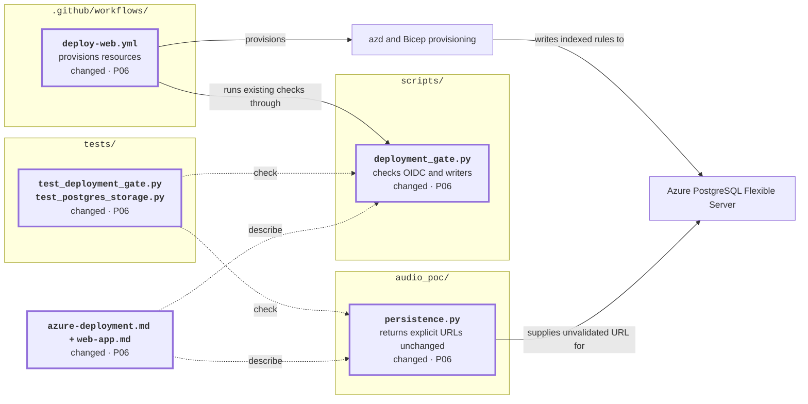
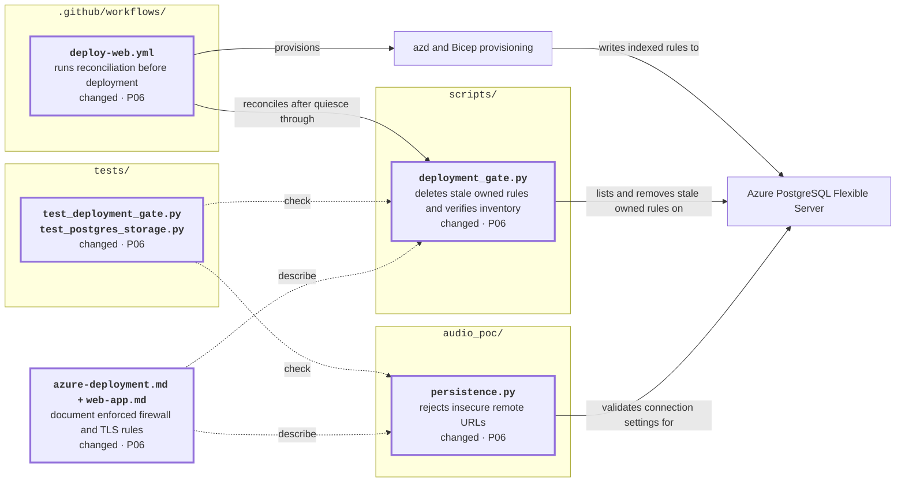

<!-- markdownlint-disable-file -->
# RPI Plan: PostgreSQL review fixes

## Task Metadata

* Task ID: `postgresql-review-fixes`
* Task slug: `postgresql-review-fixes`
* Plan date: 2026-11-15

## Executive Summary

* Bottom line: P06 closes the two accepted PostgreSQL findings by reconciling obsolete app-owned firewall rules in the approved post-provision workflow and enforcing verified TLS for remote explicit database URLs.
* Why this matters: Removed egress addresses should not retain database access, and remote database connections must verify both the certificate chain and server hostname.
* Planning result: Complete and Ready. The child-task default skips another critique; implementation can proceed within the repository-only boundary.
* Confidence and uncertainty: High for the root causes and selected remediation boundaries. The test database's actual endpoint/TLS settings and live Azure state remain unknown and are not assumed.

### What You May Not Know

* Firewall changes may take up to five minutes to propagate, so a correct control-plane inventory is not proof of immediate data-plane behavior. The test URL is environment-supplied; only a target proven to be loopback or a Unix socket can use a non-TLS local exception.

## Phase Checklist

The single P06 phase changes the approved deployment workflow and gate, the PostgreSQL URL parser, their existing focused tests, and directly related operator guidance. The firewall and TLS tasks are independent.

### Before

### After

Key: arrows point from a part to what it uses; dotted arrows, tests and docs; thick border, changed; each tag names the phase that makes the change.

The approved workflow continues to provision through Bicep, then calls the deployment gate to remove only stale app-owned rules and verify inventory before any deploy or resume. The persistence layer rejects remote URLs that do not provide full verification and trusted CA configuration. Existing tests and operator guides document and check both paths in P06.

<!-- rpi:phase id=P06 -->
### [x] P06: Close accepted PostgreSQL findings

Goals:
* Approved allowlist changes remove stale managed firewall access, and remote explicit database URLs cannot bypass verified TLS.

Dependencies:
* None.

Changes in the map: Approved deployment workflow and gate; PostgreSQL URL parser; focused tests and operator guides.

<!-- rpi:task id=P06-T01 -->
#### [x] P06-T01: Reconcile PostgreSQL firewall rules after provisioning

Goals:
* After an approved deployment, the firewall inventory for the Earwyrm server matches the current approved allowlist without deleting unrelated resources.

Requirements:
* `FR-008`, `NFR-006`; research F5 and D5.
* Preserve the existing OIDC, approved-maintenance, writer-exclusion, subscription, environment, and allowlist validation gates. Run reconciliation only after successful provisioning and writer quiescence, before any application deploy or resume.
* Reconcile only the Bicep-owned `container-app-egress-<index>` rule namespace. Remove stale indexed rules, do not delete unrecognized rules, and fail closed when the server is absent or ambiguous, an unknown rule remains, an Azure operation fails, or the final rule names/IP pairs do not exactly match the desired entries.
* Keep control-plane inventory verification distinct from effective network propagation; do not claim immediate data-plane enforcement from a successful rule listing.

Details:
* The workflow provisions through `azd`; `azure.yaml` has pre-provision and pre-deploy checks but no post-provision cleanup. Insert the action in the approved GitHub workflow after provisioning and the second quiesce step, before deployment or workflow completion.
* Bicep owns the `container-app-egress-${index}` names and tags the Flexible Server with the azd environment name. Resolve exactly one matching database server in the isolated resource group; never infer a server from an unchecked hostname or delete unrelated firewall rules.
* Leave creation and in-place updates of desired indexed rules to Bicep. The reconciliation action should remove only obsolete owned entries and verify the resulting owned inventory; surface readiness, inventory, CLI, or deletion failures rather than logging success.
* Extend mocked-Azure tests for stale-rule deletion after allowlist shrink, exact post-update inventory, unknown-rule failure, ambiguous/missing target failure, and CLI errors. Document the deployment boundary and the up-to-five-minute propagation caveat. No live Azure operations are part of validation.

References:
* [azure.yaml](../../../azure.yaml): existing fail-closed deployment hooks.
* [.github/workflows/deploy-web.yml](../../../.github/workflows/deploy-web.yml): approved OIDC workflow and post-provision quiesce/deploy sequence.
* [scripts/deployment_gate.py](../../../scripts/deployment_gate.py): existing subscription, identity, maintenance, target, and CLI helpers.
* [infra/postgresql.bicep](../../../infra/postgresql.bicep) and [infra/platform.bicep](../../../infra/platform.bicep): indexed rule namespace and server environment tag.
* [tests/test_deployment_gate.py](../../../tests/test_deployment_gate.py): mocked Azure and fail-closed gate tests.
* [docs/azure-deployment.md](../../../docs/azure-deployment.md): approved provisioning and maintenance instructions.
* [.copilot-tracking/research/2026-11-15/postgresql-review-fixes-research.md](../../research/2026-11-15/postgresql-review-fixes-research.md):
  * Finding F5, decision D5, and evidence C8-C9, C13, C15, W6-W7, and W11-W12.
* [.copilot-tracking/reviews/logs/2026-11-15/postgresql-migration-review.md](../../reviews/logs/2026-11-15/postgresql-migration-review.md): accepted finding RV-001 and its resolution condition.

Dependencies:
* None.

<!-- rpi:task id=P06-T02 -->
#### [x] P06-T02: Enforce verified TLS for explicit database URLs

Goals:
* Remote PostgreSQL connections created from explicit URLs verify the certificate chain and server hostname, while proven-local non-TLS workflows remain supported.

Requirements:
* `FR-009`, `NFR-006`; research F6 and D6.
* Reject non-local explicit URLs with a missing, weak, or invalid `sslmode`; require effective `sslmode=verify-full` and trusted CA configuration. Preserve a provided CA path and use the same system CA bundle as the field-based path when the URL has no explicit root certificate.
* Permit a non-TLS exception only when the parsed target is demonstrably loopback or a Unix socket. Treat unknown or conflicting host resolution as non-local; never infer that an arbitrary test URL is local.
* Preserve rejection of mixed URL and field-based settings. Do not expose full connection URLs, passwords, or other credentials in errors or logs.

Details:
* `database_url_from_environment` currently returns an explicit URL unchanged, while field-based configuration supplies `verify-full` and the system CA bundle. Use the existing psycopg connection-info parsing pattern so validation reflects effective URL options.
* Cover a valid remote `verify-full` URL with trusted CA, missing and weaker remote modes, missing effective trust, loopback and Unix-socket non-TLS cases, and mixed configuration. Keep test cases credential-free and do not inspect or print the environment-provided integration URL.
* Update operator guidance to describe the enforced runtime contract and the narrow local exception. Preserve local SQLite behavior and field-based PostgreSQL behavior.

References:
* [audio_poc/persistence.py](../../../audio_poc/persistence.py): explicit URL and field-based PostgreSQL configuration.
* [tests/test_postgres_storage.py](../../../tests/test_postgres_storage.py): connection-info parsing and TLS tests.
* [tests/conftest.py](../../../tests/conftest.py): environment-provided integration URL boundary; actual test settings are not assumed.
* [docs/audio-poc/web-app.md](../../../docs/audio-poc/web-app.md): operator connection-string guidance.
* [.copilot-tracking/research/2026-11-15/postgresql-review-fixes-research.md](../../research/2026-11-15/postgresql-review-fixes-research.md):
  * Finding F6, decision D6, and evidence C10-C15 and W8.
* [.copilot-tracking/reviews/logs/2026-11-15/postgresql-migration-review.md](../../reviews/logs/2026-11-15/postgresql-migration-review.md): accepted finding RV-002 and its resolution condition.

Dependencies:
* None.

## User Decisions and Requirements

### Confirmed User Direction

* Resolve the accepted Review findings RV-001 and RV-002 before starting the separate React/Vite migration.
* Keep this child limited to repository implementation and validation. Do not provision Azure resources, perform data cutover, or conduct destructive operations.
* Use automatic, agent-owned planning decisions under the confirmed end-to-end RPI session.
* Preserve the separate queued React/Vite work and `src/audio_poc/` source-layout decision; neither is part of this plan.

### Planning Decisions and Feedback

| Group | Decision or feedback item | Status | Owner | Rationale or input needed | Evidence | Planning impact |
|-------|---------------------------|--------|-------|----------------------------|----------|-----------------|
| D4 | Firewall-rule reconciliation boundary | Selected | Agent | Reconcile only the app-owned rule namespace after provisioning, stop on unknown or failed operations, and verify inventory against the submitted allowlist. | Research D5; C8, C9, C13, C15, W6, W7, W11, W12 | Include the existing approved deployment path, focused tests, and operator guidance. |
| D5 | Explicit database URL TLS boundary | Selected | Agent | Require effective `sslmode=verify-full` and a trusted CA for non-local URLs; permit non-TLS only for proven loopback or Unix-socket targets. | Research D6; C10-C15, W8 | Include URL parsing validation, negative and local-boundary tests, and operator guidance. |

## Planning Readiness and Next Step

| Field | Record |
|-------|--------|
| Planning execution and readiness | Complete; Ready. Both tasks are grounded in the accepted findings and existing deployment/configuration paths. |
| Decision participation | Agent-owned; inherited from the confirmed automatic RPI session. |
| Blockers | None. |
| Latest critique | Skipped by child-task default; no critique result is required for this child plan. |
| Relevant research | [.copilot-tracking/research/2026-11-15/postgresql-review-fixes-research.md](../../research/2026-11-15/postgresql-review-fixes-research.md) |
| Plan | `.copilot-tracking/plans/2026-11-15/postgresql-review-fixes-plan.md` |
| Changes-record role | `.copilot-tracking/changes/2026-11-15/postgresql-review-fixes-changes.md` will be implementation evidence. |
| Continuation owner | Confirmed automatic RPI Agent. |
| Required gates or confirmations | No live Azure provisioning, data cutover, or destructive operation. Actual test target TLS settings and live firewall propagation remain external validation gates. |
| Next action | Transition automatically to Implement using P06-T01 and P06-T02; no additional critique is scheduled. |

## Goals

* Ensure approved PostgreSQL allowlist changes remove obsolete app-owned firewall access.
* Ensure remote explicit database URLs cannot bypass certificate-chain and hostname verification.

## Scope and Non-Goals

### In Scope

* PostgreSQL firewall reconciliation in the approved deployment path, with narrow ownership and fail-closed verification.
* Enforcement and tests for verified TLS on explicit PostgreSQL URLs, including a proven-local exception boundary.
* Directly related operator documentation and regression validation.

### Non-Goals

* Live Azure provisioning, live firewall modification, database cutover, or credential inspection.
* Broad resource-ownership changes such as moving the server to a deployment stack.
* React/Vite migration, the broader TypeScript migration decision, or source-directory moves.

## Functional Requirements

* `FR-008`: After an approved allowlist change, the PostgreSQL firewall inventory contains only the currently approved app-owned entries; removed entries no longer remain in that managed namespace.
* `FR-009`: Explicit database URLs used for non-local connections require full certificate and hostname verification with a trusted CA; any non-TLS compatibility path is limited to a demonstrably local endpoint.

## Non-Functional Requirements

* `NFR-006`: The deployment and connection-configuration paths fail closed on unknown firewall ownership, failed reconciliation, missing trust configuration, or an insecure non-local URL.

## Risks and Open Questions

| Priority | Type | Risk, question, or planning item | Affected work | Impact | Smallest action or evidence needed | Owner |
|----------|------|----------------------------------|---------------|--------|------------------------------------|-------|
| Medium | Risk | Firewall changes may take up to five minutes to propagate, and no live server was inspected. | P06-T01 | Inventory may be correct before data-plane behavior changes. | Keep live propagation and connectivity checks as deployment-owner gates; do not claim a live result from repository tests. | Deployment owner |
| Medium | Risk | The test database URL and TLS mode are environment-supplied and unknown. | P06-T02 | A broad exception could weaken remote TLS, while an overly strict rule could break local tests. | Validate proven-local and non-local URL parsing without printing or inspecting environment-supplied credentials; remote integration targets must use verified TLS. | Implementer |

## Sources

* [.copilot-tracking/research/2026-11-15/postgresql-review-fixes-research.md](../../research/2026-11-15/postgresql-review-fixes-research.md): findings F5-F6, decisions D5-D7, and evidence C8-C15 and W6-W12.
* [.copilot-tracking/reviews/logs/2026-11-15/postgresql-migration-review.md](../../reviews/logs/2026-11-15/postgresql-migration-review.md): accepted findings RV-001 and RV-002 and their resolution conditions.
* [.copilot-tracking/plans/2026-11-15/postgresql-migration-plan.md](./postgresql-migration-plan.md): parent PostgreSQL requirements and P05-T01 constraints.
* Business-source search for PostgreSQL, firewall, TLS, and database URL terms: searched `docs/planning/**/*.md`, `**/.adr-config.yml`, and Markdown frontmatter under `docs/` for `brd_id`, `prd_id`, and approval/supersession fields. No relevant BRD, PRD, or ADR was found. The parent plan identifies [docs/project-plan.md](../../../docs/project-plan.md) as a proposal, not an approved business source.

## Validation and Test Ownership

* Canonical targets: `scripts/deployment_gate.py`, `.github/workflows/deploy-web.yml`, `audio_poc/persistence.py`, and the two operator guides named in P06.
* Test owners: extend [tests/test_deployment_gate.py](../../../tests/test_deployment_gate.py) and [tests/test_postgres_storage.py](../../../tests/test_postgres_storage.py); add no test files and remove no tests.
* Maximum additions and removals: zero new test files; no removals. No generated artifact is authoritative or in scope.
* Semantic coverage: mocked Azure tests prove stale-rule cleanup, strict inventory equality, fail-closed unknown/ambiguous targets, and CLI failure propagation. URL tests prove effective remote TLS/CA requirements and the narrow proven-local exception.
* Regression coverage: retain existing deployment identity, writer-exclusion, field-built TLS, URL/field ambiguity, PostgreSQL, and SQLite behavior tests.
* Planned validation: `uv run pytest -q tests/test_deployment_gate.py tests/test_postgres_storage.py`; `uv run ruff check scripts/deployment_gate.py audio_poc/persistence.py tests/test_deployment_gate.py tests/test_postgres_storage.py`; and `uv run ruff format --check scripts/deployment_gate.py audio_poc/persistence.py tests/test_deployment_gate.py tests/test_postgres_storage.py`. PostgreSQL integration tests may skip when `EARWYRM_TEST_DATABASE_URL` is unset; no test URL or secret may be printed or inspected.

## Critique Disposition

* Critique setting and provenance: `skip`; child-task default, with no user request for another critique.
* Critique status: `skipped`.
* Latest critique and verdict: Not applicable; skipped by parent-session direction.
* Earlier critiques: None for this child plan.
* Limitations: None.

## Artifact Self-Check

* [x] Executive Summary, What You May Not Know, and the Phase Checklist lead and summarize the intended changes.
* [x] Confirmed direction, decisions D4-D5, readiness, goals, scope, requirements, risks, and dependencies are current.
* [x] FR-008, FR-009, NFR-006 are cited in the task Requirements blocks; tasks also cite research findings and decisions.
* [x] P06 and P06-T01/P06-T02 have required blocks, dependencies, references, and matching change-map tags.
* [x] The map shows the workflow path change, uses active arrows and the required marks, and has the key and walk-through. Light/dark rendering was not validated in this tool session.
* [x] Open risks name their affected tasks and owners; the test ownership, exact removals, maximum additions, canonical targets, coverage, and planned validation are locked.
* [x] The BRD/PRD/ADR search and result are recorded; no relevant approved business source was found.
* [x] Critique is skipped by child-task default, and readiness does not depend on a critique result.
* [x] Executive summary, planning readiness, gates, next action, and implementation evidence path are synchronized.
* Checked sections: Task metadata, summary, change map, phases and tasks, decisions, readiness, goals, scope, requirements, risks, dependencies, sources, test ownership, critique, follow-up, and handoff.
* Missing or limited sections: Live Azure inventory/connectivity and actual test-database TLS settings are unavailable and remain external validation gates; Mermaid light/dark preview was not available.

## Follow-Up Items

* Research and plan the separate React/Vite migration, including the full TypeScript boundary and the `src/audio_poc/` move, after these PostgreSQL findings are implemented and validated. For the POC, focus on coding the new version; do not spend effort migrating existing data. The parent RPI task owns that next child.

## Handoff

* Authoritative implementation handoff: Planning Readiness and Next Step.
