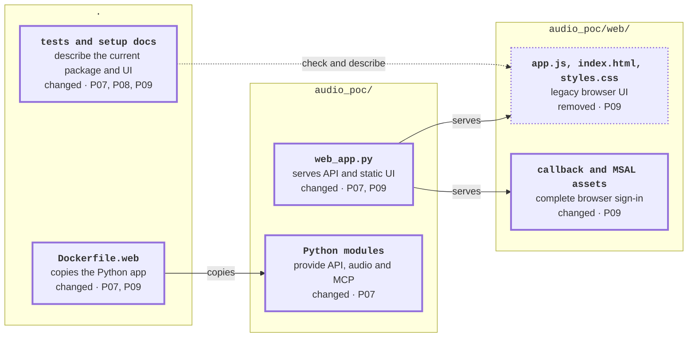
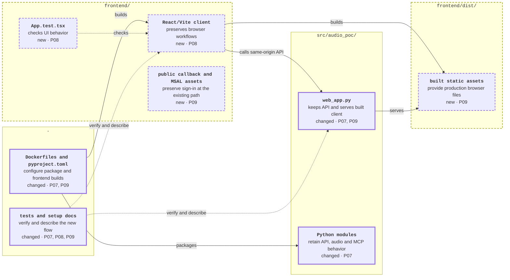

<!-- markdownlint-disable-file -->
# RPI Plan: React/Vite Web Client

## Task Metadata

* Task ID: `react-vite-web`
* Task slug: `react-vite-web`
* Plan date: `2026-11-15`

## Executive Summary

* Bottom line: Build a TypeScript React/Vite client on the existing origin, retain FastAPI and the Python runtime, and move the package to `src/audio_poc/` without changing its import name.
* Why this matters: The POC gets the requested frontend without rebuilding API security, PostgreSQL access, audio generation, or MCP services.
* Planning result: Complete and ready. Research supports the architecture, and package, UI, integration, and validation work are bounded.
* Confidence and uncertainty: High confidence in the server boundary and no-data-migration scope. Exact frontend package versions will be locked and tested during implementation.

### What You May Not Know

The browser uses MSAL with the existing `/auth-callback.html` path, and the local Entra registration expects `http://localhost:8000/auth-callback.html`. The API retains authorization and paid-render safeguards. Skipping SQLite import does not skip fresh PostgreSQL schema initialization.

## Phase Checklist

### Before

### After

Key: arrows point from a part to what it uses; dotted arrows, tests and docs; dashed border, new; thick border, changed; dotted border, removed, in Before only; each tag names the phases that make the change.

P07 moves the Python package while preserving its public import name and runtime behavior. P08 adds the React/Vite client and focused interaction tests. P09 builds and serves the client from FastAPI, preserves the existing sign-in callback, and removes the replaced static UI.

<!-- rpi:phase id=P07 -->
### [x] P07: Move the Python package to `src/`

Goals:
* Keep Python entry points, imports, tests, and container startup working after the confirmed source-layout change.

Dependencies:
* None.

Changes in the map: Move the Python package, adjust path and build configuration, and update directly related tests and documentation.

<!-- rpi:task id=P07-T01 -->
#### [x] P07-T01: Move the Python package without changing behavior

Goals:
* Make the package available at `src/audio_poc/` while preserving `audio_poc` imports and existing API, CLI, MCP, audio, and PostgreSQL behavior.

Requirements:
* `FR-012`, `NFR-008`; research F7-F9 and C16-C22.
* Preserve the package import name and make the documented `uv run` entry points work from the repository root and in both Python container images.

Details:
* Configure package discovery for the `src/` layout, preserve repository-root and `src` pytest import paths, update both Docker copy paths and `.dockerignore`, and correct filesystem-root calculations.
* Preserve all existing uncommitted PostgreSQL changes. Keep `audio_poc.*` imports and module entry points stable; adjust repository-root, fixture, and static paths that currently derive from `__file__`.
* Update direct source-path links and lint commands in the service and operator documentation. Do not mass-edit historical `.copilot-tracking/` records or change database import behavior.
* Extend existing tests only where the package move changes path-dependent behavior; run the focused Python suite and lint/format checks.

References:
* [pyproject.toml](../../../pyproject.toml): current package and test configuration.
* [Dockerfile](../../../Dockerfile) and [Dockerfile.web](../../../Dockerfile.web): both container entry points copy the package from `src/audio_poc/`.
* [.dockerignore](../../../.dockerignore): includes the `src/audio_poc/` package in Docker build contexts.
* [src/audio_poc/__main__.py](../../../src/audio_poc/__main__.py), [src/audio_poc/web_app.py](../../../src/audio_poc/web_app.py), and [src/audio_poc/cloud_web.py](../../../src/audio_poc/cloud_web.py): repository and fixture path calculations and runtime entry points.
* [docs/service-contracts.md](../../../docs/service-contracts.md), [docs/lyric-mcp.md](../../../docs/lyric-mcp.md), and [docs/melody-mcp.md](../../../docs/melody-mcp.md): directly linked modules and executable commands.
* [.copilot-tracking/research/2026-11-15/react-vite-web-research.md](../../research/2026-11-15/react-vite-web-research.md):
  * Finding F8 and evidence C19-C21 establish the Python API, audio, and MCP boundary.

Dependencies:
* None.

<!-- rpi:phase id=P08 -->
### [x] P08: Build the React/Vite client

Goals:
* Replace the browser implementation with a typed React client while preserving user workflows, same-origin token handling, and accessible interactions.

Dependencies:
* None.

Changes in the map: Add the React/Vite client and focused UI tests.

<!-- rpi:task id=P08-T01 -->
#### [x] P08-T01: Implement the browser workflows in React

Goals:
* Let users complete the existing browser workflows through the React/Vite UI without changing server-side authorization or rendering behavior.

Requirements:
* `FR-010`, `FR-011`, `NFR-007`; research D10, F7, F10, and C18, C23-C24.

Details:
* Build from the current browser and API contract, including Entra sign-in, workspace navigation, protected audio/evidence access, evaluation, access administration, paid rendering, and reconciliation. Keep bearer tokens restricted to same-origin `/api/` requests.
* Preserve the existing callback URI `http://localhost:8000/auth-callback.html`. For local development, serve Vite on port `8000` and proxy `/api/` to FastAPI on a separate local port; do not require Entra registration changes.
* Use the current vendored MSAL Browser `5.29.0` assets and license as the compatibility baseline unless implementation evidence requires a package-level adjustment. Pin frontend dependencies in the npm lockfile and validate the selected Node/Vite combination.
* Replace the Node DOM-fixture navigation test with focused React tests using mocked MSAL and API responses. Cover navigation without losing entered state, permission clearing when the subject changes, visible errors/status, accessible names, and keyboard operation. Do not treat these tests as full accessibility certification.
* Preserve Python API authorization and paid-render safeguards; existing Python tests remain the authority for those server-side behaviors.

References:
* [src/audio_poc/web/app.js](../../../src/audio_poc/web/app.js) and [src/audio_poc/web/index.html](../../../src/audio_poc/web/index.html): current frontend behavior and accessible structure.
* [src/audio_poc/web/styles.css](../../../src/audio_poc/web/styles.css): current focus and responsive styling.
* `tests/test_web_navigation.cjs` (removed in P09-T01 after React tests covered its behaviors): legacy selected navigation and form-state regression coverage.
* [docs/audio-poc/web-app.md](../../../docs/audio-poc/web-app.md): current same-origin API and callback contract.
* [.copilot-tracking/research/2026-11-15/react-vite-web-research.md](../../research/2026-11-15/react-vite-web-research.md):
  * Finding F10, evidence C23-C24, and decision D10 define the preserved interaction and auth boundary.

Dependencies:
* None. The client can be developed against mocked API and MSAL behavior.

<!-- rpi:phase id=P09 -->
### [x] P09: Integrate the built client with FastAPI

Goals:
* Deliver the new browser client from the existing production origin and keep local setup, static serving, callback handling, and protected storage boundaries correct.

Dependencies:
* P07 and P08.

Changes in the map: Serve `frontend/dist/` through FastAPI, add a Node build stage to the web container, and retire the legacy static client.

<!-- rpi:task id=P09-T01 -->
#### [x] P09-T01: Build and serve the frontend on the existing origin

Goals:
* Serve the production React/Vite assets and existing sign-in callback alongside the current FastAPI API without adding a separate runtime or origin.

Requirements:
* `FR-011`, `FR-013`, `NFR-008`; research D10, F8-F10, and C19-C24.

Details:
* Point FastAPI static serving at the Vite build output and preserve `/api/`, `/auth-callback.html`, current CSP restrictions, and protected-media behavior. Update the private-storage guard and its test so private data remains outside the new static root.
* Use a Node build stage in `Dockerfile.web` to install the lockfile and create `frontend/dist/`; copy only the built assets into the Python runtime image. Keep the existing single Python production service and do not add Node to its runtime stage.
* Preserve the callback page, redirect bridge, vendored library license, and checksums under the frontend public-asset path. Remove only the replaced legacy files from `src/audio_poc/web/`: `app.js`, `index.html`, `styles.css`, `auth-callback.html`, `auth-callback.js`, `vendor/msal-browser.min.js`, `vendor/msal-redirect-bridge.min.js`, and `vendor/LICENSE`.
* Update `docs/audio-poc/web-app.md` for the Vite dev server on port `8000`, the FastAPI API on a separate port, the `/api/` proxy, and the unchanged production origin. Retain the fresh-schema initialization instructions and omit any legacy-data import from this task.
* Update existing static-serving/CSP tests to verify the built app, callback, and assets. Validate the frontend checks, Python tests, locked npm install/build, and web container build without contacting a real tenant, paid Speech service, or live database.

References:
* [src/audio_poc/web_app.py](../../../src/audio_poc/web_app.py): current FastAPI static mount and API routes.
* [src/audio_poc/web_storage.py](../../../src/audio_poc/web_storage.py): private data must remain outside the frontend static root.
* [tests/test_web_app.py](../../../tests/test_web_app.py) and [tests/test_web_auth.py](../../../tests/test_web_auth.py): current static/CSP, callback, and auth regression coverage.
* [docs/audio-poc/web-app.md](../../../docs/audio-poc/web-app.md): local callback URI, production setup, and PostgreSQL initialization requirements.
* [.copilot-tracking/research/2026-11-15/react-vite-web-research.md](../../research/2026-11-15/react-vite-web-research.md):
  * Findings F8-F10, decision D10, and evidence C19-C24 support the same-origin integration and retained server responsibilities.

Dependencies:
* P07-T01 and P08-T01.

## User Decisions and Requirements

### Confirmed User Direction

* Replace the Python-served browser UI with React/Vite while continuing the PostgreSQL work; this POC does not need existing-data migration.
* Place the Python package at `src/audio_poc/`, preserve the `audio_poc` import name, and keep React/Vite source separate.
* Keep this work focused on the browser client; do not broaden it into a TypeScript rewrite of the API, CLI/MCP tools, or audio runtime.

### Planning Decisions and Feedback

| Group | Decision or feedback item | Status   | Owner      | Rationale or input needed | Evidence                                | Planning impact |
|-------|---------------------------|----------|------------|---------------------------|-----------------------------------------|-----------------|
| D6    | Browser and server boundary | Selected | Evidence   | A same-origin React/Vite client replaces the current browser UI while FastAPI and Python domain services remain authoritative. | Research D10, F8-F10, C19-C24 | Keep frontend scope separate from API and runtime work. |
| D7    | Full TypeScript runtime rewrite | Deferred | Constraint | The request confirms a React/Vite browser client, not replacement of shared Python API, audio, or MCP behavior. | Research D11, F8, C19-C21 | Exclude backend/runtime rewrites from this plan. |
| D8    | Local development callback origin | Selected | Evidence | Keeping `localhost:8000/auth-callback.html` avoids an Entra redirect-URI change; Vite can proxy API calls to a separate local FastAPI port. | `docs/audio-poc/web-app.md`, local setup and registration sections | Use the existing callback path and port for Vite. |
| D9    | Legacy data migration | Confirmed | User | The user states that data migration is unnecessary for this POC. | User request, 2026-11-15; research F9 and C22 | Do not implement or test a SQLite import in this task; retain fresh-schema startup. |

## Planning Readiness and Next Step

| Field | Record |
|-------|--------|
| Planning execution and readiness | Complete; Ready. |
| Decision participation | Agent-owned; inherited from the confirmed automatic RPI session. |
| Blockers | None. |
| Latest critique | Skipped by child-task default; no additional critique was requested. |
| Relevant research | [.copilot-tracking/research/2026-11-15/react-vite-web-research.md](../../research/2026-11-15/react-vite-web-research.md) |
| Plan | `.copilot-tracking/plans/2026-11-15/react-vite-web-plan.md` |
| Changes-record role | `.copilot-tracking/changes/2026-11-15/react-vite-web-changes.md` is implementation evidence. |
| Continuation owner | Automatic RPI Agent. |
| Required gates or confirmations | No live Azure provisioning, tenant changes, destructive data actions, or legacy-data import are authorized or required. |
| Next action | P09-T01 is complete; return implementation evidence to the automatic RPI parent for its next eligible gate. |

## Goals

* Deliver a React/Vite browser experience that preserves the current web workflows while using the existing FastAPI API and Python domain runtime.
* Move the Python package to the confirmed `src/audio_poc/` layout without breaking its import name, tests, commands, or container startup.
* Keep the POC on a fresh PostgreSQL schema without importing legacy SQLite data.

## Scope and Non-Goals

### In Scope

* Build a TypeScript React/Vite client and integrate its production assets with the existing FastAPI service.
* Preserve same-origin Entra/MSAL behavior, API authorization boundaries, existing user workflows, and accessibility requirements.
* Move and configure the Python package under `src/audio_poc/`, updating dependent paths and test configuration.
* Update focused frontend, API/static-serving, container-build, and operator documentation.

### Non-Goals

* Importing, transforming, or otherwise migrating existing SQLite data.
* Rewriting FastAPI, PostgreSQL persistence, CLI/MCP servers, or Python audio services in TypeScript.
* Changing Entra tenant registrations, provisioning Azure resources, or hosting the frontend on a separate origin.
* Modifying PostgreSQL migration behavior unrelated to starting from a fresh schema.

## Functional Requirements

* `FR-010`: The React/Vite browser client preserves the current user-facing workflows, including authentication, workspace navigation, protected audio/evidence access, evaluation, administration, paid rendering, and reconciliation.
* `FR-011`: The browser sends bearer tokens only to same-origin `/api/` endpoints and continues to use `/auth-callback.html` without requiring an Entra redirect-URI change.
* `FR-012`: The Python application remains importable as `audio_poc` after its source moves to `src/audio_poc/`; repository commands, fixtures, tests, static paths, and container startup continue to resolve correctly.
* `FR-013`: Production serves the built React/Vite client and its authentication callback from the existing FastAPI origin while preserving `/api/` routes.

## Non-Functional Requirements

* `NFR-007`: Keyboard operation, accessible names, visible errors, and status announcements remain available for the preserved browser workflows.
  * Objective threshold or evaluation condition: Focused UI tests exercise keyboard navigation/activation and assert accessible names and surfaced error/status messages for covered workflows.
  * Operating condition or verification approach, if needed: Existing API authorization tests remain authoritative for server-side access and paid-render controls.
* `NFR-008`: The production container builds frontend assets reproducibly and runs the Python web service without requiring Node.js at runtime.
  * Objective threshold or evaluation condition: A locked npm install and production frontend build succeed in the container build; the final runtime stage contains the Python service and built static assets, not Node.js.
  * Operating condition or verification approach, if needed: Verify with the Docker build and existing FastAPI/container tests; do not claim live Entra or Azure validation.

## Risks and Open Questions

| Priority | Type | Risk, question, or planning item | Affected work | Impact | Smallest action or evidence needed | Owner |
|----------|------|----------------------------------|---------------|--------|------------------------------------|-------|
| Medium | Risk | Existing uncommitted PostgreSQL changes include modified package, UI, tests, infrastructure, and deployment files that overlap the planned package move. | P07-T01, P09-T01 | A broad move or replacement could lose or overwrite work that is already in progress. | Preserve the current worktree contents and reconcile each affected file as it moves; do not reset or discard existing changes. | Implementer |
| Medium | Risk | Existing browser tests cover selected navigation behavior, not full accessibility conformance. | P08-T01 | A superficial port could preserve screenshots while losing keyboard, focus, or announcement behavior. | Define focused React interaction tests against the established keyboard, labels, errors, and status requirements. | Implementer |
| Low | Risk | Official Vite documentation was unavailable through the research proxy; package versions are now pinned and validated. | P08-T01, P09-T01 | A future lockfile or toolchain change could introduce an unsupported runtime or plugin combination. | Keep the lockfile committed and validate local and container builds after dependency updates. | Implementer |

## Dependencies

* The existing FastAPI API, Python audio services, and PostgreSQL persistence remain the server-side contract; the browser rewrite must not replace their security decisions.
* Local or deployed app use still requires a newly initialized empty PostgreSQL schema and existing Entra configuration. This plan does not import data, change tenant settings, or validate live infrastructure.
* Node.js and npm are required for frontend development and asset generation, but not for the production runtime.

## Validation and Test Ownership

* Canonical targets: `frontend/package.json`, `frontend/package-lock.json`, `frontend/vite.config.ts`, `frontend/src/**`, `src/audio_poc/**`, `Dockerfile`, `Dockerfile.web`, `pyproject.toml`, `.dockerignore`, `tests/test_web_app.py`, `tests/test_web_auth.py`, and the directly related setup and service documentation.
* Generated target: `frontend/dist/` is build output, not an authoritative source or a committed artifact.
* Test owners: add at most one frontend test file, `frontend/src/App.test.tsx`; update existing Python static-serving and auth tests; remove the obsolete `tests/test_web_navigation.cjs` only after equivalent React workflow coverage exists.
* Exact test changes: remove `tests/test_web_navigation.cjs`; add no other test files and remove no other tests.
* Semantic coverage: React tests cover navigation without losing entered data, subject-change permission clearing, accessible names, keyboard interaction, surfaced errors/status, and mocked auth/API behavior. FastAPI tests cover built static assets, CSP, callback delivery, API authorization, and protected storage boundaries.
* Regression coverage: retain the existing PostgreSQL, access-control, paid-render, audio, CLI, and MCP tests; no live data import or destructive database operation is part of this task.
* Planned validation: `npm ci`, `npm run typecheck`, `npm test -- --run`, and `npm run build`; `uv run pytest -q`; `uv run ruff check src/audio_poc tests`; `uv run ruff format --check src/audio_poc tests`; `uv lock --check`; and `docker build -f Dockerfile.web -t earwyrm-web-poc .`. PostgreSQL integration tests may skip when `EARWYRM_TEST_DATABASE_URL` is unset. Do not print or inspect environment-supplied credentials, contact a real tenant, enable paid Speech, or run against a live database.

## Sources

* [.copilot-tracking/research/2026-11-15/react-vite-web-research.md](../../research/2026-11-15/react-vite-web-research.md): selected architecture, findings F7-F10, decisions D10-D11, and evidence C16-C24.
* [docs/project-plan.md](../../../docs/project-plan.md): proposed POC goal and web-app scope; this is not an approved BRD, PRD, or ADR.
* [docs/design-proposal.md](../../../docs/design-proposal.md): proposal describing the POC's web-app role; it is not an approved business source.
* [docs/audio-poc/web-app.md](../../../docs/audio-poc/web-app.md) and [docs/azure-deployment.md](../../../docs/azure-deployment.md): local callback URI, same-origin API contract, production callback, and setup constraints.
* [pyproject.toml](../../../pyproject.toml), [Dockerfile](../../../Dockerfile), [Dockerfile.web](../../../Dockerfile.web), [.dockerignore](../../../.dockerignore), [src/audio_poc/web_app.py](../../../src/audio_poc/web_app.py), [frontend/src/App.test.tsx](../../../frontend/src/App.test.tsx), [tests/test_web_app.py](../../../tests/test_web_app.py), and [tests/test_web_auth.py](../../../tests/test_web_auth.py): current package, container, static-serving, and UI test boundaries.
* Business-source search: searched `.adr-config.yml`, Markdown frontmatter fields `brd_id`, `prd_id`, `status`, and supersession fields, plus the terms React, Vite, browser UI, web app, frontend, Entra, and callback under `docs/`. No relevant BRD, PRD, or ADR was found. `docs/project-plan.md` and `docs/design-proposal.md` are proposals, not approved business sources.

## Critique Disposition

* Critique setting and provenance: `skip`; child-task default, with no user request for another critique.
* Critique status: Skipped.
* Latest critique and verdict: Skipped; the automatic RPI parent excludes child-task critiques by default.
* Earlier critiques: None.
* Limitations: None.

## Artifact Self-Check

* [x] Executive Summary, What You May Not Know, and the Phase Checklist lead the plan.
* [x] Confirmed direction, decisions D6-D9, readiness, goals, scope, requirements, risks, and dependencies are consistent.
* [x] Planning decision participation and provenance are recorded; agent-owned choices have evidence-backed rationales.
* [x] Every functional and non-functional requirement is cited by at least one task.
* [x] Every phase and task has the required markers and labeled blocks; requirements name this plan's FR/NFR IDs and relevant research evidence.
* [x] Task goals describe observable outcomes, and open risks name affected tasks.
* [x] Existing repository links resolve from the plan directory; future artifact paths remain in code formatting.
* [x] The change map has Before and After views because the static-client-to-build integration changes connections, with active arrows and phase tags.
* [ ] Mermaid preview in light and dark themes was not available; syntax and map references were checked in the source.
* [x] Risks have owners and next actions; the no-migration and no-live-system boundaries are explicit.
* [x] Planning critique is recorded as skipped under the child-task default; no critique result is treated as a Pass.
* [x] Planning readiness, continuation owner, gates, next action, and changes-record path are consistent.
* Checked sections: Task Metadata; Executive Summary; Phase Checklist; User Decisions and Requirements; Planning Readiness and Next Step; Goals; Scope and Non-Goals; Functional Requirements; Non-Functional Requirements; Risks and Open Questions; Dependencies; Validation and Test Ownership; Sources; Critique Disposition.
* Missing or limited sections: Mermaid preview was unavailable during planning; npm package versions were subsequently pinned and validated during implementation.

## Follow-Up Items

* None

## Handoff

* Authoritative implementation handoff: Planning Readiness and Next Step.

