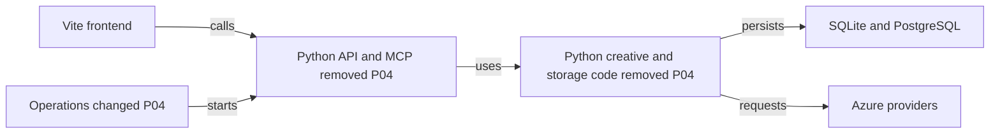
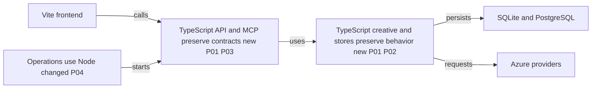

<!-- markdownlint-disable-file -->
# RPI Plan: Retire Python

## Task Metadata

* Task ID: retire-python
* Task slug: retire-python
* Plan date: 2026-11-15

## Executive Summary

Replace application Python, tests and operational entry points with a Node 24 TypeScript backend. Preserve the existing frontend, public contracts, private storage schemas and explicit safety boundaries. Planning completed; standard critique passed with one interface clarification resolved below.

### What You May Not Know

Seeded music will remain deterministic in the new runtime, but historical NumPy seeds will not reproduce byte-identical music. Live cloud deployment and paid calls are not authorized by automatic progression.

## Phase Checklist

### Before

### After

Arrows point from actors to dependencies. New runtime components replace Python while clients, data and cloud endpoints retain their contracts. Diagram preview is unavailable; syntax self-check only.

<!-- rpi:phase id=P01 -->
### [x] P01: Establish the runtime and canonical contracts

Goals:
* A strict ESM TypeScript build and test runner support all backend modules.

Dependencies:
* None

Changes in the map: API/MCP and creative/store runtime foundations.

<!-- rpi:task id=P01-T01 -->
#### [x] P01-T01: Establish Node tooling and schema ownership

Goals:
* Backend modules build with strict types and share canonical schema definitions.

Requirements:
* FR-001, FR-002, NFR-001

Details:
* Root `package.json`, `tsconfig.json`, `vitest.config.ts`; Node 24, Express 5, Zod 4, MCP SDK, pg, jose, decimal.js, official Azure identity/Speech SDKs and CMU dictionary.
* Keep snake_case JSON and schema-version-one fields. Source modules use snake_case exports where matching the port minimizes integration risk; do not change browser contracts.
* Binding integration convention: retain Python positional arguments; translate keyword-only arguments into a final typed options object. Public storage methods are async; schema values/types share PascalCase names. Each port has one file owner and communicates exported-interface deviations before callers finalize. Integration typecheck is mandatory.
* Root tests in `tests-ts/`; frontend keeps its package and tests.

References:
* Retired baseline: `pyproject.toml`; replacement [package.json](../../../package.json)
* [frontend/package.json](../../../frontend/package.json)
* [docs/service-contracts.md](../../../docs/service-contracts.md)

Dependencies:
* None

<!-- rpi:phase id=P02 -->
### [x] P02: Preserve creative generation and durable state

Goals:
* TypeScript supplies the existing audio, lyric, data and operator workflows.

Dependencies:
* P01

Changes in the map: creative/store runtime.

<!-- rpi:task id=P02-T01 -->
#### [x] P02-T01: Port creative schemas, DSP, lyrics and provider adapters

Goals:
* Validated lyric generation, deterministic screened composition and PCM/MIDI rendering work without Python.

Requirements:
* FR-002, FR-003, FR-004, NFR-001, NFR-002, NFR-004

Details:
* Port `lyrics`, `lyric_cloud`, `lyric_service`, `dsp`, `melody`, `similarity`, and `speech` into `src/*.ts`.
* Preserve native TypeScript safe outcomes, timing validation, retry limits, content checks, private provider errors and all rights disclosures.
* Export snake_case equivalents of Python APIs; async for provider methods and writer; filesystem/audio helpers may stay synchronous. Zod schemas use PascalCase export names with `z.infer` types of the same name.
* Maintain deterministic new PRNG and PCM16 24 kHz mono/30 seconds; document historical seed compatibility break.
* User-approved precision extension: safe seeds remain numeric; oversized seeds through signed-63-bit maximum use canonical exact decimal strings. Reject unsafe numeric inputs; preserve safe-seed generation and support deterministic oversized-string generation.

References:
* Retired baseline: `src/audio_poc/`, `tests/test_audio_poc.py`, `tests/test_lyrics.py`, `tests/test_lyric_service.py`
* [src/dsp.ts](../../../src/dsp.ts), [src/lyrics.ts](../../../src/lyrics.ts), [tests-ts/creative-audio.test.ts](../../../tests-ts/creative-audio.test.ts), [tests-ts/creative-lyrics.test.ts](../../../tests-ts/creative-lyrics.test.ts)

Dependencies:
* P01-T01

<!-- rpi:task id=P02-T02 -->
#### [x] P02-T02: Port persistence, storage, composition jobs and database administration

Goals:
* Existing SQLite/PostgreSQL records, private media and immutable job identities remain usable.

Requirements:
* FR-002, FR-005, NFR-001, NFR-003, NFR-004

Details:
* Port `persistence`, `sqlite_files`, `web_storage`, `melody_service`, and `bootstrap_database` into `src/*.ts`.
* Keep SQL tables/columns/markers, rollback transactions, advisory serialization, missing-file fail-closed behavior, owner isolation, budgets and source-import verification.
* Export async equivalents of Python public methods with snake_case names and object options for keyword arguments. `new WebStorage(root, {database_url})` and `new MelodyService(root, {database_url})`; await public methods.
* Consumers use canonical creative schemas and DSP exports. No live database writes during tests unless explicitly isolated and opt-in.
* Losslessly decode historical numeric seed tokens into decimal strings before JavaScript numeric rounding, including retrieval, artifact checks, retries and SQLite import. Original databases/media are not rewritten. User approved this wire precision extension.

References:
* Retired baseline: `src/audio_poc/web_storage.py`, `src/audio_poc/persistence.py`, `tests/test_postgres_storage.py`, `tests/test_user_access.py`
* [src/web_storage.ts](../../../src/web_storage.ts), [src/persistence.ts](../../../src/persistence.ts), [tests-ts/storage.test.ts](../../../tests-ts/storage.test.ts)

Dependencies:
* P01-T01; final integration with P02-T01

<!-- rpi:phase id=P03 -->
### [x] P03: Preserve APIs, MCP and local rendering

Goals:
* Existing clients and local operators can use TypeScript services with equivalent protection and protocol behavior.

Dependencies:
* P01 for independent source ports; P02 completion gates integration and acceptance.

Changes in the map: API/MCP runtime.

<!-- rpi:task id=P03-T01 -->
#### [x] P03-T01: Port protected web API and authentication

Goals:
* Same-origin API, access administration, rendering and evaluations retain fail-closed behavior.

Requirements:
* FR-001, FR-002, FR-004, FR-005, NFR-001, NFR-003, NFR-004

Details:
* Port `web_auth`, `web_app`, `cloud_web` to Express and jose. Keep security headers, issuer/audience/scope/token-kind checks, discovery/JWKS cache and rotation behavior, setup-needed statuses and no secret-bearing logs.
* Async storage/provider/render integration, no unauthenticated public listener. Cloud entrypoint retains mount validation and lifetime flock via installed util-linux; no stale PID lock substitute.
* `create_app(options)` returns Express app without listening; test injection supports `settings`, `validator`, `storage`, `environ`, `speech_factory`, `render` as needed.
* Rendering helpers supplied by parent in `src/render.ts` retain Python names (`FIXTURES`, `load_inputs`, `load_evidence`, `cost_for`, `render_brief`).

References:
* Retired baseline: `src/audio_poc/web_app.py`, `src/audio_poc/web_auth.py`, `tests/test_web_app.py`, `tests/test_web_auth.py`
* [src/web_app.ts](../../../src/web_app.ts), [src/web_auth.ts](../../../src/web_auth.ts), [tests-ts/web_app.test.ts](../../../tests-ts/web_app.test.ts), [tests-ts/web_auth.test.ts](../../../tests-ts/web_auth.test.ts)

Dependencies:
* P01-T01 for independent source implementation; P02-T01/P02-T02/P03-T02 before integration acceptance.

<!-- rpi:task id=P03-T02 -->
#### [x] P03-T02: Port platform contracts, MCP entry points and render CLI

Goals:
* Actual MCP clients negotiate, call typed tools and read binary resources; offline CLI emits complete artifacts.

Requirements:
* FR-001, FR-002, FR-003, FR-004, NFR-001, NFR-002, NFR-004

Details:
* Port platform contracts and role scaffold, local lyric/melody MCP servers, `__main__` render helpers and CLI.
* Use official SDK stdio and Streamable HTTP with loopback host/origin restrictions. Preserve scaffold 501 and not-integrated outcomes.
* Test through actual MCP client transports, not direct tool functions. Verify instrumental CLI output parses as WAV/MIDI and carries pending rights/evaluation evidence.

References:
* Retired baseline: `src/audio_poc/contracts.py`, `src/audio_poc/platform_service.py`, `tests/test_melody_mcp.py`
* [src/contracts.ts](../../../src/contracts.ts), [src/platform_service.ts](../../../src/platform_service.ts), [tests-ts/platform.test.ts](../../../tests-ts/platform.test.ts)

Dependencies:
* P01-T01; P02-T01; P02-T02

<!-- rpi:phase id=P04 -->
### [x] P04: Retire Python entry points and prove parity

Goals:
* Development and deployment require Node, with no executable application Python left.

Dependencies:
* P03

Changes in the map: operations; removal of old Python runtime.

<!-- rpi:task id=P04-T01 -->
#### [x] P04-T01: Replace deployment tooling and document supported commands

Goals:
* Container images, azd hooks and workflows invoke TypeScript replacements with existing gates.

Requirements:
* FR-006, NFR-001, NFR-003, NFR-004

Details:
* Port deployment gate to `scripts/deployment_gate.ts`; update Dockerfiles, azd hooks, workflow, ignores and directly affected docs. Runtime image includes util-linux for flock and system CA certificates.
* Preserve operator confirmations and do not execute cloud mutations.
* Update dependency/provenance notes and historical seed boundary.

References:
* Retired baseline: `scripts/deployment_gate.py`; replacement [scripts/deployment_gate.ts](../../../scripts/deployment_gate.ts)
* [azure.yaml](../../../azure.yaml)
* [.github/workflows/deploy-web.yml](../../../.github/workflows/deploy-web.yml)
* [docs/](../../../docs/)

Dependencies:
* P03-T01; P03-T02

<!-- rpi:task id=P04-T02 -->
#### [x] P04-T02: Verify parity and remove superseded Python

Goals:
* A clean TypeScript build, behavioral tests and smoke checks establish a Python-free local app.

Requirements:
* FR-001 through FR-006; NFR-001 through NFR-004

Details:
* Test owners: creative port owns creative tests, persistence port owns storage/bootstrap/jobs tests, web port owns auth/API tests; parent owns platform/MCP/render/deployment integration tests.
* Exact removals after replacement: `src/audio_poc/*.py`, `tests/*.py`, `scripts/deployment_gate.py`, `pyproject.toml`, `uv.lock`, generated egg-info metadata. Do not remove render data, local databases, secrets, unrelated files or pre-existing frontend files.
* Canonical targets: `src/*.ts`, `scripts/*.ts`, `tests-ts/*.test.ts`; generated targets: root `package-lock.json`, ignored `dist/` and `node_modules/`.
* Maximum additions: one TypeScript module per retired module, root build/test manifests, at most eight backend test files and one shared test helper. Prefer focused cases grouped by behavior; no gratuitous file splitting.
* Semantic coverage: auth, access, paid ledger, import and job idempotency, safe cloud failures, lyric retries, audio properties, real MCP transports. Regression coverage: frontend tests/build, fixture shapes and existing SQLite records.
* Commands: root `npm run typecheck`, `npm test`, `npm run build`; frontend `npm test -- --run`, `npm run build`; offline render CLI and service smoke checks; optional PostgreSQL tests only with a dedicated explicit URL.
* Python-reference scan excludes historical render evidence, Git history, tracking artifacts and installed/generated dependencies. Active commands and executable `.py` files must have none.

References:
* Retired baseline: `tests/`; replacements [tests-ts/](../../../tests-ts/)
* [frontend/src/App.test.tsx](../../../frontend/src/App.test.tsx)
* [.copilot-tracking/research/2026-11-15/retire-python-research.md](../../research/2026-11-15/retire-python-research.md)

Dependencies:
* P04-T01; all earlier tasks

## User Decisions and Requirements

### Confirmed User Direction

* Fully retire Python, including APIs and MCP; frontend remains Vite/TypeScript.
* Handle it end to end automatically.
* Preserve pre-existing uncommitted changes.

### Planning Decisions and Feedback

| Group | Decision or feedback item | Status | Owner | Rationale or input needed | Evidence | Planning impact |
|---|---|---|---|---|---|---|
| D1 | Native TypeScript, preserve wire/data contracts | Confirmed | Agent | Research C1-C7 | Research findings | All phases |
| D2 | No live deployment or paid test calls | Confirmed | Constraint | Shared-system and paid boundaries | Intake | Local validation only |
| D3 | Lossless decimal strings for oversized seeds | Confirmed | User | Historical signed-63-bit numeric seeds exceed JavaScript exact precision; safe-only rejection would make existing jobs/imports unavailable | User selected recommended string support during Implement | P02 schemas/storage, P03 render/MCP and P04 docs/tests |

## Planning Readiness and Next Step

Complete and Ready. Standard critique Complete/Pass; PC-001 resolved by the binding interface convention in P01-T01. Agent-owned planning from automatic authorization. No unresolved material decision or required confirmation for local implementation. Parent transitions to Implement.

## Functional Requirements

* FR-001: Web API, platform roles and MCP entry points run under Node/TypeScript with the frontend unchanged.
* FR-002: Preserve version-one JSON schemas, wire shapes, outcomes and data identifiers, with user-approved decimal-string representation for oversized numeric seeds that JavaScript cannot represent exactly.
* FR-003: Preserve offline rendering, screened arrangements, lyrics, PCM/MIDI artifacts and bounded similarity behavior.
* FR-004: Preserve paid-call consent, budget, retry, moderation, provenance and human-review boundaries.
* FR-005: Preserve private SQLite/PostgreSQL stores, imports, owner access, concurrency and operator tools.
* FR-006: Remove active Python source, manifests, tests and operational dependencies; document working Node commands.

## Non-Functional Requirements

* NFR-001: Strict TypeScript typecheck and production build pass; existing frontend tests/build pass.
* NFR-002: Audio is finite non-silent mono PCM16 at 24 kHz, exactly 30 seconds; MIDI parses as type 0; explicit seed is repeatable and never silently replaced.
* NFR-003: Negative tests demonstrate fail-closed auth/storage/budget behavior; no data loss, credential disclosure or cloud mutation in validation.
* NFR-004: Behavioral tests and real protocol smoke tests pass. Live paid/Azure validation and unavailable isolated PostgreSQL evidence are explicitly reported rather than claimed.

## Risks and Open Questions

| Priority | Risk | Affected work | Evidence or mitigation | Owner |
|---|---|---|---|---|
| High | Port loses concurrency or identity checks | P02-T02, P03-T01 | Negative and parallel request tests, unchanged SQL schema | Implementer |
| High | Removing Python before parity is proven | P04-T02 | Remove only after replacement build/test; retain source until ports complete | Parent |
| Medium | Historical seed audio differs | P02-T01 | Deterministic new runtime and documented compatibility boundary | Creative owner |
| Medium | Live providers or PostgreSQL unavailable | P04-T02 | Report exact skipped integration checks; do not invent evidence | Parent |

## Dependencies

* Node 24 and npm registry; package versions verified during Research.
* Preserve shared wire schemas and asynchronous storage contracts across independent ports.
* Optional isolated PostgreSQL and paid Azure tests require explicit approved configuration.

## Goals

Run and maintain the app without Python.

## Scope and Non-Goals

Local migration and verification only. No UI redesign, production data changes or remote publishing.

## Sources

* [.copilot-tracking/research/2026-11-15/retire-python-research.md](../../research/2026-11-15/retire-python-research.md): C1-C7.
* No BRD, PRD or ADR discovered in the documentation quick search; direct user request governs this migration.

## Critique Disposition

* Setting: standard, first-task default.
* Status: Complete; Pass.
* Output: `.copilot-tracking/reviews/plans/2026-11-15/retire-python-plan-critique.md`.
* PC-001: resolved, planner-owned correction; P01-T01 now fixes positional/options and export ownership conventions, with final typecheck as verification.

## Artifact Self-Check

All requirements mapped to tasks; test ownership, exact removals, additions, canonical/generated targets and semantic/regression validation are explicit. Source traceability uses research C1-C7; no formal BRD/PRD/ADR applies. Summary, scope, decisions and diagrams agree. Critique disposition is the remaining gate.

## Follow-Up Items

* None

## Handoff

Ready for automatic implementation. Changes record: `.copilot-tracking/changes/2026-11-15/retire-python-changes.md`. No human approval gate applies to local source migration.
