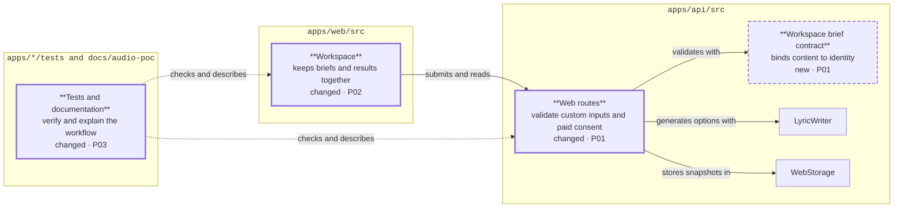

<!-- markdownlint-disable-file -->
# RPI Plan: Unified brief workspace

## Task Metadata

* Task ID: unified-brief-workspace
* Task slug: unified-brief-workspace
* Plan date: 2026-11-16

## Executive Summary

Implement one brief-led workspace with a compact collection, active Brief/Lyrics/Variants work area, batch render controls, and complementary recent runs. Support structured custom inputs and three screened lyric alternatives while preserving protected media, evaluation drafts, ownership and paid safeguards.

Planning is complete and Ready after one standard critique returned Pass with no findings. Ordinary decisions are agent-owned under the user's end-to-end authorization. Source contracts are supported; visual and participant validation remain outside the available evidence.

### What You May Not Know

* Unrendered custom briefs will stay in the current browser session; rendered snapshots remain in existing private output storage and can be recovered.
* Lyric generation uses the existing paid writer, requires separate server enablement and explicit user consent, and does not silently replace the renderer's script.
* No deployment, database migration, provider call or paid spending is authorized by implementation or tests.

## Phase Checklist

### After

Key: arrows point from a part to what it uses; dotted arrows, tests and docs; dashed border, new; thick border, changed; each tag names its phase.

Existing client/API connections stay in place, so no Before diagram is needed. P01 adds custom validation and independent lyric options; P02 composes them into one workspace; P03 verifies the result. Diagram preview is unavailable.

<!-- rpi:phase id=P01 -->
### [x] P01: Establish safe brief and lyric API capabilities

Goals:
* Custom facts and independent lyric options are real, validated capabilities without weakening existing paid or evaluation contracts.

Dependencies:
* None.

Changes in the map: web routes and new workspace brief contract.

<!-- rpi:task id=P01-T01 -->
#### [x] P01-T01: Validate and render immutable custom briefs

Goals:
* Users can submit structured custom facts and CTA, render alongside samples, recover their rendered details and evaluate against their original submission.

Requirements:
* `FR-001`, `FR-002`, `FR-004`, `NFR-001`, `NFR-002`; research C2, C3, C5, C6 and D3-D5.
* Content-derived IDs are recomputed server-side, sample IDs cannot be overridden, and each batch remains limited to three distinct briefs.
* Paid confirmation binds exact selected IDs, estimate and custom input fingerprint; no automatic retry/cancel is introduced.

Details:
* Reuse the advertiser schema and existing script renderer. Extend allowed IDs to distinguish content-addressed custom records.
* Structured custom input contains advertiser fields plus CTA. Validate printable single-line text and derive a bounded script from name, offer and CTA.
* Preserve custom snapshot/provenance in existing private manifests; custom evaluations use this immutable snapshot rather than fixture answers.
* Recover rendered custom briefs only through owner-filtered outputs. No database schema changes.

References:
* [apps/api/src/web_app.ts](../../../apps/api/src/web_app.ts): render and evaluation boundaries.
* [apps/api/src/lyrics.ts](../../../apps/api/src/lyrics.ts): existing strict brief contract.
* [apps/api/src/web_storage.ts](../../../apps/api/src/web_storage.ts): extensible owner-scoped manifests.

Dependencies:
* None.

<!-- rpi:task id=P01-T02 -->
#### [x] P01-T02: Expose three screened lyric alternatives per brief

Goals:
* An eligible user can explicitly authorize independent lyric generation and inspect safe success, held, rejection or unavailable outcomes.

Requirements:
* `FR-003`, `NFR-001`, `NFR-003`; research C4, C7 and D6.
* Default-disabled server setting, existing paid entitlement, valid server cloud configuration and explicit request consent all precede any provider call.
* Exactly three candidate slots; existing writer owns retries, duplicates produce explicit outcomes without additional attempts.

Details:
* Reuse `LyricWriter` and the injectable `LyricBackend` boundary; construct cloud settings from the injected environment, not ambient test secrets.
* Expose availability separately; generate only on explicit action. Do not send rejected text, provider diagnostics or credentials to clients or telemetry.
* Preserve AI-generated and broadcast-review labels. Alternatives are independent drafts, not automatically selected render scripts.

References:
* [apps/api/src/lyric_service.ts](../../../apps/api/src/lyric_service.ts): safe writer.
* [apps/api/src/lyric_cloud.ts](../../../apps/api/src/lyric_cloud.ts): backend, settings and screening.

Dependencies:
* `P01-T01`.

<!-- rpi:phase id=P02 -->
### [x] P02: Compose the unified responsive workspace

Goals:
* Users can keep a brief active, select a separate render batch and review outputs/runs without navigating between disconnected screens.

Dependencies:
* P01.

Changes in the map: workspace.

<!-- rpi:task id=P02-T01 -->
#### [x] P02-T01: Integrate collection, active work area and run history

Goals:
* The approved composition supports samples, manual entry, JSON upload, lyric alternatives, rendering and output review with persistent task state.

Requirements:
* `FR-001` through `FR-005`, `NFR-001` through `NFR-004`; research C1-C7.
* Desktop uses complementary collection and run regions around the active work area, not four full-width vertically stacked views.
* Brief/Lyrics/Variants choices scope long content; active brief and batch selection are independent; run selection preserves batch and evaluation drafts.

Details:
* Preserve existing account/admin functions, audio Blob ownership/cleanup, immutable evaluation behavior and reconciliation.
* Keep custom drafts in identity-scoped session storage; clear on sign-out. Restore only validated JSON shapes and explicitly surface storage/parse failures.
* A JSON file uses the manual form's advertiser fields and CTA; show parsing/validation errors without dropping existing loaded briefs.
* Use batch-level Include vocals and one primary render action; vocals trigger the existing estimate/confirmation flow.
* Bound collection/history/detail areas on desktop; on smaller screens use compact disclosure rather than exposing every form and output simultaneously. Exact responsive CSS can follow existing breakpoints.
* Avoid auto-switching away from unsaved forms or evaluation drafts when a run completes.

References:
* [apps/web/src/App.tsx](../../../apps/web/src/App.tsx): existing state owner.
* [apps/web/src/index.css](../../../apps/web/src/index.css): existing styling and responsive conventions.
* [apps/web/src/types.ts](../../../apps/web/src/types.ts): client contracts.

Dependencies:
* `P01-T01`, `P01-T02`.

<!-- rpi:phase id=P03 -->
### [x] P03: Verify behavior and document the new workflow

Goals:
* Focused tests and build checks establish that new capabilities work and existing safeguards remain intact.

Dependencies:
* P02.

Changes in the map: tests and documentation.

<!-- rpi:task id=P03-T01 -->
#### [x] P03-T01: Cover changed interactions and API boundaries

Goals:
* Tests catch incorrect selection, custom provenance, invalid upload, unauthorized generation and paid-confirmation regressions.

Requirements:
* All `FR-*` and `NFR-*`; tests use fake auth/provider responses and private temporary stores only.
* Existing web/API tests are canonical. Generated build output is not edited.

Details:
* Test ownership: web behavior in [apps/web/src/App.test.tsx](../../../apps/web/src/App.test.tsx); HTTP and stored-snapshot behavior in [apps/api/tests/web_app.test.ts](../../../apps/api/tests/web_app.test.ts). Existing creative-lyric tests own writer internals.
* Exact removals: none. Update navigation expectations in the existing web test because top-level navigation is intentionally replaced.
* Maximum additions: six API cases and six web cases, grouping tightly related edge cases rather than duplicating implementation assertions.
* Semantic coverage: immutable content identity, custom evaluation, active-vs-selected distinction, session recovery, invalid upload, safe lyric outcomes. Regression coverage: ownership, scopes, paid confirmation, admin and audio/evaluation state.
* Run `npm run test:api -- --help` only if runner syntax is uncertain; otherwise invoke the workspace test runner directly with related selectors. Run web tests, relevant API suites, `npm run typecheck`, and `npm run build`.
* Browser validation is preferred but no browser or discovery tool is exposed. Do not claim a visual or participant test occurred.

References:
* [apps/web/src/App.test.tsx](../../../apps/web/src/App.test.tsx): fake MSAL/API patterns.
* [apps/api/tests/web_app.test.ts](../../../apps/api/tests/web_app.test.ts): fake renderer/private storage patterns.
* [apps/api/tests/creative-lyrics.test.ts](../../../apps/api/tests/creative-lyrics.test.ts): screened writer regression.

Dependencies:
* `P02-T01`.

<!-- rpi:task id=P03-T02 -->
#### [x] P03-T02: Explain inputs, session retention and paid generation

Goals:
* The runbook matches the implemented screen and clearly distinguishes input readiness, rendering and evaluation.

Requirements:
* `FR-005`, `NFR-003`, `NFR-004`.

Details:
* Update only directly related web workflow sections. Document JSON shape/limits, session-scoped drafts, immutable rendered snapshots, three-brief batches, lyric prerequisites and explicit paid action, no automatic lyric-to-audio substitution.
* Existing writer spans already cover generation and cloud requests. Add no new telemetry payload attributes; drop advertiser text, contact data, identity and generated lyrics from telemetry.

References:
* [docs/audio-poc/web-app.md](../../../docs/audio-poc/web-app.md): current workflow documentation.

Dependencies:
* `P02-T01`.

## User Decisions and Requirements

### Confirmed User Direction

* User approved the supplied unified workspace proposal and requested implementation using RPI.
* User selected automatic end-to-end work.
* Consolidate selection, evaluation status, rendered variants and recent runs without one long column.
* Support samples, upload and manual brief input, multi-brief rendering, optional vocals and per-brief lyric alternatives.

### Planning Decisions and Feedback

* Research decisions D3-D6 apply: preserve the existing three-brief batch cap; batch-level vocals; structured JSON upload; session custom drafts and output snapshots; independently screened lyric alternatives.
* No material decision needs a user walkthrough at intake.

## Planning Readiness and Next Step

* Planning execution: Complete.
* Readiness: Ready; standard critique Complete, Pass, no findings.
* Blockers: none.
* Continuation owner: automatic RPI session.
* Next action: implementation and planned checks complete; automatic parent transitions to Review.

## Goals

* Keep brief development and result review in one bounded workspace.
* Add real server-backed custom-input and lyric capabilities, not decorative controls.

## Scope and Non-Goals

* In scope: client, narrow API helpers/routes, focused tests and web-app documentation.
* Non-goals: schema migrations, cross-device unrendered drafts, automatically rendering model lyric output, deployment, external writes, provider requests and unrelated refactors.

## Functional Requirements

* `FR-001`: Load samples or validate/upload manually entered custom advertiser details and CTA.
* `FR-002`: Render one to three selected briefs with optional batch-level vocals and immutable input context.
* `FR-003`: Explicitly generate three screened per-brief lyric alternatives with status/reasons; show unavailable configurations honestly.
* `FR-004`: Compare/play/download owned outputs and submit immutable evaluations; inspect recent runs without losing selection or evaluation drafts.
* `FR-005`: Consolidate into a non-columnar desktop workspace with scoped detail content and distinct input, render and evaluation statuses.

## Non-Functional Requirements

* `NFR-001`: Existing auth, owner filtering, server-side content validation and paid gates pass focused regression tests; paid provider construction stays lazy.
* `NFR-002`: Custom content cannot change under the same ID; paid confirmation rejects changed content; rendered snapshots remain recoverable after a new app instance.
* `NFR-003`: Tests make no identity/provider network calls; disabled or unconfigured paid paths make no provider calls; unknown errors are explicit, not success-shaped fallbacks.
* `NFR-004`: Existing typecheck/build pass; draft/error/selection transitions have behavior tests; no new dependencies or database migrations.

## Risks and Open Questions

| Priority | Risk | Affected work | Treatment and owner |
|----------|------|---------------|---------------------|
| Medium | Session storage may be blocked or malformed | P02-T01 | Explicit error; preserve existing server content; do not silently claim draft persistence |
| Medium | Provider may repeat candidates or hold/reject all options | P01-T02 | Preserve outcomes, deduplicate without retrying; no promise of three accepted texts |
| Medium | UI cannot be visually inspected using currently exposed tools | P03-T01 | Behavior tests and CSS review; disclose limitation |
| Low | Sample fixture CTA is not a public answer field | P01-T02 | Derive request CTA from generation script, never evaluator data |

## Sources

* [.copilot-tracking/research/2026-11-16/unified-brief-workspace-research.md](../../research/2026-11-16/unified-brief-workspace-research.md): C1-C7 and D3-D6.
* [.copilot-tracking/ux-artifacts/earwyrm/unified-brief-workspace/sketch-structure.md](../../ux-artifacts/earwyrm/unified-brief-workspace/sketch-structure.md): user-approved direction.
* No BRD, PRD or ADR source was supplied or found by the filename search; the user request is authoritative.

## Critique Disposition

* Setting: standard, first-task default.
* Status: Complete; Pass; Critical 0, High 0, Medium 0, Low 0.
* Record: [.copilot-tracking/reviews/plans/2026-11-16/unified-brief-workspace-plan-critique.md](../../reviews/plans/2026-11-16/unified-brief-workspace-plan-critique.md).
* Limitations: no subagent dispatch available; critique will assess lenses locally and state the separation limitation.

## Follow-Up Items

* None.

## Handoff

* Implementation context: this plan, completed critique and research C1-C7.
* Changes record: `.copilot-tracking/changes/2026-11-16/unified-brief-workspace-changes.md`.
* Agent self-check: requirements have task owners, safeguard tests are assigned, dependencies are acyclic, source and generated targets are distinguished, scope and summary are synchronized. No human signature or visual validation is claimed.
