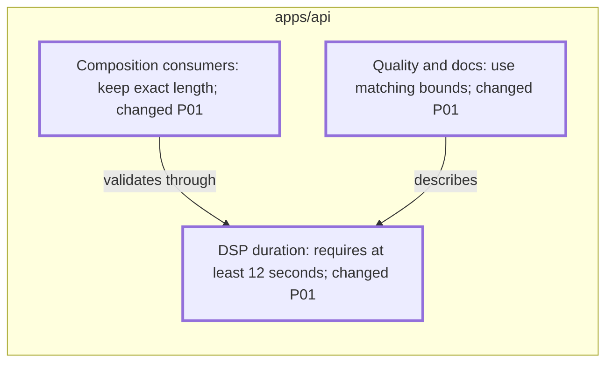

<!-- markdownlint-disable-file -->
# RPI Plan: Complete hook minimum

## Task Metadata

Task ID and slug: `complete-hook-minimum`; date 2026-11-17. Required child of `memorable-jingles`, resolving `RV-001`.

## Executive Summary

Require at least 12 seconds for all newly generated forms: two-second verse, two four-second hook phrases and two-second cadence. Keep automatic normal durations and all legacy defaults unchanged. Plan Complete/Ready; child critique and Review skipped by session defaults, not failed.

### What You May Not Know

This changes only the new lower bound; no user request requires 8/10-second support.

## Phase Checklist

### After

<!-- rpi:phase id=P01 -->
### [x] P01: Preserve a complete hook at the lower boundary

Goals:
* Every accepted form has space for its promised answering phrase.

Dependencies:
* Parent Review `RV-001`.

Changes in the map: DSP duration, composition boundary tests, quality and docs.

<!-- rpi:task id=P01-T01 -->
#### [x] P01-T01: Align the minimum and validate the boundary

Goals:
* Twelve-second forms retain both hook phrases; 8/10-second requests reject explicitly.

Requirements:
* `FR-001`: Enforce 12-30-second whole-bar forms, including matching quality/docs bounds, preserving 30-second defaults.
* `NFR-001`: Existing 14-20-second previews and seeded scores are unchanged; 12-second PCM/MIDI and motif structure pass exact checks.
* `NFR-002`: Targeted suites, typecheck/build and whitespace checks pass; no paid calls.

Details:
* Change the shared lower bound, quality envelope, messages and matching renderer/MCP/service-contract prose.
* Reuse existing invalid-input, structural and artifact tests. Add only the 12-second row to the existing DSP table (one net case, cumulative session eight additions), not new test files.
* Keep original root Review evidence intact; this correction is validated, not reviewed a second time.
* Test ownership: existing creative-audio/platform/web-app suites. Removals: none. Canonical source modules only; generated build outputs untouched manually.

References:
* [apps/api/src/dsp.ts](../../../apps/api/src/dsp.ts), [apps/api/src/contracts.ts](../../../apps/api/src/contracts.ts), [apps/api/src/melody_mcp.ts](../../../apps/api/src/melody_mcp.ts).
* [.copilot-tracking/reviews/logs/2026-11-17/memorable-jingles-review.md](../../reviews/logs/2026-11-17/memorable-jingles-review.md): `RV-001`.

Dependencies:
* None.

## User Decisions and Requirements

Inherited: flexible concise verse/hook duration, end-to-end decisions. Agent-owned correction follows `RV-001`; no unresolved user choice.

## Planning Readiness and Next Step

Implementation Complete; research reused (parent C1-C6 and RV-001). No blockers. Automatic Follow-up assessment next; child Review skipped. No BRD/PRD/ADR applies.

## Scope and Non-Goals

Only lower-bound consistency and focused validation. No new musical algorithm, provider, external action or second Review.

## Critique Disposition

Skipped by child-loop default; parent standard critique already ran. No critique findings or extra invocation.

## Artifact Self-Check

Requirement, dependency, source and validation scope checked. No human approval gate created. Diagram preview unavailable.

## Follow-Up Items

* None

## Handoff

Implement to `.copilot-tracking/changes/2026-11-17/complete-hook-minimum-changes.md`, then validate and return to session acceptance assessment.
