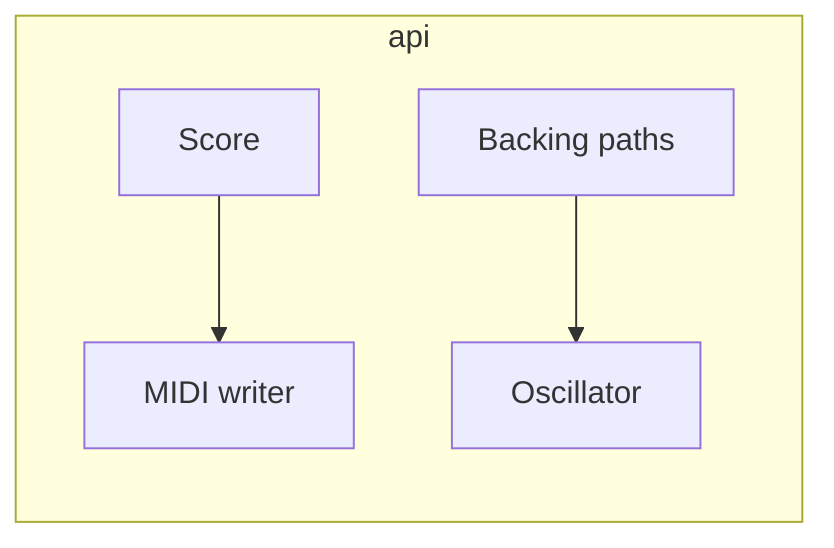
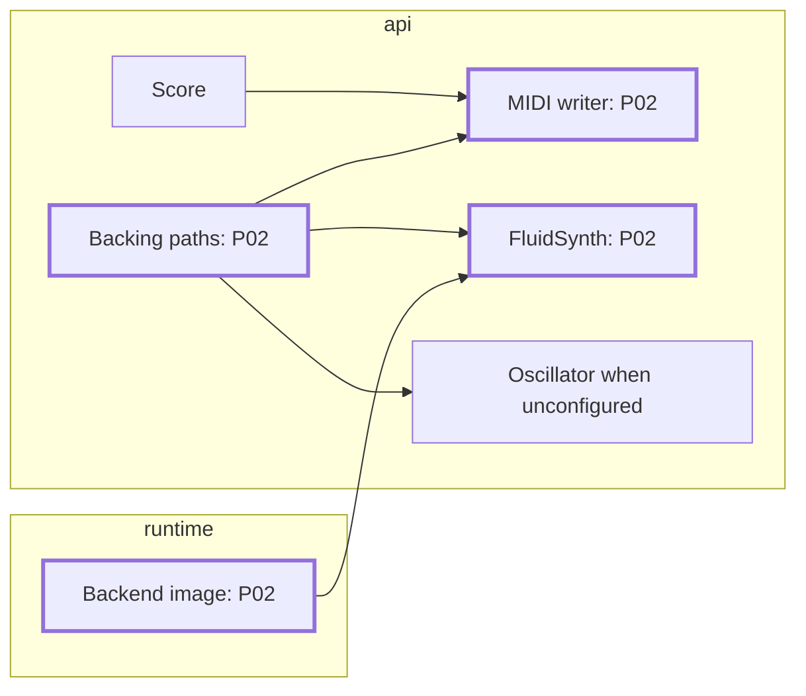

<!-- markdownlint-disable-file -->
# General MIDI instrument rendering

## Task Metadata

`general-midi`, 2026-11-17; agent-owned, local implementation only.

## Executive Summary

Use curated, seeded General MIDI palettes and render the backing with a sampled GM bank. Keep the score, lyric timing and speech flows intact.

### What You May Not Know

The backend container can provide the complete runtime; a bare development host needs local FluidSynth and a configured SoundFont.

## Phase Checklist

### Before

### After

<!-- rpi:phase id=P02 -->
### [x] P02: Match MIDI and backing instrumentation

Goals: New exports share patch selection and default container renders audibly use it.

Dependencies: Debian runtime packages and the existing DSP score.

Changes in the map: MIDI writer, web/CLI and MCP backing, backend image.

<!-- rpi:task id=P02-T01 -->
#### [x] P02-T01: Implement palettes and sampled backing

Goals: Give each rendered score a cohesive instrument palette.

Requirements: `FR-004`, `FR-005`, `NFR-004`.

Details: Use tick-zero GM Program Changes and channel 10 percussion. Render backing only through bounded, offline FluidSynth; ensure output is exact-duration mono 24 kHz. Explicitly distinguish unconfigured oscillator compatibility from configured failures. Record palette and backend without leaking file paths. Preserve legacy stored jobs. Update Dockerfile and directly related docs. No test removals, at most three additions to existing creative/platform tests. Validate targeted suites, typecheck, build and real container smoke.

References: [apps/api/src/dsp.ts](../../../apps/api/src/dsp.ts), [apps/api/src/render.ts](../../../apps/api/src/render.ts), [apps/api/src/melody_service.ts](../../../apps/api/src/melody_service.ts), [Dockerfile](../../../Dockerfile).

Dependencies: None.

## User Decisions and Requirements

Implement the proposed GM export and sampled WAV change. No deployment or paid calls.

## Planning Readiness and Next Step

Implementation complete; no unresolved decisions.

## Functional Requirements

* `FR-004`: Select repeatable acoustic pop, bright commercial or electronic patches; export them with the matching score.
* `FR-005`: Use FluidSynth in the container for both backing paths, with recorded provenance and a documented host setup.

## Non-Functional Requirements

* `NFR-004`: Preserve phrase duration, full speech, artifact contracts, idempotency, and offline operation. Honor dependency licensing and explicitly report configured renderer errors.

## Critique Disposition

Skipped; prior cycle used the ongoing session's default critique allowance.

## Artifact Self-Check

Scope and evidence reconciled; no cited business requirement or human sign-off gate.

## Follow-Up Items

None.

## Handoff

Validation recorded in [.copilot-tracking/changes/2026-11-17/general-midi-changes.md](../../changes/2026-11-17/general-midi-changes.md).
