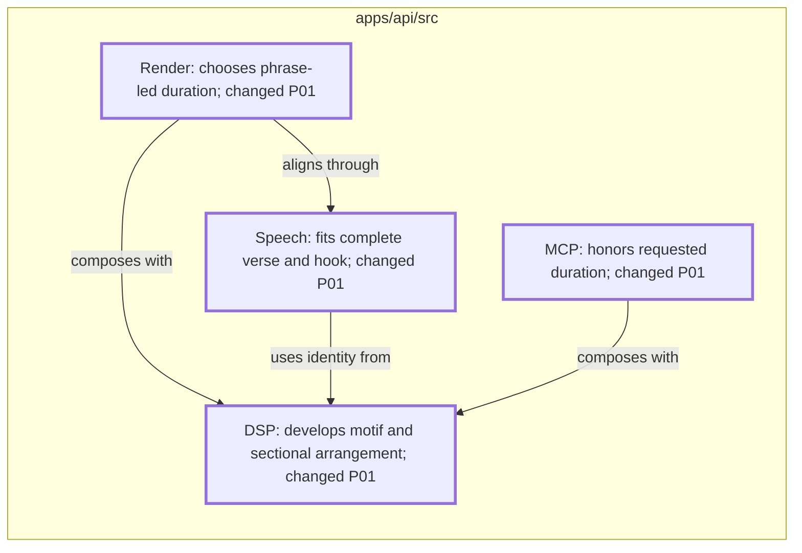

<!-- markdownlint-disable-file -->
# RPI Plan: Memorable jingles

## Task Metadata

* Task ID and slug: `memorable-jingles`
* Date: 2026-11-17
* Path: `.copilot-tracking/plans/2026-11-17/memorable-jingles-plan.md`

## Executive Summary

Replace mechanical repetition with a developed motif, clear verse/hook contrast and a resolved ending. Let new renders choose a whole-bar form that fits the complete script rather than filling 30 seconds. Planning complete and Ready; standard critique Complete/Pass with no findings. Perceived musical quality still needs listening.

### What You May Not Know

The web render and MCP composition paths share DSP but not their timing allocator. Both need consistent duration handling. Vocoded speech remains synthetic.

## Phase Checklist

### After

Thick borders mark changed parts. Connections remain unchanged; behavior is coordinated through a shared musical form.

<!-- rpi:phase id=P01 -->
### [x] P01: Deliver phrase-led, memorable jingles

Goals:
* New renders have a recognizable motif, contrasting verse/hook and a deliberate cadence without fixed padding.

Dependencies:
* Completed research C1-C6.

Changes in the map: DSP, Render, Speech and MCP.

<!-- rpi:task id=P01-T01 -->
#### [x] P01-T01: Develop the musical identity and arrangement

Goals:
* Melodies recur with purposeful development and accompaniment changes at the hook.

Requirements:
* `FR-001`, `FR-002`, `NFR-001`, `NFR-002`.

Details:
* Replace random-walk construction with seeded contour/rhythm choices, question/answer variants and chord-aware phrase endings. Preserve seed parsing and PRNG streams, not old generated score hashes.
* Use a whole-bar verse, four-bar hook and short closing cadence. Preserve legacy 30-second helper defaults; new web renders choose shorter forms based on seed/script fit.
* Use smoother pad voicings, articulated bass, backbeat, lighter verse and fuller hook. No sample/provider dependencies.

References:
* [apps/api/src/dsp.ts](../../../apps/api/src/dsp.ts): shared identity and instruments.
* Research C1-C2.

Dependencies:
* None.

<!-- rpi:task id=P01-T02 -->
#### [x] P01-T02: Keep full speech and all artifacts on the same form

Goals:
* Actual web/CLI audio is shorter, phrase-led and complete; MCP exports honor explicit duration.

Requirements:
* `FR-002`, `FR-003`, `NFR-001`, `NFR-002`.

Details:
* Split at a script sentence boundary into verse and brand/CTA hook; retain all source words, separate windows and cadence space. Never crop or silently replace speech.
* For paid speech, extend to a whole-bar form if natural speech cannot fit; reject explicitly if over the 30-second safety ceiling. Do not execute paid calls in this work.
* Generalize PCM/MIDI/mixing lengths with default 30-second compatibility; reject invalid lengths or notes beyond the selected end.
* Keep MCP request default 30 for normalized historical retry compatibility. Permit explicit whole-bar short durations and validate lyric windows against them. Return actual duration and matching WAV/MIDI.
* Keep lyric generation policy and immutable historical artifacts unchanged. Update quality duration limits to accept bounded shorter outputs, without claiming aesthetic approval.

References:
* [apps/api/src/render.ts](../../../apps/api/src/render.ts): actual audible path.
* [apps/api/src/speech.ts](../../../apps/api/src/speech.ts): complete word mapping.
* [apps/api/src/melody.ts](../../../apps/api/src/melody.ts), [apps/api/src/melody_service.ts](../../../apps/api/src/melody_service.ts), [apps/api/src/contracts.ts](../../../apps/api/src/contracts.ts): duration contracts.
* Research C2-C5.

Dependencies:
* `P01-T01`.

<!-- rpi:task id=P01-T03 -->
#### [x] P01-T03: Verify score behavior, output integrity and document listening limits

Goals:
* Regression evidence establishes structural improvements and reproducibility; local examples support listening without claiming subjective acceptance.

Requirements:
* `FR-001`, `FR-002`, `FR-003`, `NFR-001`, `NFR-002`, `NFR-003`.

Details:
* Tests belong in existing creative-audio, platform and web-app suites. Remove no tests; replace old score hashes with deterministic score assertions while retaining exact PRNG fixtures. Maximum eight added test cases, using table-driven cases where useful.
* Semantic checks: motif recurrence plus answer variation, harmonic cadence, section density, complete word coverage, short duration artifact agreement, invalid bounds and longer-speech behavior.
* Regression checks: safe/oversized seed identity, idempotency, similarity screening, paid gating and historic results. Canonical targets are source modules; compiled `dist` is generated, not manually edited.
* Run targeted API suites, `npm run typecheck`, then build and full tests when targeted results support integration. Generate offline local preview WAVs with recorded seeds and metadata.
* Update related renderer/MCP/service-contract docs, not historical proof protocol criteria. Listening remains explicit pending perception, not an automated pass.

References:
* [apps/api/tests/creative-audio.test.ts](../../../apps/api/tests/creative-audio.test.ts), [apps/api/tests/platform.test.ts](../../../apps/api/tests/platform.test.ts), [apps/api/tests/web_app.test.ts](../../../apps/api/tests/web_app.test.ts).
* [docs/audio-poc/rendering.md](../../../docs/audio-poc/rendering.md), [docs/melody-mcp.md](../../../docs/melody-mcp.md), [docs/service-contracts.md](../../../docs/service-contracts.md).

Dependencies:
* `P01-T01`, `P01-T02`.

## User Decisions and Requirements

### Confirmed User Direction

* More authentic, compelling and memorable melody/arrangement.
* Concise verse and chorus hook; duration need not be exactly 15 seconds.
* Handle it end to end; automatic progression and agent-owned decisions.

### Planning Decisions and Feedback

No unresolved material decision. Preserve provider, scripts, moderation, paid consent and stored artifacts.

## Planning Readiness and Next Step

Planning Complete, Ready. Standard critique Complete/Pass with no findings. Agent-owned decisions derive from end-to-end authorization. No unresolved decision or safety blocker for local code writes. Changes evidence will be `.copilot-tracking/changes/2026-11-17/memorable-jingles-changes.md`. Next: automatic Implementation.

## Goals

Recognizable musical identity and phrase-led concise renders with complete speech.

## Scope and Non-Goals

Local DSP, render and MCP duration integration, directly related docs and tests. No deployment, external paid calls, UI redesign or provider replacement.

## Functional Requirements

* `FR-001`: Each score has a recurring hook, a related but distinct answer, tonic ending and audible verse/hook arrangement contrast.
* `FR-002`: New web/CLI renders use whole-bar verse/hook/cadence duration, normally 14-20 seconds, not exactly 15; complete longer speech can extend the form up to 30. Explicit MCP 30-second requests and helper defaults remain supported.
* `FR-003`: Preserve all lyric/source words, brand and CTA, and make declared duration, PCM length, MIDI end time and timing bounds agree.

## Non-Functional Requirements

* `NFR-001`: Same seed/form/input gives identical score/audio; exact numeric/string seed identity and PRNG fixtures remain stable.
* `NFR-002`: Finite non-silent PCM, bounded MIDI notes, unchanged fail-closed screening/idempotency/paid consent, and no new provider calls or dependencies.
* `NFR-003`: Relevant automated tests, typecheck and build pass; local listening examples exist. Do not equate numeric gates with aesthetic or broadcast approval.

## Risks and Open Questions

| Priority | Risk | Work | Owner and action |
|---|---|---|---|
| Medium | Synthetic timbre may still feel artificial | `P01-T01` | Implementation: improve envelopes/orchestration; disclose no natural singer |
| Medium | New score may fail fixed-seed similarity checks | `P01-T03` | Implementation: investigate actual matches; never weaken screening to force pass |
| Medium | Long CTA may not fit short hook | `P01-T02` | Implementation: size windows/form from complete source, reject unfit input |

## Dependencies

Existing Node/npm tooling and local oscillator synthesis only. No external service prerequisite.

## Sources

* [.copilot-tracking/research/2026-11-17/memorable-jingles-research.md](../../research/2026-11-17/memorable-jingles-research.md): C1-C6, Ready.
* No matching BRD, PRD or ADR discovered; current user request governs this bounded change.

## Critique Disposition

Standard, first-task default; Complete/Pass, no findings or earlier critique. [.copilot-tracking/reviews/plans/2026-11-17/memorable-jingles-plan-critique.md](../../reviews/plans/2026-11-17/memorable-jingles-plan-critique.md).

## Artifact Self-Check

Identity, task blocks, requirement coverage, evidence, dependency order, test ownership and removals, generated targets and no-paid-call boundary checked. Mermaid light/dark preview not available; simple syntax used. Critique disposition checked; Ready.

## Follow-Up Items

* None

## Handoff

Automatic parent continues after standard critique disposition. No user acknowledgment required.
