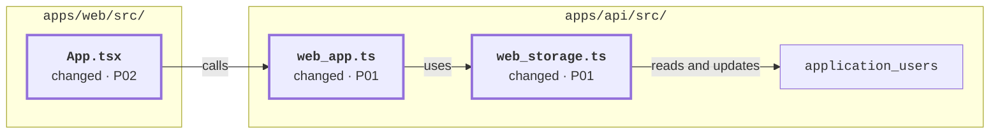
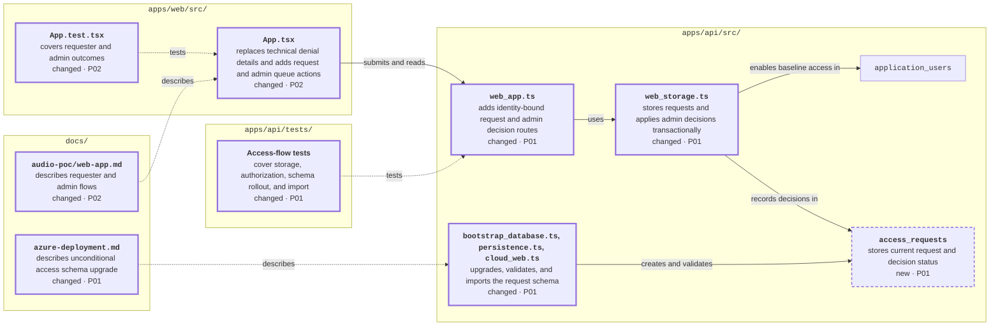

<!-- markdownlint-disable-file -->
# RPI Plan: Access Request and Approval Flow

## Task Metadata

* Task ID: access-request-approval-flow
* Task slug: access-request-approval-flow
* Plan date: 2026-11-18

## Executive Summary

* Bottom line: The plan adds a verified-identity access request flow and admin queue, with grant/deny actions that do not require manually entering a subject.
* Why this matters: Users should not see identity-provider identifiers, and admins need a direct path to act on a queued request.
* Planning result: The standard critique is complete, all nine findings are resolved in the plan, and planning is ready for Implementation.
* Confidence and uncertainty: Existing identity, admin, and database patterns are verified. No BRD, PRD, or ADR supplies feature requirements; the plan records the required behavior and schema compatibility.

### What You May Not Know

* The current screen follows successful Entra sign-in but failed application authorization. A requester must sign in before a request can be tied to a validated identity.
* Existing PostgreSQL stores need an additive access-request schema upgrade independent of `LYRIC_ENABLED`; otherwise request features fail when paid lyrics are disabled.

## Phase Checklist

### Before

### After

Key: arrows point from a part to what it uses; dotted arrows, tests and docs; dashed border, new; thick border, changed; each tag names the phases that make the change.

The requester view in `App.tsx` sends and reads identity-bound requests through `web_app.ts` (P01, P02). The API uses `web_storage.ts` to record a request and, after an admin decision, enable only baseline app access. Schema tooling provisions and validates the request table in every supported database path (P01); focused tests and guides document the user and deployment behavior.

<!-- rpi:phase id=P01 -->
### [x] P01: Persist and authorize access requests

Goals:
* Create a durable request lifecycle and secure API operations so unapproved users can enter the queue and enabled admins can decide requests without weakening existing authorization.

Dependencies:
* None.

Changes in the map: Add request storage and schema rollout; change request and admin API routes; update API and database tests and the deployment guide.

<!-- rpi:task id=P01-T01 -->
#### [x] P01-T01: Add request storage and schema rollout

Goals:
* Persist current request status across supported databases and ensure request data remains usable during PostgreSQL deployment and SQLite import.

Requirements:
* FR-002, FR-003, FR-005, FR-006; NFR-003, NFR-004; research C12-C17 and D2, D4-D6.
* Use one current request per exact issuer/subject identity, with `pending`, `approved`, or `denied` state and timestamps. Repeated pending submissions are idempotent; a denied request may return to pending.
* Any identity without enabled app access may request it, whether or not an `application_users` row already exists. An already-enabled caller cannot create a redundant request.
* Grant creates or updates the exact issuer/subject row with baseline flags only: `enabled=true`, `admin=false`, and `paid_speech=false`. This also clears elevated flags on a previously disabled row; an administrator may reassign elevated permissions separately through the existing permission editor. Request input cannot set permissions.
* Add the request table to local SQLite schema initialization, fresh PostgreSQL initialization, required-table validation, additive PostgreSQL upgrade, reset ordering, and SQLite import. Older SQLite stores without the new table remain valid; existing request rows are imported.
* The PostgreSQL access schema upgrade runs before worker startup whether `LYRIC_ENABLED` is true, false, or unset. Preserve the existing conditional behavior for paid-lyrics schema creation.
* For an existing PostgreSQL store, pre-upgrade compatibility checks tolerate a missing `access_requests` table; the additive upgrade creates it before full required-table validation includes it.

Details:
* `application_users` currently stores permissions but no request lifecycle. Keep request state in a separate table so pending/denied requests are distinct from administratively disabled accounts.
* Keep each request bound to exact validated issuer/subject values and make status/approval changes transactional. Do not trust browser-supplied identity or permission flags.
* Return an already-enabled status instead of queuing an identity that already has app access. On grant, create or update only baseline permissions, including for a previously disabled row; do not restore old admin or paid-Speech flags through the request flow.
* Include the schema in SQLite creation and fresh PostgreSQL bootstrap. Keep the existing-store pre-upgrade check compatible with a missing `access_requests` table, create that table in the additive upgrade, then run full required-table validation. The startup supervisor runs this access-schema upgrade before worker startup regardless of `LYRIC_ENABLED`, while existing paid-lyrics tables remain conditional.
* Include the new table in the explicit SQLite import map and order. Accept its absence from older SQLite sources and copy its contents when present. Ensure fresh-reset table ordering respects any references.
* Update the PostgreSQL deployment runbook to describe the unconditional access-schema upgrade and its ordering relative to full validation.
* Test ownership: `apps/api/tests/storage.test.ts`, `apps/api/tests/storage-admin.test.ts`, and `apps/api/tests/cloud_web.test.ts` own storage, authorization, bootstrap, upgrade, import, and startup coverage. Exact test removals: none. Update existing assertions in place as needed; specifically, update `upgrades PostgreSQL before starting the worker` for the unconditional access-schema upgrade. Maximum additions: 12 focused test cases. Canonical targets are TypeScript source and tests; generated `apps/api/dist/` output is not edited.
* Test-case map (9 additions): (1) request lifecycle, idempotency, denial, resubmission, and no-current status; (2) baseline grant for new, enabled, and disabled application-user states; (3) admin recheck and denied-operation non-mutation; (4) SQLite initialization/reset; (5) legacy SQLite import with the request table absent/present; (6) fresh PostgreSQL bootstrap and validation; (7-9) existing PostgreSQL upgrade with `LYRIC_ENABLED` true, false, and unset. Regression coverage also preserves unrelated application-user permissions and paid-lyrics behavior.
* Expected validation: focused storage/bootstrap tests, then `npm run typecheck` and `npm run build`.

Guidance:
* [apps/api/src/web_storage.ts](../../../apps/api/src/web_storage.ts) now exposes `request_access`, `get_access_request`, `list_access_requests_as_admin`, and `decide_access_request_as_admin`. Use `AccessRequestRecord` and `AccessRequestSubmission`; resubmission after a decision receives a fresh request ID, and unknown/non-pending decisions use `StorageNotFound`/`StorageConflict`.

References:
* [apps/api/src/web_storage.ts](../../../apps/api/src/web_storage.ts): owns SQLite schema and transactional user authorization.
* [apps/api/src/bootstrap_database.ts](../../../apps/api/src/bootstrap_database.ts): fresh store, PostgreSQL upgrade, reset, and SQLite import paths.
* [apps/api/src/persistence.ts](../../../apps/api/src/persistence.ts): PostgreSQL required-table validation.
* [apps/api/src/cloud_web.ts](../../../apps/api/src/cloud_web.ts): startup schema preparation currently gates upgrades on `LYRIC_ENABLED`.
* [apps/api/tests/storage.test.ts](../../../apps/api/tests/storage.test.ts), [apps/api/tests/storage-admin.test.ts](../../../apps/api/tests/storage-admin.test.ts), and [apps/api/tests/cloud_web.test.ts](../../../apps/api/tests/cloud_web.test.ts): storage, database lifecycle, and startup test owners.
* [.copilot-tracking/research/2026-11-18/access-request-approval-flow-research.md](../../research/2026-11-18/access-request-approval-flow-research.md):
  * Findings on existing permission storage and the database lifecycle; research C12-C17.
* [docs/azure-deployment.md](../../../docs/azure-deployment.md): update the existing PostgreSQL upgrade runbook to describe the access schema upgrade independent of lyrics.

Dependencies:
* None.

<!-- rpi:task id=P01-T02 -->
#### [x] P01-T02: Add requester and admin decision APIs

Goals:
* Expose request submission/status and admin list/grant/deny operations using verified identity and the existing authorization boundary.

Requirements:
* FR-002, FR-003, FR-004, FR-005, FR-006; NFR-001, NFR-002; research C5-C11 and D1-D5.
* Request submission and status lookup require a valid bearer token and `briefs.read`, derive identity from validated claims, and accept no caller-selected subject.
* A caller with enabled app access cannot create a duplicate request; a caller with a disabled existing row may request, but grant applies baseline flags only and clears elevated flags.
* Admin listing requires `renders.read`; admin decisions require `renders.write`. Both paths retain the live enabled-admin check at the API and storage layers.
* Admin decisions accept only a request identifier and a grant/deny decision. They cannot accept requester identity or permission fields.
* A successful grant creates or updates the exact caller row with `enabled=true`, `admin=false`, and `paid_speech=false`, and records approval atomically; denial records denied status without enabling access.
* Status lookup returns `none` when the caller has no current request. Decisions on unknown IDs return `404`; decisions on non-pending requests return `409` without changing request or user state. Only pending requests are eligible for a decision.

Details:
* Follow `require_scope`, `identity(response)`, `authorized`, and the `UserAccessSubmission` validation pattern in `web_app.ts`.
* Keep request submission available to a valid signed-in identity that is not enabled for application access. Do not route it through the ordinary `authorized` middleware that requires an enabled user.
* Use `briefs.read` for request/status operations: the existing `/api/identity` and `/api/access` flow uses that scope before determining application access. Keep `renders.read` and `renders.write` for admin operations, matching the existing `/api/admin/users` routes.
* Provide a request status response for the caller, including `none`, and a pending-request list for admins. Keep the existing `/api/admin/users` flow for direct management of existing permissions.
* Test ownership: `apps/api/tests/web_app.test.ts` owns endpoint identity, response, scope, and access-control assertions. Exact test removals: none. Maximum additions: 12 focused test cases. No generated targets.
* Test-case map (9 additions): (1) no-body identity-bound submission and initial status; (2) pending, duplicate, denied, resubmission, and no-current status; (3) admin pending-list scope; (4) grant and baseline permission effects; (5) denial; (6) unknown or already-decided request behavior and no mutation; (7) invalid token/scope; (8) non-admin/revoked-admin denial; (9) caller-supplied identity and issuer rejection. Regression coverage includes no user/permission mutation on denied or non-pending operations.
* Expected validation: focused `web_app.test.ts`, then `npm run typecheck` and `npm run build`.

Guidance:
* Requester UI uses `GET`/`POST /api/access-requests` with `briefs.read`; status is `none`, `pending`, `approved`, or `denied`, and submission has no identity body.
* Admin UI uses `GET /api/admin/access-requests` with `renders.read` and `POST /api/admin/access-requests/{request_id}/decision` with `renders.write`; the list exposes `request_id`, `subject`, and `created_at`, and decisions accept only `{ decision: "approved" | "denied" }`. Unknown IDs return `404`; already-decided IDs return `409`.

References:
* [apps/api/src/web_app.ts](../../../apps/api/src/web_app.ts): existing identity, scope, user access, and admin routes.
* [apps/api/src/web_auth.ts](../../../apps/api/src/web_auth.ts): verified bearer token, `REQUIRED_SCOPE_SUFFIXES`, and delegated-scope contract.
* [apps/api/tests/web_app.test.ts](../../../apps/api/tests/web_app.test.ts): endpoint authorization and identity test patterns.
* [.copilot-tracking/research/2026-11-18/access-request-approval-flow-research.md](../../research/2026-11-18/access-request-approval-flow-research.md):
  * Findings on identity order, admin authorization, and denial behavior; research C5-C11.

Dependencies:
* P01-T01.

<!-- rpi:phase id=P02 -->
### [x] P02: Deliver clear requester and admin experiences

Goals:
* Replace the identity-centric denial experience with a plain-language request/status flow and integrate review actions into the existing admin page.

Dependencies:
* P01 APIs and storage are available.

Changes in the map: Change the access-denied and admin views, add requester/admin UI tests, and update the web-app guide.

<!-- rpi:task id=P02-T01 -->
#### [x] P02-T01: Add request and status to the access-denied view

Goals:
* Let a signed-in user without app access request it and understand whether the request is pending, denied, or approved without seeing technical identity details.

Requirements:
* FR-001, FR-002, FR-003, FR-008; NFR-001; research C5-C6, C10, C17 and D1, D4.
* Remove issuer, subject, and token/issuer endpoint details from the requester-facing panel. Keep the separate signed-out sign-in experience.
* Submit requests with the existing authenticated API client and display pending/denied status plus retry after denial.
* Present request success/failure in an accessible status announcement and preserve keyboard-operable controls; test both keyboard activation and status announcements.

Details:
* `loadWorkspaceData` obtains identity before `/api/access`; the new action belongs in the application-denied panel after Entra sign-in, not in the truly signed-out state.
* Do not add a user-entered identity form, email field, or token display. On approved status, guide the user to reload or continue through the existing access reload path.
* Test ownership: `apps/web/src/App.test.tsx` owns requester screen behavior. Exact test removals: none. Update the existing denied-screen assertion in place to expect a request action and no identity details. Maximum additions: 4 focused test cases. No generated targets.
* Test-case map (4 additions plus 1 in-place update): (1) request action, submission, pending status, keyboard activation, and announcement; (2) denied status and resubmission; (3) approved status and reload guidance; (4) signed-out sign-in remains available. Update the existing denial test in place to assert requester identity details remain hidden; this update is not counted as an addition.
* Expected validation: focused `App.test.tsx`, then `npm run typecheck` and `npm run build`.

References:
* [apps/web/src/App.tsx](../../../apps/web/src/App.tsx): access denial and workspace-loading state.
* [apps/web/src/api.ts](../../../apps/web/src/api.ts): authenticated API request helper.
* [apps/web/src/types.ts](../../../apps/web/src/types.ts): web API response types.
* [apps/web/src/App.test.tsx](../../../apps/web/src/App.test.tsx): signed-in denial screen tests.
* [docs/audio-poc/web-app.md](../../../docs/audio-poc/web-app.md): local sign-in and current operator enrollment guidance.
* [.copilot-tracking/research/2026-11-18/access-request-approval-flow-research.md](../../research/2026-11-18/access-request-approval-flow-research.md):
  * Finding on the signed-in, app-denied screen; research C5-C6 and C10.

Dependencies:
* P01-T02.

<!-- rpi:task id=P02-T02 -->
#### [x] P02-T02: Add the pending-request queue to admin access

Goals:
* Let enabled admins review and grant or deny each queued request from the existing access-management page without entering the subject.

Requirements:
* FR-004, FR-005, FR-007, FR-008; NFR-002; research C7-C9, C11 and D2-D3, D5.
* List pending requesters with a read-only identity reference and clear grant/deny actions; do not ask the admin to type a subject to decide.
* Keep existing user permission editing available as a separate task from request decisions.
* Make the grant action's baseline-only effect explicit: granting a request for a disabled row clears administrator and paid-Speech flags; admins can assign those permissions separately afterward.
* Announce completed decisions and errors accessibly; reflect changes in the queue and existing user list. Test keyboard operation and status announcements for grant/deny.

Details:
* The current admin editor remains the mechanism for assigning administrator and paid Speech permissions. A request grant is not an entitlement editor and deliberately clears those flags when re-enabling a disabled row.
* Use the admin request API and preserve the existing user-management APIs and UI for direct permission administration.
* Test ownership: `apps/web/src/App.test.tsx` owns admin queue behavior. Exact test removals: none. Maximum additions: 6 focused test cases. No generated targets.
* Test-case map (6 additions): (1) pending queue and read-only identity without subject entry; (2) grant communicates and applies baseline-only permissions, with keyboard operation and success announcement; (3) deny with keyboard operation and denial announcement; (4) existing permission editor remains available; (5) non-admin controls are hidden and cannot be triggered; (6) action error is announced and the queue refreshes. Existing tests may be extended in place without counting as additions.
* Update the user guide to describe the new request and decision lifecycle.
* Expected validation: focused web and API tests, then `npm run typecheck` and `npm run build`.

References:
* [apps/web/src/App.tsx](../../../apps/web/src/App.tsx): existing admin access view and user permission editor.
* [apps/web/src/types.ts](../../../apps/web/src/types.ts): existing admin user API types.
* [apps/web/src/App.test.tsx](../../../apps/web/src/App.test.tsx): admin permission management tests.
* [docs/audio-poc/web-app.md](../../../docs/audio-poc/web-app.md): user-facing access workflow guidance.
* [docs/azure-deployment.md](../../../docs/azure-deployment.md): PostgreSQL upgrade and SQLite import runbook.
* [.copilot-tracking/research/2026-11-18/access-request-approval-flow-research.md](../../research/2026-11-18/access-request-approval-flow-research.md):
  * Finding on manual subject entry and enabled-admin checks; research C7-C9 and C11.

Dependencies:
* P01-T02, P02-T01.

## User Decisions and Requirements

### Confirmed User Direction

* Replace the signed-in, application-denied screen's technical identity details with a button to request access.
* Queue requests so an administrator can grant or deny access from the existing admin page without manually entering a subject.
* Use end-to-end RPI progression through Review and required in-scope follow-ups.

### Planning Decisions and Feedback

| Group | Decision or feedback item | Status | Owner | Rationale or input needed | Evidence | Planning impact |
|-------|---------------------------|--------|-------|---------------------------|----------|-----------------|
| D1 | Derive the requester from the verified token, never a browser-supplied subject | Resolved | Agent | Existing API identity contract uses validated issuer and subject | Research C5-C6, C8 | Request and status endpoints |
| D2 | Use separate request state rather than treating disabled application users as requests | Resolved | Agent | Current permission table cannot distinguish pending, denied, and administratively disabled users | Research C7, C16-C17 | Request storage and admin queue |
| D3 | Keep decisions within current enabled-admin checks at the API and storage layers | Confirmed | Constraint | The request is specifically for admin decisions | Research C8-C9, C11 | Admin list and decision APIs |
| D4 | Make duplicate pending submissions idempotent and allow a denied request to be resubmitted | Resolved | Agent | Prevent duplicate queue entries while avoiding a permanent access block after denial; this is an agent-owned default because the research identified but did not resolve the resubmission question | Research Risks and Open Questions; no user direction on resubmission | Request state transitions and user status |
| D5 | Grant baseline app access only; request approval always sets enabled=true and admin/paid-Speech=false | Resolved | Agent | The queue decision should not restore elevated rights; admins may assign those separately through the existing editor | Research C7-C9; least-privilege default for agent-owned planning | Approval transaction and tests |
| D6 | Roll out request schema independently of paid lyrics and preserve older SQLite imports | Resolved | Agent | Current PostgreSQL upgrade is conditional on `LYRIC_ENABLED`; imports use an explicit table contract | Research C12-C15 | Bootstrap, upgrade, validation, and import |

## Planning Readiness and Next Step

| Field | Record |
|-------|--------|
| Planning execution and readiness | Plan and critique are complete; all nine findings are resolved. Planning Readiness: Ready. |
| Decision participation | Agent-owned; default for the user's selected end-to-end mode |
| Blockers | None |
| Latest critique | `.copilot-tracking/reviews/plans/2026-11-18/access-request-approval-flow-plan-critique.md`; execution Complete, verdict Revise |
| Relevant research | [.copilot-tracking/research/2026-11-18/access-request-approval-flow-research.md](../../research/2026-11-18/access-request-approval-flow-research.md) |
| Plan | `.copilot-tracking/plans/2026-11-18/access-request-approval-flow-plan.md` |
| Changes-record role | `.copilot-tracking/changes/2026-11-18/access-request-approval-flow-changes.md` is implementation evidence |
| Continuation owner | Confirmed automatic RPI Agent |
| Required gates or confirmations | No planning blockers or user confirmations remain. One post-implementation Review is required. |
| Next action | Transition automatically to Implement using this plan and `.copilot-tracking/changes/2026-11-18/access-request-approval-flow-changes.md`. |

## Goals

* Give signed-in users without app access a clear, low-friction way to request it.
* Let an enabled administrator decide pending requests without manually entering an identity subject.
* Preserve identity, authorization, database rollout, and import invariants.

## Scope and Non-Goals

### In Scope

* Request submission and status for a verified Entra identity that is not enabled in the app.
* Pending request review and grant/deny actions in the existing admin experience.
* SQLite and PostgreSQL schema creation, additive upgrade, validation, and import compatibility.
* Focused API, storage, web, and database lifecycle tests plus directly related user and deployment documentation.

### Non-Goals

* Entra tenant, application registration, consent, or identity-provider workflow changes.
* A general role/permission redesign or a change to the existing manual permission editor.
* Paid Speech or administrator access through the request action.
* User profile, email, or display-name enrichment beyond the verified issuer and subject already available.
* Deployment infrastructure changes unrelated to applying the PostgreSQL schema upgrade.

## Functional Requirements

* FR-001: A signed-in user denied application access sees plain-language guidance and a `Request access` action, not issuer, subject, token, or issuer-endpoint details.
* FR-002: A request is associated with the caller's verified issuer and subject; the browser cannot select or submit another identity.
* FR-003: The requester can see whether the current request is pending or denied. Repeating a pending request does not create duplicate pending entries; a denied requester can request again.
* FR-004: An enabled administrator can list pending requests and grant or deny each request from the existing access-management page without manually entering the subject.
* FR-005: Granting a request enables baseline application access only; the request action does not grant administrator or paid Speech access.
* FR-006: Request creation, status lookup, admin listing, and decisions persist and behave consistently across local SQLite and supported PostgreSQL deployments.
* FR-007: Direct permission management for existing users remains available through the existing admin workflow.
* FR-008: User-facing access messages and the admin queue are keyboard-operable and expose action/status feedback to assistive technology.

## Non-Functional Requirements

* NFR-001: Every request and status lookup requires a valid bearer token and delegated API scope; identity comes only from validated token claims.
  * Objective threshold or evaluation condition: Requests without a valid token or required scope cannot create or inspect request records.
* NFR-002: Every admin list or decision operation requires the current actor to be an enabled administrator, checked in storage at the transaction that reads or changes request state.
  * Objective threshold or evaluation condition: Non-admin or revoked-admin callers receive a denial and make no request or user-permission changes.
* NFR-003: Existing PostgreSQL deployments receive the access-request schema before normal worker startup regardless of `LYRIC_ENABLED`.
  * Objective threshold or evaluation condition: Startup upgrades an existing store with lyrics enabled, disabled, or unset, then validates the complete required schema.
* NFR-004: SQLite-to-PostgreSQL import accepts older source databases that predate the request table and copies request rows when the table is present.
  * Objective threshold or evaluation condition: Legacy imports do not fail solely because the new table is absent; present records are imported and validated.

## Risks and Open Questions

| Priority | Type | Risk, question, or planning item | Affected work | Impact | Smallest action or evidence needed | Owner |
|----------|------|----------------------------------|---------------|--------|------------------------------------|-------|
| Medium | Risk | Admins have no verified display name or email in the current identity contract | P01-T02, P02-T02 | The queue may identify requesters by subject only | Keep the subject visible to admins as a read-only request identifier; do not infer profile claims | Planner |
| Medium | Risk | A schema upgrade failure can prevent PostgreSQL app startup | P01-T01 | Access-request features remain unavailable until the upgrade succeeds | Keep upgrade transactional/idempotent and covered by database lifecycle tests | Implementer |
| Low | Residual risk | Granting a request for an existing disabled row resets administrator and paid-Speech flags | P01-T01, P01-T02, P02-T02 | Previously assigned elevated permissions must be reassigned separately | Explain the baseline-only grant in the admin action and keep elevated permission assignment in the existing editor | Planner |
| Low | Residual risk | Request-history retention and audit requirements are not defined | P01-T01 | A one-current-request record does not provide a permanent decision log | Keep current request state only; add durable history if an audit requirement emerges | Product/follow-up |

## Sources

* [.copilot-tracking/research/2026-11-18/access-request-approval-flow-research.md](../../research/2026-11-18/access-request-approval-flow-research.md): Current UI, identity, admin authorization, persistence, bootstrap, import, and test evidence.
* [docs/audio-poc/web-app.md](../../../docs/audio-poc/web-app.md): Sign-in alone does not grant application access; the operator currently enrolls issuer and subject.
* [docs/azure-deployment.md](../../../docs/azure-deployment.md): Existing PostgreSQL upgrade and import operational guidance.
* Business source search: searched for BRD, PRD, ADR, and `.adr-config.yml` artifacts using access, authorization, application-user, and admin terms; no relevant business sources found. `docs/project-plan.md` is explicitly historical and does not contain current feature requirements.
* Planning extension review: no applicable planning extension; the PRD-to-backlog planner was not used because no PRD or tracker handoff is in scope.

## Critique Disposition

* Critique setting and provenance: standard; first-task default for the end-to-end RPI session
* Critique execution: Complete
* Latest critique verdict: Revise; `.copilot-tracking/reviews/plans/2026-11-18/access-request-approval-flow-plan-critique.md`
* Earlier critiques: none
* Limitations: The critique did not assess deployed PostgreSQL DDL privileges, multi-replica startup behavior, or the database test harness; these remain implementation/deployment verification boundaries.
* Findings and dispositions:
  * PC-001 — resolved by adding keyboard activation and status-announcement coverage to the requester and admin UI test maps.
  * PC-002 — resolved by defining requests for enabled/disabled/new identities and making every grant create or reset the exact account to baseline permissions.
  * PC-003 — resolved by defining `none`, `404` for unknown IDs, and `409` for non-pending decisions with no mutation.
  * PC-004 — resolved by authorizing in-place updates to the existing denial-screen and PostgreSQL startup assertions without counting them as removals or additions.
  * PC-005 — resolved by making P02-T02 depend on P02-T01 because both tasks edit the same UI and test files.
  * PC-006 — resolved by defining compatible pre-upgrade checks, additive table creation, and full validation after the new table exists for all lyric-configuration states.
  * PC-007 — resolved by verifying that identity/access use `briefs.read` before app authorization, and the existing admin routes use `renders.read`/`renders.write`.
  * PC-008 — resolved by recording D4 as an agent-owned default informed by the research's open resubmission question.
  * PC-009 — resolved by mapping nine storage/API cases and the requester/admin UI cases to budgets of 12, 12, 4, and 6 additions.

## Artifact Self-Check

* [x] Executive Summary, What You May Not Know, and Phase Checklist lead the plan.
* [x] User direction, agent-owned planning decisions, readiness, goals, scope, requirements, risks, dependencies, and sources are consistent with the phases.
* [x] Every functional and non-functional requirement is cited by at least one task.
* [x] Every phase and task has the required Goals, Requirements, Details, References, Dependencies, and phase map-change records.
* [x] Task details identify test owners, removals, additions, canonical/generated targets, semantic and regression coverage, and validation commands.
* [x] The map uses no more than 10 parts and 4 boxes; its arrows point from callers to dependencies and tests/docs use dotted arrows.
* [x] All changed/new map parts are tagged with their phase, and the Before diagram reflects the researched pre-change flow.
* [ ] Mermaid diagrams have not yet been rendered in light and dark themes; no preview tool is available in this planning context.
* [x] Business-source search found no relevant BRD, PRD, or ADR; there are no unresolved material user decisions.
* [x] Critique depth and provenance are recorded; execution is complete, all findings are resolved, and the critique's Revise verdict is reconciled.
* [x] Follow-up items stay outside active phase acceptance.
* Checked sections: Task metadata, summary, phases, requirements, sources, critique disposition.
* Missing or limited sections: Visual light/dark Mermaid preview.

## Follow-Up Items

* Add durable request decision history if an audit or retention requirement emerges; it was not requested for the current access flow. Owner: product owner or follow-up planning.

## Handoff

* Authoritative implementation handoff: Planning Readiness and Next Step
