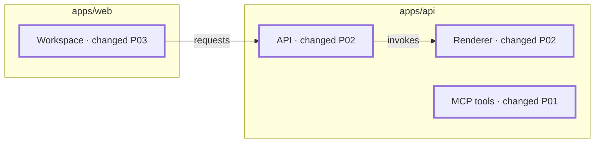
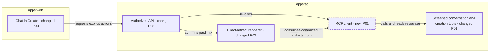

<!-- markdownlint-disable-file -->
# RPI Plan: Jingle chat

## Task Metadata

* Task ID and slug: `jingle-chat`
* Plan date: 2026-11-18

## Executive Summary

Add collaborative chat inside the existing advertiser workspace. Real MCP calls discuss creative directions, write screened lyrics, and compose an idempotent music preview. The user explicitly requires vocals over that exact arrangement, so paid rendering must consume committed MCP backing bytes and vocal timing rather than compose again.

Planning is complete and ready after standard critique and its recovery clarification. No new deployment or paid test calls are included.

### What You May Not Know

The existing renderer changes music after Speech. The new optional composition input must bypass that behavior only for chat-selected arrangements. Vocoded singing remains approximate, and every result requires human approval.

## Phase Checklist

### Before

### After

Arrows run from callers to dependencies; thick borders are changed and dashed borders new.

<!-- rpi:phase id=P01 -->
### [x] P01: Real MCP conversation and creation

Goals:
* Expose bounded screened conversation and preserve exact composition resources.

Dependencies:
* None.

Changes in the map: MCP tools and client.

<!-- rpi:task id=P01-T01 -->
#### [x] P01-T01: Add screened creative conversation and MCP client

Goals:
* Suggestions and lyric requests go through the real MCP protocol; complete accepted words produce a valid composition request.

Requirements:
* `FR-001`, `FR-002`, `NFR-001`, `NFR-003`.

Details:
* Add strict bounded conversation contracts and `suggest_jingle` to the lyric MCP. Reuse cloud HTTP, preflight and Content Safety; no arbitrary tool loop or automatic retries.
* Add optional creative direction to the writer request and both deterministic and cloud preflight. It is not a fact source.
* Use linked SDK transports, close both ends, validate structured results and digest-check allowlisted resources.
* Dictionary syllable counts govern complete orthographic timing slices. Document approximate segmentation, not phoneme alignment.

References:
* [apps/api/src/lyric_mcp.ts](../../../apps/api/src/lyric_mcp.ts)
* [apps/api/src/lyric_cloud.ts](../../../apps/api/src/lyric_cloud.ts)
* [.copilot-tracking/research/2026-11-18/jingle-chat-research.md](../../research/2026-11-18/jingle-chat-research.md): F1-F3.

Dependencies:
* None.

<!-- rpi:phase id=P02 -->
### [x] P02: Protected exact-arrangement audio

Goals:
* Publish an MCP backing preview and mix confirmed paid vocals over its exact arrangement.

Dependencies:
* `P01`.

Changes in the map: authorized API and renderer.

<!-- rpi:task id=P02-T01 -->
#### [x] P02-T01: Wire authorized chat, preview and exact vocal rendering

Goals:
* Chat results are owned, recoverable and usable by the existing cost-confirmation and listening workflows.

Requirements:
* `FR-002`, `FR-003`, `FR-004`, `NFR-001`, `NFR-002`, `NFR-003`.

Details:
* Add same-origin chat endpoints with existing scopes, enabled-user checks, explicit paid consent and global operation guards. Persist writer outcomes in existing lyric storage.
* Build only owner-scoped accepted options; derive a stable logical composition ID from owner and option. Publish backing as an existing private web run with composition identity and digest. Retry recovers the same job/run, not a second enqueue.
* Under the existing render guard, recover the owner-scoped run before insertion. If its output exists, repair completed status and return it; if the run exists without output, publish into that run. Test lost-response recovery and prevent duplicate output insertion.
* Bind composition selection to owner, selected lyric, brief, estimate fingerprint and stored preview; reject arbitrary job IDs or changed selections before Speech.
* Renderer optional input consumes digest-checked WAV/MIDI/score and timing. Never recompose, resize or rescreen against itself. Align complete source word intervals proportionally to committed syllable notes and preserve duration.
* Keep original renderer behavior unchanged without composition input. Existing reservation, failure/unknown usage, reconciliation, protected playback and human-review statuses remain authoritative.

References:
* [apps/api/src/web_app.ts](../../../apps/api/src/web_app.ts)
* [apps/api/src/render.ts](../../../apps/api/src/render.ts)
* [apps/api/src/speech.ts](../../../apps/api/src/speech.ts)
* [apps/api/src/web_storage.ts](../../../apps/api/src/web_storage.ts)

Dependencies:
* `P01-T01`.

<!-- rpi:phase id=P03 -->
### [x] P03: Collaborative chat in the workspace

Goals:
* Sellers can discuss, refine, build, listen and explicitly confirm paid voice without losing advertiser context.

Dependencies:
* `P02`.

Changes in the map: chat in Create.

<!-- rpi:task id=P03-T01 -->
#### [x] P03-T01: Add accessible advertiser-scoped chat and validation

Goals:
* A bounded conversational UI offers suggestions, exact lyric selection, MCP preview, and exact-arrangement voice estimate with truthful failure and unavailable states.

Requirements:
* `FR-001` through `FR-004`, `NFR-001` through `NFR-003`.

Details:
* Extend Create in the inherited visual world; retain old controls. Keep transcripts per advertiser in page memory, clear on sign-out, discard stale async responses after context change, and never render model HTML.
* Make paid consent explicit for each discuss/write action. Build preview is free of cloud calls; voice uses the existing estimate modal.
* Show tool provenance and lyrics, separate busy/error/status and broadcast review. Protected playback uses existing output components. Mobile must not overflow.
* Tests belong to existing API/web/audio test files, with at most one new MCP adapter test file if necessary. No removals. Add only behavioral tests covering actual protocol, gating, ownership, idempotency, exact backing/timing and UI actions.
* Run focused tests, workspace typecheck/build, and browser validation. Document settings, transport and demo limitations in existing service/web docs.

Guidance:
* Use `/api/chat` with explicit `discuss`, `write`, and `compose` actions. An accepted `option_id` builds one private preview; paid estimate and rendering carry both `lyric_selections` and `composition_selections` (`brief_id`, `job_id`). Existing protected listening handles preview playback.

References:
* [apps/web/src/App.tsx](../../../apps/web/src/App.tsx)
* [apps/web/src/App.test.tsx](../../../apps/web/src/App.test.tsx)
* [apps/api/tests/web_app.test.ts](../../../apps/api/tests/web_app.test.ts)
* [apps/api/tests/creative-audio.test.ts](../../../apps/api/tests/creative-audio.test.ts)

Dependencies:
* `P02-T01`.

## User Decisions and Requirements

### Confirmed User Direction

* Use RPI end to end to add chat that uses MCP directly to suggest and build jingles with the user.
* User selected expanded scope: vocals must use the exact MCP arrangement.
* Retain existing advertiser-first UI and paid safety gates; no deployment or actual paid calls in this run.

### Planning Decisions and Feedback

| Group | Decision or feedback item | Status | Owner | Rationale | Evidence | Planning impact |
|-------|---------------------------|--------|-------|-----------|----------|-----------------|
| D1 | Real in-process MCP, no new HTTP deployment | confirmed | agent | Reuses tested transport and same-origin auth | Research C1-C5 | P01 |
| D2 | Explicit bounded actions, model cannot autonomously spend | confirmed | agent | Existing paid consent contract | Research C3, C7 | All phases |
| D3 | Exact committed backing and vocal map | confirmed | user | exact-mcp-vocals answer | Research C6 | P02 |

## Planning Readiness and Next Step

* Execution: complete; readiness: Ready after standard critique.
* Participation: agent-owned, automatic end-to-end.
* Next: automatic Implementation.
* Changes record: `.copilot-tracking/changes/2026-11-18/jingle-chat-changes.md`.

## Goals

Deliver a working, tested collaborative MCP-backed jingle flow while preserving existing creation and review.

## Scope and Non-Goals

Local source, tests and related documentation only. No deployment, push, paid production calls, generic distributed worker, arbitrary remote MCP endpoints, natural-singing guarantee, or new brand identity.

## Functional Requirements

* FR-001: Bounded contextual chat suggests and refines a creative direction through a screened MCP tool.
* FR-002: Explicitly generate, store and select screened lyrics through MCP; held/unavailable results cannot build.
* FR-003: Build and recover a playable MCP backing preview exactly once per selected lyric identity.
* FR-004: Confirm and render vocals over that exact backing and vocal timing, with recoverable provenance and protected listening.

## Non-Functional Requirements

* NFR-001: Every API action enforces existing scopes, enabled-user and relevant entitlement/consent. No secrets or raw provider errors in output.
* NFR-002: Existing non-chat behavior and paid budget/reconciliation remain unchanged. Exact selected job and digest join estimate binding; no second queue submission.
* NFR-003: Strict bounded input/output validation, explicit errors, closed transports, keyboard labels/live status, no mobile overflow, passing focused tests and type/build checks.

## Risks and Open Questions

| Priority | Risk | Affected work | Mitigation | Owner |
|----------|------|---------------|------------|-------|
| Medium | Resampled syllables sound mechanical | P02-T01 | Exact timing tests; disclose demo quality; producer listening before broadcast | implementer/operator |
| Medium | Paid production prerequisites unavailable | P03-T01 | Injected providers for tests, explicit disabled state, setup docs | operator |
| Medium | Preview publication partially fails | P02-T01 | Stable job/run identity, recover outputs before retry and do not enqueue again | implementer |

## Dependencies

Existing SDK, Zod, Speech, Azure credential, Content Safety, SQLite/PostgreSQL and React dependencies suffice; no manifest changes planned.

## Sources

Research C1-C7 and explicit user scope. Existing project/design proposals are background; no task-specific approved BRD, PRD or ADR with requirement IDs was supplied. This plan's FR/NFR IDs own the feature acceptance boundary.

## Critique Disposition

* Setting: standard, first-task default.
* Status: Complete; initial verdict Revise, one Medium finding.
* `PC-001`: resolved by P02-T01's explicit owner-scoped existing-run/output recovery and lost-response test requirement. Planner-owned correction; no new critique required.

## Artifact Self-Check

Requirements map to completed tasks; no unresolved user decision. Diagram preview in editor not independently rendered. Canonical source files only; generated dist files are build outputs, not manual edit targets. Behavioral regression tests, no test removals or repository tooling additions. Standard critique resolved. Implementation validation passed; post-implementation Review is next.

## Follow-Up Items

* None.

## Handoff

All P01-P03 tasks complete. API tests (212), workspace UI tests (14), root typecheck and production builds passed. Browser checks used injected API/auth responses, not cloud calls, at 1440px and 390px. Automatic parent proceeds to the one required Review.
