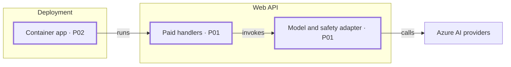
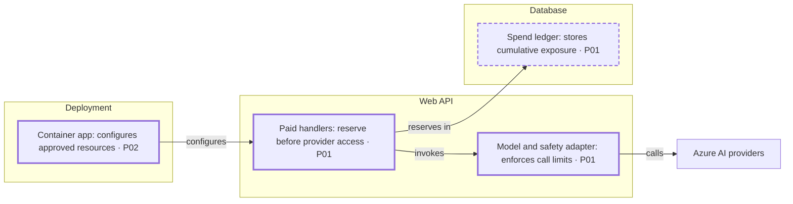

<!-- markdownlint-disable-file -->
# RPI Plan: Paid cloud AI

## Task Metadata

* Task ID and slug: `paid-cloud-ai`
* Date: 2026-11-18

## Executive Summary

Keep the current web and entitlement design. Add bounded, durable admission for model and screening spend and a default-off deployment path for approved Azure services. Exact resource and rate verification belongs to rollout, not implementation.

### What You May Not Know

The allowance accounts for worst-case costs, not the actual Azure bill. Failed or interrupted actions do not release reservations.

## Phase Checklist

### Before

### After

Thick borders mark changes; dashed borders mark additions. Deployment passes approved configuration in P02. P01 places the budget between paid action admission and the existing model adapter.

<!-- rpi:phase id=P01 -->
### [x] P01: Bound text usage and spending

Goals: Admit only actions covered by the whole-action budget.

Dependencies: Existing web store and provider adapter.

Changes in the map: Paid handlers, model and safety adapter, spend ledger.

<!-- rpi:task id=P01-T01 -->
#### [x] P01-T01: Persist and enforce text allowances

Goals: No model or screening calls without a committed reservation and an available call slot.

Requirements: `FR-001`, `FR-002`, `NFR-001`.

Details: Use exact decimals and model/safety per-call bounds; reserve under the existing transaction across all three web paths. Use per-action USD and cumulative USD caps, and protect the serialized provider body and completion length. Return a distinct budget denial before provider calls. Keep the existing standalone tools and consent. Add the ledger through supported PostgreSQL upgrades and SQLite import, and preserve rollback compatibility with unpaid mode.

References: [apps/api/src/web_app.ts](../../../apps/api/src/web_app.ts), [apps/api/src/lyric_cloud.ts](../../../apps/api/src/lyric_cloud.ts), [apps/api/src/bootstrap_database.ts](../../../apps/api/src/bootstrap_database.ts).

Dependencies: None.

<!-- rpi:phase id=P02 -->
### [x] P02: Enable approved cloud configuration

Goals: Provide a reproducible, opt-in path without creating AI services or weakening approvals.

Dependencies: P01 runtime contract.

Changes in the map: Container app.

<!-- rpi:task id=P02-T01 -->
#### [x] P02-T01: Wire configuration and operator instructions

Goals: Deploy Speech and shared Foundry plus Content Safety independently using existing resources.

Requirements: `FR-003`, `NFR-001`.

Details: Configure optional explicit workflow choices and typed optional Bicep settings, server-side only. Reference Speech key through Key Vault and select app managed identity for text call auth. Document permissions, pricing evidence, and rollback. For an existing private database, document running the new additive CLI upgrade from an approved VNet-connected host, with no reset. Validate Bicep locally and test default-off behavior and opt-in config mappings.

References: [infra/service.bicep](../../../infra/service.bicep), [.github/workflows/deploy-web.yml](../../../.github/workflows/deploy-web.yml), [docs/azure-deployment.md](../../../docs/azure-deployment.md).

Dependencies: `P01-T01`.

## User Decisions and Requirements

Keep `paid_speech`; implement cloud integration and bounded model controls. Decisions are agent-owned under the end-to-end choice.

| Group | Decision | Status / owner | Basis and impact |
|---|---|---|---|
| D1 | Full worst-case reservation; no automatic credits | Selected / agent | Research C1–C3; P01 |
| D2 | Use existing resources, no live changes | Selected / agent | Research C4/W1; P02 |

## Planning Readiness and Next Step

Complete and ready for implementation after resolving both critique findings. No unresolved design decision. Live enablement and billing are separately gated.

## Goals

Provide controlled paid audio and text in the existing application.

## Scope and Non-Goals

Web runtime, schema evolution, deployment plumbing, docs and tests. Excludes creating or changing live resources, changing entitlements, autonomous tools and actual-spend reconciliation.

## Functional Requirements

* `FR-001`: Require existing authorization and consent, then atomically reserve a full action against per-action and global cumulative upper bounds before any paid text provider work; refuse absent/invalid budget control.
* `FR-002`: Enforce request byte, completion-token and model/safety call ceilings on the production adapter, including retries. Keep free composition and Speech workflow separate.
* `FR-003`: Provide default-off, independently opt-in Azure Speech and shared Foundry/Content Safety configuration with managed identity and server-side Key Vault secret reference.

## Non-Functional Requirements

* `NFR-001`: No sensitive values in clients, reports or logs; verify denial at threshold, persistence across instances, any relevant migration, and existing behavior without paid calls.

## Risks and Open Questions

| Risk | Impact | Owner / next action |
|---|---|---|
| Actual rates or context differ from approval, or deployment selection changes | P01–P02 cap could understate costs | Operator revalidates dedicated deployment and prices before enablement or rotation |
| Missing upgraded table | P01 paid text unavailable | Operator follows additive migration instructions, no live changes in implementation |
| Overlap of differently configured revisions | P02 could admit against stale cap | Keep deployment quiesce/verification and one active writer |

## Dependencies

Existing Postgres/SQLite and approved Azure resources and roles for rollout only.

## Sources

* [.copilot-tracking/research/2026-11-18/paid-cloud-ai-research.md](../../research/2026-11-18/paid-cloud-ai-research.md): C1–C4/W1. No standalone BRD, PRD or ADR discovered in docs; the user request owns scope.

## Critique Disposition

Standard, first-task default. Complete; initial verdict Revise. Both findings resolved directly: `PC-001` by explicit refusal and test in P01, `PC-002` by private-network upgrade instructions in P02.

Test ownership: extend existing web API, provider and deployment tests; no removals and no generated test targets. Maximum 12 focused additions across existing suites; use mock provider, SQLite cross-instance tests and repository PostgreSQL harness if available. Semantic checks above; regression via affected suites and build; compile the Bicep deployment.

## Artifact Self-Check

Requirements mapped to both tasks; diagrams describe intended paths and have not been previewed in both themes. No live verification claim.

## Follow-Up Items

* None.

## Handoff

Automatic RPI proceeds after critique disposition. Implementation evidence goes to `.copilot-tracking/changes/2026-11-18/paid-cloud-ai-changes.md`.
