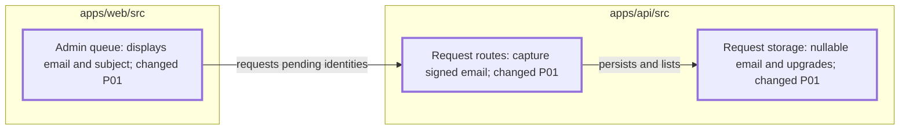

<!-- markdownlint-disable-file -->
# RPI Plan: Admin request email

## Task Metadata

Task ID and slug: admin-request-email. Date: 2026-11-19.

## Executive Summary

Show email alongside the subject in pending access requests. Capture it only from validated token claims and persist it as optional display metadata. Preserve all grant permissions and subject-based identity.

### What You May Not Know

Old requests cannot be backfilled without a new token-bearing submission. Show "Email unavailable" for them. PostgreSQL uses the existing explicit additive upgrade path.

## Phase Checklist

### After

Thick borders mark changed parts. Existing connections remain unchanged.

<!-- rpi:phase id=P01 -->
### [x] P01: Preserve and display requester email

Goals:
* Administrators can distinguish requesters without losing their stable subject.

Dependencies:
* Research C1-C4; no external dependency.

Changes in the map: request routes, request storage, admin queue.

<!-- rpi:task id=P01-T01 -->
#### [x] P01-T01: Carry optional email through persistence and API

Goals:
* Signed email survives submission, restarts, and admin listing.

Requirements:
* FR-001, FR-002, NFR-001, NFR-002.

Details:
* Normalize `email`, then a valid string in `emails`; never trust request-body identity. Missing metadata stays null.
* Add nullable `email` through idempotent SQLite initialization and PostgreSQL upgrade. Keep legacy SQLite imports and existing requests intact.
* Pending submissions may refresh available email without changing IDs or timestamps. Resubmissions after decisions refresh metadata.
* Existing API and storage test files own these assertions. No removals; at most six new cases plus focused extensions to existing cases.

References:
* [apps/api/src/web_storage.ts](../../../apps/api/src/web_storage.ts)
* [apps/api/src/web_app.ts](../../../apps/api/src/web_app.ts)
* [apps/api/src/bootstrap_database.ts](../../../apps/api/src/bootstrap_database.ts)
* [.copilot-tracking/research/2026-11-19/admin-request-email-research.md](../../research/2026-11-19/admin-request-email-research.md): C1-C4.

Dependencies:
* None.

<!-- rpi:task id=P01-T02 -->
#### [x] P01-T02: Display requester metadata and verify

Goals:
* The pending list visibly labels email and subject and clearly reports missing email.

Requirements:
* FR-001, FR-003, NFR-001, NFR-002.

Details:
* Preserve current styling and button naming; add a labeled email line and retain subject.
* Update related user documentation. Extend existing frontend tests for present and missing email.
* Validate targeted API/storage/import tests, frontend admin tests, typecheck, and rendered desktop/mobile states using synthetic data.
* Canonical targets are authored source/tests/docs; build output is generated, not manually edited. No new test tooling.

References:
* [apps/web/src/App.tsx](../../../apps/web/src/App.tsx)
* [apps/web/src/App.test.tsx](../../../apps/web/src/App.test.tsx)
* [docs/audio-poc/web-app.md](../../../docs/audio-poc/web-app.md)

Dependencies:
* P01-T01.

## User Decisions and Requirements

### Confirmed User Direction

* Show requesting users' email in addition to subject in the admin grant screen.
* User selected end-to-end progression with agent-owned decisions.

### Planning Decisions and Feedback

D1 resolved by agent: optional signed-token email, no directory lookup. C1-C4 support the smallest end-to-end solution. No unresolved decision or required walkthrough.

## Planning Readiness and Next Step

Planning complete and Ready; standard critique passed without findings. Automatic parent continues to implementation.
Changes record: `.copilot-tracking/changes/2026-11-19/admin-request-email-changes.md`.

## Functional Requirements

* FR-001: Show available requester email beside retained subject.
* FR-002: Persist trusted claim metadata, including `email` and `emails` variants; migrate without losing historical data.
* FR-003: Show an explicit unavailable state when email is absent.

## Non-Functional Requirements

* NFR-001: Existing admin-only disclosure and issuer/subject grant semantics remain unchanged.
* NFR-002: Targeted tests and typecheck pass; long email wraps at mobile widths.

## Scope and Non-Goals

No deployment, account lookup, new authorization mechanism, or visual redesign.

## Risks and Open Questions

P01-T01: claims may be missing; null is supported and visible, not guessed. Email is not proof of mailbox ownership.

## Sources

Research C1-C4 and the user's request are authoritative for this change. Existing product documents describe broader application scope, not this field-level requirement; no relevant BRD/PRD/ADR identifier supplied.

## Critique Disposition

Standard (default), Complete, Pass, no findings or blockers. No prior critique.

## Artifact Self-Check

Requirements, task ownership, dependencies, scope, source references and validation targets checked. Diagram theme preview not available in planning.

## Follow-Up Items

None.

## Handoff

Proceed automatically after critique, then implement and review once.
