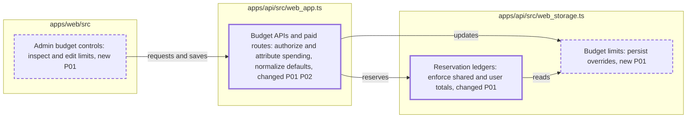

<!-- markdownlint-disable-file -->
# RPI Plan: Budget administration

## Task Metadata

Task ID: budget-administration. Date: 2026-11-19. Mode: automatic; agent-owned decisions.

## Executive Summary

Extend existing admin controls with shared budget limits, visible actuals and charged reservations, and editable per-user $5 lifetime trial allowances. Keep paid provider caps and reconciliation behavior intact.
P01 and P02 are complete. P02 resolved the acceptance review's Speech-default compatibility gap.

### What You May Not Know

Text reservations are not actual charges; historical lyric reservations cannot be reliably assigned to users.

## Phase Checklist

### After

Arrows follow callers to their dependencies. Dashed borders mark additions, thick borders changes. Existing environment caps remain defaults and per-action safety checks. Diagram syntax checked; theme rendering unavailable.

<!-- rpi:phase id=P01 -->
### [x] P01: Enable persistent budget administration and trial enforcement

Goals:
* Administrators can inspect charged usage and actuals, update shared and individual limits, and trust concurrent paid calls to honor them.

Dependencies:
* None.

Changes in the map: Admin budget controls, Budget APIs and paid routes, Budget limits, Reservation ledgers.

<!-- rpi:task id=P01-T01 -->
#### [x] P01-T01: Persist and enforce budget limits

Goals:
* Shared totals and user lifetime limits govern every paid reservation, and existing records survive upgrades.

Requirements:
* FR-001, FR-002, FR-003, FR-004, NFR-001, NFR-002.

Details:
* Add persistent limit settings with actor and timestamp; retain environment totals until overridden. User defaults are $5. Zero is a valid stop-spending limit.
* Add nullable owner attribution to legacy lyric reservations without inventing historical ownership. Known score/Speech history counts toward each user.
* Use decimal arithmetic and the existing serialized transaction for aggregate checks and updates. Score idempotent replays remain free; safe reconciled retries only add their existing reservation delta.
* Report confirmed Speech/AI actuals separately from charged text ceilings and conservative Speech amounts; do not sum overlapping AI actuals into charged usage.
* Bootstrap/import/explicit PostgreSQL upgrade/readiness checks cover new schema. SQLite imports accept legacy lyric columns and optional new settings.

References:
* [apps/api/src/web_storage.ts](../../../apps/api/src/web_storage.ts): transaction and ledger contracts.
* [apps/api/src/bootstrap_database.ts](../../../apps/api/src/bootstrap_database.ts): additive upgrades and import.
* [.copilot-tracking/research/2026-11-19/budget-administration-research.md](../../research/2026-11-19/budget-administration-research.md): C1/C5.

Dependencies:
* None.

<!-- rpi:task id=P01-T02 -->
#### [x] P01-T02: Expose admin and user budget workflows

Goals:
* Administrators see truthful usage and save limits; all paid HTTP paths attribute the correct user and preflight full jingles.

Requirements:
* FR-001, FR-002, FR-003, FR-004, NFR-001, NFR-003.

Details:
* Add strict authenticated admin budget GET/PUT with enabled/admin checks inside storage transactions and owner-specific limit targets restricted to existing users.
* Add own-budget GET for enabled users and show lifetime balance in the creation workspace; refresh it through history reload after paid work.
* Extend current admin screen with exact USD totals, service limits, user allowance editing, refresh/error/loading/saved states, labels, and existing busy/focus conventions.
* Distinguish missing service configuration from zero balance; no provider credentials exposed. A stored limit never enables a disabled provider.

References:
* [apps/api/src/web_app.ts](../../../apps/api/src/web_app.ts): admin route guards, paid backend and jingle quote.
* [apps/web/src/App.tsx](../../../apps/web/src/App.tsx): existing admin UX.
* [apps/web/DESIGN.md](../../../apps/web/DESIGN.md): Operate surface and native fields.

Dependencies:
* P01-T01.

<!-- rpi:task id=P01-T03 -->
#### [x] P01-T03: Verify contracts and document operation

Goals:
* Focused tests establish enforcement, administrative access, persistence, migration, and usable forms.

Requirements:
* FR-001, FR-002, FR-003, FR-004, NFR-001, NFR-002, NFR-003.

Details:
* Test zero/default/raised/lowered limits, exact decimal boundaries, two-user isolation, combined text/score/Speech usage, concurrent reservations, idempotent score replay, admin denial and revoked access, invalid inputs, legacy migration, and fresh/import/upgrade persistence.
* Test frontend load/save/error and user-balance display in existing App tests.
* Test ownership: existing storage, storage-admin, web_app, and App tests. Maximum one new focused budget test file; no test deletions. Existing table-count and legacy SQL fixtures change only for the new schema.
* Run targeted tests together, repository typecheck, and production web build. Expand only if failures expose affected behavior. Inspect rendered admin layout at desktop/mobile with isolated mocked identity/API, never live billing.
* Canonical targets are TypeScript source/tests and web guide/deployment docs; generated bundles are not authored. No new tools or dependencies planned.

References:
* [apps/api/tests/storage-admin.test.ts](../../../apps/api/tests/storage-admin.test.ts)
* [apps/api/tests/web_app.test.ts](../../../apps/api/tests/web_app.test.ts)
* [apps/web/src/App.test.tsx](../../../apps/web/src/App.test.tsx)
* [docs/audio-poc/web-app.md](../../../docs/audio-poc/web-app.md)

Dependencies:
* P01-T01, P01-T02.

<!-- rpi:phase id=P02 -->
### [x] P02: Preserve existing Speech default representations

Goals:
* Valid existing operator settings remain administrable without loosening editable budget inputs.

Dependencies:
* P01.

Changes in the map: Budget APIs and paid routes.

<!-- rpi:task id=P02-T01 -->
#### [x] P02-T01: Normalize defaults without weakening update validation

Goals:
* Admin overview accepts existing valid Speech decimal forms and reports malformed configuration explicitly.

Requirements:
* FR-001, FR-004, NFR-001; RV-001 resolution condition.

Details:
* Reuse the existing `decimal` parser to normalize Speech environment defaults; retain existing strict text defaults and strict administrative update schemas. No changes to provider enablement, reservations, authentication, or schema.
* Add a few regression cases in the existing `web_app.test.ts` for alternate valid Speech defaults, malformed defaults, and rejection of exponent-form update payloads. Maximum two new test declarations; remove none. No fixtures or dependencies beyond the existing runner.
* Run the focused `web_app.test.ts` suite and repository typecheck. No generated targets authored. No browser repeat needed for unchanged response shape/UI.

References:
* [.copilot-tracking/reviews/logs/2026-11-19/budget-administration-review.md](../../reviews/logs/2026-11-19/budget-administration-review.md): RV-001, RD-005/006.
* [apps/api/src/web_app.ts](../../../apps/api/src/web_app.ts): `decimal`, `positive_decimal`, `budget_defaults`.
* [apps/api/tests/web_app.test.ts](../../../apps/api/tests/web_app.test.ts): authenticated fixture and budget endpoint checks.

Dependencies:
* P01-T02, P01-T03.

## User Decisions and Requirements

User requested budget administration and default $5 total trials, with premium subscriptions left for the future. Automatic end-to-end progression and agent-owned decisions authorized.

## Planning Decisions and Feedback

Carry research D1-D5 forward. No unresolved decision groups.
Accepted RV-001 follow-up: normalize existing Speech operator defaults using
the current parser; preserve strict admin-write inputs. Agent-owned decision
from RD-005/006; local source evidence is sufficient, no new research needed.

## Planning Readiness

Complete; P01 and P02 implemented and validated. RV-001 resolved by P02-T01,
with no evidence or decision blocker. Initial standard critique Complete/Pass
reused; no repeated critique under the automatic session's follow-up rules.

## Goals

Persistent, reservation-aware administration and user trial enforcement.

## Scope and Non-Goals

Local API, UI, storage migrations/imports, tests, and directly related docs. No live mutations, deployment, payments, or recurring billing.

## Functional Requirements

* FR-001: Admins see service limits, charged usage, remaining balances, available confirmed actuals, and explicitly unattributed historical text costs.
* FR-002: Admins persist shared text/Speech total overrides and per-user lifetime limits, including zero and values below current usage, without rewriting consumption.
* FR-003: Every new user defaults to $5 total lifetime usage; the same default applies to existing users with attributable history retained. All paid paths enforce combined user usage; free operations continue.
* FR-004: Runtime reservations and full-jingle preflight use effective persisted limits. Existing provider-enable flags, per-action caps, score idempotency, and reconciliation safeguards stay intact.

## Non-Functional Requirements

* NFR-001: Strict decimal strings, finite nonnegative USD, maximum 8 integer and 12 fractional digits; exact decimal accounting and atomic writer checks; no cross-user disclosure.
* NFR-002: Additive SQLite and explicit PostgreSQL upgrades preserve spend and permissions; import supports old/new schema.
* NFR-003: Native labeled fields, visible loading/failure/saved feedback, keyboard operation and no horizontal page overflow at 390px.

## Risks and Open Questions

Legacy ownerless reservations remain explicitly unattributed; do not erase or redistribute them.

## Sources

Research: .copilot-tracking/research/2026-11-19/budget-administration-research.md, C1-C5.

## Critique Disposition

Standard, initial-pass default; Complete/Pass, no findings. Output: [.copilot-tracking/reviews/plans/2026-11-19/budget-administration-plan-critique.md](../../reviews/plans/2026-11-19/budget-administration-plan-critique.md). All four lenses assessed directly for one coherent phase.
P02 is an accepted localized review follow-up; repeat critique skipped by parent
session rule. No unresolved critique findings or significant design changes.

## Artifact Self-Check

Task coverage, dependencies, map, exact input shapes, migration ownership, test budget, generated targets, scope, and summary checked. No BRD/PRD/ADR files found under docs; direct user direction and C1-C5 are authoritative.

## Follow-Up Items

Subscription billing is out of scope.

## Handoff

Automatic parent closes after final follow-up reconciliation. All markers are
complete; localized RV-001 remediation was validated without another review.
