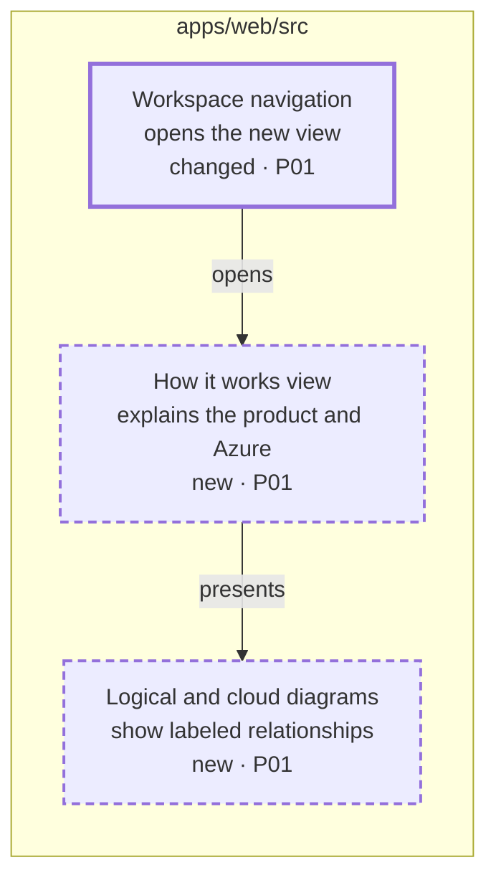

<!-- markdownlint-disable-file -->
# RPI Plan: How it works

## Task Metadata

* Task ID: `how-it-works`
* Task slug: `how-it-works`
* Plan date: 2026-11-19

## Executive Summary

Add a secondary view to the existing signed-in workspace. It will show an accessible logical flow and a representative Azure topology with concise explanations. The approach is grounded in the current code and infrastructure; the standard critique identified one access-state issue that has been resolved in the plan.

### What You May Not Know

The Azure deployment serves the client and API together. Local storage and optional AI configuration differ from the representative Azure topology.

## Phase Checklist

### After

Key: arrows point from a part to what it uses; dashed borders mark new parts and thick borders mark changed parts. The existing navigation opens the new view, which presents both diagrams.

<!-- rpi:phase id=P01 -->
### [x] P01: Add and validate the explanation view

Goals:
* Users can understand the product flow and representative cloud deployment without losing their current workspace.

Dependencies:
* Research C1-C9 and the existing app shell.

Changes in the map: workspace navigation, How it works view, and logical and cloud diagrams.

<!-- rpi:task id=P01-T01 -->
#### [x] P01-T01: Add navigation and explanation

Goals:
* Users can open and leave the view, read two diagrams and their explanations, and return to existing workspace state.

Requirements:
* `FR-001`, `FR-002`, `FR-003`, `NFR-001`, `NFR-002`, `NFR-003`.

Details:
* Extend the existing state-based view model, preserve mounted workspace state, prevent view changes during busy actions, focus the new heading, and preserve sign-out and administrator behavior.
* Show the new navigation only when application access and workspace readiness permit its panel to be displayed; loading and access-denied users must not see an inoperative button.
* Use semantic HTML with labeled flow relationships and responsive styles, not a diagram dependency or a visual-only image. The cloud diagram represents the configured Azure topology rather than a live resource inventory. Explain conditional AI and local SQLite briefly.
* Existing application identity is authoritative. Follow the established red, white, and ink design; reserve yellow for lyric/audio selection.

References:
* [apps/web/src/App.tsx](../../../apps/web/src/App.tsx): `WorkspaceView`, `handleViewChange`, shell and panels.
* [apps/web/src/index.css](../../../apps/web/src/index.css): existing styling and responsive rules.
* [apps/web/DESIGN.md](../../../apps/web/DESIGN.md): design system.
* [.copilot-tracking/research/2026-11-19/how-it-works-research.md](../../research/2026-11-19/how-it-works-research.md): findings C1-C9 and decisions D1-D2.

Dependencies:
* None.

<!-- rpi:task id=P01-T02 -->
#### [x] P01-T02: Verify behavior and maintain the guide

Goals:
* The added page is tested for navigation, content, and preserved state, and the guide makes it discoverable.

Requirements:
* `FR-001`, `FR-002`, `FR-003`, `NFR-001`, `NFR-002`, `NFR-003`.

Details:
* Add at most four focused behavior tests in the existing [apps/web/src/App.test.tsx](../../../apps/web/src/App.test.tsx); no test removals or generated test files. Cover opening and returning, focus, meaningful diagram labels, state preservation, non-admin access, and access-denied visibility as appropriate.
* Run `npm run test:web` and `npm run build --workspace @earwyrm/web`; use a browser to inspect a representative desktop and narrow viewport when a browser is available, and report any inability rather than claim visual verification.
* Update [docs/audio-poc/web-app.md](../../../docs/audio-poc/web-app.md) to mention the view and keep architecture labels aligned with implementation and infrastructure. No other documentation is required unless implementation reveals a directly affected contract.

Guidance:
* [apps/web/src/HowItWorks.tsx](../../../apps/web/src/HowItWorks.tsx) contains the diagram and explanatory content.

References:
* [apps/web/src/App.test.tsx](../../../apps/web/src/App.test.tsx): current test fixtures and navigation patterns.
* [docs/audio-poc/web-app.md](../../../docs/audio-poc/web-app.md): web workspace guide.
* [infra/platform.bicep](../../../infra/platform.bicep): cloud resource declarations.
* [infra/service.bicep](../../../infra/service.bicep): service wiring.

Dependencies:
* `P01-T01`.

## User Decisions and Requirements

### Confirmed User Direction

* Add a How it works page to the existing web app with logical and cloud architecture diagrams and helpful, not overly detailed explanations.
* Use `apps/web` and work end to end, making ordinary decisions without routine approvals.

### Planning Decisions and Feedback

| Group | Decision or feedback item | Status | Owner | Rationale | Evidence | Planning impact |
|---|---|---|---|---|---|---|
| D1 | Reuse existing view navigation and visual system | confirmed | agent | Preserve workspace state and avoid unsupported deep routing. | Research C1, C5, C7 | Include navigation and focus in plan. |
| D2 | Describe a representative Azure topology and conditional services | confirmed | agent | No live deployment was inspected. | Research C3, C8, C9 | Avoid universal deployment claims. |

## Planning Readiness and Next Step

| Field | Record |
|---|---|
| Planning execution and readiness | Complete; Ready for implementation after resolving PC-001 |
| Decision participation | agent-owned; user selected automatic end-to-end |
| Blockers | None |
| Latest critique | [.copilot-tracking/reviews/plans/2026-11-19/how-it-works-plan-critique.md](../../reviews/plans/2026-11-19/how-it-works-plan-critique.md), Revise; PC-001 resolved below |
| Relevant research | [.copilot-tracking/research/2026-11-19/how-it-works-research.md](../../research/2026-11-19/how-it-works-research.md) |
| Plan | `.copilot-tracking/plans/2026-11-19/how-it-works-plan.md` |
| Changes-record role | `.copilot-tracking/changes/2026-11-19/how-it-works-changes.md` will record implementation |
| Continuation owner | confirmed automatic RPI session |
| Required gates or confirmations | Standard critique complete; no unresolved blocking findings |
| Next action | Automatic transition to Review |

## Goals

* Give web users a clear, accurate understanding of how Earwyrm works and is hosted.

## Scope and Non-Goals

### In Scope

* Existing web app navigation, logical and cloud diagrams, concise prose, relevant tests and documentation.

### Non-Goals

* Deployment, infrastructure changes, new APIs, and unrelated changes.

## Functional Requirements

* `FR-001`: Signed-in workspace users can navigate to and from How it works without losing in-progress workspace state.
* `FR-002`: A logical diagram and short explanation describe the brief, music, conditional lyrics and voice, and human review.
* `FR-003`: A cloud diagram and short explanation accurately identify the browser, Entra External ID, shared app/API container, PostgreSQL, Azure Files, and configured AI services, distinguishing local behavior.

## Non-Functional Requirements

* `NFR-001`: Navigation is keyboard-operable, focus reaches the new heading, diagrams have accessible readable labels, and content reflows at 320 CSS pixels without horizontal page overflow.
* `NFR-002`: Claims are supported by current code/infrastructure and do not imply a verified live deployment or universal feature enablement.
* `NFR-003`: Preserve existing authentication, administrator behavior, active form state, busy guards, and established design tokens; add no runtime dependencies.

## Risks and Open Questions

| Priority | Type | Risk | Affected work | Impact | Smallest action | Owner |
|---|---|---|---|---|---|---|
| Medium | risk | Architecture and optional-service descriptions drift | `P01-T01`, `P01-T02` | Misleading users | Compare with source and document maintenance | implementer |
| Medium | risk | Visual connections become illegible at small width | `P01-T01`, `P01-T02` | Reduced comprehension | Inspect desktop and 320px rendering, retain semantic labels | implementer |

## Dependencies

* Research C1-C9 supplies evidence; no separate business-requirement artifacts found in the initial documentation search.

## Sources

* [.copilot-tracking/research/2026-11-19/how-it-works-research.md](../../research/2026-11-19/how-it-works-research.md): source evidence and decisions.

## Critique Disposition

* Critique setting and provenance: `standard`, default initial pass.
* Critique status: `Complete`.
* Latest critique and verdict: [.copilot-tracking/reviews/plans/2026-11-19/how-it-works-plan-critique.md](../../reviews/plans/2026-11-19/how-it-works-plan-critique.md), `Revise`.
* Earlier critiques: none.
* Limitations: diagram preview unavailable in this planning phase; the implementation will inspect the rendered page.

| Critique run and finding | Disposition | Action owner | Exact resolving evidence | Decision route | Plan response |
|---|---|---|---|---|---|
| PC-001 | resolved | planning parent | P01-T01 gating and P01-T02 access-denied test | direct correction | Require navigation only when the workspace is ready and accessible. |

## Artifact Self-Check

* Requirements map to both tasks; dependencies, scope, critique and readiness are recorded.
* Change-map preview was not rendered during planning; implementation will visually inspect the delivered page.

## Follow-Up Items

* None.

## Handoff

* Authoritative implementation handoff: Planning Readiness and Next Step.
