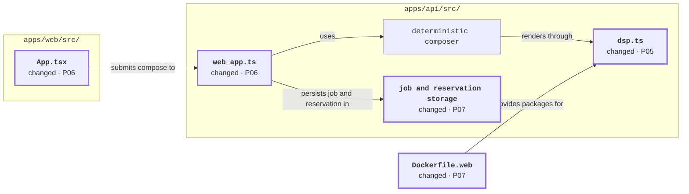
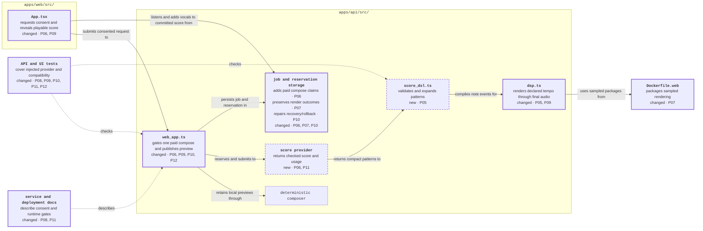

<!-- markdownlint-disable-file -->
# RPI Plan: LLM MIDI Jingle Implementation

## Task Metadata

* Task ID: llm-midi-jingle-build
* Task slug: llm-midi-jingle-build
* Plan date: 2026-11-19

## Executive Summary

* Bottom line: Implement the approved bounded-score design: validate a compact, versioned arrangement, compile it into Earwyrm's deterministic MIDI/audio path, and invoke Foundry only from the accepted-lyrics compose action with explicit paid consent and idempotent budget reservation.
* Why this matters: It adds editable LLM-authored jingle arrangements while retaining deterministic previews, legacy composition, private artifacts, and the existing shared deployment and spending controls.
* Planning result: Complete; P05-P12 are implemented and validated within the unchanged offline scope. Original and surface findings are resolved.
* Confidence and uncertainty: The repository integration approach is grounded in the parent research and plan. The configured production model/version, live budget values, remote provider idempotency/status contract, and subjective musical quality remain unverified.

### What You May Not Know

The original plan's critique returned Revise and all 12 findings were resolved there. Its NFR-007 telemetry addition came after that critique; this child plan inherits it, and the session will not run a second critique. A live listening evaluation would require separate paid compose calls and is not included in this implementation scope.

## Phase Checklist

### Before

### After

Key: arrows point from a part to what it uses; dotted arrows, tests and docs; dashed border, new; thick border, changed; each tag names the phases that make the change.

The UI and compose route add a one-shot, consented provider request with a durable shared-budget claim, without replacing deterministic previews (P06). The new score provider returns a bounded DSL that the compiler validates and expands into the existing renderer, with tempo-aware timing and durable job identity (P05, P07). The web image gains the sampled runtime, and tests and documentation cover compatibility and operational limits (P07, P08).

<!-- rpi:phase id=P05 -->
### [x] P05: Implement the bounded score and renderer contract

Goals:
* Accept only supported, versioned patterns and render their declared tempo without changing legacy timing behavior.

Dependencies:
* None.

Changes in the map: Add the score DSL/compiler and update tempo-aware MIDI/audio rendering.

<!-- rpi:task id=P05-T01 -->
#### [x] P05-T01: Implementing the versioned arrangement DSL

Goals:
* Validated score input can be deterministically expanded into supported note events.

Requirements:
* FR-007; parent FR-001, FR-002; NFR-008; parent NFR-001, NFR-002.
* Research D1 and C1-C8, C13-C14, C17: constrain v1 to 4/4, 8-12 bars, 100-140 BPM, declared major/minor key, chord progression, hook motif, `retro-synth`, and existing renderer roles/palette.
* Reject unknown fields, unsupported roles, malformed or out-of-range patterns, and scores that cannot cover accepted lyric timing or fit the existing 12-30 second envelope.

Details:
* Add the compact, versioned score contract and deterministic pattern expansion in the API. The model describes patterns; application code owns note-event generation and all range checks. Preserve the existing melody-similarity screening before render or persistence.
* Add focused schema/compiler tests for boundary values, malformed patterns, unsupported roles, lyric timing coverage, and screened-score rejection. Use static fixtures; do not call a live provider.

Guidance:
* P05-T02 should consume `ArrangementScore` and `compile_score` from [apps/api/src/score_dsl.ts](../../../apps/api/src/score_dsl.ts). The compiler expands per-bar eighth-note patterns over the score's four-chord progression, returns second-based events and lyric-aligned vocal notes, and applies the existing similarity screen before returning.

References:
* [apps/api/src/melody.ts](../../../apps/api/src/melody.ts): Existing note and composition contracts.
* [apps/api/src/dsp.ts](../../../apps/api/src/dsp.ts): Existing note validation, renderer roles, and fixed tempo.
* [apps/api/src/melody_service.ts](../../../apps/api/src/melody_service.ts): Screening before render and persistence.
* [.copilot-tracking/plans/2026-11-19/llm-midi-jingle-plan.md](./llm-midi-jingle-plan.md): Parent plan requirements FR-001 and FR-002 and decisions D1/D5.
* [.copilot-tracking/research/2026-11-19/llm-midi-jingle-research.md](../../research/2026-11-19/llm-midi-jingle-research.md):
  * Research D1 and C1-C8, C13-C14, C17 under the selected approach and current renderer.

Dependencies:
* None.

<!-- rpi:task id=P05-T02 -->
#### [x] P05-T02: Rendering tempo-aware scores compatibly

Goals:
* New scores render at their declared tempo and bar count while legacy callers retain established 120 BPM behavior.

Requirements:
* FR-007; parent FR-003, FR-006; NFR-008, NFR-009; parent NFR-004.
* Research C2-C4 and C13: preserve second-based audio/lyric timing, serialize the declared MIDI tempo, and keep new-score duration within 12-30 seconds.
* Do not broaden or silently round the legacy whole-bar request contract.

Details:
* The parent plan bounds new arrangements to 8-12 bars at 100-140 BPM, about 13.7-28.8 seconds. Extend timing calculations for fractional durations without changing legacy defaults. Verify MIDI tempo metadata and audio/note alignment.
* Add regressions for legacy 120 BPM output and focused cases for tempo-derived durations and invalid boundaries.

Guidance:
* P07-T01 must pass the score's `tempo_bpm` to [apps/api/src/backing.ts](../../../apps/api/src/backing.ts) and to `normalize`, `mix`, `align`, and `place_spoken` when processing fractional durations. [apps/api/src/melody_service.ts](../../../apps/api/src/melody_service.ts) now accepts fractional result durations; keep `CompositionRequest` on the legacy whole-bar `ScoreDuration` contract.

References:
* [apps/api/src/dsp.ts](../../../apps/api/src/dsp.ts): Current `ScoreDuration`, fixed MIDI tempo, and rendering.
* [apps/api/src/backing.ts](../../../apps/api/src/backing.ts) and [apps/api/src/jingle_tools.ts](../../../apps/api/src/jingle_tools.ts): Audio output and artifact duration validation.
* [.copilot-tracking/plans/2026-11-19/llm-midi-jingle-plan.md](./llm-midi-jingle-plan.md): Parent FR-003 and FR-006 and NFR-001 and NFR-004.

Dependencies:
* P05-T01.

<!-- rpi:phase id=P06 -->
### [x] P06: Integrate the provider behind consent and shared budgets

Goals:
* The existing accepted-lyrics compose action can request one bounded score under explicit user consent without affecting deterministic previews.

Dependencies:
* P05 must define the score schema and compiler.
* Existing shared model and paid-text budget settings must be reused without inventing limits.

Changes in the map: Add the Foundry score provider, idempotent shared-budget reservation, paid compose route, and consent UI.

<!-- rpi:task id=P06-T01 -->
#### [x] P06-T01: Adding the structured-output score provider

Goals:
* The provider returns a schema-valid compact arrangement or an explicit failure, with content-free, context-propagated telemetry.

Requirements:
* FR-008; parent FR-001 and FR-002; NFR-008 and NFR-010; parent NFR-002, NFR-005, and NFR-007.
* Research C5-C8, C14-C17: use shared Foundry configuration, a 1,200-token completion cap, a 64 KiB serialized-request cap, and no provider call for deterministic previews.
* Send only the validated selected brief fields, CTA, accepted lyrics, and v1 style; exclude contact details, raw chat, and browser-supplied prompt instructions. Invoke only after lyric acceptance and `validate_draft`.
* Reject refusal, truncation, malformed/oversized output, and schema-invalid responses without a success-shaped fallback.
* Use applicable OpenTelemetry GenAI client conventions, propagate context, and record outcome and duration without unbounded metric dimensions. The API uses `@opentelemetry/api` only; the host supplies the SDK, exporter, and required service/SDK resources. Do not add an in-process SDK/exporter or endpoint configuration in this plan. Exclude prompts, brief/lyric content, contact details, and raw provider output.

Details:
* Follow the injected transport and strict structured-output pattern in `lyric_cloud.ts`. Tests use injected responses and verify request minimization, failure behavior, and content-free telemetry. Do not inspect production secrets or make live model calls.
* Keep telemetry API-only, matching the existing lyric provider. The process host owns SDK/resource/exporter setup; spans and metrics are no-ops when a host does not register a provider, so offline tests verify instrumentation through injection rather than export.
* Before any future live inference, verify model/version capability and nonsecret settings; an unsupported model is a no-go, not permission to change shared settings or exceed caps.

References:
* [apps/api/src/lyric_cloud.ts](../../../apps/api/src/lyric_cloud.ts): Existing Foundry request and injected backend pattern.
* [apps/api/src/lyrics.ts](../../../apps/api/src/lyrics.ts), [apps/api/src/jingle_chat.ts](../../../apps/api/src/jingle_chat.ts), and [apps/api/src/melody.ts](../../../apps/api/src/melody.ts): Validated brief, accepted lyrics, and request conversion.
* [OpenTelemetry Semantic Conventions](https://opentelemetry.io/docs/specs/semconv/): Current GenAI client span and metric conventions.
* [.copilot-tracking/plans/2026-11-19/llm-midi-jingle-plan.md](./llm-midi-jingle-plan.md): Parent FR-001 and FR-002 and NFR-002, NFR-005, and NFR-007.
* [.copilot-tracking/research/2026-11-19/llm-midi-jingle-research.md](../../research/2026-11-19/llm-midi-jingle-research.md):
  * Research C5-C8 and C14-C17 under provider and compose-flow evidence.

Dependencies:
* P05-T01.

<!-- rpi:task id=P06-T02 -->
#### [x] P06-T02: Requiring consent and an idempotent budget reservation

Goals:
* A web compose request cannot invoke the paid provider without explicit consent and one reservation within the shared ceilings.

Requirements:
* FR-008; parent FR-004; NFR-008 and NFR-010; parent NFR-003 and NFR-005.
* Research C8, C12, C15-C17: keep all three guided previews deterministic; add no composer-specific deployment flag, feature-level approval, or mandatory preview.
* Reuse `LYRIC_MODEL_CALL_MAX_USD`, `LYRIC_PER_ACTION_CAP_USD`, and `LYRIC_TOTAL_BUDGET_USD`; disclose the maximum call cost and fail closed if the configured call does not fit.
* Key the reservation by owner/action/logical job ID. Check committed results first, persist one reservation and one durable submit claim before the provider call, and prevent concurrent or ambiguous retries from submitting again.

Details:
* Extend the existing paid-action consent and shared budget flow; keep local/MCP deterministic composition available. Missing or declined consent, invalid input, or exhausted caps returns an explicit non-success outcome with zero provider calls.
* Add API and UI tests for consent, exhausted budgets, reservation identity/order, committed retry, concurrent requests, and provider call counts. No test may make a live call.

Guidance:
* P07-T01 must reuse `score_reservations` and the `claim_score_compose`, `commit_score_compose`, and `finish_score_compose` APIs in [apps/api/src/web_storage.ts](../../../apps/api/src/web_storage.ts) for submission claims, committed score recovery, and uncertain outcomes. The additive table is created with the lyric budget schema and the explicit PostgreSQL upgrade path.

References:
* [apps/api/src/web_app.ts](../../../apps/api/src/web_app.ts): Existing compose route and consent boundary.
* [apps/web/src/App.tsx](../../../apps/web/src/App.tsx): Guided previews and compose UI.
* [apps/api/src/lyric_budget.ts](../../../apps/api/src/lyric_budget.ts) and [docs/service-contracts.md](../../../docs/service-contracts.md): Shared budget and consent contract.
* [apps/api/src/web_storage.ts](../../../apps/api/src/web_storage.ts) and [apps/api/src/bootstrap_database.ts](../../../apps/api/src/bootstrap_database.ts): Existing reservation schema and upgrade paths.

Dependencies:
* P05-T01.
* P06-T01.

<!-- rpi:phase id=P07 -->
### [x] P07: Preserve job outcomes and sampled rendering

Goals:
* Scores, provider outcomes, reservations, and artifacts remain tied to one durable job, and the web runtime can render sampled audio.

Dependencies:
* P05 must establish score expansion and render timing.
* P06 must establish provider and consent/budget boundaries.

Changes in the map: Update durable job storage and `Dockerfile.web` for compatible outcomes and sampled rendering.

<!-- rpi:task id=P07-T01 -->
#### [x] P07-T01: Persisting score jobs and uncertain outcomes safely

Goals:
* A committed job recovers the same score and artifacts without another model call, and an ambiguous provider outcome remains blocked until reconciled.

Requirements:
* FR-009; parent FR-003 and FR-004; NFR-009 and NFR-010; parent NFR-003, NFR-004, and NFR-005.
* Research C3, C6-C8, C13-C17: preserve logical-job identity, request conflict detection, artifact digests, reservation identity, and preview verification.
* Persist score version and provider provenance; for ambiguous remote timeouts, persist `outcome_unknown`, return `provider_outcome_unknown` with `retryable: false`, and do not resubmit until provider and billing evidence establishes a non-accepted outcome.
* Use additive, versioned SQLite and PostgreSQL migrations; preserve v1 jobs/reservations and do not widen v1 `render_jobs.status`.

Details:
* Extend `MelodyService`'s serialized creation/recovery path. Commit the score and artifacts with existing screening and digest behavior; use one durable submitter claim for the logical job. Concurrent calls recover current state instead of invoking the provider.
* Test committed retries, same-job concurrency, changed-request conflicts, render failures, digest mismatch, screening rejection, ambiguous timeout, blocked response, reconciliation and confirmed-not-accepted retry, and migration/rollback against existing fixtures.

References:
* [apps/api/src/melody_service.ts](../../../apps/api/src/melody_service.ts): Current serialized jobs, screening, persistence, and digests.
* [apps/api/src/persistence.ts](../../../apps/api/src/persistence.ts), [apps/api/src/bootstrap_database.ts](../../../apps/api/src/bootstrap_database.ts), and [apps/api/src/web_storage.ts](../../../apps/api/src/web_storage.ts): Transaction and database upgrade patterns.
* [.copilot-tracking/plans/2026-11-19/llm-midi-jingle-plan.md](./llm-midi-jingle-plan.md): Parent FR-003 and FR-004 and NFR-003 and NFR-004.

Dependencies:
* P05-T01.
* P06-T01.
* P06-T02.

<!-- rpi:task id=P07-T02 -->
#### [x] P07-T02: Packaging the sampled renderer in the web image

Goals:
* The Azure-selected web image has a readable SoundFont, can produce sampled audio locally, and preserves package notices.

Requirements:
* FR-010; parent FR-005; NFR-009.
* Research C9-C11 and W4: configure `/usr/share/sounds/sf2/FluidR3_GM.sf2`, verify non-root readability, and preserve the package copyright/notice files.

Details:
* Mirror the established sampled-runtime package pattern from `Dockerfile`, but update only `Dockerfile.web`. Identify notice paths using `dpkg-query -L fluid-soundfont-gm`; do not characterize package attribution as a legal review.
* Build the local web image, run it as its configured non-root user, and render a known MIDI fixture to a valid WAV. Do not deploy the image.

References:
* [Dockerfile](../../../Dockerfile) and [Dockerfile.web](../../../Dockerfile.web): Existing local sampled setup and Azure-selected runtime.
* [apps/api/src/backing.ts](../../../apps/api/src/backing.ts): Runtime SoundFont selection and sampled rendering.
* [.copilot-tracking/research/2026-11-19/llm-midi-jingle-research.md](../../research/2026-11-19/llm-midi-jingle-research.md):
  * Research C9-C11 and W4 under deployment and SoundFont evidence.

Dependencies:
* P05-T02.

<!-- rpi:phase id=P08 -->
### [x] P08: Align contracts and validate without live inference

Goals:
* Automated evidence demonstrates integration and compatibility; service and deployment documentation match the implemented boundaries without making live or deployment claims.

Dependencies:
* P06 must establish the paid compose behavior.
* P07 must establish durable outcomes and sampled rendering.

Changes in the map: Update service/deployment documentation and run injected-provider, compatibility, and local-image checks.

<!-- rpi:task id=P08-T01 -->
#### [x] P08-T01: Reconciling service and deployment documentation

Goals:
* Service documentation describes the separate deterministic preview and paid compose paths, while deployment guidance matches the existing PoC workflow.

Requirements:
* FR-010; parent FR-004, FR-005, and FR-006.
* Research C8-C12 and C15-C17: preserve normal shared voice/chat/lyrics deployment, existing `maintenance_approved` and billing safeguards, and no composer-specific flag or mandatory deployment preview.
* Describe model/budget pre-live checks, consent, timeout reconciliation, and SoundFont/notice behavior without exposing secrets or claiming deployment.

Details:
* Reconcile `docs/azure-deployment.md` with `azure.yaml`, the selected deployment workflow, and infrastructure defaults. Update `docs/service-contracts.md` for paid compose and deterministic previews. Do not change Azure resources, workflows, or deploy.

Guidance:
* Document that the API exposes OpenTelemetry API instrumentation but the host must configure the SDK, service/SDK resources, and exporter; this implementation does not configure or verify telemetry export.

References:
* [docs/service-contracts.md](../../../docs/service-contracts.md): Existing compose, consent, budgets, and preview language.
* [docs/azure-deployment.md](../../../docs/azure-deployment.md), [azure.yaml](../../../azure.yaml), [.github/workflows/deploy-web.yml](../../../.github/workflows/deploy-web.yml), [.github/workflows/prepare-deployment.yml](../../../.github/workflows/prepare-deployment.yml), and [infra/main.bicep](../../../infra/main.bicep): Existing defaults and safeguards to preserve.
* [.copilot-tracking/plans/2026-11-19/llm-midi-jingle-plan.md](./llm-midi-jingle-plan.md): Parent FR-004, FR-005, and FR-006 and deployment decisions.

Dependencies:
* P06-T02.
* P07-T02.

<!-- rpi:task id=P08-T02 -->
#### [x] P08-T02: Validating the implementation with injected providers

Goals:
* The new path and existing behavior pass repository checks without external model calls, deployment, or paid sample generation.

Requirements:
* FR-007, FR-008, FR-009, and FR-010; NFR-008, NFR-009, and NFR-010; parent NFR-004, NFR-005, and NFR-007.
* Automated tests use injected provider responses and preserve deterministic previews, legacy composition, artifact integrity, budget rules, and content-free telemetry.
* Validate using the repository's API tests, typecheck, build, and the relevant UI/docs checks; locally build and smoke-test the web image when Docker is available.

Details:
* Test ownership: the existing suites `apps/api/tests/creative-audio.test.ts`, `apps/api/tests/web_app.test.ts`, `apps/api/tests/storage.test.ts`, `apps/api/tests/storage-admin.test.ts`, and `apps/web/src/App.test.tsx`. Remove no tests; add no test files, frameworks, or dependencies; cap additions at 30 focused test cases, using table-driven cases where useful. Keep generated files in temporary test directories.
* Cover schema/compiler boundaries, provider refusal/truncation/errors, consent/budget/reservation order, retry/reconciliation, migrations, telemetry redaction, and legacy 120 BPM behavior with semantic tests; retain regression coverage for previews, artifacts, and existing records.
* Run `npm test`, `npm run typecheck`, and `npm run build`; build/smoke-test the local web image if Docker is available. Assert tests make zero live provider calls.
* The parent NFR-006 listening evaluation requires three separate consented paid outputs. Keep that evaluation as a follow-up requiring explicit authorization; do not generate samples or claim subjective musical quality in this task.

References:
* [apps/api/package.json](../../../apps/api/package.json) and [package.json](../../../package.json): Existing API, workspace test, typecheck, and build commands.
* [docs/idea.md](../../../docs/idea.md): User concept for future representative listening prompts.
* [.copilot-tracking/plans/2026-11-19/llm-midi-jingle-plan.md](./llm-midi-jingle-plan.md): Parent requirements NFR-004, NFR-005, NFR-006, and NFR-007 and all resolved critique dispositions.

Dependencies:
* P05-T01.
* P05-T02.
* P06-T01.
* P06-T02.
* P07-T01.
* P07-T02.
* P08-T01.

<!-- rpi:phase id=P09 -->
### [x] P09: Complete playable paid-score continuity

Goals:
* Paid arrangements are listenable and reusable for final vocals without changing legacy timing or creating another model call.

Dependencies:
* Completed P05-P08.

Changes in the map: Connect the UI and compose route to published score previews; propagate tempo through final audio.

<!-- rpi:task id=P09-T01 -->
#### [x] P09-T01: Publishing and rendering the exact paid arrangement

Goals:
* A successful paid compose request exposes one owner-scoped playable run that remains usable after retry/reload and in final audio.

Requirements:
* RV-001; FR-007, FR-009, FR-010; NFR-008, NFR-009; parent FR-003.
* Preserve immutable lyric-option ownership, brief checks, score/backing/MIDI digests and one provider call. Publish/recover the existing job as a run/output with option metadata; UI refreshes and reveals that run.
* Persist optional validated score tempo with CompositionResult while old results remain unchanged. Final rendering uses sample-rounded frames and tempo-aware form/normalize/align/mix; do not broaden the legacy whole-bar request contract.

Details:
* Reuse the existing deterministic compose publication and selection shape, not a second playback mechanism. Score retries must not require new generation or bypass paid consent/authentication.
* Test injected score compose through run selection and an offline speech provider, including fractional duration and matching original MIDI/backing identity. Extend the existing UI test to assert the result becomes inspectable, not just announced.

References:
* [.copilot-tracking/reviews/logs/2026-11-19/llm-midi-jingle-build-review.md](../../reviews/logs/2026-11-19/llm-midi-jingle-build-review.md): RV-001.
* [apps/api/src/web_app.ts](../../../apps/api/src/web_app.ts), [apps/api/src/render.ts](../../../apps/api/src/render.ts), [apps/api/src/melody_service.ts](../../../apps/api/src/melody_service.ts), [apps/web/src/App.tsx](../../../apps/web/src/App.tsx).

Dependencies:
* Completed P07-T01.

<!-- rpi:phase id=P10 -->
### [x] P10: Repair durable recovery and rollback boundaries

Goals:
* Valid stores migrate, aborted transactions leave no artifacts, and interrupted paid claims recover only under evidence-backed administration and current budget coverage.

Dependencies:
* Completed P06-P08.

Changes in the map: Repair store/import validation, attempt recovery, retry accounting and render transaction cleanup.

<!-- rpi:task id=P10-T01 -->
#### [x] P10-T01: Preserving nullable imports and transaction cleanup

Goals:
* Current-schema null provider provenance imports safely; failed job commits remove only the newly created artifacts.

Requirements:
* RV-002 and RF-001; FR-009; NFR-009; parent NFR-004.
* Null provenance is valid for submitted/unknown/legacy rows; malformed non-null provenance still fails before target writes.
* Actual INSERT or COMMIT failure rolls back the job and removes its new artifact directory for both legacy and score submissions. Existing recovered jobs are never deleted.

Details:
* Keep existing schemas and transaction helpers. Consolidate cleanup ownership around the real transaction rather than adding nested compensating commit flags. Test commit failure using the existing injected connection pattern and retry.

References:
* [.copilot-tracking/reviews/logs/2026-11-19/llm-midi-jingle-build-review.md](../../reviews/logs/2026-11-19/llm-midi-jingle-build-review.md): RV-002.
* [.copilot-tracking/reviews/logs/2026-11-19/llm-midi-jingle-build-refinement.md](../../reviews/logs/2026-11-19/llm-midi-jingle-build-refinement.md): RF-001.
* [apps/api/src/bootstrap_database.ts](../../../apps/api/src/bootstrap_database.ts), [apps/api/src/melody_service.ts](../../../apps/api/src/melody_service.ts), [apps/api/src/persistence.ts](../../../apps/api/src/persistence.ts).

Dependencies:
* Completed P07-T01.

<!-- rpi:task id=P10-T02 -->
#### [x] P10-T02: Recovering interrupted claims with fenced attempts and current costs

Goals:
* An administrator can resolve a stopped submitter without allowing live-claim theft or unreserved retries.

Requirements:
* RV-003 and RV-005; FR-008, FR-009; NFR-010; parent FR-004/NFR-003.
* Preserve ordinary unknown-outcome evidence reconciliation. A `submitted` row additionally requires explicit `confirmed_submission_stopped: true`; no age-based automatic reclamation.
* Include attempt number in score commit/failure update predicates so a previous worker cannot commit into a later claim.
* Before a reconciled retry, reserve at least the greater of the stored and current call ceilings, include all shared spend in the total check, and do not refund or duplicate unchanged reservations.

Details:
* No new schema or lease service is necessary: the existing attempt count provides fencing, and operator evidence is the established reconciliation authority. Document the stop-worker requirement explicitly; app code does not claim to verify provider/billing evidence.
* Test a durable submitted row across app restart, missing/explicit stop attestation, rejected late result writes, concurrent retry ownership, repricing increase and reduced total cap.

References:
* [.copilot-tracking/reviews/logs/2026-11-19/llm-midi-jingle-build-review.md](../../reviews/logs/2026-11-19/llm-midi-jingle-build-review.md): RV-003/RV-005.
* [apps/api/src/web_storage.ts](../../../apps/api/src/web_storage.ts), [apps/api/src/web_app.ts](../../../apps/api/src/web_app.ts), [apps/api/tests/web_app.test.ts](../../../apps/api/tests/web_app.test.ts).

Dependencies:
* Completed P06-T02 and P07-T01.

<!-- rpi:phase id=P11 -->
### [x] P11: Complete usage evidence and validate required fixes

Goals:
* Reported provider usage and operator guidance match the accepted telemetry boundary, and focused regressions establish completion.

Dependencies:
* P09 and P10 for integrated validation.

Changes in the map: Complete provider usage, documentation and tests for the repaired workflow and durability contracts.

<!-- rpi:task id=P11-T01 -->
#### [x] P11-T01: Recording usage and validating the repaired contracts

Goals:
* Injected evidence verifies reported token counts and the playable/recoverable workflow without paid calls.

Requirements:
* RV-004; FR-008, FR-009, FR-010; NFR-009, NFR-010; parent NFR-002/NFR-007.
* Record validated nonnegative provider-reported input/output token usage on the existing GenAI span; missing usage stays absent, never estimated. No prompts, identities or output content in telemetry.
* Document host-owned SDK, exporter, required service/SDK resources and unverified export; document interrupted-submit administration.
* Test ownership: existing creative-audio, creative-lyrics, web_app, storage-admin and web App tests; removals none; at most 12 additional focused cases for this loop, prefer extending existing cases. No dependency changes, new test framework or generated source.
* Run targeted tests, workspace typecheck and build. Escalate to full tests only for cross-module regressions; no new container build unless runtime packaging changes.

Details:
* Use existing OpenTelemetry API and SDK response usage names. Run a surface acceptance/refinement pass after significant public contract changes, confined to these findings; do not rerun full initial reviews.

References:
* [.copilot-tracking/reviews/logs/2026-11-19/llm-midi-jingle-build-review.md](../../reviews/logs/2026-11-19/llm-midi-jingle-build-review.md): RV-004.
* [apps/api/src/score_cloud.ts](../../../apps/api/src/score_cloud.ts), [docs/service-contracts.md](../../../docs/service-contracts.md), [docs/azure-deployment.md](../../../docs/azure-deployment.md).

Dependencies:
* P09-T01, P10-T01, P10-T02.

<!-- rpi:phase id=P12 -->
### [x] P12: Preserve tolerated score boundaries during publication

Goals:
* Valid committed scores remain playable when independent bar/note arithmetic differs by binary rounding.

Dependencies:
* P09-P11 are complete.

Changes in the map: Align the route's artifact-reader boundary and extend the existing end-to-end regression; no connection changes.

<!-- rpi:task id=P12-T01 -->
#### [x] P12-T01: Reconciling artifact-reader timing tolerance

Goals:
* Boundary-tempo score publication and final vocals retain exact committed artifacts without loosening material duration containment.

Requirements:
* Surface RV-001 in the second acceptance record; original RV-001; FR-009, FR-010, NFR-009.
* Reproduce a compiler-produced last-bar arithmetic boundary using the existing paid-score integration case, starting with 140 BPM/12 bars. Align the reader with the renderer's existing 1 ns tolerance only when reproduced; do not broaden note/duration schema ranges.
* Retain a regression that rejects materially out-of-duration committed score events.
* Test ownership: [apps/api/tests/web_app.test.ts](../../../apps/api/tests/web_app.test.ts) and existing JingleTools tests; no removals, new files, dependencies or live calls. Add at most two cases, keeping the combined follow-up loop at no more than 12 additions.
* Run targeted affected API tests, workspace typecheck/build and whitespace. No repeat full review for a localized condition fix; no container rebuild or paid/live work.

Details:
* The compiler and DSP already use bounded floating arithmetic. Preserve artifact digests, ownership and input checks; this is a numeric containment consistency repair, not a change to the trusted-resource boundary.

References:
* [.copilot-tracking/reviews/logs/2026-11-19/llm-midi-jingle-build-review-2.md](../../reviews/logs/2026-11-19/llm-midi-jingle-build-review-2.md): RV-001.
* [apps/api/src/jingle_tools.ts](../../../apps/api/src/jingle_tools.ts), [apps/api/src/dsp.ts](../../../apps/api/src/dsp.ts), and [apps/api/src/score_dsl.ts](../../../apps/api/src/score_dsl.ts): Artifact containment and existing arithmetic contract.

Dependencies:
* P09-T01 and P11-T01.

## User Decisions and Requirements

### Confirmed User Direction

* User requested investigation and a plan, then explicitly changed scope with “build this,” referring to the existing LLM MIDI jingle plan.
* Implement that plan's bounded score-to-render path; retain deterministic previews, explicit paid per-action consent, and shared budget ceilings.
* Do not deploy or make paid live inference calls. Keep automated provider tests injected.
* Preserve the PoC deployment behavior: no composer-specific deployment toggle, feature-level approval, or mandatory preview gate; retain existing deployment safeguards.
* Keep OpenTelemetry API instrumentation in the API and rely on the runtime host for SDK, exporter, and required service/SDK resources; do not add in-process SDK/exporter dependencies or endpoint configuration.

### Planning Decisions and Feedback

| Group | Decision or feedback item | Status | Owner | Rationale or input needed | Evidence | Planning impact |
|-------|---------------------------|--------|-------|--------------------------|----------|-----------------|
| D8 | Implement the existing bounded plan, with no deployment or paid live inference | Selected | User | The direct request authorizes implementation; existing consent and safety boundaries remain | User: "build this"; parent plan and research | Sets child scope and no-live validation boundary |
| D9 | Keep score telemetry API-only; host supplies the SDK, exporter, and required service/SDK resources | Selected | User | Avoid adding an in-process SDK or unconfigured outbound exporter; export is not verified until host configuration exists | User selected `host_provided`; `apps/api/package.json` has `@opentelemetry/api` only | P06-T01 instrumentation remains content-free and host-managed |
| D10 | Complete required parent Review fixes in the same plan | Selected | Agent under saved automatic mode | RV-001 through RV-005 and RF-001 are in-scope correctness gaps; optional idea extensions remain deferred | Parent review/refinement records, resumed user direction | Append P09-P11; keep P05-P08 checked; no repeat critique |
| D11 | Recover interrupted submissions only with explicit operator stop attestation and evidence | Selected | Agent under saved automatic mode | Age alone cannot prove a worker stopped; automatic lease stealing could duplicate paid calls | RV-003 and existing admin reconciliation | Permit submitted-state reconciliation only when operator confirms original submitter stopped; fence result writes by attempt number; no automatic resubmit |

## Planning Readiness and Next Step

| Field | Record |
|-------|--------|
| Planning execution and readiness | Complete; P05-P12 implemented and validated, including all required surface findings |
| Decision participation | Agent-owned; inherited from the confirmed automatic session |
| Blockers | None for code implementation; live model capability, active cost ceilings, provider idempotency/status support, and subjective listening quality remain unverified |
| Latest critique | Skipped for this child by the parent session's one-critique limit; parent critique returned Revise and all 12 findings are resolved in the parent plan |
| Relevant research | [Parent research](../../research/2026-11-19/llm-midi-jingle-research.md) |
| Plan | [Parent implementation plan](./llm-midi-jingle-plan.md); this child plan is `.copilot-tracking/plans/2026-11-19/llm-midi-jingle-build-plan.md` |
| Changes-record role | `.copilot-tracking/changes/2026-11-19/llm-midi-jingle-build-changes.md` is implementation evidence |
| Continuation owner | Confirmed automatic RPI Agent |
| Required gates or confirmations | Tests must use injected providers; do not deploy or perform paid live inference. Before any future live use, verify model/version support, active budget ceilings, and provider outcome/reconciliation capability |
| Next action | Parent records resolved acceptance and stops; no required offline work remains |

## Goals

* Deliver a bounded, versioned score path compiled into deterministic MIDI and audio.
* Integrate one explicitly consented paid compose call under existing budget and idempotency protections.
* Preserve legacy jobs, deterministic previews, artifact integrity, and non-root sampled rendering.
* Document and validate the new code without deployment or live inference.

## Scope and Non-Goals

### In Scope

* API score schema/compiler, tempo-aware MIDI/audio timing, provider adapter, consent/budget handling, durable job outcomes and versioned migrations.
* Web consent flow, sampled renderer packages/notices in the Azure-selected web image, service/deployment documentation, and automated tests.
* Local image build/smoke test if Docker is available.

### Non-Goals

* Azure provisioning or deployment, paid live inference, and the three-output listening evaluation.
* Humanization, dynamics, polyphony controls, section/drum variation, a second Composer/Producer pass, custom patches, Summit/PatchGator, arbitrary programs, and non-4/4 meter.

## Functional Requirements

* FR-007: The API accepts only a versioned, bounded arrangement DSL and deterministically expands valid patterns into supported note events.
* FR-008: The accepted-lyrics compose action requests one schema-constrained score after explicit consent, reusing shared paid-text ceilings and excluding contact data, raw chat, and untrusted browser prompt instructions.
* FR-009: Score, reservation, provider outcome, and artifacts share a durable logical job identity; committed retries recover without another call, while uncertain outcomes remain blocked until reconciled.
* FR-010: The web runtime, service contracts, and deployment guidance support the sampled compose path while preserving existing preview, legacy, PoC deployment, and operator-gate behavior.

## Non-Functional Requirements

* NFR-008: V1 remains 4/4, 8-12 bars, 100-140 BPM, `retro-synth`, bounded to the existing 12-30 second envelope, with a 1,200-token response cap and 64 KiB serialized-request cap.
* NFR-009: Existing 120 BPM composition, previews, v1 job/reservation rows, and artifact digests remain compatible through additive SQLite/PostgreSQL migrations and verified rollback.
* NFR-010: Automated tests make no paid external calls; telemetry follows current GenAI conventions and excludes prompts, briefs, lyrics, contact details, raw provider output, and unbounded metric dimensions.

## Risks and Open Questions

| Priority | Type | Risk, question, or planning item | Affected work | Impact | Smallest action or evidence needed | Owner |
|----------|------|----------------------------------|---------------|--------|------------------------------------|-------|
| Medium | Risk | Configured model/version or existing budgets may not support live compose | P06-T01, P06-T02 | Live feature use could be unavailable | Verify nonsecret model/version support and active ceilings before any future live inference | Operator |
| High | Risk | Provider timeout may leave remote outcome uncertain | P06-T02, P07-T01 | Retry may duplicate paid work | Persist unknown outcome and require provider/billing reconciliation before retry | Implementer |
| Medium | Risk | Existing SQLite/PostgreSQL records may not survive migration or rollback | P07-T01 | Jobs or reservations could be lost or unreadable | Test additive migration and rollback against existing fixtures | Implementer |
| Medium | Risk | Sampled audio could fail in the selected web image or package notices could be omitted | P07-T02 | Deployed image may lack expected rendering or notices | Build locally; verify non-root readability, sample render, and notice presence | Implementer |
| Medium | Risk | Host may not register an OpenTelemetry SDK, resources, or exporter | P06-T01, P08-T01 | Provider spans and metrics remain no-op or lack required resources | Document and verify host telemetry configuration before relying on exported telemetry; do not configure an exporter in this implementation | Operator |
| Medium | Open question | Listening quality is not established by structural tests | P08-T02 | Product quality remains unknown | Separate follow-up needs user consent and available budget for three paid samples and a documented rubric | User / future task |
| Low | Planning item | Parent NFR-007 was added after its initial critique | P06-T01, P08-T02 | Telemetry was not independently assessed by that critique | Preserve the requirement and validate emitted test telemetry; do not run a second session critique | Implementer |

## Dependencies

* The existing test fixtures and injected provider patterns must be available to exercise the provider without live inference.
* Before a future paid live call, the selected model/version, existing cost ceilings, and remote outcome-reconciliation contract must be verified.
* Docker must be available for the local web-image smoke test; if unavailable, record that validation gap without deploying.

## Sources

* [Parent plan](./llm-midi-jingle-plan.md): Implementation-ready design, FR-001-FR-006, NFR-001-NFR-007, and resolved critique findings.
* [Parent research](../../research/2026-11-19/llm-midi-jingle-research.md): Evidence C1-C17 and W1-W4.
* [Parent critique](../../reviews/plans/2026-11-19/llm-midi-jingle-plan-critique.md): One standard initial critique, Revise, 12 findings, all resolved in the parent plan.
* Business-source search inherited from the parent plan: searched `.adr-config.yml`, planning PRD/BRD/ADR filenames, `brd_id`, `prd_id`, and business-source terms; no relevant BRD, PRD, or ADR found.

## Critique Disposition

* Critique setting and provenance: Skip; child-task default and the session already used its one critique.
* Critique status: Skipped.
* Latest critique and verdict: Not run for this child plan; the parent plan's initial critique returned Revise and all findings are resolved in the parent plan.
* Earlier critiques: [Parent critique](../../reviews/plans/2026-11-19/llm-midi-jingle-plan-critique.md).
* Limitations: The parent's NFR-007 telemetry addition followed its critique; this child inherits the requirement without another critique. The canvas page is disconnected, so Mermaid rendering was not visually checked.

## Artifact Self-Check

* [x] Executive Summary, What You May Not Know, and Phase Checklist lead with the outcome, sequencing, and boundary.
* [x] User direction, readiness, goals, scope, requirements, risks, and dependencies are consistent.
* [x] Each child FR/NFR is referenced by at least one task; parent requirements are referenced by inherited IDs.
* [x] Every phase has Goals, Dependencies, and a matching Changes-in-the-map line; every task has the required five blocks in order.
* [x] Change map has no more than 10 parts or 4 boxes; tags match phases and arrows point from callers to dependencies.
* [x] Existing file links resolve relative to the plan; paths not yet created are in backticks.
* [x] Parent BRD/PRD/ADR search and result are recorded; no business source was found.
* [x] Critique is recorded as skipped under the child/session limit, not as a pass; the parent critique remains linked.
* [x] Implementation tasks prohibit paid tests and deployment; listening evaluation remains an out-of-scope follow-up.
* Checked sections: identity, user direction, evidence, phases/tasks, requirements, dependencies, risks, sources, critique disposition, validation gates, and next action.
* Missing or limited sections: Canvas page disconnected; Mermaid rendering could not be visually checked.

## Follow-Up Items

* Run the three-brief listening evaluation only in a separate task with explicit user consent and available paid budget; no live samples are part of this implementation.

## Handoff

* P05-P12 are complete. [.copilot-tracking/changes/2026-11-19/llm-midi-jingle-build-changes.md](../../changes/2026-11-19/llm-midi-jingle-build-changes.md) records current validation. Parent reconciles acceptance and stops; paid listening, deployment and telemetry export are not claimed.
