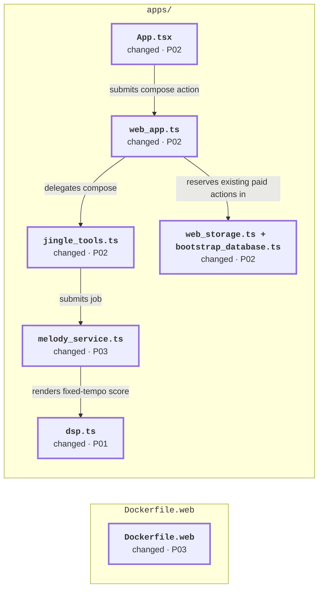

<!-- markdownlint-disable-file -->
# RPI Plan: LLM MIDI Jingle Pipeline

## Task Metadata

* Task ID: `llm-midi-jingle`
* Task slug: `llm-midi-jingle`
* Plan date: 2026-11-19

## Executive Summary

* Bottom line: The implementation plan adds a compact, versioned arrangement DSL to the existing paid compose action, then deterministically expands it into MIDI and backing audio through Earwyrm's renderer.
* Why this matters: The plan should enable editable jingles without introducing an audio-generation model or replacing the existing artifact and preview guarantees.
* Planning result: Ready for implementation planning after all findings from the complete initial standard critique were resolved in the plan. No implementation is authorized by this RPI request.
* Confidence and uncertainty: A compact DSL, deterministic expansion, current Foundry structured-output patterns, existing persistence/test seams, and the SoundFont package path are evidence-backed. The deployed model/version, active nonsecret settings, exact configured budget values, provider idempotency/status support, and subjective musical quality remain pre-live verification conditions.

### What You May Not Know

Azure deploys [Dockerfile.web](../../../Dockerfile.web), which does not currently include FluidSynth or a SoundFont, even though the separate [Dockerfile](../../../Dockerfile) already packages them. The existing compose action is deterministic and free; three guided previews remain separate from compose. The current provider caps completion at 1,200 tokens, and deployment documentation conflicts about Foundry defaults. The selected model/version and active environment/budget values have not been inspected. Paid compose must reuse existing caps and reservation controls; uncertain provider outcomes remain blocked from retry until reconciled.

## Phase Checklist

### Before

### After

```mermaid
flowchart LR
    accTitle: After: one consented LLM score compiles into deterministic MIDI and audio
    accDescr: The existing compose flow requests one compact score, validates and expands it through the deterministic renderer, while deployment and service documentation reflect the paid compose contract.
    subgraph image["`<code>Dockerfile.web</code>`"]
        dockerfile["`**<code>Dockerfile.web</code>**
        packages FluidSynth and SoundFont
        changed · P03`"]
    end
    subgraph apps["`<code>apps/</code>`"]
        ui["`**<code>App.tsx</code>**
        collects one-shot paid consent
        changed · P02`"]
        route["`**<code>web_app.ts</code>**
        authorizes paid compose
        changed · P02`"]
        tools["`**<code>jingle_tools.ts</code>**
        passes the composition backend
        changed · P02`"]
        composer["`**<code>jingle_cloud.ts</code>**
        requests one constrained score
        new · P02`"]
        budget["`**<code>web_storage.ts + bootstrap_database.ts</code>**
        adds idempotent compose reservations
        changed · P02`"]
        service["`**<code>melody_service.ts</code>**
        persists the score and artifacts
        changed · P03`"]
        score["`**<code>score_dsl.ts</code>**
        validates and expands patterns
        new · P01`"]
        dsp["`**<code>dsp.ts</code>**
        renders tempo-aware MIDI and audio
        changed · P01`"]
    end
    subgraph docs["`<code>docs/</code>`"]
        contracts["`**<code>service-contracts.md + azure-deployment.md</code>**
        clarify paid compose and deployment defaults
        changed · P04`"]
    end
    ui -->|submits consented action| route
    route -->|delegates compose| tools
    route -->|reserves one consented paid call in| budget
    tools -->|submits job| service
    service -->|requests score by job identity| composer
    composer -->|returns compact DSL| score
    service -->|validates and expands score| score
    score -->|produces note events for| dsp
    dockerfile -->|packages sampled runtime for| dsp
    contracts -.->|describes consent and budgets| route
    contracts -.->|documents deployed defaults| dockerfile
    classDef new stroke-dasharray: 6 4,stroke-width:2px
    classDef changed stroke-width:3px
    class composer,score new
    class dockerfile,ui,route,tools,service,budget,dsp,contracts changed
```

Key: arrows point from a part to what it uses; dotted arrows, docs; dashed border, new; thick border, changed; each tag names the phases that make the change.

The existing compose action continues from the UI through the API and MCP boundary, but now has explicit paid consent and requests one compact score (P02). The score contract expands deterministically into the existing MIDI/audio path, with tempo-aware timing and durable identity (P01, P03). The deployed image gains the sampled-render runtime and its notices, while documentation is reconciled with the actual deployment defaults (P03, P04).

<!-- rpi:phase id=P01 -->
### [ ] P01: Define and compile the score contract

Goals:
* Establish a bounded, versioned pattern score that can be validated and deterministically expanded into note events without exceeding the provider response budget.

Dependencies:
* None.

Changes in the map: Add `score_dsl.ts`; update [apps/api/src/dsp.ts](../../../apps/api/src/dsp.ts) for tempo-aware rendering.

<!-- rpi:task id=P01-T01 -->
#### [ ] P01-T01: Defining the compact arrangement DSL

Goals:
* The application accepts a compact versioned score whose musical structure is sufficiently constrained for safe deterministic expansion.

Requirements:
* FR-001, FR-002, FR-003; NFR-001, NFR-002, NFR-004.
* Research D1 and C1-C8, C13-C14, C17: score output is pattern-based rather than a list of individual MIDI events.
* Bind the contract to 4/4, 8-12 bars, 100-140 BPM, declared major/minor key, chord progression, hook motif, `retro-synth` style, and enumerated existing renderer roles/palette. Keep existing accepted lyric timing as the source of vocal line coverage; exact field names and pattern notation remain implementation judgment.
* The strict schema rejects unsupported roles, unknown fields, invalid ranges, or content that cannot be expanded within the existing 12-30 second composition envelope.

Details:
* Current composition requests in [apps/api/src/melody.ts](../../../apps/api/src/melody.ts) are lyric/timing-oriented, while [apps/api/src/dsp.ts](../../../apps/api/src/dsp.ts) uses a fixed 120 BPM arrangement and the existing roles. The DSL should describe repeated patterns and musical constraints; application code, not the model, owns event expansion and timing validation.
* Preserve the current melody-similarity screening, input size limit, and existing three deterministic preview path. Apply screening to the expanded score before rendering or persistence. Add focused schema/compiler tests in the API test suite for boundary values, unsupported roles, malformed patterns, lyric timing coverage, and rejected screened output; the provider adapter owns the runtime token cap and truncation tests.
* Run `npm run test:api` and `npm run typecheck` after the contract/compiler changes; tests must use static score fixtures, not a live provider.

References:
* [docs/idea.md](../../../docs/idea.md): User-supplied direction and illustrative pattern concept.
* [apps/api/src/melody.ts](../../../apps/api/src/melody.ts) and [apps/api/src/dsp.ts](../../../apps/api/src/dsp.ts): Existing request, note, instrument-role, and deterministic composition contracts.
* [apps/api/src/jingle_tools.ts](../../../apps/api/src/jingle_tools.ts): Existing application-side score validation and artifact loading.
* [apps/api/src/melody_service.ts](../../../apps/api/src/melody_service.ts): Existing melody-similarity screening before render and persistence.
* [.copilot-tracking/research/2026-11-19/llm-midi-jingle-research.md](../../research/2026-11-19/llm-midi-jingle-research.md):
  * D1 and C1-C8, C13-C14, C17 under the selected approach and evidence.

Dependencies:
* None.

<!-- rpi:task id=P01-T02 -->
#### [ ] P01-T02: Adding tempo-aware MIDI and render timing

Goals:
* Accepted scores render at their declared tempo and bar count while legacy callers retain their established 120 BPM whole-bar behavior.

Requirements:
* FR-003, FR-006; NFR-001, NFR-004.
* Research C2-C4 and C13: calculated duration remains within 12-30 seconds, while the existing legacy request validation remains compatible.
* Preserve timing in seconds for audio and lyric alignment, and serialize the declared tempo correctly into MIDI.

Details:
* The current `ScoreDuration` accepts only even whole seconds and MIDI uses fixed 120 BPM. Eight to twelve 4/4 bars at 100-140 BPM span about 13.7-28.8 seconds, so the new model path needs fractional durations; do not broaden the legacy whole-bar request contract or silently round tempo-derived duration.
* Update focused tests around `write_midi`, backing rendering, `JingleTools.artifacts`, and the new tempo-derived duration; retain regression assertions for existing 120 BPM artifacts and default duration. The existing audio pipeline measures note positions in seconds, so keep the MIDI/audio timing conversion consistent.
* Run `npm run test:api`, `npm run typecheck`, and `npm run build` for API changes.

References:
* [apps/api/src/dsp.ts](../../../apps/api/src/dsp.ts): Current `ScoreDuration`, fixed MIDI tempo, note validation, and renderer.
* [apps/api/src/backing.ts](../../../apps/api/src/backing.ts) and [apps/api/src/jingle_tools.ts](../../../apps/api/src/jingle_tools.ts): Audio render and returned artifact duration validation.
* [.copilot-tracking/research/2026-11-19/llm-midi-jingle-research.md](../../research/2026-11-19/llm-midi-jingle-research.md):
  * C2-C4 and C13 under current composition and renderer contracts.

Dependencies:
* P01-T01.

<!-- rpi:phase id=P02 -->
### [ ] P02: Generate scores through the consented compose action

Goals:
* Connect the validated score contract to shared Foundry through the existing compose workflow, with transparent per-action consent and bounded spend.

Dependencies:
* P01 must establish the score schema and deterministic compiler.
* The configured model/version must support the selected structured-output request before paid live inference.
* Existing paid-text model-call and shared action/total caps must accommodate one compose request without introducing new defaults.

Changes in the map: Update [apps/web/src/App.tsx](../../../apps/web/src/App.tsx), [apps/api/src/web_app.ts](../../../apps/api/src/web_app.ts), [apps/api/src/jingle_tools.ts](../../../apps/api/src/jingle_tools.ts), [apps/api/src/web_storage.ts](../../../apps/api/src/web_storage.ts), and [apps/api/src/bootstrap_database.ts](../../../apps/api/src/bootstrap_database.ts); add the Foundry composition provider.

<!-- rpi:task id=P02-T01 -->
#### [ ] P02-T01: Adding the structured-output composition provider

Goals:
* A provider returns only a schema-valid compact arrangement from the selected brief and accepted lyrics, or surfaces an explicit failure.

Requirements:
* FR-001, FR-002; NFR-002, NFR-005, NFR-007.
* Research C5-C8, C14-C17: use the shared Foundry configuration, keep completion output within 1,200 tokens and serialized requests within 64 KiB, and do not call the provider for deterministic preview generation.
* The request uses only a server-selected, validated brief's name, offer, location, tone, approved claims, the CTA, accepted lyrics, and the v1 `retro-synth` style; it excludes contact details, raw chat, and browser-supplied prompt instructions. Invoke the composer only after the existing lyric result is accepted and `validate_draft` succeeds.
* Set a hard 1,200-token completion limit and a 64 KiB serialized-request limit; use provider-reported usage when available and do not infer token counts from serialized byte size.
* Reject refused, truncated, malformed, or unsupported responses without a success-shaped fallback; validate with the same versioned schema used by the compiler.

Details:
* Follow the injected-provider and strict structured-output pattern in [apps/api/src/lyric_cloud.ts](../../../apps/api/src/lyric_cloud.ts); keep the composer behind an interface so automated tests can inject deterministic responses. Treat brief and lyric text as data, not instructions; pass only the accepted, server-selected brief subset and lyrics with validated composition context. Rejected or human-review-required lyric results must not invoke the composer.
* Instrument the Foundry boundary with the applicable OpenTelemetry GenAI client span conventions and context propagation. Include `service.name`, `service.version`, `deployment.environment`, and the required `telemetry.sdk.*` resource attributes. Use the applicable GenAI operation-duration histogram in seconds, whose measurements also provide call counts, and standard span status/outcome; do not invent metric names or put logical job IDs, user IDs, brief IDs, or free-form outcomes in metric dimensions. Correlate failure/reconciliation logs with trace context.
* Do not emit prompts, brief or lyric content, contact details, or raw provider output in spans, metrics, or logs. If a stable user reference is necessary, emit only an opaque hash as `user.id`.
* Verify the configured model/version's structured-output support and nonsecret settings before any live inference. The current model/version and active configuration have not been inspected; unsupported capability is a no-go, not authorization to change the shared production model or exceed the token/budget limits.
* Add provider tests for valid, refused, truncated, schema-invalid, oversized, and transport-failure responses, and assert contact details and chat history are absent from requests and telemetry. Run API tests and type checking with no external model call.

References:
* [apps/api/src/lyric_cloud.ts](../../../apps/api/src/lyric_cloud.ts): Existing Foundry request and injected backend pattern with a 1,200-token completion cap.
* [OpenTelemetry Semantic Conventions](https://opentelemetry.io/docs/specs/semconv/): Apply the current GenAI client conventions and avoid project-invented attribute names.
* [apps/api/src/lyric_budget.ts](../../../apps/api/src/lyric_budget.ts): Existing bounded paid-action accounting.
* [apps/api/src/melody.ts](../../../apps/api/src/melody.ts): Accepted lyric, timing, style, and logical identity input.
* [apps/api/src/lyrics.ts](../../../apps/api/src/lyrics.ts) and [apps/api/src/jingle_chat.ts](../../../apps/api/src/jingle_chat.ts): Validated brief fields, accepted lyrics, and current compose-request conversion.
* [.copilot-tracking/research/2026-11-19/llm-midi-jingle-research.md](../../research/2026-11-19/llm-midi-jingle-research.md):
  * C5-C8 and C14-C17 under provider and compose-flow evidence.

Dependencies:
* P01-T01.

<!-- rpi:task id=P02-T02 -->
#### [ ] P02-T02: Integrating paid compose consent and budget reservation

Goals:
* The user can explicitly authorize one paid score-generation request from the existing compose action, and the request cannot proceed without consent and an idempotent reservation in the shared paid-text budget.

Requirements:
* FR-004, FR-006; NFR-002, NFR-005.
* Research C8, C12, C15-C17: preserve the deterministic guided previews, add no feature-level deployment approval or mandatory deployment preview, and request consent only for the user-triggered paid compose action.
* Extend the closed paid-action map with one `compose` model call, reserving the configured `LYRIC_MODEL_CALL_MAX_USD` against the existing `LYRIC_PER_ACTION_CAP_USD` and `LYRIC_TOTAL_BUDGET_USD`; do not add new budget defaults or silently raise existing operator-approved values.
* Use a unique reservation key bound to the owner, compose action, and logical job ID. Check for an already committed job before reserving; for a new job, atomically persist the reservation and one durable provider-submission claim before invocation. A retry reuses that reservation and cannot create another paid call while its outcome is uncertain; concurrent requests for the same logical job return its current state without submitting again.
* The one-shot consent disclosure states the maximum cost represented by the reservation. Missing consent, invalid input, unsupported model configuration, or exhausted budget produces an explicit non-success outcome and no unreserved model call.

Details:
* The `/api/chat` compose branch currently calls deterministic `compose_arrangement`; the UI describes its preview as making no cloud requests. Keep the three preview arrangements deterministic and add a distinct, clear one-shot consent step before the accepted-lyrics compose call, including the applicable budget/cost disclosure and existing action-accounting behavior.
* Reuse the current paid-action consent and shared budget settings rather than adding a broad feature toggle or changing budget values. The one-call worst-case reservation uses the configured model-call ceiling; if that ceiling cannot fit the existing per-action/total caps, fail explicitly and leave enablement blocked until an operator-approved budget change. Keep deterministic composition available to local/MCP callers that do not opt into the web paid composer.
* Extend the reservation schema additively through the repository's SQLite initialization and explicit PostgreSQL upgrade path. Preserve existing reservations and use an idempotent key so consent, budget, committed-job recovery, and retry share one reservation.
* Add API/UI tests for consent accepted/declined/missing, budget available/exhausted, reservation identity/order, committed retry, and provider call count. Tests must inject the provider and assert zero calls on rejected actions or an unknown-outcome retry.

References:
* [apps/api/src/web_app.ts](../../../apps/api/src/web_app.ts): Existing deterministic compose action and API consent boundary.
* [apps/web/src/App.tsx](../../../apps/web/src/App.tsx): Existing preview workflow and user consent presentation.
* [apps/api/src/lyric_budget.ts](../../../apps/api/src/lyric_budget.ts) and [docs/service-contracts.md](../../../docs/service-contracts.md): Paid-action budget and consent contract.
* [apps/api/src/web_storage.ts](../../../apps/api/src/web_storage.ts) and [apps/api/src/bootstrap_database.ts](../../../apps/api/src/bootstrap_database.ts): Existing reservation schema and explicit database-upgrade patterns.
* [.copilot-tracking/research/2026-11-19/llm-midi-jingle-research.md](../../research/2026-11-19/llm-midi-jingle-research.md):
  * C8 and C12, C15-C17 under consent and compose-flow evidence.

Dependencies:
* P01-T01.
* P02-T01.

<!-- rpi:phase id=P03 -->
### [ ] P03: Preserve job identity and sampled rendering

Goals:
* The validated score, its provider provenance, and rendered artifacts remain one durable, digest-checked composition, and the deployed web image can create sampled audio.

Dependencies:
* P01 must define score expansion and render timing.
* P02 must define the paid compose provider and consent boundary.

Changes in the map: Update [apps/api/src/melody_service.ts](../../../apps/api/src/melody_service.ts) and [Dockerfile.web](../../../Dockerfile.web) for score persistence and sampled rendering.

<!-- rpi:task id=P03-T01 -->
#### [ ] P03-T01: Persisting score generation idempotently

Goals:
* A committed logical composition identity recovers the exact score and artifacts without another model call or budget reservation.

Requirements:
* FR-003; NFR-003, NFR-004, NFR-005.
* Research C3, C6-C8, C13-C17: preserve logical-job identity, request conflict detection, artifact SHA-256 digests, privacy boundaries, and guided-preview verification.
* Persist score schema/generator version and provider provenance with the composition result; an ambiguous remote timeout must not trigger an automatic paid resubmission before reconciliation.

Details:
* `MelodyService.submit` currently serializes local job creation, rejects changed requests under an existing logical ID, screens melodies before rendering/persistence, and persists digest-addressed artifacts. Extend that durable boundary so a compiled score passes the existing screening step, an existing committed job is checked before reservation or provider invocation, and retries recover the exact committed result. A durable claim permits only one provider submitter per logical job; concurrent requests recover the current status rather than issuing another call. Keep the returned score, MIDI, backing audio, timing, provenance, and budget reservation consistent with one composition identity.
* Use an explicit persisted `outcome_unknown` state when a provider timeout leaves remote completion uncertain. Return a non-success response with code `provider_outcome_unknown`, the logical job identity, and `retryable: false`; the service operator reconciles against provider status/idempotency and billing evidence. If evidence cannot establish whether the call was accepted, leave the job blocked and do not resubmit. Only a confirmed non-accepted outcome may permit another provider attempt under the same idempotent reservation key. Do not claim exactly-once remote inference where the provider contract cannot guarantee it.
* Keep existing version-one queue rows readable and make new state/provenance storage additive and backward-compatible across SQLite and PostgreSQL. Store `outcome_unknown` in a versioned additive record rather than widening the version-one `render_jobs.status` constraint. Version the migration through the existing database bootstrap/upgrade path, preserve existing jobs and reservations, and verify rollback against an existing database; do not make older application versions reject existing job rows.
* Add injected-provider tests for successful commit/retry, concurrent same-job submission, changed-request conflict, render failure after generation, artifact digest mismatch, screened-score rejection, ambiguous timeout, non-success response, reconciliation and confirmed-not-accepted retry, and migration/rollback from existing SQLite/PostgreSQL schemas. Assert retry call counts and reservation identity/order, and run API tests/type checking without paid calls.

References:
* [apps/api/src/melody_service.ts](../../../apps/api/src/melody_service.ts): Current serialized idempotency, job persistence, artifact generation, and digests.
* [apps/api/src/jingle_tools.ts](../../../apps/api/src/jingle_tools.ts): Existing artifact integrity checks and composition transport.
* [apps/api/src/persistence.ts](../../../apps/api/src/persistence.ts): SQLite/PostgreSQL transaction and connection patterns.
* [apps/api/src/bootstrap_database.ts](../../../apps/api/src/bootstrap_database.ts) and [apps/api/src/web_storage.ts](../../../apps/api/src/web_storage.ts): Existing schema version, additive migration, and explicit PostgreSQL upgrade patterns.
* [.copilot-tracking/research/2026-11-19/llm-midi-jingle-research.md](../../research/2026-11-19/llm-midi-jingle-research.md):
  * C3, C6-C8, and C13-C17 under job, artifact, consent, and compose evidence.

Dependencies:
* P01-T01.
* P02-T01.
* P02-T02.

<!-- rpi:task id=P03-T02 -->
#### [ ] P03-T02: Packaging the sampled renderer in the web image

Goals:
* The image used by Azure deployment can render valid sampled backing audio and retains the required SoundFont notices.

Requirements:
* FR-005; NFR-004.
* Research C9-C11, W4: update the deployed [Dockerfile.web](../../../Dockerfile.web), preserve the SoundFont/package notices, and set `EARWYRM_SOUNDFONT` to the verified package path `/usr/share/sounds/sf2/FluidR3_GM.sf2`.

Details:
* The local [Dockerfile](../../../Dockerfile) already installs FluidSynth and FluidR3 GM, while the deployed [Dockerfile.web](../../../Dockerfile.web) does not. Reuse the established package pattern; do not assume local-only package installation reaches Azure.
* Build the web image, run it as the configured non-root application user, and verify that the configured SoundFont path is readable before smoke-testing a known MIDI fixture to a valid WAV. Use `dpkg-query -L fluid-soundfont-gm` to identify the installed package's exact copyright/notice paths, preserve those files in the image, and assert their presence. Research identified Debian's FluidR3 GM packaging and upstream notices; preserve them, but do not characterize this as a legal review.

References:
* [Dockerfile](../../../Dockerfile) and [Dockerfile.web](../../../Dockerfile.web): Existing local sampled-render setup and deployed image; the known package SoundFont path.
* [apps/api/src/backing.ts](../../../apps/api/src/backing.ts): Runtime SoundFont selection and sampled rendering.
* [.copilot-tracking/research/2026-11-19/llm-midi-jingle-research.md](../../research/2026-11-19/llm-midi-jingle-research.md):
  * C9-C11 and W4 under deployment and SoundFont evidence.

Dependencies:
* P01-T02.

<!-- rpi:phase id=P04 -->
### [ ] P04: Reconcile deployment guidance and validate the experience

Goals:
* The deployment contract, tests, and listening evidence align with the composed-score behavior without adding a deployment approval or preview gate.

Dependencies:
* P02 must establish paid compose behavior and user consent.
* P03 must establish durable score generation and the sampled-render image.

Changes in the map: Update service and Azure deployment documentation; validate the integrated compose and render path.

<!-- rpi:task id=P04-T01 -->
#### [ ] P04-T01: Reconciling deployment and service documentation

Goals:
* The documented deployment defaults, paid compose contract, and in-product preview behavior agree with the implemented workflow.

Requirements:
* FR-004, FR-005, FR-006.
* Research C8-C12 and C15-C17: do not introduce a feature-level deployment approval or mandatory deployment preview; retain per-action consent for paid compose and distinguish that action from the guided preview flow.
* The normal PoC deployment provisions and enables shared voice/chat/lyrics together; the paid composer inherits the existing `paid_speech`, `LYRIC_ENABLED`, validated-settings, and shared-budget availability checks and has no separate composer deployment flag or approval.
* Preserve the existing `maintenance_approved` workflow gate and any existing billing/deployment safeguards; a deployment preview remains optional.

Details:
* The Azure deployment documentation conflicts about Foundry and paid-feature defaults; reconcile it against [.github/workflows/deploy-web.yml](../../../.github/workflows/deploy-web.yml), [.github/workflows/prepare-deployment.yml](../../../.github/workflows/prepare-deployment.yml), [azure.yaml](../../../azure.yaml), and the selected infrastructure settings without exposing secrets. Document the structured score limits, model settings that operators must verify, consent/budget behavior, ambiguous provider timeout handling, SoundFont path/notices, and the separation between deployment readiness and product preview.
* Keep shared voice/chat/lyrics enabled through normal PoC deployment and reuse the existing paid-text availability checks (`paid_speech`, `LYRIC_ENABLED`, validated settings, and shared budget) for the composer. Retain `maintenance_approved` and existing billing/deployment safeguards; do not add a composer-specific flag, feature-level approval, or required preview run. Update the service contract to distinguish deterministic guided previews from paid LLM compose.
* Run the documentation checks, `npm run typecheck`, and `npm run build` after code is integrated; deployment settings must remain consistent with the normal PoC workflow.

References:
* [docs/service-contracts.md](../../../docs/service-contracts.md): Existing compose, consent, budget, and preview contracts.
* [docs/azure-deployment.md](../../../docs/azure-deployment.md), [.github/workflows/deploy-web.yml](../../../.github/workflows/deploy-web.yml), [.github/workflows/prepare-deployment.yml](../../../.github/workflows/prepare-deployment.yml), and [azure.yaml](../../../azure.yaml): Deployment defaults, operator gates, and selected web image.
* [infra/main.bicep](../../../infra/main.bicep): Foundry and app configuration defaults.
* [.copilot-tracking/research/2026-11-19/llm-midi-jingle-research.md](../../research/2026-11-19/llm-midi-jingle-research.md):
  * C8-C12 and C15-C17 under deployment, consent, and compose evidence.

Dependencies:
* P02-T02.
* P03-T02.

<!-- rpi:task id=P04-T02 -->
#### [ ] P04-T02: Validating end-to-end composition and musical fit

Goals:
* The complete no-paid-test compose path is validated, and representative rendered jingles have documented listening results.

Requirements:
* FR-001, FR-002, FR-003, FR-004, FR-005, FR-006; NFR-001, NFR-002, NFR-003, NFR-004, NFR-005, NFR-006, NFR-007.
* Research C1-C17: preserve the bounded score contract, test isolation from live Foundry, artifact identity, renderer deployment, and consent/budget controls.

Details:
* Run `npm test`, `npm run typecheck`, and `npm run build`; include an API integration test using an injected composer and a UI test covering consent and paid-action errors. Assert telemetry has bounded dimensions and contains no prompts, brief/lyric content, contact details, or raw provider output. No test may make a live Foundry call.
* Build and smoke-test [Dockerfile.web](../../../Dockerfile.web) as described in P03-T02. Verify the hard 1,200-token completion cap, 64 KiB request limit, provider-reported usage when available, tempo-derived duration, MIDI tempo metadata, valid backing audio, committed retry recovery, and unchanged deterministic preview behavior.
* After the feature exists, create three representative outputs using separate user-consented, budget-reserved compose actions; do not substitute fixtures for the listening evaluation. Record each sample's logical job ID, selected brief identity, scores, and observable defects with a 1-5 rubric for brief fit, hook memorability, rhythmic clarity, and cadence. If consent or budget is unavailable, mark the evaluation blocked. Because no quality threshold has been agreed, report results without claiming a pass or generalized musical quality.

References:
* [apps/api/package.json](../../../apps/api/package.json) and [package.json](../../../package.json): Existing API, workspace test, typecheck, and build commands.
* [docs/idea.md](../../../docs/idea.md): User concept to ground representative listening prompts.
* [.copilot-tracking/research/2026-11-19/llm-midi-jingle-research.md](../../research/2026-11-19/llm-midi-jingle-research.md):
  * C1-C17 and W1-W4 under the final recommendation, risk, and validation evidence.

Dependencies:
* P03-T01.
* P03-T02.
* P04-T01.

## User Decisions and Requirements

### Confirmed User Direction

* Investigate the supplied LLM MIDI-jingle idea and produce an implementation plan; do not implement in this task.
* The RPI session is automatic through its eligible phases, with agent-owned research and planning choices. This authorizes progression, not expansion into implementation.
* Earwyrm is a proof of concept. The normal deployment should enable shared voice, chat, and lyrics without separate feature-level deployment approval or a mandatory deployment preview run. Preserve existing per-action consent and spending controls for billable requests, and preserve the app's jingle preview behavior.

### Planning Decisions and Feedback

| Group | Decision or feedback item | Status | Owner | Rationale or input needed | Evidence | Planning impact |
|-------|---------------------------|--------|-------|--------------------------|----------|-----------------|
| D1 | Use a compact, versioned pattern-based jingle DSL in the existing compose flow | Selected | Agent | It fits existing renderer roles and the 1,200-token cap; deterministic expansion avoids one model token per MIDI event | Research D1; C1-C8, C13-C17, W1-W4 | Defines the score contract and compiler scope |
| D2 | Keep the three deterministic guided previews and invoke the LLM only for the existing compose action after lyric acceptance | Selected | Agent | The current compose action is the bounded path that receives selected lyrics and avoids multiplying model calls across the three preview alternatives | Research C16-C17; [apps/api/src/web_app.ts](../../../apps/api/src/web_app.ts), [apps/api/src/jingle_tools.ts](../../../apps/api/src/jingle_tools.ts) | Defines the integration point and limits each requested composition to one provider call |
| D3 | Preserve paid per-action consent and capped budgets without feature-level deployment approval or mandatory deployment preview | Selected | Agent | Deployment enablement is distinct from the user-triggered paid compose action; existing paid text actions already require consent | Research C8, C12, C15-C17; [docs/service-contracts.md](../../../docs/service-contracts.md) | Defines consent and budget requirements |
| D4 | Include custom synth patch generation, Summit, or PatchGator in the first increment | Deferred | Agent | No integration was found, and sound design is separate from editable MIDI composition | Research D2; C7, C9 | Keep these as follow-up work, not active phases |
| D5 | Include humanization, velocity/dynamics, polyphony controls, section variation, drum-specific constraints, or a second Composer/Producer pass in the first increment | Deferred | Agent | These are supplied-idea extensions beyond the bounded DSL/compiler path and are not required to validate the first editable-score increment | [docs/idea.md](../../../docs/idea.md); Research D1, C1-C8 | Keep them out of active requirements; reconsider after the bounded score-to-render path is evaluated |
| D6 | Reuse the existing paid-text per-call, per-action, and total budget settings for one compose call | Selected | Agent | Existing accounting uses operator-approved call ceilings and shared caps; new default amounts or a composer-specific budget would create unnecessary policy | Research C8, C16-C17; [apps/api/src/lyric_budget.ts](../../../apps/api/src/lyric_budget.ts), [apps/api/src/web_storage.ts](../../../apps/api/src/web_storage.ts) | Reserve one configured maximum-cost call under an idempotent compose key; fail closed if existing caps cannot accommodate it |
| D7 | Instrument the Foundry compose boundary with OpenTelemetry GenAI conventions and content-free outcomes | Selected | Agent | The call crosses a network boundary and measurable request outcomes must remain traceable without exporting brief, lyric, contact, or prompt content | [apps/api/src/lyric_cloud.ts](../../../apps/api/src/lyric_cloud.ts); [OpenTelemetry Semantic Conventions](https://opentelemetry.io/docs/specs/semconv/) | Add bounded provider outcome/duration telemetry and preserve PII-denylist handling |

## Planning Readiness and Next Step

| Field | Record |
|-------|--------|
| Planning execution and readiness | Complete; Ready for implementation planning; implementation remains outside this RPI request |
| Decision participation | Agent-owned; confirmed automatic RPI session selected “Handle it end to end” |
| Blockers | None; live inference remains conditional on configured model support and existing caps accommodating one call |
| Latest critique | [.copilot-tracking/reviews/plans/2026-11-19/llm-midi-jingle-plan-critique.md](../../reviews/plans/2026-11-19/llm-midi-jingle-plan-critique.md) is complete with a Revise verdict; all findings are resolved in the plan |
| Relevant research | [.copilot-tracking/research/2026-11-19/llm-midi-jingle-research.md](../../research/2026-11-19/llm-midi-jingle-research.md) |
| Plan | [.copilot-tracking/plans/2026-11-19/llm-midi-jingle-plan.md](./llm-midi-jingle-plan.md) |
| Changes-record role | `.copilot-tracking/changes/2026-11-19/llm-midi-jingle-changes.md` will be implementation evidence |
| Continuation owner | Confirmed automatic RPI Agent |
| Required gates or confirmations | Verify configured model/version support and active budget ceilings before live inference; no user input is required, and this plan does not authorize implementation |
| Next action | Return the research-backed plan and its resolved critique dispositions; stop before implementation |

## Goals

* Provide a versioned and editable jingle arrangement from the selected brief and accepted lyrics, validated by application code, and compiled into MIDI and backing audio.
* Preserve current deterministic rendering, screening, retry identity, private artifact storage, and preview/final continuity.
* Keep the existing deterministic guided previews; use shared Foundry only for the explicit paid compose action, with per-action consent and budget reservations.
* Enable the feature through normal deployment without a new feature-level deployment approval or mandatory deployment preview.
* Make the sampled audio path available in the Azure web image and validate it without paid provider calls in automated tests.

## Scope and Non-Goals

### In Scope

* A compact 4/4 arrangement DSL with declared major/minor key, 8-12 bars, 100-140 BPM, and bounded patterns for the existing renderer roles and General MIDI palette.
* A strict structured-output provider path, application-side validation, deterministic pattern expansion, tempo-aware MIDI timing, persistence/versioning, and renderer integration.
* One paid provider request per accepted compose action, with explicit per-action consent and capped budget reservation.
* Deployment image packaging and notices, runbook consistency, deterministic tests, and a small listening evaluation.

### Non-Goals

* Source implementation, deployment execution, paid live inference, or external tracker changes in this RPI request.
* Humanization, velocity/dynamics controls, polyphony controls, named section variation, drum-specific constraints, a second Composer/Producer pass, arbitrary instrument programs, custom synth patches, Summit/PatchGator integration, non-4/4 meter, or generative-audio inference in the first increment.

## Functional Requirements

* FR-001: The existing compose action uses the validated server-selected brief's creative fields (excluding contact details), accepted lyrics, and `retro-synth` style to request a compact, versioned arrangement score with tempo, key, bar count, progression, motif, and enumerated role patterns.
* FR-002: The service validates model output locally and rejects malformed, out-of-range, overlong, or unsupported arrangements before rendering or persistence.
* FR-003: The service deterministically expands an accepted score to note events, MIDI, and backing audio while preserving stable logical job identity, artifact digests, and preview/final continuity.
* FR-004: Billable composition uses shared Foundry configuration, explicit per-action consent, and one idempotent maximum-cost reservation under existing per-action/total caps without feature-level deployment approval or a mandatory deployment preview.
* FR-005: The deployed web image provides the configured FluidSynth/SoundFont path and retains required package notices.
* FR-006: The three deterministic guided previews and legacy non-LLM composition behavior remain available and compatible.

## Non-Functional Requirements

* NFR-001: V1 accepts 8-12 bars at 100-140 BPM in 4/4, yielding approximately 13.7-28.8 seconds within the existing 12-30 second composition envelope.
* NFR-002: The provider request hard-caps completion at 1,200 tokens and serialized requests at 64 KiB; record provider-reported usage when available, never estimate tokens from byte size, and revise either cap only with a corresponding operator-approved budget and consent update.
* NFR-003: A retry after canonical score/artifact commit returns the same result without another model call or duplicate reservation; an ambiguous provider timeout persists `outcome_unknown`, returns `provider_outcome_unknown` with `retryable: false`, and is not resubmitted until operator reconciliation establishes the provider outcome.
* NFR-004: Existing deterministic previews, legacy composition output, retry identity, guided-preview digest verification, and version-one job/reservation records remain compatible through additive migrations and rollback.
* NFR-005: Automated tests use injected provider responses and make no paid external calls; invalid responses and consent/budget failures are explicit.
* NFR-006: A listening evaluation rates three representative briefs for brief fit, hook memorability, rhythmic clarity, and cadence, records the scores and defects, and makes no quality claim without an agreed threshold.
* NFR-007: The Foundry compose boundary uses context-propagated OpenTelemetry GenAI client conventions, required resources (`service.name`, `service.version`, `deployment.environment`, and `telemetry.sdk.*`), standard span outcome, and the applicable operation-duration histogram in seconds; prompts, briefs, lyrics, contact details, provider output, and unbounded identifiers are excluded from telemetry, with logs correlated to trace context.

## Risks and Open Questions

| Priority | Type | Risk, question, or planning item | Affected work | Impact | Smallest action or evidence needed | Owner |
|----------|------|----------------------------------|---------------|--------|------------------------------------|-------|
| Medium | Open question | The configured Foundry model/version may not support the required strict structured-output schema | P02-T01 | Could require a model or provider-contract change | Verify the selected model/version against current Microsoft capability documentation before live inference | Plan |
| High | Risk | A compose action could exceed the shared budget or reserve/pay twice on retry | P02-T02, P03-T01 | Undisclosed or duplicated spend would violate the paid-action contract | Reserve one configured maximum-cost call against existing per-action/total caps with a logical-job idempotency key before invocation; verify commit/retry ordering | Plan |
| Medium | Risk | The Azure runbook conflicts about Foundry and paid-feature defaults | P04-T01 | Deployment assumptions may be wrong | Reconcile the runbook with the deployment workflow and confirm active nonsecret settings | Plan |
| Medium | Risk | The Azure web image lacks FluidSynth/SoundFont and shipped notice handling is unverified | P03-T02 | Sampled audio could be missing or attribution incomplete | Package dependencies and notices, then smoke-test the built image | Plan |
| Medium | Risk | Schema-valid music may still sound weak or fail the brief | P04-T02 | Technical success may not satisfy the product goal | Run the three-brief listening evaluation and record its scores and defects | Plan |
| Medium | Risk | The compose call consumes Foundry quota even though audio rendering is local | P02-T01, P02-T02 | The shared model quota may be unavailable or exhausted | Verify quota and active model settings before live calls; unsupported capability or unavailable quota is a no-go, not a reason to change shared deployment settings | Plan |
| High | Risk | A provider timeout after remote completion but before local score commit may have an uncertain outcome | P02-T02, P03-T01 | Automatic retries may duplicate a paid request or leave a job unresolved | Persist `outcome_unknown`, return a non-success non-retryable response, and reconcile provider/idempotency and billing evidence before a retry | Plan |
| Medium | Risk | New score/reservation state can make existing SQLite/PostgreSQL data incompatible with rollout or rollback | P02-T02, P03-T01 | Existing jobs/reservations may become unreadable or duplicated | Version additive migrations, preserve version-one rows, and test upgrade/rollback against existing database fixtures | Plan |
| Medium | Risk | Returning individual MIDI events may exceed the 1,200-token completion cap | P01-T01, P02-T01 | A truncated score cannot be rendered and may waste the reserved call | Keep the model DSL pattern-based, hard-cap completion output, and reject truncated responses; inspect provider-reported usage when available | Plan |

## Dependencies

* The configured shared Foundry deployment must support the selected structured-output request schema before live composition is enabled; verify through nonsecret model/version settings and a test stub before paid inference.
* Existing model-call, per-action, and total paid-text budget settings must accommodate one compose call; if not, keep paid composition blocked until an operator-approved budget change.
* The web image must package an approved SoundFont and preserve its required notices before sampled output can be accepted in Azure.

## Sources

* [.copilot-tracking/research/2026-11-19/llm-midi-jingle-research.md](../../research/2026-11-19/llm-midi-jingle-research.md): Selected approach, evidence IDs C1-C17 and W1-W4, and remaining uncertainty.
* [docs/idea.md](../../../docs/idea.md): User-supplied concept and illustrative score; examples are not assumed to be binding schema.
* [docs/service-contracts.md](../../../docs/service-contracts.md): Current compose, paid-text consent/budget, and preview contracts.
* [docs/azure-deployment.md](../../../docs/azure-deployment.md), [.github/workflows/deploy-web.yml](../../../.github/workflows/deploy-web.yml), [.github/workflows/prepare-deployment.yml](../../../.github/workflows/prepare-deployment.yml), and [azure.yaml](../../../azure.yaml): Shared AI defaults, operator gates, and selected web image.
* [apps/api/src/web_app.ts](../../../apps/api/src/web_app.ts) and [apps/api/src/lyric_budget.ts](../../../apps/api/src/lyric_budget.ts): Existing paid-text availability and budget settings used by the composer.
* [OpenTelemetry Semantic Conventions](https://opentelemetry.io/docs/specs/semconv/): Current GenAI client span and metric conventions for the remote composition call.
* [Dockerfile](../../../Dockerfile) and [Dockerfile.web](../../../Dockerfile.web): Existing sampled-render package pattern and currently deployed web image.
* [apps/api/src/lyric_cloud.ts](../../../apps/api/src/lyric_cloud.ts), [apps/api/src/lyric_budget.ts](../../../apps/api/src/lyric_budget.ts), and [apps/api/src/web_app.ts](../../../apps/api/src/web_app.ts): Existing strict-output provider, paid-action accounting, compose route, and request boundaries.
* [apps/api/src/jingle_tools.ts](../../../apps/api/src/jingle_tools.ts), [apps/api/src/melody_service.ts](../../../apps/api/src/melody_service.ts), [apps/api/src/melody.ts](../../../apps/api/src/melody.ts), and [apps/api/src/dsp.ts](../../../apps/api/src/dsp.ts): Current MCP compose transport, durable job/artifact contracts, whole-bar request contract, and fixed-120-BPM renderer.
* Business-source search: searched for `.adr-config.yml`, planning PRD/BRD/ADR filenames, `brd_id`, `prd_id`, and business-source terms; no relevant BRD, PRD, or ADR found. [docs/idea.md](../../../docs/idea.md) is the supplied proposal, not a business requirements document.

## Critique Disposition

* Critique setting and provenance: Standard; first-task default, not explicitly skipped or deepened.
* Critique status: Complete; the initial standard assessment returned Revise, and all 12 findings are resolved in this plan.
* Latest critique and verdict: [.copilot-tracking/reviews/plans/2026-11-19/llm-midi-jingle-plan-critique.md](../../reviews/plans/2026-11-19/llm-midi-jingle-plan-critique.md) returned Revise; planner-owned corrections are recorded below.
* Earlier critiques: None.
* Limitations: NFR-007 was added after the initial critique in response to the applicable OpenTelemetry planning guidance. The critique remains the single authorized run and did not assess that later addition; no follow-up critique was run.

| Critique run and finding | Disposition | Action owner | Exact resolving evidence | Decision route | Plan response or residual risk |
|--------------------------|--------------|--------------|--------------------------|----------------|--------------------------------|
| Initial standard, PC-001 [High] | Resolved | Planning parent | P04-T02 requires three outputs from separate consented, budget-reserved compose actions; records each logical job ID, rubric results, and blocked state if consent/budget is unavailable | Direct planner correction | Listening evidence is a future manual evaluation; no paid calls are part of planning or automated tests |
| Initial standard, PC-002 [High] | Resolved | Planning parent | NFR-003/P03-T01 define persisted `outcome_unknown`, `provider_outcome_unknown` with `retryable: false`, service-operator reconciliation, no resubmit without provider/billing evidence, and a blocked state when outcome cannot be established | Direct planner correction | No exactly-once provider claim; unresolved jobs remain blocked |
| Initial standard, PC-003 [Medium] | Resolved | Planning parent | D5, Non-Goals, and Follow-Up Items list humanization, dynamics, polyphony, section/drum variation, and the second pass as deferred | Direct planner correction | No active-scope expansion |
| Initial standard, PC-004 [Medium] | Resolved | Planning parent | FR-001/P02-T01/P04-T02 name `retro-synth` and the selected brief/CTA/accepted-lyrics subset; contact details and chat history are excluded | Direct planner correction | Composer input is minimized and version-one style is explicit |
| Initial standard, PC-005 [Medium] | Resolved | Planning parent | P04-T01 requires normal shared voice/chat/lyrics deployment and reuses `paid_speech`, `LYRIC_ENABLED`, validated settings, and shared-budget checks without a composer-specific flag | Direct planner correction | Normal deploy remains enabled; operational model/budget preflight is separate |
| Initial standard, PC-006 [High] | Resolved | Planning parent | NFR-002 hard-caps output/request size; P02-T02 reserves one `LYRIC_MODEL_CALL_MAX_USD` call against existing per-action/total caps, discloses the maximum, and uses an owner/action/job idempotency key plus a durable one-submitter claim; P03-T01 checks committed jobs first | Direct planner correction | No new default USD values; unsupported or over-cap configuration fails closed |
| Initial standard, PC-007 [Low] | Resolved | Planning parent | P03-T01 Dependencies directly names P02-T01 | Direct planner correction | All direct task prerequisites are visible |
| Initial standard, PC-008 [Low] | Resolved | Planning parent | P04-T01 References and plan Sources include `azure.yaml` and `.github/workflows/prepare-deployment.yml` alongside the deploy workflow | Direct planner correction | Deployment image selection is traceable |
| Initial standard, PC-009 [Medium] | Resolved | Planning parent | P04-T01 explicitly retains `maintenance_approved` and existing billing/deployment safeguards, keeps preview optional, and adds no feature-level gate | Direct planner correction | Deployment safeguards remain distinct from paid-action consent |
| Initial standard, PC-010 [Medium] | Resolved | Planning parent | P02-T02/P03-T01 require versioned additive SQLite/PostgreSQL migrations, existing row/reservation preservation, version-one `render_jobs.status` compatibility, and upgrade/rollback tests | Direct planner correction | Backward-compatible data path is a required implementation outcome |
| Initial standard, PC-011 [Medium] | Resolved | Planning parent | P03-T02 names `/usr/share/sounds/sf2/FluidR3_GM.sf2`, requires non-root readability, identifies package notice paths with `dpkg-query -L fluid-soundfont-gm`, and asserts image presence | Direct planner correction | Package notices are preserved; this is not a legal review |
| Initial standard, PC-012 [Medium] | Resolved | Planning parent | P02-T01 requires accepted/validated inputs only; P01-T01 defines strict score validation; P03-T01 applies existing melody screening before rendering/persistence and tests rejection | Direct planner correction | No unvalidated score reaches rendering |

## Artifact Self-Check

* [x] Executive Summary, What You May Not Know, and the Phase Checklist lead with the outcome, sequencing, and scope.
* [x] Confirmed direction, agent-owned planning decisions, readiness, goals, scope, requirements, risks, and dependencies are consistent.
* [x] Every `FR-nnn` and `NFR-nnn` is cited by at least one task's Requirements.
* [x] Every phase has Goals, Dependencies, and a matching `Changes in the map:` line; every task has Goals, Requirements, Details, References, and Dependencies.
* [x] Task goals are observable outcomes; open risks are assigned to affected tasks; no per-task status blocks were added.
* [x] Existing file references are linked with plan-relative destinations; code, commands, and symbols use backticks.
* [x] The map shows the changed connections in Before and the complete intended result in After, with active arrows, phase tags, and no more than 10 parts or 4 boxes.
* [x] Business-source search recorded no relevant BRD, PRD, or ADR; the supplied idea remains a proposal source.
* [x] Follow-up items remain outside active phase/task completion.
* [x] The standard critique setting and provenance are recorded.
* [x] The complete critique result exists, all 12 findings have planner-owned dispositions, and no blocking finding remains open.
* Checked sections: task identity, summary, change map, phase/task decomposition, confirmed direction, planning decisions, readiness, goals, scope, FR/NFR coverage, risks, dependencies, sources, critique setting, follow-up, and handoff.
* Missing or limited sections: The RPI Workflow canvas page was disconnected, so Mermaid rendering in light and dark themes could not be visually checked. No planning sections remain pending.

## Follow-Up Items

* Humanization, velocity/dynamics, polyphony, section-specific variation, drum-specific constraints, and a second Composer/Producer pass are outside the first increment; reconsider after the bounded score and rendering path is evaluated.
* Custom synth patch generation and Summit/PatchGator integration are outside the first increment; reconsider after validated MIDI composition and sampled rendering are established.

## Handoff

* The plan and its standard critique are the requested deliverables; implementation is not authorized by this task.
