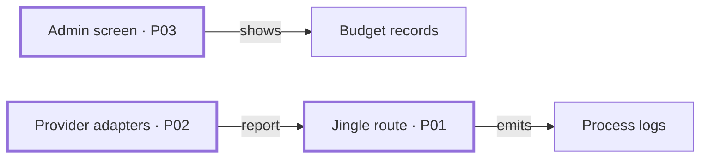
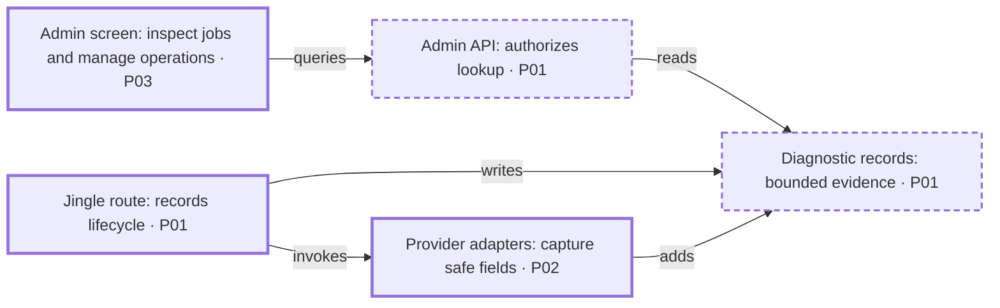

<!-- markdownlint-disable-file -->
# RPI Plan: Admin job diagnostics

## Task Metadata

* Task ID and slug: `admin-job-diagnostics`
* Plan date: 2026-11-20

## Executive Summary

Establish durable, safe job lookup and reorganize the existing admin screen while preserving access and budget operations. Planning is complete and ready for implementation after resolving the standard critique. Existing route and storage paths provide high-confidence evidence; actual provider metadata varies and may be unavailable.

### What You May Not Know

Failures can occur before a render record exists, and historical details that were not saved cannot be recreated.

## Phase Checklist

### Before

### After

Key: arrows show the acting component; thick borders are changed and dashed borders are new. The route and adapters populate safe records, while the admin UI queries them through an authorized API.

<!-- rpi:phase id=P01 -->
### [x] P01: Durable job inspection

Goals: Make browser-jingle attempts inspectable even when they fail before rendering.

Dependencies: Existing authenticated route and database initialization.

Changes in the map: Jingle route, diagnostic records, admin API.

<!-- rpi:task id=P01-T01 -->
#### [x] P01-T01: Persist and authorize job lifecycle

Goals: Administrators can locate a durable request using its server-issued diagnostic ID and see its known status and stage.

Requirements: `FR-001`, `FR-002`, `NFR-001`, `NFR-002`; research F1, F3, F4.

Details: Create a record before any paid provider call; if its creation fails, return a safe service error without calling the provider. Keep the existing server-issued diagnostic ID. Store no user identity, request content or provider messages. Use `running`, `completed`, and `failed` outcomes; an unfinalized record after process restart or loss of the active request reads as `outcome unknown`, never success. If a later diagnostic write fails, explicitly log the safe failure, prevent further paid stages where possible, and return a safe error warning that costs or results may already exist; do not retry paid calls or claim no charge. Include a bounded 30-day retention window, with cleanup on new record creation and tests for expiry.

Authenticate and require enabled administrator privileges on lookup. Create the table in SQLite initialization and in both fresh PostgreSQL creation and the startup additive upgrade regardless of paid-feature settings. Add the table to `REQUIRED_TABLES` and exempt it from the upgrade's pre-upgrade completeness check. Add it to the import schema and optional legacy source list; preserve existing rows, and include it in reset only under existing reset authorization. Validate pre-change fixtures and do not run upgrades against shared or live stores.

References: [apps/api/src/web_app.ts](../../../apps/api/src/web_app.ts), [apps/api/src/web_storage.ts](../../../apps/api/src/web_storage.ts), [apps/api/src/jingle_diagnostics.ts](../../../apps/api/src/jingle_diagnostics.ts), [apps/api/src/bootstrap_database.ts](../../../apps/api/src/bootstrap_database.ts), [apps/api/src/persistence.ts](../../../apps/api/src/persistence.ts).

Dependencies: None.

<!-- rpi:phase id=P02 -->
### [x] P02: Safe provider evidence

Goals: Retain actionable provider diagnostics without storing arbitrary provider text or altering billing and retries.

Dependencies: `P01`.

Changes in the map: Provider adapters, diagnostic records.

<!-- rpi:task id=P02-T01 -->
#### [x] P02-T01: Capture bounded provider metadata

Goals: The job view can show recognized provider error codes, rejected parameter names, request IDs, operations and HTTP statuses when safely available.

Requirements: `FR-003`, `NFR-001`, `NFR-002`; research F2.

Details: For lyric and score HTTP errors, extract only `error.code` and `error.param` from a bounded JSON body using allowlists of provider codes and request parameter names actually sent by the application. Read request IDs only from named `x-request-id`, `apim-request-id`, and `x-ms-request-id` headers when values have a bounded UUID format. Other codes, names, headers and invalid values are unavailable. Preserve existing refusal and retry behavior; never persist raw messages, authorization headers, endpoints, prompts or lyrics. Cover success, malformed, oversized and hostile values.

Guidance: Extend the lifecycle record and admin lookup in [apps/api/src/web_storage.ts](../../../apps/api/src/web_storage.ts) and [apps/api/src/web_app.ts](../../../apps/api/src/web_app.ts); stage changes are awaited by the jingle pipeline.

References: [apps/api/src/lyric_cloud.ts](../../../apps/api/src/lyric_cloud.ts), [apps/api/src/score_cloud.ts](../../../apps/api/src/score_cloud.ts), [apps/api/src/jingle_diagnostics.ts](../../../apps/api/src/jingle_diagnostics.ts).

Dependencies: `P01-T01`.

<!-- rpi:phase id=P03 -->
### [x] P03: Admin redesign and validation

Goals: Administrators can find a job and navigate existing access and spending tasks confidently across device sizes.

Dependencies: `P01`, `P02`.

Changes in the map: Admin screen.

<!-- rpi:task id=P03-T01 -->
#### [x] P03-T01: Reorganize the admin experience

Goals: Provide an accessible job lookup and clear task navigation while preserving existing admin actions.

Requirements: `FR-004`, `FR-005`, `NFR-001`, `NFR-003`; research F1, F3.

Details: Follow Impeccable's established-world Operate workflow; surface-direction selection is a gate before UI edits. Inspect incumbent and resulting views using browser automation against local Vite with an isolated synthetic MSAL/API interception fixture; capture 1440px desktop and 390px mobile evidence in an ignored review directory. Never use live user data. Show each recognized provider code, parameter, request ID, operation and HTTP status or an explicit unavailable state. Separate unknown evidence, pipeline outcomes and accounting; support initial, loading, not found and error states. Preserve permission and budget forms, settlement histories, dialogs and keyboard behavior.

Guidance: `GET /api/admin/jingle-diagnostics/:id` returns the lifecycle fields and a `provider_events` array from [apps/api/src/web_app.ts](../../../apps/api/src/web_app.ts); each event follows `ProviderDiagnostic` in [apps/api/src/jingle_diagnostics.ts](../../../apps/api/src/jingle_diagnostics.ts).

References: [apps/web/src/App.tsx](../../../apps/web/src/App.tsx), [apps/web/src/index.css](../../../apps/web/src/index.css), [apps/web/src/api.ts](../../../apps/web/src/api.ts), [apps/web/PRODUCT.md](../../../apps/web/PRODUCT.md), [apps/web/DESIGN.md](../../../apps/web/DESIGN.md).

Dependencies: `P02-T01`.

<!-- rpi:task id=P03-T02 -->
#### [x] P03-T02: Verify and document

Goals: Demonstrate security, lifecycle, migration, existing admin behaviors and responsive rendering using offline evidence.

Requirements: `FR-001` through `FR-005`, `NFR-001` through `NFR-003`.

Details: Test unauthorized lookup, initial and late persistence failures, early and late generation failure, interruption, retention, safe and malicious metadata, status distinctions, existing admin actions, and unchanged provider retry, screening, spending and settlement. Test SQLite initialization and PostgreSQL fresh creation, validation, additive upgrade, legacy import and authorized reset using disposable fixtures only. Use existing API and web suites as owners, no removals, at most 18 focused new cases as a planning budget; no generated source targets. Semantic tests verify actual outcomes, regression tests retain existing behavior. Run targeted API and web tests, migration tests, typecheck/build, and the Impeccable finish review. Document limitations, historical unavailability and schema-before-worker rollout.

References: [apps/api/tests/web_app.test.ts](../../../apps/api/tests/web_app.test.ts), [apps/api/tests/storage.test.ts](../../../apps/api/tests/storage.test.ts), [apps/api/tests/storage-admin.test.ts](../../../apps/api/tests/storage-admin.test.ts), [apps/api/tests/creative-lyrics.test.ts](../../../apps/api/tests/creative-lyrics.test.ts), [apps/web/src/App.test.tsx](../../../apps/web/src/App.test.tsx), [docs/azure-deployment.md](../../../docs/azure-deployment.md).

Dependencies: `P03-T01`.

## User Decisions and Requirements

### Confirmed User Direction

* Preserve sanitized provider error codes, rejected parameter names, and request IDs.
* Redesign the admin screen with Impeccable review; provide a reliable check-this-job workflow.
* Preserve access and budget operations; user selected `apps/web` and end-to-end progression.

### Planning Decisions and Feedback

Agent-owned decisions under automatic mode: durable request-level records, 30-day retention and identity minimization avoid indefinite unnecessary diagnostic data. Fail closed before paid calls when initial recording fails; later write failures report uncertain outcomes without retries. The Impeccable surface direction is a required gate before UI edits.

## Planning Readiness and Next Step

Implementation complete; standard critique findings resolved. Evidence: [.copilot-tracking/research/2026-11-20/admin-job-diagnostics-research.md](../../research/2026-11-20/admin-job-diagnostics-research.md), [plan critique](../../reviews/plans/2026-11-20/admin-job-diagnostics-plan-critique.md), and [changes record](../../changes/2026-11-20/admin-job-diagnostics-changes.md). The user selected the surface direction, and visual verification and the Impeccable fix verdict are recorded. The automatic session continues to acceptance and refinement review.

## Goals

Make a specific jingle request inspectable and make admin tasks easier to navigate.

## Scope and Non-Goals

Browser jingle diagnostic pipeline, admin UI, related tests and documentation. No deployment, live paid generation, raw prompts or raw provider errors.

## Functional Requirements

* `FR-001`: Each authenticated browser-jingle attempt has a durable server-owned diagnostic record, including early failures.
* `FR-002`: Enabled admins can inspect a specific diagnostic ID, with truthful stage and outcome.
* `FR-003`: Preserve safe provider code, parameter, request ID, operation and HTTP status when available; identify missing or unsafe evidence as unavailable.
* `FR-004`: Admins can use an accessible job lookup in the redesigned screen.
* `FR-005`: Preserve access management, budgets and reservation settlement.

## Non-Functional Requirements

* `NFR-001`: Never retain or expose raw provider bodies, customer prompts, lyrics, credentials, or arbitrary provider strings; test hostile inputs and non-admin access.
* `NFR-002`: Preserve retry, screening, spending and accounting semantics; support SQLite and PostgreSQL upgrades and existing data.
* `NFR-003`: Verify keyboard access, loading/error/empty states and responsive desktop/mobile rendering; use offline tests and isolated fixtures without paid calls.

## Risks and Open Questions

Provider-controlled metadata can contain secrets. PostgreSQL upgrades must preserve existing stores. Rendered admin inspection requires an isolated authenticated fixture.

## Sources

Research C1-C7 in [.copilot-tracking/research/2026-11-20/admin-job-diagnostics-research.md](../../research/2026-11-20/admin-job-diagnostics-research.md). No applicable formal BRD, PRD, or ADR found in the repository's docs.

## Critique Disposition

Standard initial-pass critique complete, verdict Revise. [Plan critique](../../reviews/plans/2026-11-20/admin-job-diagnostics-plan-critique.md): PC-001 through PC-005 resolved in the task details and verification requirements; no residual critique findings accepted.

## Artifact Self-Check

Phase ownership, evidence, scope, requirements, dependencies, offline test ownership and critique dispositions recorded. Diagram visual rendering was not checked.

## Follow-Up Items

* None.

## Handoff

Full-plan implementation is complete. Continue with the initial acceptance and refinement reviews. The live PostgreSQL test remains opt-in and was not run.
