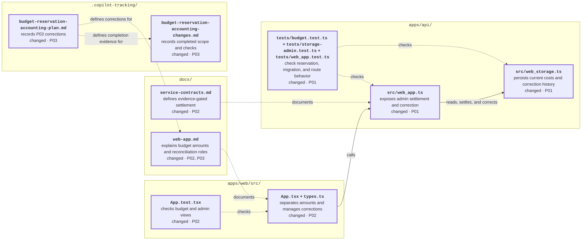

<!-- markdownlint-disable-file -->
# RPI Plan: Budget Reservation and Actual Cost

## Task Metadata

* Task ID: `budget-reservation-accounting`
* Task slug: `budget-reservation-accounting`
* Plan date: `2026-11-20`

## Executive Summary

* Bottom line: Preserve the evidence-gated lyric-reservation lifecycle and add a bounded follow-up phase to correct the budget guide's Speech reconciliation wording and reconcile the implementation handoff record.
* Why this matters: The app's upfront cap and settlement flow are implemented, but two accepted Review findings show that the guide can misstate who records Speech actuals and the changes record can mislead readers about completed work.
* Planning result: Follow-up planning is complete and P03 is ready for implementation. The initial standard critique and initial implementation are complete; the P03 tasks address accepted findings RV-001 and RV-002 without changing runtime behavior.
* Confidence and uncertainty: High confidence in the concrete wording and tracking-record corrections. The reported Azure charges remain unverified and are outside the approved scope.

### What You May Not Know

* Azure Cost Management data is delayed and meter-oriented, not an immediate per-request charge. A settlement stays pending unless an administrator has evidence that supports the actual amount for that reservation. The app records the administrator's verification; it does not fetch or independently validate Azure billing data.
* Existing full-jingle AI actuals are recorded against paid render attempts. Keep those figures distinct from lyric-reservation actuals so one Azure cost is not presented or summed twice.
* The acceptance Review found two documentation and handoff defects after implementation; P03 will correct them without changing runtime budget behavior or broadening into Azure billing verification.

## Phase Checklist

The backend lifecycle, authorization, and audited correction contract land before the UI and documentation update. P03 corrects the guide and reconciles the implementation record without changing runtime connections or budget behavior.

### After

Key: arrows point from a part to what it uses; dotted arrows, tests and docs; thick border, changed; each tag names the phases that make the change.

The web app calls the budget API, which reads reservation state and settles or corrects it in storage (P01, P02). API and UI tests check accounting, migration, authorization, and presentation, while the service contract and web-app guide describe the workflow (P01, P02). P03 updates the guide's reconciliation wording and records completion evidence in the changes record.

<!-- rpi:phase id=P01 -->
### [x] P01: Establish safe lyric settlement

Goals:
* Keep each worst-case lyric reservation in the shared spending guard until an administrator records attributable actual-cost evidence, and preserve an audited way to correct or reopen a mistaken settlement without changing score or Speech reservation behavior.

Dependencies:
* None.

Changes in the map: `web_storage.ts` and `web_app.ts` add the durable reservation lifecycle, settlement history, and admin settlement/correction paths; API tests cover the contract.

<!-- rpi:task id=P01-T01 -->
#### [x] P01-T01: Persist pending and settled lyric costs

Goals:
* Storage distinguishes an outstanding lyric reservation from its settled actual while the budget guard continues to account for the full effective amount.

Requirements:
* FR-001, FR-002, FR-004, FR-006, NFR-001, NFR-002; research F1, F3, D1, D3, C1-C3, C8, C13.
* Existing lyric reservations migrate as pending. For lyric reservations, budget enforcement counts pending reserved amounts plus settled actual amounts; score reservations remain reserved under the existing policy.
* Initial settlement is one-time. An administrator can correct a settled amount or reopen it as pending; each transition preserves its prior state in an append-only audit history.

Details:
* The existing `lyric_reservations` rows already have stable reservation IDs, but no settlement state or actual-cost field. Extend the existing ledger and expose its reservation identity in the admin workflow. Add an append-only settlement-event history for corrections; use the reservation row as the balance source, not a duplicate ledger.
* Apply compatible SQLite and PostgreSQL schema upgrades. Preserve every legacy reservation as pending and keep `reserved_usd` as its original cap. PostgreSQL upgrades are explicit operator actions; keep startup validation gated on the new lyric schema version rather than running DDL at startup.
* Update shared, per-user, and unattributed budget calculations from the current reservation state so a pending lyric contributes its reservation and a settled lyric contributes its actual, while score reservations and Speech accounting retain their current rules.
* Use the existing exact-decimal and serialized storage-write patterns. Reject invalid or negative amounts, and make settlement and correction atomic with the administrator check.
* Extend `budget.test.ts` and `storage-admin.test.ts` to cover pending holds, settlement and correction arithmetic, actual above the reserve, zero-cost settlement, concurrent settlement, reopened reservations, audit history, and legacy-row migration through SQLite and the PostgreSQL adapter. Preserve existing per-action cap, shared cap, and user lifetime-budget checks.

Guidance:
* `TextBudgetBalance` exposes `lyric_reserved_usd` and `lyric_actual_usd`; `BudgetOverview.lyric_reservations` includes pending and settled entries with their transitions.
* Use `settle_lyric_reservation_as_admin`, `correct_lyric_reservation_as_admin`, and `reopen_lyric_reservation_as_admin` for admin routes. Each operation rechecks admin access in storage; settlement and correction require evidence and a reason.
* `lyric_reservation_events` is included in `WEB_TABLE_COLUMNS` and the explicit SQLite import path so settled costs and history survive PostgreSQL migration.

References:
* [apps/api/src/web_storage.ts](../../../apps/api/src/web_storage.ts): Current `lyric_reservations`, budget aggregation, and storage write patterns.
* [apps/api/src/bootstrap_database.ts](../../../apps/api/src/bootstrap_database.ts): Existing explicit PostgreSQL schema-upgrade path.
* [apps/api/tests/budget.test.ts](../../../apps/api/tests/budget.test.ts): Existing SQLite budget and migration tests.
* [apps/api/tests/storage-admin.test.ts](../../../apps/api/tests/storage-admin.test.ts): Existing PostgreSQL adapter and migration test patterns.
* [.copilot-tracking/research/2026-11-20/budget-reservation-accounting-research.md](../../research/2026-11-20/budget-reservation-accounting-research.md):
  * Findings F1 and F3; decisions D1 and D3; evidence C1-C3, C8, and C13.

Dependencies:
* None.

<!-- rpi:task id=P01-T02 -->
#### [x] P01-T02: Add admin-authorized lyric reconciliation

Goals:
* An application administrator can find a pending lyric reservation, record an attributable actual amount and evidence reference, and correct or reopen a settled reservation with an audit reason; other users cannot release shared funds.

Requirements:
* FR-003, FR-005, FR-006, NFR-001, NFR-003; research F2, F5, D4, C4-C6, C11, C14.
* The admin lyric-reservation view includes pending and settled entries with stable reservation ID, owner, action, reserved amount, current status, actual when settled, creation time, and transition history. Reconciliation requires a finite nonnegative actual USD amount and a non-empty evidence reference.
* Only a current application administrator can reconcile, correct, or reopen a settlement. If evidence cannot attribute cost to the reservation, it remains pending; failure status, token counts, and non-empty references alone are not verification.

Details:
* Reuse the current admin check in the score-reservation route and recheck it in storage, following `require_admin`. Do not reuse the owner-only paid-attempt reconciliation endpoint as a release authorization path.
* Extend `GET /api/admin/budgets` with lyric reservations and their transition history, and add admin-only reconciliation and correction/reopen operations using existing `web_app.ts` request validation and error patterns.
* Record the actor, amount, evidence reference, time, and reason for each transition in append-only history. Corrections require attributable evidence for a replacement actual; reopening restores the full pending hold. The app records an administrator's verification but cannot validate Azure billing independently.
* Add route tests for admin success, non-admin denial, malformed and negative amounts, missing evidence, nonexistent and already-settled IDs, correction, reopening, and a failed lyric request whose reservation remains pending and counted. Do not expose raw Azure billing records or secrets.

Guidance:
* `GET /api/admin/budgets` returns `lyric_reservations` with transition history. Admin actions use `POST /api/admin/lyric-reservations/:reservation_id/settle`, `/correct`, and `/reopen`; each returns `{ reservation }`.
* Settlement and correction requests use `{ actual_cost_usd, evidence_reference, reason }`; reopening uses `{ reason }`. The user budget response includes `lyric_reserved_usd` and `lyric_actual_usd`.

References:
* [apps/api/src/web_app.ts](../../../apps/api/src/web_app.ts): Existing budget routes, validation, admin checks, and score reconciliation pattern.
* [apps/api/tests/web_app.test.ts](../../../apps/api/tests/web_app.test.ts): Existing admin authorization and reconciliation route tests.
* [.copilot-tracking/research/2026-11-20/budget-reservation-accounting-research.md](../../research/2026-11-20/budget-reservation-accounting-research.md):
  * Finding F5; decision D4; evidence C5, C13, and C14.

Dependencies:
* P01-T01.

<!-- rpi:phase id=P02 -->
### [x] P02: Present and document separate amounts

Goals:
* Users and administrators can distinguish pending lyric reserves from settled lyric actuals while the existing budget cap and other service accounting remain intact.

Dependencies:
* P01.

Changes in the map: `App.tsx` and `types.ts` present the distinct totals and admin settlement/correction controls; the UI tests and service documentation describe and verify them.

<!-- rpi:task id=P02-T01 -->
#### [x] P02-T01: Show reserved and settled lyric amounts

Goals:
* A user sees pending lyric reservation and settled lyric actual as separate amounts, and an administrator can review pending entries and correct or reopen settled entries from the budget view.

Requirements:
* FR-002, FR-003, FR-004, FR-006, NFR-001, NFR-003; research F3, F5, D1, D4, C7, C14.
* Budget API responses expose explicit pending lyric-reserved and settled lyric-actual totals. The admin view lists pending reservations, provides the evidence-backed settlement form, and exposes correction/reopen actions for settled entries.
* Remaining budget continues to reflect settled actuals plus outstanding holds and existing charges. Existing full-jingle AI actuals remain separately labeled and are not added to lyric actuals.

Details:
* Update the existing user budget summary and admin budget area in `App.tsx`; preserve the current loading, error, refresh, authorization, and accessible form behavior.
* Label the settled value as the administrator-recorded verified lyric actual, and clarify that the app does not fetch billing data. Keep an entry pending when no attributed evidence exists; do not present token-derived cost or provider failure as an actual.
* After a successful settlement, refresh the budget totals and pending list. On a rejected request, show the error and retain the entered value without a success-shaped fallback.
* After a correction or reopen, refresh the budget totals, pending list, and audit history. On a rejected request, show the error and retain the entered value without a success-shaped fallback.
* Extend `App.test.tsx` to verify separate values and remaining-budget behavior, the pending reservation/admin form, correction/reopen controls, and successful submission plus error handling. Keep existing paid-render reconciliation behavior unchanged.

References:
* [apps/web/src/App.tsx](../../../apps/web/src/App.tsx): Current budget summary and administrator controls.
* [apps/web/src/types.ts](../../../apps/web/src/types.ts): Shared API response types.
* [apps/web/src/App.test.tsx](../../../apps/web/src/App.test.tsx): Existing mocked API and UI interaction tests.
* [.copilot-tracking/research/2026-11-20/budget-reservation-accounting-research.md](../../research/2026-11-20/budget-reservation-accounting-research.md):
  * Findings F3-F5; evidence C7 and C14.

Dependencies:
* P01-T01 and P01-T02.

<!-- rpi:task id=P02-T02 -->
#### [x] P02-T02: Update the budget service contract

Goals:
* Service and user-facing documentation accurately describes the pending, settled, and evidence-unavailable states without implying that the app reads Azure invoice data.

Requirements:
* FR-001, FR-005, FR-006, NFR-003; research F1-F5, D1-D4, C8-C14, W1-W3.
* The docs state that failure status and token counts do not verify billed dollars, that an administrator records actual cost only with attributable evidence, and that unverified reservations remain pending.
* Document the separate budget amounts, the correction/reopen audit path, the unchanged score and Speech policies, and the lack of account-specific verification for the two reported failures.

Details:
* Update the directly related cost and service-contract sections in `docs/service-contracts.md` and `docs/audio-poc/web-app.md`.
* Remove or replace statements that lyric reservations are always retained after failure once the new settlement path exists. Keep the distinction between an application budget ledger and Azure charges.
* No new documentation or test files are planned.

References:
* [docs/service-contracts.md](../../../docs/service-contracts.md): Current failed/partial reservation policy.
* [docs/audio-poc/web-app.md](../../../docs/audio-poc/web-app.md): Current cost and budget guidance.
* [.copilot-tracking/research/2026-11-20/budget-reservation-accounting-research.md](../../research/2026-11-20/budget-reservation-accounting-research.md):
  * Findings F1-F5; decisions D1-D4; evidence C8-C14 and W1-W3.

Dependencies:
* P01-T01, P01-T02, and P02-T01.

<!-- rpi:phase id=P03 -->
### [x] P03: Correct follow-up documentation and implementation evidence

Goals:
* Make the budget guide accurately distinguish lyric administrator settlement from existing Speech reconciliation, and make the changes record reliably report completed work and validation.

Dependencies:
* P02.

Changes in the map: `docs/audio-poc/web-app.md` clarifies reconciliation roles; the plan and changes record track and report the two accepted Review corrections.

<!-- rpi:task id=P03-T01 -->
#### [x] P03-T01: Clarify lyric and Speech reconciliation wording

Goals:
* The budget guide explains the administrator evidence gate for lyric reservations without implying that administrators record existing owner-scoped Speech or full-jingle actuals.

Requirements:
* FR-007; acceptance finding RV-001.
* Keep score, Speech, and full-jingle accounting behavior unchanged; do not suggest that Earwyrm retrieves or independently verifies Azure billing data.

Details:
* Correct the broad actuals sentence in `docs/audio-poc/web-app.md`, “Manage budgets,” to scope administrator-recorded evidence to lyric reservations.
* Preserve the distinct existing Speech/full-jingle reconciliation behavior and the app's limitation that it stores an evidence reference without validating the Azure billing record.
* This is documentation-only; no new tests or runtime changes are needed. Run `git diff --check`.

References:
* [docs/audio-poc/web-app.md](../../../docs/audio-poc/web-app.md): Budget policy wording identified by RV-001.
* [apps/api/src/web_app.ts](../../../apps/api/src/web_app.ts): Existing owner-scoped attempt reconciliation route.
* [.copilot-tracking/reviews/logs/2026-11-20/budget-reservation-accounting-review.md](../../reviews/logs/2026-11-20/budget-reservation-accounting-review.md): RV-001 and its resolution condition.

Dependencies:
* P02-T02.

<!-- rpi:task id=P03-T02 -->
#### [x] P03-T02: Reconcile implementation status and validation evidence

Goals:
* The changes record consistently reports completed plan markers, task validation, remaining work, and review readiness.

Requirements:
* NFR-004; acceptance finding RV-002.
* Every completion and validation statement must agree with the checked plan markers and recorded command results.

Details:
* Reconcile the execution status, completed-work markers, P02 task validation, pre-review reconciliation, blockers, remaining work, follow-up items, and return-to-caller state in the existing changes record.
* Record P03 as complete only after both follow-up tasks and the documentation check are complete; preserve the recorded full API/web/typecheck results and do not claim that runtime tests were rerun for documentation-only changes.
* Run `git diff --check` and compare the final changes record with the plan and Review validation table. No runtime tests are needed for this tracking-only edit.

References:
* [.copilot-tracking/changes/2026-11-20/budget-reservation-accounting-changes.md](../../changes/2026-11-20/budget-reservation-accounting-changes.md): Contradictory status and validation statements identified by RV-002.
* [.copilot-tracking/plans/2026-11-20/budget-reservation-accounting-plan.md](./budget-reservation-accounting-plan.md): Authoritative completed task markers and validation plan.
* [.copilot-tracking/reviews/logs/2026-11-20/budget-reservation-accounting-review.md](../../reviews/logs/2026-11-20/budget-reservation-accounting-review.md): RV-002 and its resolution condition.

Dependencies:
* P02.

## User Decisions and Requirements

### Confirmed User Direction

* Keep the upfront jingle spending cap.
* Show reserved funds separately from verified actual cost and release only the verified unused portion.
* Do not claim that the two reported failures caused a `$1.24` balance drop without account evidence.
* Work through Research, Plan, Implementation, and Review automatically, scoped to local code, tests, and directly related documentation. Do not inspect live Azure billing, mutate Azure resources, or deploy.

### Planning Decisions and Feedback

| Group | Decision or feedback item | Status | Owner | Rationale or input needed | Evidence | Planning impact |
|-------|---------------------------|--------|-------|---------------------------|----------|-----------------|
| D1 | Require an application administrator to record lyric actuals with supporting evidence before releasing shared budget | Confirmed | Agent | The existing owner reconciliation endpoint accepts a non-empty reference without verifying it; a settlement changes the shared guard | Research D4, F5, C13-C14 | P01-T01, P01-T02 |
| D2 | Use manual evidence-gated settlement rather than automatic Azure invoice integration | Confirmed | Agent | Current provider responses expose usage, not dollars; billing data is delayed and meter-oriented, with no demonstrated request-level attribution | Research F2, F4, C4, C9, W1-W3 | P01-T01, P01-T02 |
| D3 | Preserve an append-only settlement history and allow an administrator to correct or reopen a mistaken settlement | Confirmed | Agent | PC-001 identified that a one-time settlement without correction could leave the shared budget guard using an incorrect release | Critique PC-001 | P01-T01, P01-T02, P02-T01 |
| D4 | Scope administrator evidence wording to lyric settlement and accurately preserve the existing owner-scoped Speech/full-jingle reconciliation description | Confirmed | Agent | The broad actuals statement in the budget guide exceeds the lyric workflow; the existing attempt reconciliation route is owner-scoped | Review RV-001; `apps/api/src/web_app.ts` | P03-T01 |
| D5 | Make the changes record's completed markers, validation, and handoff state agree with the completed plan and recorded checks | Confirmed | Agent | The changes record still reports P02 work and validation as pending despite checked plan markers and passed full validation | Review RV-002; plan markers and Review validation evidence | P03-T02 |

## Planning Readiness and Next Step

| Field | Record |
|-------|--------|
| Planning execution and readiness | Complete; Ready for the documentation-only P03 follow-up |
| Decision participation | Agent-owned, from the user's “Handle it end to end” selection |
| Blockers | None |
| Latest critique | `.copilot-tracking/reviews/plans/2026-11-20/budget-reservation-accounting-plan-critique.md` is complete; verdict Revise; follow-up critique is not required by the active RPI session rules |
| Relevant research | [.copilot-tracking/research/2026-11-20/budget-reservation-accounting-research.md](../../research/2026-11-20/budget-reservation-accounting-research.md); accepted findings RV-001 and RV-002 are recorded in the [Review](../../reviews/logs/2026-11-20/budget-reservation-accounting-review.md) |
| Plan | `.copilot-tracking/plans/2026-11-20/budget-reservation-accounting-plan.md` |
| Changes-record role | `.copilot-tracking/changes/2026-11-20/budget-reservation-accounting-changes.md` will be implementation evidence |
| Continuation owner | Confirmed automatic RPI Agent |
| Required gates or confirmations | Keep follow-up work local and documentation-only; no live billing inspection or Azure deployment |
| Next action | P03 implementation is complete; the automatic parent can close out the session with both accepted Review corrections resolved |

## Goals

* Retain a worst-case lyric reservation as a pending spending guard until an administrator records attributable actual-cost evidence.
* Present pending reservations and settled lyric actuals as distinct amounts while keeping budget enforcement accurate.
* Release no more than the verified unused amount and never infer zero cost from failure status or token usage.
* Keep the user guide precise about lyric administrator settlement versus existing Speech reconciliation, and keep the changes record aligned with completed implementation evidence.

## Scope and Non-Goals

### In Scope

* Durable status and actual-cost evidence for each lyric reservation, including compatibility for existing reservation rows.
* Audited administrator correction and reopening of settled lyric reservations.
* Admin-authorized viewing and reconciliation of pending lyric reservations.
* User and administrator budget summaries that distinguish pending reservation from settled lyric actual.
* Focused API, storage, and UI tests, plus directly related cost and service-contract documentation.
* The P03 follow-up edits to the web-app guide and the task's implementation changes record.

### Non-Goals

* Automatic Azure Cost Management ingestion or cost calculation from token counts.
* Inspecting live Azure billing or determining whether the two reported failures incurred specific charges.
* Changing score-composition or Speech reservation/reconciliation behavior.
* Releasing a reservation when the provider fails, evidence is missing, or a reference cannot support the attributed amount.
* Changing runtime code, budget accounting, Azure resources, or deployment behavior in the follow-up phase.

## Functional Requirements

* FR-001: A lyric action reserves its configured worst-case amount before provider calls and remains pending after success or failure until evidence-backed settlement.
* FR-002: Budget responses and UI distinguish outstanding lyric reservations from settled lyric actuals; budget enforcement counts settled actuals plus outstanding holds and preserves other existing reservations.
* FR-003: An application administrator can inspect pending lyric reservations and record a nonnegative actual USD amount with a required evidence reference.
* FR-004: Settlement releases only the unused amount, never more than `max(reserved - actual, 0)`. An actual above the reservation remains visible as actual spend and releases nothing.
* FR-005: Provider failure, diagnostic events, and token counts never settle a lyric reservation. An amount and reference are accepted only through the administrator-authorized reconciliation path after external evidence supports attribution.
* FR-006: An application administrator can correct a settled actual or reopen the reservation as pending. Each transition records its actor, time, and reason; a corrected actual also requires attributable evidence, and prior settlement history is preserved.
* FR-007: Budget guidance scopes administrator-provided evidence to lyric settlement and accurately describes unchanged Speech/full-jingle reconciliation roles.

## Non-Functional Requirements

* NFR-001: Settlement and correction updates are atomic and auditable. Concurrent or repeated initial settlements cannot release the same amount twice; corrections preserve prior events and update effective budget totals exactly once.
  * Objective threshold or evaluation condition: One successful initial settlement per reservation; concurrent duplicates leave totals unchanged after the winning settlement; each correction or reopen appends one event and produces the expected effective amount.
  * Operating condition or verification approach, if needed: Exercise storage transactions and API authorization tests using existing SQLite-backed test fixtures.
* NFR-002: Existing SQLite and PostgreSQL deployments preserve legacy lyric rows as pending reservations when schema changes are applied.
  * Objective threshold or evaluation condition: Existing reservation amounts remain counted after migration; no historical row is silently discarded or marked settled.
  * Operating condition or verification approach, if needed: Extend SQLite and PostgreSQL-adapter migration tests and run API type-checks and tests.
* NFR-003: The app stores only the evidence reference and settlement metadata required for auditability; it does not ingest or expose raw Azure billing exports or secrets.
  * Objective threshold or evaluation condition: API responses expose no credentials or raw billing payloads.
  * Operating condition or verification approach, if needed: Reuse the repository's existing response-sanitization and authorization test patterns.
* NFR-004: The implementation changes record reports completed scope and validation consistently with the active plan and recorded check results.
  * Objective threshold or evaluation condition: No P01/P02 task is simultaneously described as complete and remaining, and every listed validation status matches its recorded result.
  * Operating condition or verification approach, if needed: Compare the changes record against plan markers and the final Review validation table.

## Validation Plan

* Test owner: The implementation agent owns all tests in the existing API and web test suites.
* Canonical test targets: `apps/api/tests/budget.test.ts`, `apps/api/tests/storage-admin.test.ts`, `apps/api/tests/web_app.test.ts`, and `apps/web/src/App.test.tsx`.
* Exact test removals: None.
* Maximum additions: Twenty focused test cases across the existing test files; no new test files.
* Generated targets: None.
* Semantic coverage: Pending-to-settled accounting, admin-only evidence-backed release, audited correction/reopening, zero-cost and concurrent settlement behavior, failed-request hold retention, duplicate and over-reservation behavior, and distinct UI amounts.
* Regression coverage: Existing per-action/shared/user caps, historical reservations, score and Speech reservation behavior, paid-render reconciliation, and budget loading/error handling.
* Validation commands from the repository root: `npm run test:api`, `npm run test:web`, and `npm run typecheck`.
* P03 validation: Documentation and handoff-record edits only; no tests are added or removed. Run `git diff --check` and compare the changes record with the completed plan and recorded full validation. Do not claim runtime tests were rerun.

## Risks and Open Questions

| Priority | Type | Risk, question, or planning item | Affected work | Impact | Smallest action or evidence needed | Owner |
|----------|------|----------------------------------|---------------|--------|------------------------------------|-------|
| High | Risk | Azure billing data may not support attribution to an individual lyric request | P01-T01, P01-T02 | Some reservations may remain pending indefinitely | Require evidence that supports the specific amount; otherwise do not settle | Administrator |
| Medium | Risk | Existing full-jingle AI actuals may overlap with actuals recorded against a lyric reservation | P02-T01 | Combined totals could double-count spend | Label and aggregate the two sources separately; do not sum overlapping full-jingle actuals into lyric actuals | Planner |
| Medium | Open question | An administrator may lack access to adequate billing evidence | P01-T02 | A new admin workflow cannot itself prove a submitted amount | Keep the reservation pending when the administrator cannot substantiate the amount | Administrator |
| Medium | Risk | A correction or reopening can change shared budget availability | P01-T01, P01-T02, P02-T01 | An unreasoned correction could release or restore the wrong hold | Require admin authorization, a reason, atomic recalculation, and an append-only event record | Planner |

## Dependencies

* The existing `WebStorage` write transaction and admin authorization mechanisms: settlement and reservation totals must remain atomic and server-authorized.
* Existing API and UI test harnesses in the API and web workspaces: reuse current storage, route, and component test conventions.

## Sources

* [.copilot-tracking/research/2026-11-20/budget-reservation-accounting-research.md](../../research/2026-11-20/budget-reservation-accounting-research.md): Findings F1-F5 and decisions D1-D4 establish reservation lifecycle, evidence limits, settlement authority, and non-goals.
* [`apps/api/src/web_storage.ts`](../../../apps/api/src/web_storage.ts): Current reservation persistence, shared budget calculations, and transaction patterns.
* [`apps/api/src/web_app.ts`](../../../apps/api/src/web_app.ts): Existing `/api/budget`, `/api/admin/budgets`, attempt reconciliation, and admin authorization patterns.
* [`apps/api/tests/budget.test.ts`](../../../apps/api/tests/budget.test.ts), [`apps/api/tests/web_app.test.ts`](../../../apps/api/tests/web_app.test.ts), and [`apps/web/src/App.test.tsx`](../../../apps/web/src/App.test.tsx): Existing budget, API authorization, and UI test fixtures.
* [`apps/api/tests/storage-admin.test.ts`](../../../apps/api/tests/storage-admin.test.ts): Existing PostgreSQL adapter and migration test patterns.
* [`apps/web/src/App.tsx`](../../../apps/web/src/App.tsx): Current combined budget label, user budget summary, administrator budget view, and paid-attempt reconciliation UI.
* [`docs/service-contracts.md`](../../../docs/service-contracts.md) and [`docs/audio-poc/web-app.md`](../../../docs/audio-poc/web-app.md): Existing reservation-retention and budget-display contracts to update.
* [.copilot-tracking/reviews/logs/2026-11-20/budget-reservation-accounting-review.md](../../reviews/logs/2026-11-20/budget-reservation-accounting-review.md): Accepted findings RV-001 and RV-002 define the documentation and handoff corrections.
* Microsoft Foundry and Azure Cost Management documentation, cited as W1-W3 in the research artifact: token counts are not billed dollars, and Cost Details are delayed and meter-oriented.
* Business-source search: Searched `docs/planning/**`, `.adr-config.yml`, and Markdown for `PRD`, `BRD`, `ADR`, `brd_id`, and `prd_id`; no relevant business sources were found.

## Critique Disposition

* Critique setting and provenance: `standard`; default initial-plan critique.
* Critique execution: `Complete`.
* Critique verdict: `Revise`.
* Latest critique: `.copilot-tracking/reviews/plans/2026-11-20/budget-reservation-accounting-plan-critique.md`.
* Earlier critiques: None.
* Limitations: Executability source-code claims outside the supplied plan and research were not adopted; see the critique artifact. The active RPI session does not repeat the initial critique for this follow-up plan unless the user asks.
* Finding dispositions:
  * PC-001 — High; resolved by adding an admin correction/reopen path with append-only history, a required reason, verified replacement evidence, and atomic budget recalculation.
  * PC-002 — Medium; resolved by adding a route regression test that verifies a failed lyric request remains pending and counted.
  * PC-003 — Medium; resolved by naming zero-cost and concurrent-settlement storage tests.

## Artifact Self-Check

* [x] Executive Summary, What You May Not Know, and Phase Checklist lead and explain the plan.
* [x] Confirmed direction, grouped decisions, readiness, goals, scope, requirements, risks, and dependencies are current and consistent with the phases.
* [x] Planning decision participation and provenance are recorded; agent-owned decisions cite the research evidence.
* [x] Every functional and non-functional requirement is cited by at least one task.
* [x] Every phase and task has the required blocks, stable markers, and map references.
* [x] Task goals describe observable outcomes, and details/references ground the work without prescribing unsupported steps.
* [x] Risks name affected tasks and include owners and next actions; no task has a separate status block.
* [x] Code paths, commands, and symbols use backticks or workspace-relative Markdown links as required.
* [x] The change map has fewer than 10 parts and 4 boxes, with unchanged parts only where connected to a change; Before is omitted because module connections remain.
* [x] The map uses active arrows, correct flow direction, changed tags, accessible captions, and the prescribed border classes. Light/dark preview rendering was not available and was not checked.
* [x] Test ownership, removals, maximum additions, canonical targets, generated targets, regression and semantic coverage, and validation commands are locked.
* [x] Business-source search is recorded; no relevant source was found.
* [x] Readiness does not rely on an absent critique result; the critique is complete and every finding has a recorded disposition.
* [x] PC-001 through PC-003 are resolved by planner-owned corrections recorded below.
* [x] Planning execution, readiness, continuation owner, gates, next action, and implementation paths are recorded.
* [x] Follow-Up Items remain outside active plan completion and acceptance claims.

* Checked sections: Executive summary, change map, phases/tasks, decisions, readiness, goals, scope, requirements, risks, dependencies, validation plan, sources, and follow-up items.
* Missing or limited sections: Live account-specific charge verification remains intentionally out of scope.

## Follow-Up Items

* None

## Handoff

* Authoritative implementation handoff: Planning Readiness and Next Step
