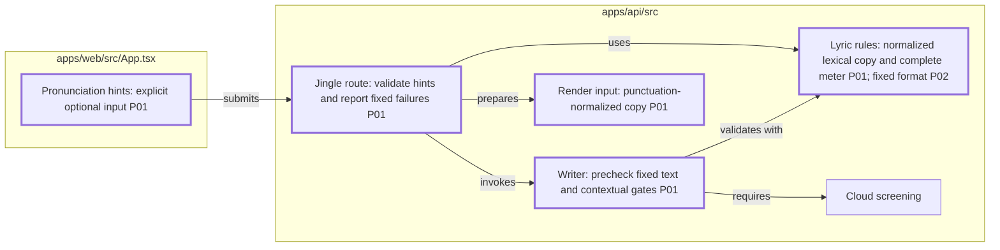

<!-- markdownlint-disable-file -->
# RPI Plan: Generation validation

## Task Metadata

* Task ID and slug: generation-validation
* Plan date: 2026-11-20

## Executive Summary

Resolve four generation failures with fixed-line validation, explicit pronunciation hints, narrower local keyword checks and punctuation-only speech normalization. Preserve existing uncommitted changes and all contextual safety gates.
Planning is complete and Ready after standard critique Pass. Source evidence supports the bounded changes.

### What You May Not Know

Pronunciation hints support verified meter, not a guarantee of Azure voice pronunciation; listening review remains required. Guided exact meter and rhyme remain strict.

## Phase Checklist

### After

Thick borders identify P01 and P02 changes. The browser supplies explicit hints; the route and writer validate immutable text before generation. Screening remains mandatory and render input normalizes punctuation only.

<!-- rpi:phase id=P01 -->
### [x] P01: Resolve generation input failures

Goals:
* Accept supported ordinary inputs, prevent fixed-text retry waste and retain safety/timing guarantees.

Dependencies:
* None

Changes in the map: pronunciation hints, route, lyric rules, writer and render input.

<!-- rpi:task id=P01-T01 -->
#### [x] P01-T01: Validate fixed text and normalize lexical copies

Goals:
* Short spoken CTAs fit with a sufficiently long opening, fixed defects stop early, and typographic text remains exact in provenance.

Requirements:
* FR-001, FR-004, NFR-002

Details:
* Shared punctuation normalization feeds word lookup, format validation, syllable labels and submitted render text; never mutate draft or exact comparisons.
* Fixed-line checks apply before generation. Spoken total threshold is 16-40; opening stays 8-20. Guided meter/rhyme remain exact.

References:
* [apps/api/src/lyrics.ts](../../../apps/api/src/lyrics.ts): schemas and deterministic validation
* [apps/api/src/lyric_service.ts](../../../apps/api/src/lyric_service.ts): retry loop
* [apps/api/src/web_app.ts](../../../apps/api/src/web_app.ts): saved validation and render input

Dependencies:
* None

<!-- rpi:task id=P01-T02 -->
#### [x] P01-T02: Expose explicit pronunciation hints and contextual keyword handling

Goals:
* Browser users can provide verifiable brand syllables; ordinary phrases reach independent contextual safety checks.

Requirements:
* FR-002, FR-003, NFR-002

Details:
* Optional multiline input uses `word = spoken words`; server parses bounded input, rejects duplicate/malformed lines, restricts overrides to brand tokens and derives phones from dictionary words. Persist validated ARPABET using existing request field.
* Preserve submitted text on failure; reset hints on sign-out; no optional hints means existing request shape unchanged.
* Narrow deterministic imitation/risk triggers without changing mandatory cloud evidence or refusals.

References:
* [apps/web/src/App.tsx](../../../apps/web/src/App.tsx): existing composer and action errors
* [apps/api/src/lyric_cloud.ts](../../../apps/api/src/lyric_cloud.ts): contextual evidence and generation policy

Dependencies:
* P01-T01

<!-- rpi:task id=P01-T03 -->
#### [x] P01-T03: Verify regressions and document input behavior

Goals:
* Every reported failure has a regression case and relevant documentation reflects supported behavior.

Requirements:
* FR-001, FR-002, FR-003, FR-004, NFR-001, NFR-002

Details:
* Test ownership: existing creative-lyrics, web_app and App test files; no removals; maximum 14 new test blocks with parameterized cases. Canonical source only; generated dist is not edited.
* Verify short/overlong CTAs, no generation for fixed unknown text, hints/invalid hints, guided strictness, keyword false positives and true contextual flags, punctuation provenance and speech copy.
* Run targeted API tests, browser App tests, workspace typecheck/build and isolated browser render at desktop/mobile. No paid requests.

References:
* [apps/api/tests/creative-lyrics.test.ts](../../../apps/api/tests/creative-lyrics.test.ts)
* [apps/api/tests/web_app.test.ts](../../../apps/api/tests/web_app.test.ts)
* [apps/web/src/App.test.tsx](../../../apps/web/src/App.test.tsx)
* [docs/audio-poc/web-app.md](../../../docs/audio-poc/web-app.md)

Dependencies:
* P01-T01, P01-T02

<!-- rpi:phase id=P02 -->
### [x] P02: Close fixed-format retry gap

Goals:
* Every immutable closing-line format defect rejects before opening generation.

Dependencies:
* P01

Changes in the map: lyric rules fixed-format precheck.

<!-- rpi:task id=P02-T01 -->
#### [x] P02-T01: Reject fixed whitespace and normalized length defects

Goals:
* Exact invalid fixed text is never silently trimmed and never consumes opening retries.

Requirements:
* FR-001, FR-004, NFR-001, NFR-002; RV-001 resolution condition

Details:
* Check CTA and brand edge whitespace, normalized printable/spoken format and normalized CTA maximum before dictionary/meter validation. Return a specific safe fixed-format reason and actionable browser feedback.
* Add parameterized no-attempt whitespace/length tests and check the spoken total boundary at 15 versus 16 syllables. Keep previous completed tasks checked.
* Revalidate affected API suites, workspace typecheck and API build. This localized finding fix stays within previous review targets and does not start another critique or review.

References:
* [.copilot-tracking/reviews/logs/2026-11-20/generation-validation-review.md](../../reviews/logs/2026-11-20/generation-validation-review.md): RV-001
* [apps/api/src/lyrics.ts](../../../apps/api/src/lyrics.ts): fixed and draft validators
* [apps/api/tests/creative-lyrics.test.ts](../../../apps/api/tests/creative-lyrics.test.ts): focused regression owner

Dependencies:
* P01-T01, P01-T02, P01-T03

## User Decisions and Requirements

* User confirmed all four supplied findings, exact wording and safeguards.
* User selected end-to-end automatic progression; local-only changes, no paid cloud requests.
* Agent-owned planning decisions use verified C1-C4 evidence; no unresolved choice.

## Planning Readiness and Next Step

Complete; P01 and P02 implemented and validated, standard initial critique Pass. No blockers or remaining markers.

## Goals

Prevent deterministic retry waste and accept supported ordinary input without weakening safety or guided timing.

## Scope and Non-Goals

Local generation validation, supporting browser hints, existing tests and related docs. No deployment, push, paid calls or unrelated cleanup.

## Functional Requirements

* FR-001: Fixed CTA/brand pronunciation, format and meter defects stop before generation; exact CTAs are never rewritten. Spoken opening remains 8-20 syllables, CTA 1-20, total 16-40.
* FR-002: Browser users can provide explicit word-to-dictionary-spelling pronunciation hints. Validated overrides persist for later score/render revalidation; invalid hints fail explicitly.
* FR-003: Ordinary sound comparisons and feel-free invitations reach contextual checks; imitation, risky claims, moderation and protected material remain guarded.
* FR-004: Common typographic punctuation normalizes for validation and speech only; original lyrics and CTA remain unchanged in stored/display provenance.

## Non-Functional Requirements

* NFR-001: Existing and focused regression tests pass; all workspace typechecks and builds pass.
* NFR-002: Guided exact meter/rhyme and malformed/symbolic input rejection remain effective; no pronunciation guesses or safety fallbacks.

## Risks and Open Questions

* Speech and displayed punctuation differ intentionally; source boundary offsets refer to submitted speech text.
* Existing dirty source changes must be preserved.

## Dependencies

Existing dictionary, Zod schemas, authenticated API, stored lyric request and test tooling.

## Sources

* [.copilot-tracking/research/2026-11-20/generation-validation-research.md](../../research/2026-11-20/generation-validation-research.md): C1-C4.
* [docs/generation-issues.md](../../../docs/generation-issues.md): user-supplied four findings.

## Critique Disposition

Standard default; Complete, Pass, zero findings. [Critique](../../reviews/plans/2026-11-20/generation-validation-plan-critique.md).

## Artifact Self-Check

Identity, scope, task goals, requirements, dependencies, map, test ownership and critique checked. No BRD/PRD/ADR matching sources found in bounded docs search; user findings and C1-C4 govern. Diagram preview is limited to canvas renderer.

## Follow-Up Items

* None

## Handoff

Automatic parent closes Follow-up after acceptance reconciliation. No user action required.
