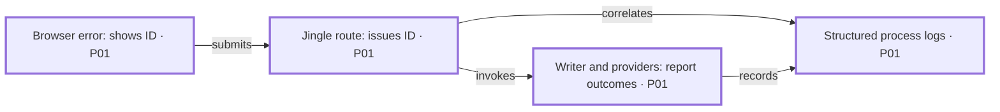

<!-- markdownlint-disable-file -->
# RPI Plan: Jingle diagnostic tracing

## Task Metadata

* Task ID and slug: `jingle-diagnostic-tracing`
* Plan date: 2026-11-20

## Executive Summary

Add a diagnostic ID to failed browser generation and correlate it with structured API logs. No new provider calls, exporter, or database changes.

### What You May Not Know

An HTTP success from the model can still fail schema, lyric fit, or safety checks.

## Phase Checklist

### After

<!-- rpi:phase id=P01 -->
### [x] P01: Correlate failed generations

Goals: Make recurrent jingle failures diagnosable without inspecting advertiser content.

Dependencies: Existing route, transport and offline fixtures.

Changes in the map: Browser error, jingle route, writer and providers, process logs.

<!-- rpi:task id=P01-T01 -->
#### [x] P01-T01: Capture and surface diagnostics

Goals: Join the browser error to the exact attempt and terminal stage.

Requirements: `FR-001`, `FR-002`, `NFR-001`.

Details: Use a server-generated UUID in `X-Earwyrm-Diagnostic-Id`, a scoped async context and JSON logs. Keep reason codes allowlisted; distinguish provider HTTP status from application outcomes. Record the route's actual HTTP outcome, including errors processed by middleware. No change to public messages except the ID.

References: [apps/api/src/web_app.ts](../../../apps/api/src/web_app.ts), [apps/api/src/lyric_service.ts](../../../apps/api/src/lyric_service.ts), [apps/api/src/lyric_cloud.ts](../../../apps/api/src/lyric_cloud.ts), [apps/api/src/score_cloud.ts](../../../apps/api/src/score_cloud.ts), [apps/web/src/api.ts](../../../apps/web/src/api.ts).

Dependencies: None.

<!-- rpi:task id=P01-T02 -->
#### [x] P01-T02: Document and verify troubleshooting

Goals: Give operators a reproducible lookup and demonstrate no content exposure or provider retry changes.

Requirements: `FR-003`, `NFR-001`, `NFR-002`.

Details: Extend existing API and web suites; up to four new cases, no removals, no generated targets. Cover mixed validation attempts, refusal, provider status or failure, UI ID, and content masking. Assert no diagnostic header on unauthenticated responses and use an injected failure code to prove unknown codes are replaced. Run targeted API and web tests plus typecheck and diff checks.

References: [apps/api/tests/web_app.test.ts](../../../apps/api/tests/web_app.test.ts), [apps/web/src/App.test.tsx](../../../apps/web/src/App.test.tsx), [docs/azure-deployment.md](../../../docs/azure-deployment.md).

Dependencies: `P01-T01`.

## User Decisions and Requirements

* Implement diagnostics for the repeated generic lyric failure; scope it to the browser jingle path.
* End-to-end RPI; agent-owned decisions. D1: preserve public errors and log only bounded metadata, based on research F1–F3.

## Planning Readiness and Next Step

Complete and ready from verified research C1–C5. Initial standard critique complete; its finding is resolved. No blockers.

## Functional Requirements

* `FR-001`: Include a lookup ID in failed authenticated browser jingle requests that reach the route, without changing HTTP status or body.
* `FR-002`: Log final stage/HTTP outcome, lyric retry and final status/reason codes, and provider operation, duration and status when available. Critically, distinguish screening from exhausted fit or malformed-output attempts.
* `FR-003`: Document terminal and Azure console log lookup and how to interpret the outcomes.

## Non-Functional Requirements

* `NFR-001`: No raw prompts, lyrics, credentials, IDs of users, provider bodies, or exception messages in new logs. Preserve billing, retry and screening behavior; no new dependencies or remote requests.
* `NFR-002`: Verify in offline tests, no paid calls.

## Scope and Non-Goals

Paid browser jingle pipeline only; no deployment, prompt changes, raw transcript export, or broad OTel rollout.

## Sources

Research F1–F3 from [.copilot-tracking/research/2026-11-20/jingle-diagnostic-tracing-research.md](../../research/2026-11-20/jingle-diagnostic-tracing-research.md). No applicable formal BRD, PRD or ADR identified.

## Critique Disposition

Standard, initial-pass default; execution Complete, original verdict Revise. `PC-001` resolved by the explicit unauthenticated and unknown-code assertions in `P01-T02`. Test ownership: existing API and web suites; no removed tests; maximum four additions. Semantic and regression evidence as in `P01-T02`.

## Artifact Self-Check

Scope, dependencies, verification ownership and required gates accounted for.

## Follow-Up Items

None selected.

## Handoff

Changes record: `.copilot-tracking/changes/2026-11-20/jingle-diagnostic-tracing-changes.md`.
