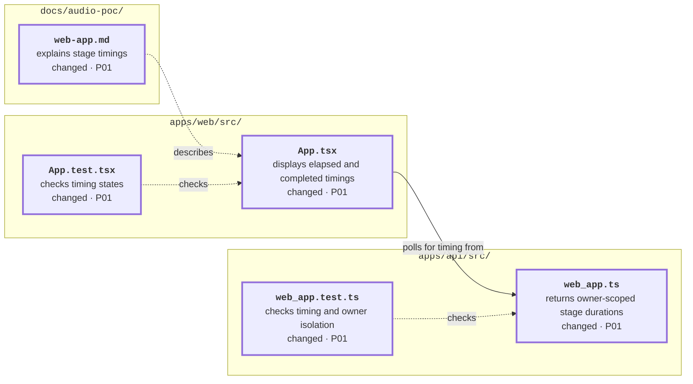

<!-- markdownlint-disable-file -->
# RPI Plan: Jingle step diagnostics

## Task Metadata

* Task ID: `jingle-step-diagnostics`
* Task slug: `jingle-step-diagnostics`
* Plan date: 2026-11-21

## Executive Summary

* Bottom line: Plan an API progress extension and timeline update that show server-measured elapsed time for each generation stage.
* Why this matters: Users can see how long each step takes, including short steps that browser polling may miss.
* Planning result: The plan is implementation-ready; its single standard critique finding was resolved by clarifying active revisited-stage timing.
* Confidence and uncertainty: High confidence in the need for server-side stage timing. The progress result must remain owner-scoped and briefly available after the generation request ends.

### What You May Not Know

Token counts are recorded only for some model calls and do not cover the complete generation flow. The plan therefore uses per-stage time and leaves token counts out rather than presenting incomplete usage as job-wide diagnostics.

## Phase Checklist

### After



Key: arrows point from a part to what it uses; dotted arrows, tests and docs; thick border, changed; each tag names the phase that makes the change.

The workflow guide describes the browser timeline, and its tests verify the timing display (P01). The timeline polls the API, which reports accumulated server-measured stage durations while preserving the existing owner check (P01).

<!-- rpi:phase id=P01 -->
### [x] P01: Report per-step generation timing

Goals:
* Show users how long each generation step takes without relying on browser polling intervals or exposing incomplete provider usage.

Dependencies:
* None.

Changes in the map: `App.tsx` and its tests display and verify timing; `web_app.ts` and its tests return and verify owner-scoped stage durations; `web-app.md` documents the timeline.

<!-- rpi:task id=P01-T01 -->
#### [x] P01-T01: Return measured stage durations from progress API

Goals:
* Make completed and active stage timing available through the existing authenticated progress endpoint, including the final stage after success or failure.

Requirements:
* `FR-001`, `FR-002`, `NFR-001`, and `NFR-002`; research F1-F2 and D1.
* The progress response contract is:

  ```json
  {
    "stage": "lyrics",
    "stage_durations_ms": {
      "brief": 250
    },
    "current_stage_elapsed_ms": 130
  }
  ```

  `stage` is null, `stage_durations_ms` is empty, and `current_stage_elapsed_ms` is null when the progress ID is not current, has expired, or belongs to another user. For a terminal result, the final stage is included in `stage_durations_ms` and `current_stage_elapsed_ms` is null.
* While a stage is active, `stage_durations_ms` contains elapsed time from its completed visits and `current_stage_elapsed_ms` contains elapsed time from its current visit. On termination, the map includes all visits, including the final one.

Details:
* The route already owns each stage transition and checks both the progress ID and authenticated identity. Measure with monotonic server time at transitions; keep repeated same-stage assignments from resetting the timer and accumulate durations if a stage is revisited.
* Retain at most the latest terminal snapshot for 60 seconds, scoped to the same identity and progress ID. Expire it on a later progress lookup or replace it when another jingle begins. Do not persist the snapshot or add provider content, token usage, or cost fields.
* Test ownership: this task owns up to three focused additions in `apps/api/tests/web_app.test.ts`; remove no tests and add no generated targets or dependencies. Cover active and terminal timing, active and terminal repeated-stage accumulation, expiration or replacement, and existing cross-user isolation with mocked providers only.
* Validate the API test file with `npm run test --workspace @earwyrm/api -- tests/web_app.test.ts`; include it in the final workspace typecheck.

References:
* [apps/api/src/web_app.ts](../../../apps/api/src/web_app.ts): current progress route, stage setter, and request cleanup.
* [apps/api/tests/web_app.test.ts](../../../apps/api/tests/web_app.test.ts): current stage and owner-isolation coverage.
* [.copilot-tracking/research/2026-11-21/jingle-step-diagnostics-research.md](../../research/2026-11-21/jingle-step-diagnostics-research.md):
  * F1 and Q1 establish that server stage transitions, not browser polling, are the reliable timing source.
  * F2 and Q2 establish that token counts are incomplete and provider exchanges are not user-facing data.

Dependencies:
* None.

<!-- rpi:task id=P01-T02 -->
#### [x] P01-T02: Display timing in generation steps

Goals:
* Show current elapsed time and final duration alongside the existing status and description for each reached step.

Requirements:
* `FR-001`, `FR-002`, and `NFR-003`; research F1-F2 and D1.
* Show a truthful not-reached or unavailable state when no timing exists. Do not display token counts or infer stage duration from polling intervals.

Details:
* Extend the browser progress type and existing generation state with the API timing fields. Keep the existing step order, provider labels, `aria-current`, stage announcements, error handling, and responsive layout.
* Show the accumulated completed duration plus current-visit elapsed time for the active stage, and the accumulated duration for completed stages. Retrieve the terminal snapshot after the generation request settles so the final stage's duration appears for both success and failure.
* Present timing as compact supporting text, using the existing restrained Operate styling. Do not place the changing timer in a live region that repeatedly interrupts screen-reader users.
* Add up to two focused browser tests in `apps/web/src/App.test.tsx` for timing updates, including an active revisited stage, and final success/failure states; retain existing tests and add no generated targets or dependencies. Cover unavailable timing and unchanged progress and error announcements in those cases.
* Validate the browser test file with `npm run test --workspace @earwyrm/web -- --run src/App.test.tsx`; include it in the final workspace typecheck.

References:
* [apps/web/src/App.tsx](../../../apps/web/src/App.tsx): existing progress polling and timeline rendering.
* [apps/web/src/types.ts](../../../apps/web/src/types.ts): browser API types.
* [apps/web/src/App.test.tsx](../../../apps/web/src/App.test.tsx): stage, accessibility, and failure behavior.
* [.copilot-tracking/research/2026-11-21/jingle-step-diagnostics-research.md](../../research/2026-11-21/jingle-step-diagnostics-research.md):
  * F1 and Q3 support server-reported active and completed timings.
  * F2 and D1 exclude selectively available token counts.

Dependencies:
* P01-T01.

<!-- rpi:task id=P01-T03 -->
#### [x] P01-T03: Document generation step timing

Goals:
* Explain what per-step timings mean and when they are unavailable in the browser workflow guide.

Requirements:
* `FR-001` and `FR-002`; research F1.
* Clarify that step duration is server-measured elapsed time and is not provider billing or token usage.

Details:
* Update the existing generation-timeline guidance in the web app guide. Keep current failure, diagnostic-ID, and charge warnings intact.

References:
* [docs/audio-poc/web-app.md](../../../docs/audio-poc/web-app.md): existing step-by-step generation guidance.
* [.copilot-tracking/research/2026-11-21/jingle-step-diagnostics-research.md](../../research/2026-11-21/jingle-step-diagnostics-research.md):
  * F1 and Q3 establish the timing behavior and its limitation.

Dependencies:
* None.

## User Decisions and Requirements

### Confirmed User Direction

* Show useful diagnostic information for each step of the jingle flow, such as duration or token counts.
* Handle the request end to end through implementation and review.

### Planning Decisions and Feedback

| Group | Decision or feedback item | Status    | Owner | Rationale or input needed | Evidence       | Planning impact |
|-------|---------------------------|-----------|-------|---------------------------|----------------|-----------------|
| D1    | Metric and transport scope | Confirmed | Agent | Use server stage timing; do not show incomplete token counts | Research F1-F2 | Define progress response and timeline behavior |
| D2    | Terminal progress lifetime | Confirmed | Agent | Retain the latest terminal timing snapshot for 60 seconds, scoped to the progress ID and authenticated owner | Research F1; existing progress route | Lets the browser read the final step duration while bounding stale in-memory data |

## Planning Readiness and Next Step

| Field                            | Record |
|----------------------------------|--------|
| Planning execution and readiness | Complete; Ready after resolving PC-001 |
| Decision participation           | Agent-owned, based on the user's “Handle it end to end” choice |
| Blockers                         | None |
| Latest critique                  | [.copilot-tracking/reviews/plans/2026-11-21/jingle-step-diagnostics-plan-critique.md](../../reviews/plans/2026-11-21/jingle-step-diagnostics-plan-critique.md): Revise; PC-001 resolved in the plan |
| Relevant research                | [.copilot-tracking/research/2026-11-21/jingle-step-diagnostics-research.md](../../research/2026-11-21/jingle-step-diagnostics-research.md): findings F1-F2 and questions Q1-Q3 |
| Plan                             | `.copilot-tracking/plans/2026-11-21/jingle-step-diagnostics-plan.md` |
| Changes-record role              | `.copilot-tracking/changes/2026-11-21/jingle-step-diagnostics-changes.md` is implementation evidence |
| Continuation owner               | Automatic RPI session |
| Required gates or confirmations  | None identified |
| Next action                      | Implementation of P01 and its named validation are complete; proceed to review; the single critique is complete and its planner-owned finding is resolved |

## Goals

* Let a user see accurate elapsed time for each reached jingle-generation step.
* Preserve progress ownership, existing stage announcements, and honest unavailable or not-yet-reached states.

## Scope and Non-Goals

### In Scope

* Add server-measured stage durations to the existing owner-scoped jingle progress response.
* Render active and completed timings in the existing generation timeline.
* Add focused API and browser tests and update the browser workflow guide.

### Non-Goals

* Adding token counts, provider request or response content, or other partially available measurements to the user timeline.
* Changing generation, screening, billing, provider, or administrator diagnostic behavior.
* Making live paid requests, deploying, or changing cloud resources.
* Redesigning unrelated parts of the workspace.

## Functional Requirements

* FR-001: Each reached timeline step displays its accumulated server-measured duration; the active step also displays its current elapsed time.
* FR-002: The final stage duration remains available to the requesting user after successful or failed generation, while stages that have not been reached do not display fabricated timings.

## Non-Functional Requirements

* NFR-001: Stage timing uses monotonic server elapsed time. Repeated assignments to the same stage do not reset its timer, and repeated visits to a stage accumulate rather than overwrite duration.
  * Objective threshold or evaluation condition: API tests assert non-negative millisecond values, retained prior-stage durations, and accumulation for a revisited stage.
  * Operating condition or verification approach, if needed: Measure at server stage transitions, not from browser polling intervals.
* NFR-002: Progress timings remain visible only to the matching authenticated owner and contain no prompt, lyric, provider exchange, or token-count data.
  * Objective threshold or evaluation condition: API tests assert another owner receives no timing data; response shapes contain only stage timing fields.
* NFR-003: Existing progress and failure announcements remain accessible, and timing text fits the existing timeline at desktop and narrow mobile widths.
  * Objective threshold or evaluation condition: Browser tests retain current stage and failure assertions and verify readable timing text in active, completed, failed, and unavailable states; visually inspect desktop and 375-pixel layouts for overflow.

## Risks and Open Questions

| Priority | Type | Risk, question, or planning item | Affected work | Impact | Smallest action or evidence needed | Owner |
|----------|------|----------------------------------|---------------|--------|-----------------------------------|-------|
| L        | Risk | A terminal progress snapshot must be readable after the request exits without becoming stale indefinitely | `P01-T01` | Without a bounded lifetime the endpoint may return stale results; without a terminal read the final duration is lost | Keep one owner-scoped snapshot for a short fixed interval and clear it on expiry or replacement | Planner |

## Dependencies

* None.

## Sources

* No relevant business sources found. The quick search checked `docs/planning/`, `docs/planning/adrs/`, and Markdown front matter for `brd_id` and `prd_id`; no `.adr-config.yml` was found. `docs/project-plan.md` is a historical pointer, not a current BRD, PRD, or ADR.
* Search terms included `jingle`, `generation`, `progress`, `diagnostic`, and `duration`; no relevant business source matched.
* [apps/api/src/web_app.ts](../../../apps/api/src/web_app.ts): current stage tracking and owner-scoped progress response.
* [apps/web/src/App.tsx](../../../apps/web/src/App.tsx): progress polling and generation timeline.
* [apps/web/src/types.ts](../../../apps/web/src/types.ts): current browser diagnostic and progress types.
* [apps/api/tests/web_app.test.ts](../../../apps/api/tests/web_app.test.ts): current progress ownership and cleanup test.
* [apps/web/src/App.test.tsx](../../../apps/web/src/App.test.tsx): existing stage-progress and failure behavior tests.
* [docs/audio-poc/web-app.md](../../../docs/audio-poc/web-app.md): generation timeline guidance to update.
* [.copilot-tracking/research/2026-11-21/jingle-step-diagnostics-research.md](../../research/2026-11-21/jingle-step-diagnostics-research.md): evidence F1-F2 supports server stage timings and excludes partial token usage.

## Critique Disposition

* Critique setting and provenance: `standard`; initial-plan default.
* Critique execution: Complete.
* Latest critique and verdict: [.copilot-tracking/reviews/plans/2026-11-21/jingle-step-diagnostics-plan-critique.md](../../reviews/plans/2026-11-21/jingle-step-diagnostics-plan-critique.md) (Revise; PC-001 resolved).
* Earlier critiques: None.
* Limitations: None.

| Critique run and finding | Disposition | Action owner | Exact resolving evidence | Decision route | Plan response or residual risk |
|--------------------------|-------------|--------------|--------------------------|----------------|--------------------------------|
| PC-001 | Resolved | Planner | P01-T01 defines active versus terminal duration fields; P01-T02 displays prior accumulated time plus current visit elapsed time and tests a revisited active stage. | Direct planner correction | The user sees the accumulated step total throughout a repeated stage visit. |

## Artifact Self-Check

* [x] Executive Summary, What You May Not Know, and the Phase Checklist present the final sequence and change map.
* [x] Confirmed direction, agent-owned decisions, readiness, goals, scope, requirements, and risks are recorded.
* [x] Functional and non-functional requirements have stable IDs for task references.
* [x] Phases and tasks have their required blocks, dependencies, and change-map tags.
* [x] The After change map follows the planning reference; Before is omitted because existing connections are unchanged.
* [x] Relevant source paths and the no-business-source search result are recorded.
* [x] The standard critique has returned on the implementation-ready plan and every finding has a disposition.
* [x] Final readiness, continuation owner, gates, next action, and implementation paths are consistent.
* Checked sections: All planning sections, phase/task structure, requirements traceability, and map structure.
* Missing or limited sections: Rendered light/dark map preview; the canvas source warnings are empty, but its page is not connected.

## Follow-Up Items

* Revisit cross-provider token counts only if every relevant generation step can report accurate usage through an approved user-facing contract. This is optional and outside the current plan; the owner is a future planning session.

## Handoff

* Authoritative implementation handoff: Planning Readiness and Next Step.
